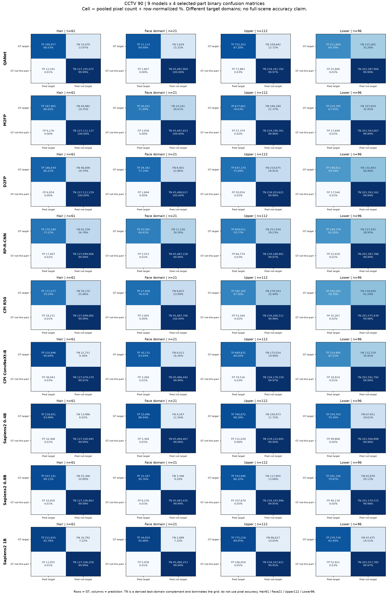

# CCTV controlled ROI — ผลประเมินสี่เป้าหมายครบเก้าระบบบน GT domain ที่ตรวจได้

ตรวจปิด 2026-11-01T23:26:54.611649+07:00 (Asia/Bangkok). สถานะ **FOUR_TARGET_EVALUATION_COMPLETE_ON_REVIEWED_GT — 9/9**. รอบนี้ model inference ใหม่ **0**; ใช้ predictions ที่ครบ90ภาพ/130frozen YOLO opportunities ต่อ checkpoint และเก็บผล/attempts เดิมครบ.

**Sapiens2 1B ได้ค่าเฉลี่ยหลักสี่ targets สูงสุดที่65.430%** ตาม reference/domain นี้; QANet64.533% ตามมา ห่าง0.898percentage points. QANetได้ Face-domainและUpperสูงสุด; Sapiens2 1Bได้HairและLowerสูงสุด. เป็น observed point estimates ไม่ใช่ statistical significance หรือการรับรองพร้อม deployment.

Face-domain ใช้ได้ **21จาก35 source Face records** หลัง GT-only review; อีก14รายการมีปัญหา reference/contour หรือ RGBยืนยันไม่ได้และกันออกเท่ากันทุกโมเดล. ใน21รายการนั้น18มี Neckที่ไม่ทราบขอบแน่ชัดและมี explicit uncertainty; Face+Neck delivery ใช้ได้เพียง3รายการ. **การคำนวณรอบนี้จบแล้วบน domain ที่ประกาศ ไม่ได้หมายความว่า GTทั้ง35รายการเป็น anatomical gold หรือให้คะแนน Face/Neckครบทุกกรณีแล้ว.**

## ตารางหลัก

หน่วยเป็นpercentของ **mean per-GT-part IoUภายในแต่ละtarget** แล้วเฉลี่ยtargetละ25%. ไม่ใช่ global full-image mIoU, official native parser benchmark หรือคะแนนCIHPเดิม. Frozen roster order:

| Checkpoint | Prediction frames | Hair n61 | Face-domain n21 | Upper n112 | Lower n96 | Macro4 |
|---|---:|---:|---:|---:|---:|---:|
| QANet_CIHP_HRNetW48_512x384 | 90/90 | 60.817 | 71.434 | 68.746 | 57.134 | 64.533 |
| M2FP_R101_CIHP | 90/90 | 48.990 | 54.790 | 56.264 | 46.032 | 51.519 |
| D2FP_R101_CIHP | 90/90 | 47.454 | 57.279 | 51.497 | 41.062 | 49.323 |
| RPR_CIHP | 90/90 | 43.918 | 52.964 | 51.482 | 41.940 | 47.576 |
| CPI_R50_CIHP | 90/90 | 41.730 | 56.192 | 39.992 | 35.993 | 43.477 |
| CPI_ConvNeXtB_CIHP | 90/90 | 59.795 | 63.172 | 53.832 | 44.967 | 55.441 |
| Sapiens2_0.4b | 90/90 | 65.746 | 64.157 | 62.330 | 53.818 | 61.513 |
| Sapiens2_0.8b | 90/90 | 60.770 | 65.665 | 60.281 | 55.198 | 60.479 |
| Sapiens2_1b | 90/90 | 67.152 | 69.607 | 66.044 | 58.919 | 65.430 |

ใช้ **290 eligible parts**: Hair61 + Face21 + Upper112 + Lower96. Sourceหลังแก้ownerมี326groupedparts; non-Face exclusions22และFace exclusions14เก็บเหตุผล/private recordsไว้ครบ. ไม่เติมคะแนนของGTที่ไม่รองรับเป็น0 และไม่ตีความGT exclusionเป็นmodel failure.

[CSVหลักพร้อมfull precision](../metrics/CONTROLLED_ROI_FOUR_TARGET_RESULTS.csv) / [per-target overall/day/night](../metrics/CONTROLLED_ROI_PER_TARGET.csv) / [Face views](../metrics/CONTROLLED_ROI_FACE_VIEWS.csv) / [canonical derived index](CONTROLLED_ROI_FOUR_TARGET_INDEX.json).

## สูงสุดรายเป้าหมายและข้อเสนอเลือกใช้ต่อ

| Target | Observed leader | IoU % | อันดับถัดไป | ส่วนต่าง pp |
|---|---|---:|---|---:|
| Hair | Sapiens2_1b | 67.152 | Sapiens2_0.4b | 1.406 |
| Face-domain | QANet_CIHP_HRNetW48_512x384 | 71.434 | Sapiens2_1b | 1.827 |
| Upper | QANet_CIHP_HRNetW48_512x384 | 68.746 | Sapiens2_1b | 2.702 |
| Lower | Sapiens2_1b | 58.919 | QANet_CIHP_HRNetW48_512x384 | 1.785 |
| Macro4 | Sapiens2_1b | 65.430 | QANet_CIHP_HRNetW48_512x384 | 0.898 |

**ข้อสรุปการเลือก: แนะนำ Sapiens2 segmentation 1B เป็นตัวหลักสำหรับขั้นถัดไป เมื่อเป้าหมายคือคุณภาพรวม Hair / Face-domain / Upper / Lower และใช้เกณฑ์ที่กำหนดไว้เดิม**. คะแนน Macro4 เท่ากับ **65.430%** สูงสุดจากเก้าระบบที่รันครบ ส่วน QANet ได้64.533% ห่าง **0.898 percentage points**. คำแนะนำนี้อิง CCTV reference-domain รอบนี้ ไม่ได้นำคะแนน CIHP คนละ protocol มารวมกัน.

เหตุผลที่เลือก1Bแม้ QANet จะชนะสองส่วน: Hair ของ1Bสูงกว่า6.335pp และ Lowerสูงกว่า1.785pp ซึ่งชดเชย Face-domainที่ต่ำกว่า1.827pp และ Upperที่ต่ำกว่า2.702pp เมื่อเฉลี่ยทั้งสี่ส่วนด้วยน้ำหนักเท่ากัน. ไม่ได้เปลี่ยนน้ำหนักให้1Bชนะหลังเห็นผล.

| Metric | Sapiens2 1B (%) | QANet (%) | 1B − QANet (pp) |
|---|---:|---:|---:|
| Hair | 67.152 | 60.817 | +6.335 |
| Face-domain | 69.607 | 71.434 | -1.827 |
| Upper | 66.044 | 68.746 | -2.702 |
| Lower | 58.919 | 57.134 | +1.785 |
| Macro4 | 65.430 | 64.533 | +0.898 |

**QANet เป็นทางเลือกที่มีหลักฐานรองรับหากงานให้น้ำหนักกับ Face-reference และ Upper มากขึ้น**. การเปลี่ยนความสำคัญของเป้าหมายในอนาคตต้องระบุแยกจากคะแนน Macro4 ปัจจุบัน. ผล Neck coverage ประกอบมี Sapiens2 0.4B สูงสุด แต่มีเพียง3รายการและเป็น recall ไม่ได้นำมาแทนเกณฑ์หลักสี่ส่วน.

### รุ่นและ configuration ที่แนะนำจริง

| รายการ | ค่าที่ผูกกับผลรัน |
|---|---|
| Exact model ID | `Sapiens2_1b`, task segmentation, native29 labels |
| จำนวนพารามิเตอร์ | **1,470,819,805** รวม segmentation module ตาม `MODEL_DETAILS.json` ของรอบรัน; 1B เป็นชื่อ variant และรอบเขียนสรุปนี้ไม่ได้โหลดโมเดลเพื่อนับใหม่ |
| Checkpoint | `sapiens2_1b_seg.safetensors`, 5,883,353,380 bytes; เก็บภายนอก Git |
| Effective route | `CONTROLLED_YOLO_PERSON_ROI`: frozen YOLO person crop → parser → original-grid map-back → frozen YOLO mask ownership |
| Input | lossless RGB crop เดียวกับทุกระบบ, context10% แต่ละข้าง, preserve aspect ratio, letterbox **1024H × 768W**, mean padding |
| Precision / execution | FP32, batch1, eval/inference mode, AMP/TF32/extra TTA ปิด |
| Preprocessing / map-back | ใช้ official preprocessor/channel conversion เพียงครั้งเดียวตาม adapter ที่ตรวจแล้ว; ถอด padding แล้ว map logits กลับก่อน argmax |
| Environment ที่ใช้จริง | Python3.12.3, PyTorch2.14.0+cu130, CUDA runtime13.0, GPUTesla T4; ไม่ได้ติดตั้งหรือแก้ environment ในงานสรุปนี้ |
| Outputs ที่ใช้ | native29 integer masks, original-grid person masks, frozen YOLO identity/extents และ geometry; ไม่ใช่ native Sapiens person-instance IDs |
| Native target projection | Hair4; Face candidate3+24–28; Upper23; Lower13. Face candidate รวมคอ และ Apparel1 เป็น OTHER ใน non-Dress garment view |

Route ข้างต้นคือ **person ROI ที่รันจริงใน controlled cohort นี้**. ฟิลด์ `SAPIENS_FRAME_YOLO_MASK_OWNERSHIP` ที่ติดมากับ registry เดิมเป็นชื่อ route รอบเก่า; ไม่ใช่ route ของผล65.430%นี้. การเลือก1Bจึงหมายถึง **checkpointพร้อม application configuration นี้** ไม่ใช่ทุกวิธีป้อน input ให้1B.

Checkpoint SHA256: `4b73c44963b377e93fcb4c4053f72a189836a22d05e12c30383046b9cd3c5bd4`. Native config SHA256: `d33d8802741cb7b0cddc09ac3b2f780a801932bdeb88dc097c22a43996fef61d`. Upstream source revision: `7e5bae88456ac418ff0e58e74106c9fe192055d4`. ตำแหน่ง local assets, environment/model-details hashes และ source result hashes อยู่ใน [machine-readable recommendation](MODEL_RECOMMENDATION.json). Hashes อ้าง frozen records/accepted packets เดิม; รอบนี้ไม่ rehash weights หรือเริ่ม inference เพิ่ม.

### ขอบเขตของข้อสรุป

- เหมาะเป็น **ข้อเสนอเลือก configuration เพื่อทำงานต่อจากหลักฐานคุณภาพชุดนี้**. ค่าเฉลี่ยสูงสุดยังไม่ใช่ absolute pass threshold หรือ production acceptance.
- Face ใช้21/35รายการ และมี uncertainty; Neck deliveryใช้3รายการ. GTเป็น agent-assisted reference ที่สืบทอด source contours ไม่ใช่ independent expert gold. ส่วนต่าง0.898ppยังไม่มี uncertainty/statistical-significance study.
- รายงานความเร็ว/VRAM เดิมมีขอบเขตและสภาพ shared GPU ต่างกัน จึงไม่สรุปว่า1Bเร็วที่สุด เบาที่สุด หรือคุ้มทรัพยากรที่สุด. ขนาด checkpoint/parameter count ไม่ใช่ค่า peak VRAM ที่วัดแล้ว.
- Native Face_Neck hard labels ยังแยก strict Face-only/Neck-only ไม่ได้. ผลนี้ยังไม่รับรองการแยกชุด Dress, สี, attributes หรือทุกคน/ทุกส่วนของฉาก.
- ไม่มีการรวมโมเดลเป็น ensemble/fusion, เปลี่ยน execution config, อนุมัติ deployment หรือเริ่มการทดลองถัดไปจากการบันทึกคำแนะนำนี้.

## GT Face/Neck และความหมายของคะแนน

1. ตรวจRGB/source GT35รายการใหม่ในcoordinate references และGT-only overlaysหกcontact pages. Sourceannotations/masksไม่เปลี่ยน; owner correctionsสองจุดเดิมคงอยู่ในderivedcopy. ผู้ตรวจคือCodex visual assistant ไม่ใช่independent expert.
2. Face referenceคือ **source Face contour ลบ known Neck, uncertainty และ known opaque occluder**. Contourส่วนอื่นยังสืบทอดsource annotation จึงไม่รับรองpixel-perfect anatomical Faceหรือแก้ข้อผิดพลาดGTทุกชนิดหมดแล้ว.
3. Known Neckวาดเป็นvisible polygons3กรณี. อีก18กรณีใช้ `REGION_UNCERTAIN`: manually boundบริเวณown-neck/jaw/collarที่ระบุไม่ได้จากRGB. Unknown Neckยังเป็นunknown ไม่ใช่zero-Neck truth. Face-domainใช้พื้นที่ที่เหลือร่วมทุกโมเดล; Face+Neck/NeckCoverageเป็นnullสำหรับกรณีเหล่านี้.
4. Face valid domain `V_i = original grid − known Neck_i − GT-only uncertainty_i`. ใช้Neck/UของGTคนที่ประเมินเท่านั้น ไม่ignoreคอคนอื่นทั้งภาพ. Known opaque occluder coresเป็นvalidnegative; ไม่เติมamodalNeckหลังวัตถุ. พบplantเข้าdraftNeckแล้วแก้จากRGBก่อนเปิดคะแนนFace; draftเก็บไว้.
5. Mappingเดิมไม่เปลี่ยน: CIHPFace13; SapiensFace_Neck3+mouth subparts24–28. ไม่ใช้Torso-skinแทนNeck ไม่แบ่งpredictionด้วยGTหรือgeometry. Sapiensoutputยังเป็นFace+Neckcandidate ไม่กลายเป็นstrictFace-only output.
6. ตรึงmanualannotations/GT masks/eligibility/domain hashesและprotocol **ก่อนคำนวณคะแนนFaceใหม่นี้**. รู้historical/non-Face resultsมาก่อน จึงเป็นpost-hoc exploratory revision ไม่ใช่preregistered/blinded confirmation. ไม่มีการปรับGT/mappingจากFace scoresรอบนี้.

GTcoverage: Face21/35 (day9/night12), validFacepositive36,743pixels จากsourceFaceของ21items45,453pixels เหลือ80.837%. ส่วนที่ถูกกัน/เปลี่ยนบทบาทรายitemอยู่ในprivatebinding. สัดส่วนนี้ไม่ใช่annotationaccuracyหรือความสมบูรณ์ทั้งdataset.

[Protocol revisionR2](../configs/CONTROLLED_ROI_FACE_NECK_PROTOCOL.json) / [GTcoverageและstates](FACE_NECK_GT_SUMMARY.json) / [CPU+actual-packet acceptance](FACE_NECK_ACCEPTANCE.json). Historical [non-Face report](CONTROLLED_ROI_GT_AND_PART_RESULTS_TH.md) และR1indexยังคงnullFaceตามสถานะตอนนั้น ไม่ได้แก้ย้อนหลัง.

## Face+Neck delivery และ known-Neck coverage — supplementary n3

หน่วยpercent. Face+Neckใช้mean per-part IoUบนvaliddomainที่ตัดGTuncertainty; Neckcoverageคือmean recallของcandidateบนknownNeck. **ไม่ใช่Neck-only IoU/precision** และไม่รวมซ้ำในprimaryMacro4.

| Checkpoint | Face+Neck IoU n3 | Known-Neck coverage n3 |
|---|---:|---:|
| QANet_CIHP_HRNetW48_512x384 | 62.288 | 5.949 |
| M2FP_R101_CIHP | 39.632 | 3.668 |
| D2FP_R101_CIHP | 70.151 | 30.438 |
| RPR_CIHP | 61.729 | 4.512 |
| CPI_R50_CIHP | 63.509 | 5.386 |
| CPI_ConvNeXtB_CIHP | 55.091 | 0.000 |
| Sapiens2_0.4b | 85.751 | 68.605 |
| Sapiens2_0.8b | 84.240 | 57.126 |
| Sapiens2_1b | 86.614 | 66.336 |

KnownNecksupportรวม10,190pixels; n3น้อยและขนาดไม่สมดุล จึงใช้เป็นdiagnostic ไม่สรุปNeckcapabilityทั่วไป. ไม่รายงาน18unknownNeckเป็นbackground/score0หรือส่งผ่านว่าverifiedabsent. สถานะverified-not-visibleรองรับในscorerแต่ชุดGTนี้ไม่มีกรณีนั้น.

## Matching, metrics และ completeness

คงmatchingจากowner-correctedsourceparts union→frozenYOLO bbox coverage≥0.50, maximumcardinalityก่อนsumcoverage และtie policyเดิม. NewNeck/Uไม่เปลี่ยนmatching, detectorcache, parserinstance selection หรือownership. เป็นpartial-person association ไม่ใช่maskAPหรือfull-personF1.

ต่อeligible partใช้whole original-grid person plane, ไม่clipด้วยGTbbox/polygon. `TP=|G∩P∩V|`, `FP=|P∩V−G|`, `FN=|G∩V−P|`; IoU=TP/(TP+FP+FN), Dice=2TP/(2TP+FP+FN). Meanของแต่ละpartภายในtargetก่อนmacro4; pooledIoU/Diceเป็นตารางประกอบ ไม่เฉลี่ยnative-classIoUแทนunion. Zero-supportgroupsเป็นnull.

GTpersonที่ไม่จับคู่ใช้emptycandidateและpositivepartsเป็นFN/IoU0. Faceมี **2unmatched partsคงอยู่ในn21**; Hair5/Upper15/Lower14ตามเดิม. `detector_unmatched`รวมกรณีไม่มีeligiblebboxหรือone-to-onecompetition ไม่พิสูจน์ว่าdetectorไม่เห็นคนในทุกกรณี. Validextentแต่semanticemptyคงเป็นemptytargetprediction ไม่ใช่executionfailure.

STRICT_COMPLETEต่อระบบ: accepted90unique source framepackets + non-Face statisticsเดิมที่ครบ + Face21eligible tasks + delivery3tasksครบ. ผลจริงครบ9/9, missing/duplicate/scoringfailed0ในacceptedview. Historicalmodel/setup/controller/CPUerrorsยังเก็บครบ; finalfailed0ไม่ได้แปลว่าไม่เคยล้ม. SourceCCTVเป็นpartialselectedpeople/parts ไม่สร้างunlabeledpeopleเป็นfull-scenenegatives และไม่อ้างfull-sceneFP/AP.

## ตรวจอะไรจริงและreuseอะไร

- CPU9independent literal casesPASS: known/unknown/absentNeckต่างกัน, OTHER/invalidID, union, positiveFN/missedperson/wrongperson, knownoccluderFP, asymmetricgeometry, mean-part vs pooled, null/STRICT_COMPLETE, actualatomicpacket→scorer→JSON และsourceimmutability. ไม่รับรองGTจากtestcount.
- ActualFacepacket→scorer→reportครบ **171 source framepackets /189Face tasks /27delivery tasks**. ReadbackNPZ/COMMIT/sourcepacket identity เทียบacceptednon-Faceframe, checkpoint/input/config/native-label/original-grid/YOLObindingsและmaskhashes. Per-frameledger/recordhashes,GTsupport/counts/means/Macro4reconciliationผ่าน.
- ReuseHair/Upper/Lowerและexact90membership auditเดิม; ตรวจตัวเลขเหมือนเดิมแบบfullprecision ไม่rerun non-Facescoringหรือmodelinference. Sourceweights/environment identitiesใช้หลักฐานรับรองเดิม ไม่bulkrehashweights/datasetsใหม่เพื่อเขียนรายงาน.
- Usage-limit interruptionเกิดระหว่างGTmaterialization; กลับมาตรวจprocessและfinalbindingพบเขียนเสร็จแล้ว จึงใช้ต่อ ไม่เปิดซ้ำ. CPUscoringรอบนี้เปิดครั้งเดียวและปิดครบ.

Scientificbindingsตรึงด้วยfilehashesก่อนFaceCPUscoring; Gitcommitรอบส่งมอบเป็น **post-scoring publication snapshot** ไม่ใช่launchcommitของmodelinferenceหรือหลักฐานว่าsourceถูกcommitก่อนCPUlaunch. Sourcecurrent`CCTV_Human_Parsing_Benchmark/`; publicationcheckout`Human_Parsing_Study_Public/`แยกกัน.

## ภาพและartifacts

Privatepathsที่เปิดได้ในworkspace:

- **หน้าดูรายละเอียดรายโมเดล:** `CCTV_Human_Parsing_Benchmark/outputs/model-detail-gallery-20261102/index.html` — เลือกภาพ/ROI/โมเดล, ซูมและปรับ opacity, เทียบ RGB/GT/prediction, สลับ shared4-target/native20หรือ29 classes และ owned/raw output. Owned คือ mask ที่ใช้คิดคะแนน; raw ก่อน YOLO clip เป็น diagnostic. ทุกภาพใช้ saved masks เดิม ไม่มี inference หรือ rescoring.
- **เปิดนอก server:** ดาวน์โหลด `outputs/model-detail-gallery-20261102.zip` แล้วแตกและเปิด `index.html`; bundle รวม assets ไว้แล้ว ไม่ต้องตั้งเว็บหรือใช้ network. มี `by_model/<model_id>.html` สำหรับเปิดแต่ละโมเดลโดยตรง และภาพเทียบทั้งเก้าตัวต่อROI. หน้าROIมี15opportunitiesจาก6ภาพเดิม; คนที่GTไม่จับคู่ไม่มีpredictedROI ให้ดูภาพรวมฉากและmissedcountsประกอบ.

- `CCTV_Human_Parsing_Benchmark/outputs/face-neck-comparison-gallery-20261101/index.html` — fixed6framesเดิม,RGB/GT/เก้าระบบ, paletteเดียวกัน; ไม่เลือกภาพตามคะแนน. Gallerycomposition/downsamplingใช้แสดงผลเท่านั้น ขณะที่scorerใช้per-personfullgrid. SapiensFacecandidateในภาพรวมNeckด้วย.
- `outputs/face-neck-gt-reviewed-20261101/GT_ONLY_CONTACT/page_01.png` ถึง`page_06.png` — 21eligibleFaceGT overlaysที่ตรวจจริง (RGBเทียบFace/knownNeck/U/occluder). Directoryเก็บmaskdraft/GT-only reviewก่อนfinalfreeze; frozenbindingอยู่pathถัดไป.
- `outputs/face-neck-gt-frozen-20261101/index.html` — GT auditindexทั้ง35dispositionsและ21eligibleoverlays; `FACE_NECK_GT_BINDING.json`และ21original-gridGTNPZsอยู่directoryเดียวกัน. ตรวจarraysเท่ากับชุดที่เปิดดูจริงก่อนfreeze.
- `outputs/face-neck-manual-review-20261101/` — RGB/sourcecoordinates35items, frozenmanualvertices, ineligibleitemreasons, context/detailfigures.
- `outputs/face-neck-evaluation-20261101/` — Faceper-personrecords,immutableledgers,FROZEN_INPUTS,canonicalMETRICS/RESULTS.

ภาพCCTV,sourcefilenames,manualvertices/personrecords,GTmasks,predictions/logsอยู่privateoutputsเท่านั้น ไม่มีCCTVassetsขึ้นPUBLICGit. Publicrepoมีcode/tests/protocol/aggregateCSV/JSON/docs; cloneอย่างเดียวไม่พอทำซ้ำ ต้องมีrestrictedsourceassets,parentpredictionpacketsและGTbindingsตามhashes. [CPUrequirements](../requirements-cpu.txt)เป็นexistingenvironmentที่สังเกต ไม่ได้ติดตั้งหรือแก้modelenvironment.

## ข้อจำกัดและสถานะจบ

เปรียบเทียบ **checkpoint + controlledYOLO-ROI applicationconfiguration** บนCCTV90ชุดนี้: crop/context/ownershipร่วมกัน แต่native resolution,normalization,internaldetector/decoderต่างกัน. ไม่แยกarchitecture/training-data/adapter effects. NativeCIHP/commonCIHPresultsและfrozenYOLOคงเดิม.

GTยังเป็นagent-assistedreview ไม่ใช่independentexpertgold; Faceมีuncertaintydomainและ14excludeditems, Neckpositiveviewเพียง3items. คะแนนจึงรองรับการเลือกเบื้องต้นจากreference/domainนี้ ไม่รับรองstrictFace-only/Neck-only,ทุกคน/ทุกส่วนในฉาก,night/generalCCTVperformance,สี/attributes หรือproductionacceptance. Timing/VRAMของเดิมเป็นsharedGPUadapterdiagnostics ไม่ใช้จัดอันดับFPS/latency/VRAMefficiency.

**รอบประเมินสี่targetsปิดแล้วบนdeclaredeligibleGT ไม่เหลือFace-scorejobหรือGPUjobที่ต้องเปิดต่อเพื่อให้ได้ตารางนี้.** ขั้นถัดไปคือใช้รายงานนี้พิจารณาSapiens2 1B/QANetตามความต้องการ หรือจัดindependentGT/deploymentvalidationหากต้องการคำอ้างที่เข้มกว่า. ไม่เริ่มการฝึก สี CCTVinferenceเพิ่ม หรือexperimentอื่นอัตโนมัติ.

<!-- TARGET_CONFUSION_START -->
## Confusion matrix และการเก็บส่วนที่ต้องการครบแค่ไหน

อัปเดตจาก **สถิติที่ตรวจรับแล้ว** ของ CCTV ชุดล่าสุด 90 ภาพเท่านั้น ไม่มี inference หรือ rescore และไม่แก้ GT, mapping หรือคะแนนหลักเดิม ใช้ภาพเดียวรวม 36 binary matrices (9 โมเดล × 4 targets) และ CSV เดียวรวม 36 แถวพร้อมตัวหารและค่าก่อนปัดเศษ

[เปิดภาพ matrix ขนาดเต็ม](figures/CONTROLLED_ROI_TARGET_CONFUSION.png) · [CSV ตัวเลข/ตัวหาร/ส่วนที่พลาด](../metrics/CONTROLLED_ROI_TARGET_CONFUSION.csv)

### อ่าน matrix และเข้าใจ domain

| GT / Prediction | เป็น target ของคนที่ประเมิน | ไม่เป็น target ของคนนั้น |
|---|---:|---:|
| GT เป็น target | TP: พิกเซลที่เก็บถูก | FN: พิกเซล GT ที่พลาด |
| GT ไม่เป็นส่วนนี้ของคนที่ประเมิน ภายใน V | FP: พิกเซลที่ทำนายเกิน | TN: ส่วนเติมเต็มของ domain |

**เหตุผลที่ใช้ 2×2 ต่อคลาส:** Hair 61 / Face 21 / Upper 112 / Lower 96 ส่วน ใช้คนที่มีสิทธิ์และพื้นที่ประเมินต่างกันตาม selected-person part task เดิม สถิติ binary ไม่บอกว่า Hair ที่พลาดถูกทำนายเป็น Face, Upper, BG หรือ OTHER อย่างละเท่าไร จึงสร้างตาราง cross-class 4×4 จาก TP/FP/FN นี้ไม่ได้ การตอบคำถามนั้นต้องอ่าน native planes ภายใต้ joint-domain protocol เพิ่มเติม ซึ่งยังไม่ได้ทำในรอบนี้

Hair/Upper/Lower ใช้พิกัดภาพต้นฉบับทั้งกริดต่อ eligible part ตาม scorer เดิม ส่วน Face ใช้ V = original grid − known own Neck − GT-only uncertainty โดย known occluder ยังเป็น valid negative กรณี Neck ไม่ทราบ ใช้ uncertainty ที่ระบุไว้ ไม่ตีความ unknown ว่าไม่มีคอ **TN = |V| − TP − FP − FN** เป็นส่วนเติมเต็มทางคณิตศาสตร์จาก dimensions และ GT counts ที่ตรึงแล้ว ไม่ใช่ annotation ยืนยันว่าฉากที่เหลือเป็น background จึงไม่ใช้ accuracy/specificity หรือ TN จำนวนมากอ้างว่าแยกทุกคนถูกครบ Negative ในที่นี้หมายถึง “ไม่ใช่ส่วนนี้ของคนที่กำลังประเมิน” ไม่ใช่ full-scene GT และการรวม person-part tasks อาจนับพิกัดภาพเดียวกันซ้ำ

สีในรูป normalize แยกแถว: แถว GT-target คือ Recall และ Miss fraction; แถว GT-not-this-part คือ FP/TN ต่อ negative-domain support แต่ละช่องแสดงจำนวนพิกเซลจริงด้วย ไม่ใช้สีแถวล่างหรือ pixel accuracy เลือกผู้ชนะ

### Metric มาจากไหน คำนวณอย่างไร และตอบอะไร

| ตัวชี้วัด | สูตร/ตัวหาร | ความหมายและข้อจำกัด | ที่มา |
|---|---|---|---|
| Recall / GT coverage | ΣTP/(ΣTP+ΣFN) | เก็บพิกเซล GTได้กี่%; ไม่ลงโทษการทำนายเกิน และไม่ใช่%คนที่ตรวจครบ | [นิยาม Recall](https://scikit-learn.org/stable/modules/generated/sklearn.metrics.recall_score.html) |
| Miss fraction | ΣFN/(ΣTP+ΣFN)=1−Recall | พิกเซลส่วนที่ต้องการซึ่งหายไป; ไม่ใช่จำนวน person misses | ComplementของRecallบนdomainเดียวกัน |
| Precision | ΣTP/(ΣTP+ΣFP) | พิกเซลที่ทำนายว่าเป็นส่วนนี้ถูกจริงเท่าไร; จำกัด selected-person/GT-reference domain | [นิยาม Precision](https://scikit-learn.org/stable/modules/generated/sklearn.metrics.precision_score.html) |
| IoU / Jaccard | TP/(TP+FP+FN) ต่อpart | ลงโทษทั้งเก็บไม่ครบและทำนายเกิน | [นิยาม Jaccard](https://scikit-learn.org/stable/modules/generated/sklearn.metrics.jaccard_score.html), [scorer counts](../scripts/controlled_roi_core.py) |
| Dice / binary F1 | 2TP/(2TP+FP+FN) | overlapอีกสเกลหนึ่งจากcountsเดียวกัน; ไม่ใช่หลักฐานอิสระเพิ่ม และไม่เท่ากับperson-detectionF1 | [นิยาม F1](https://scikit-learn.org/stable/modules/generated/sklearn.metrics.f1_score.html) |
| Mean-part IoU / Macro4 เดิม | mean_i IoU_i ใน target แล้วเฉลี่ย 4 targets เท่ากัน 25% | แต่ละ part น้ำหนักเท่ากันก่อนรวม targets; **ยังเป็นเกณฑ์หลักเดิม** | [protocol R2](../configs/CONTROLLED_ROI_FACE_NECK_PROTOCOL.json), [aggregate/macro source](../scripts/face_neck_evaluation.py) |
| Pooled IoU / Dice | รวมintegercountsทุกpartก่อนratio | partใหญ่มีน้ำหนักมาก จึงต่างจากmean-part; ไม่เอาpooledRecall/IoUมาเปลี่ยนอันดับหลัก | CSVและformulaเดียวกัน |
| Zero overlap / Full GT coverage | นับ TP_i=0 / FN_i=0 จาก eligible parts | ส่วนที่ไม่ทับ GT เลย / เก็บ GT pixels ครบ; **FN=0 ยังมี FP ได้** จึงไม่เท่ากับ mask ถูกทั้งหมด | Diagnostics จาก counts เดิม ไม่มีตั้ง threshold เพิ่มภายหลัง |
| Empty prediction / Exact mask | นับ prediction_pixels_i=0 / (FP_i=0 และ FN_i=0) | ไม่มี target prediction / ทุกพิกเซลตรง reference; ไม่ใช่ execution failure หรือเกณฑ์ผ่านการใช้งาน | Diagnostics จาก counts เดิม |
| Unmatched parts | นับ detector_miss หรือ detector_unmatched ของ accepted task rows | GT part ที่ไม่มี assigned candidate; อาจเกิดจากไม่มี detection หรือ assignment competition ไม่ใช่จำนวนคนทั้งฉากที่ detector พลาด | [non-Face scorer](../scripts/controlled_roi_evaluation.py), [Face scorer](../scripts/face_neck_evaluation.py) |

นิยาม matrix อิง [official confusion-matrix reference](https://scikit-learn.org/stable/modules/generated/sklearn.metrics.confusion_matrix.html) โดยเรียง labels [target, not-target] จึงเป็น [[TP,FN],[FP,TN]] คำนวณจาก canonical integer counts โดยตรง ไม่ได้เรียก sklearn มา rescore หากตัวหารเป็นศูนย์จะให้ null เพราะไม่มี support (CSV ใช้คำว่า null) ไม่แทนด้วยศูนย์อัตโนมัติ; ชุดนี้ทุก target มี positive GT การรวม native classes ใช้ union ตาม mapping เดิมแล้วจึงนับพิกเซล ไม่เฉลี่ย IoU ของคลาสย่อย

### รายโมเดลและรายคลาส: เก็บได้/พลาด/เกิน

ร้อยละในตารางเป็น **pooled pixels** จากทุก eligible part ของ target จึงมีน้ำหนักตามขนาดส่วน ต่างจาก mean-part IoU ในตารางหลัก “ไม่ทับเลย” คือ TP=0 รวมกรณี empty/wrong-place และ unmatched GT ซึ่งไม่ใช่ execution failure ส่วน “เก็บ GT ครบ” คือ FN=0 เท่านั้น CSV มี empty-prediction, exact-mask, unmatched counts และ TN เพิ่มเติม

#### Hair: n=61 parts, GT support=232,447 pixels

| Model | Recall % | พลาด % | Precision % | TP px | FN px | FP px | ไม่ทับเลย/ทั้งหมด | เก็บ GT ครบ/ทั้งหมด |
|---|---:|---:|---:|---:|---:|---:|---:|---:|
| QANet | 86.031 | 13.969 | 94.232 | 199,977 | 32,470 | 12,241 | 7/61 | 1/61 |
| M2FP | 80.648 | 19.352 | 96.811 | 187,465 | 44,982 | 6,176 | 20/61 | 0/61 |
| D2FP | 80.207 | 19.793 | 96.855 | 186,439 | 46,008 | 6,054 | 21/61 | 0/61 |
| RP-R-CNN | 73.216 | 26.784 | 90.721 | 170,189 | 62,258 | 17,407 | 20/61 | 0/61 |
| CPI R50 | 74.545 | 25.455 | 90.480 | 173,277 | 59,170 | 18,231 | 19/61 | 0/61 |
| CPI ConvNeXt-B | 90.643 | 9.357 | 84.706 | 210,696 | 21,751 | 38,043 | 9/61 | 0/61 |
| Sapiens2 0.4B | 93.979 | 6.021 | 93.030 | 218,451 | 13,996 | 16,368 | 8/61 | 1/61 |
| Sapiens2 0.8B | 89.113 | 10.887 | 95.197 | 207,141 | 25,306 | 10,450 | 11/61 | 0/61 |
| Sapiens2 1B | 92.776 | 7.224 | 95.124 | 215,655 | 16,792 | 11,055 | 8/61 | 0/61 |

#### FaceDomain: n=21 parts, GT support=36,743 pixels

| Model | Recall % | พลาด % | Precision % | TP px | FN px | FP px | ไม่ทับเลย/ทั้งหมด | เก็บ GT ครบ/ทั้งหมด |
|---|---:|---:|---:|---:|---:|---:|---:|---:|
| QANet | 84.680 | 15.320 | 94.511 | 31,114 | 5,629 | 1,807 | 2/21 | 0/21 |
| M2FP | 71.992 | 28.008 | 92.781 | 26,452 | 10,291 | 2,058 | 5/21 | 0/21 |
| D2FP | 77.136 | 22.864 | 94.360 | 28,342 | 8,401 | 1,694 | 5/21 | 0/21 |
| RP-R-CNN | 69.415 | 30.585 | 90.901 | 25,505 | 11,238 | 2,553 | 6/21 | 0/21 |
| CPI R50 | 76.009 | 23.991 | 93.302 | 27,928 | 8,815 | 2,005 | 5/21 | 0/21 |
| CPI ConvNeXt-B | 83.640 | 16.360 | 90.386 | 30,732 | 6,011 | 3,269 | 3/21 | 0/21 |
| Sapiens2 0.4B | 88.441 | 11.559 | 85.968 | 32,496 | 4,247 | 5,304 | 2/21 | 0/21 |
| Sapiens2 0.8B | 90.757 | 9.243 | 84.161 | 33,347 | 3,396 | 6,276 | 2/21 | 0/21 |
| Sapiens2 1B | 92.682 | 7.318 | 86.186 | 34,054 | 2,689 | 5,458 | 2/21 | 0/21 |

#### Upper: n=112 parts, GT support=861,845 pixels

| Model | Recall % | พลาด % | Precision % | TP px | FN px | FP px | ไม่ทับเลย/ทั้งหมด | เก็บ GT ครบ/ทั้งหมด |
|---|---:|---:|---:|---:|---:|---:|---:|---:|
| QANet | 87.278 | 12.722 | 91.277 | 752,203 | 109,642 | 71,883 | 17/112 | 0/112 |
| M2FP | 78.629 | 21.371 | 92.194 | 677,661 | 184,184 | 57,374 | 34/112 | 0/112 |
| D2FP | 75.091 | 24.909 | 92.821 | 647,170 | 214,675 | 50,054 | 40/112 | 0/112 |
| RP-R-CNN | 70.768 | 29.232 | 90.399 | 609,911 | 251,934 | 64,774 | 31/112 | 0/112 |
| CPI R50 | 67.565 | 32.435 | 91.634 | 582,302 | 279,543 | 53,164 | 34/112 | 0/112 |
| CPI ConvNeXt-B | 80.041 | 19.959 | 90.251 | 689,831 | 172,014 | 74,516 | 28/112 | 0/112 |
| Sapiens2 0.4B | 88.284 | 11.716 | 85.309 | 760,872 | 100,973 | 131,030 | 15/112 | 1/112 |
| Sapiens2 0.8B | 86.319 | 13.681 | 87.356 | 743,940 | 117,905 | 107,679 | 18/112 | 0/112 |
| Sapiens2 1B | 89.949 | 10.051 | 87.966 | 775,218 | 86,627 | 106,054 | 17/112 | 2/112 |

#### Lower: n=96 parts, GT support=327,214 pixels

| Model | Recall % | พลาด % | Precision % | TP px | FN px | FP px | ไม่ทับเลย/ทั้งหมด | เก็บ GT ครบ/ทั้งหมด |
|---|---:|---:|---:|---:|---:|---:|---:|---:|
| QANet | 64.743 | 35.257 | 90.283 | 211,849 | 115,365 | 22,800 | 19/96 | 0/96 |
| M2FP | 67.049 | 32.951 | 92.535 | 219,395 | 107,819 | 17,699 | 36/96 | 0/96 |
| D2FP | 59.536 | 40.464 | 91.738 | 194,811 | 132,403 | 17,544 | 42/96 | 0/96 |
| RP-R-CNN | 61.055 | 38.945 | 89.709 | 199,779 | 127,435 | 22,918 | 29/96 | 0/96 |
| CPI R50 | 58.764 | 41.236 | 84.502 | 192,285 | 134,929 | 35,267 | 36/96 | 0/96 |
| CPI ConvNeXt-B | 65.549 | 34.451 | 91.896 | 214,485 | 112,729 | 18,914 | 33/96 | 0/96 |
| Sapiens2 0.4B | 79.386 | 20.614 | 83.911 | 259,763 | 67,451 | 49,808 | 22/96 | 0/96 |
| Sapiens2 0.8B | 79.867 | 20.133 | 86.687 | 261,336 | 65,878 | 40,134 | 24/96 | 0/96 |
| Sapiens2 1B | 85.491 | 14.509 | 84.092 | 279,739 | 47,475 | 52,921 | 18/96 | 0/96 |

### สรุปสิ่งที่ตอบได้จาก diagnostics

- **Hair:** pooled GT coverage สูงสุด Sapiens2 0.4B 93.979% (พลาด 13,996/232,447 px); pooled precision สูงสุด D2FP 96.855% ค่านี้อธิบาย coverage/overprediction ไม่ได้เปลี่ยนอันดับ mean-part IoU เดิม
- **FaceDomain:** pooled GT coverage สูงสุด Sapiens2 1B 92.682% (พลาด 2,689/36,743 px); pooled precision สูงสุด QANet 94.511% ค่านี้อธิบาย coverage/overprediction ไม่ได้เปลี่ยนอันดับ mean-part IoU เดิม
- **Upper:** pooled GT coverage สูงสุด Sapiens2 1B 89.949% (พลาด 86,627/861,845 px); pooled precision สูงสุด D2FP 92.821% ค่านี้อธิบาย coverage/overprediction ไม่ได้เปลี่ยนอันดับ mean-part IoU เดิม
- **Lower:** pooled GT coverage สูงสุด Sapiens2 1B 85.491% (พลาด 47,475/327,214 px); pooled precision สูงสุด M2FP 92.535% ค่านี้อธิบาย coverage/overprediction ไม่ได้เปลี่ยนอันดับ mean-part IoU เดิม

**ตัวอย่างอ่านผลผมของ Sapiens2 1B:** เก็บถูก 215,655/232,447 พิกเซล = Recall 92.776% พลาด 16,792 พิกเซล = 7.224% และทำนายเกิน 11,055 พิกเซล จึงได้ Precision 95.124% แต่ยังมี 8/61 ส่วนที่ไม่ทับ GT เลย (ในนั้นเป็น unmatched 5 ส่วน) ขณะที่ mean-part IoU = 67.152% คะแนน pooled ที่สูงไม่ใช่หลักฐานว่าเก็บผมครบทุกคน เพราะส่วนใหญ่มีน้ำหนักมากกว่าส่วนเล็กใน pooled metric และ Recall ไม่ลงโทษ FP

Detector-unmatchedคงเดิมร่วมทุกระบบ: Hair5/61,Face2/21,Upper15/112,Lower14/96; GTเหล่านี้ยังอยู่ในdenominatorและถูกคิดFN ไม่ตัดภาพล้มเหลวเพื่อช่วยคะแนน. Zero-overlapที่มากกว่านี้ยังอาจเกิดจากsemanticempty/wrongpart/ownership ไม่ควรเรียกทุกกรณีว่าYOLOไม่เห็นคน.

คำตอบว่า “ทำผมครบไหม” จึงต้องอ่าน Recallคู่Precision/IoUและจำนวนส่วนที่ไม่ทับเลย; coverage100%อย่างเดียวอาจเป็นmaskใหญ่เกินจริง. ยังไม่มีเกณฑ์ผ่านแบบabsolute และไม่เปลี่ยนน้ำหนักเพื่อให้โมเดลใดชนะ. การไม่มีpartใดexact-maskไม่ได้หมายถึงทุกpartใช้งานไม่ได้—เกณฑ์exactคือทุกpixelตรงreference.

Faceยังเป็น21/35referencecontoursที่ผ่านagent-assistedreview ไม่ใช่expertgold; SapiensFace_Neckcandidateยังคงเดิมบนneck-excludeddomain. Diagnosticsไม่สร้างstrictFace-only/Dress/Neck-onlycapabilityขึ้นมา และไม่ใช้พิสูจน์training/architectureเพียงอย่างเดียว. Matrixเพิ่มหลังเห็นผลแล้ว เป็นpost-hoc reporting ไม่ใช่preregisteredconfirmatoryanalysis. ไม่เพิ่มGPU/CPUfullrescore/GTreview/mappingtuning.

หลักฐานการสร้างภาพ/CSV และการตรวจว่า canonical results คงเดิม: [STUDY_STATE.json](../STUDY_STATE.json) → target_confusion_reporting เก็บเฉพาะ aggregate counts บน public Git ไม่มีภาพ CCTV, person IDs, annotation vertices หรือ prediction packets

สร้างซ้ำจาก private accepted scoring artifacts ที่ตรวจรับแล้วได้ด้วย environment เดิมที่มี matplotlib (ไม่โหลดโมเดล): `python CCTV_Human_Parsing_Benchmark/scripts/report_target_confusion.py --audit-dir CCTV_Human_Parsing_Benchmark/outputs/<fresh-audit-id>` คำสั่งสร้างเฉพาะภาพ/CSV/ส่วน diagnostics ในรายงานนี้ และเก็บ verification ใน private outputs; public clone ไม่มี private inputs จึงยังสร้างซ้ำไม่ได้จนกว่าจะจัดเตรียม artifacts ที่มีสิทธิ์เข้าถึง
<!-- TARGET_CONFUSION_END -->

<!-- RUNTIME_DIAGNOSTICS_START -->
## ความเร็วและเวลาประมวลผลจาก log เดิม

**เป็น historical shared-GPU adapter diagnostics บน Tesla T4 ที่บันทึกไว้ ไม่ใช่ clean parser-only หรือ end-to-end speed benchmark** ไม่มีการรันโมเดลใหม่เพื่อเพิ่มตารางนี้ หน่วยหลักเป็นหนึ่ง shared person ROI ไม่ใช่หนึ่งภาพ; 90 ภาพมี 130 YOLO opportunities และ 8 ภาพไม่มี detection แต่ละ call คืนทุก native class ร่วมกัน จึงไม่มีเวลาราย Hair/Face/Upper/Lower แยกต่างหาก

### A. เวลา adapter จาก monotonic timer — parent segment

| Model | ROI ที่มี timer / 130 | Mean ms/ROI | Median ms/ROI | P95 ms/ROI | ผลรวมเวลาที่จับ s |
|---|---:|---:|---:|---:|---:|
| QANet | 130/130 | 76.325 | 75.173 | 91.062 | 9.922 |
| M2FP | 130/130 | 220.187 | 224.719 | 264.329 | 28.624 |
| D2FP | 130/130 | 694.885 | 702.347 | 858.098 | 90.335 |
| RP-R-CNN | 1/130 | 351.633 | 351.633 | 351.633 | 0.352 |
| CPI R50 | 28/130 | 2806.344 | 2551.307 | 5762.779 | 78.578 |
| CPI ConvNeXt-B | 27/130 | 485.599 | 502.240 | 710.526 | 13.111 |
| Sapiens2 0.4B | 115/130 | 1410.127 | 1435.509 | 1450.973 | 162.165 |
| Sapiens2 0.8B | 115/130 | 2922.120 | 2944.655 | 3021.344 | 336.044 |
| Sapiens2 1B | 115/130 | 4143.146 | 4187.459 | 4307.980 | 476.462 |

นับ ROI_READINESS ที่เป็นสมาชิกจริงด้วย ไม่มี inference ซ้ำเฉพาะ timing และไม่คัดจากคะแนน แยก TRAIN warmup ออกทั้งหมด RP-R-CNN มี timer เพียง 1 ROI; CPI เป็น parent subset 28/27 ROI จึงใช้เป็นตัวแทนเต็มชุดไม่ได้ Sapiens แต่ละขนาดมี 115 ROI; อีก 15 เป็น prior diagnostic predictions ที่ reuse จึงไม่มี timer ของรอบนี้ ไม่เติมศูนย์หรือรวม timer คนละขอบเขตจาก pilot

### B. Continuation — ช่วงเวลาระหว่าง UTC events

| Model | ROI ที่มี start–end | Mean ms/ROI | Median ms/ROI | P95 ms/ROI | ผลรวม interval s |
|---|---:|---:|---:|---:|---:|
| RP-R-CNN | 129 | 225.817 | 220.679 | 307.976 | 29.130 |
| CPI R50 | 102 | 3046.172 | 3372.932 | 5982.932 | 310.710 |
| CPI ConvNeXt-B | 103 | 491.921 | 456.155 | 809.974 | 50.668 |

Continuation ไม่ได้เก็บ adapter_elapsed_seconds จึงใช้ FORWARD_END.utc − FORWARD_START.utc เป็น **event interval** ที่มี pre-synchronization และการบันทึก resource JSON/flush/fsync เพิ่มด้วย ไม่เท่ากับ monotonic adapter timer ของ A และอาจได้รับผลจากการปรับ system clock จึงไม่เฉลี่ยสองตารางเข้าด้วยกัน ไม่ทิ้ง historical failed call: RP-R-CNN มี start ที่ไม่มี end 1 ครั้ง เก็บประวัติไว้แต่ไม่มี duration ที่วัดจบสำหรับ sample นั้น ส่วน CPI parent หยุดที่ pre-forward headroom guard ไม่ใช่หลักฐาน CUDA OOM ในรอบนี้

### C. เวลา worker ที่ผ่านไปจริง — บัญชีการทำงาน

| Model | จำนวน attempts/segments | Parent s | Continuation s | รวม worker elapsed s |
|---|---:|---:|---:|---:|
| QANet | 1 | 52.864 | — | 52.864 |
| M2FP | 1 | 72.627 | — | 72.627 |
| D2FP | 1 | 132.674 | — | 132.674 |
| RP-R-CNN | 2 | 10.704 | 65.200 | 75.904 |
| CPI R50 | 2 | 99.918 | 386.909 | 486.827 |
| CPI ConvNeXt-B | 2 | 39.048 | 100.763 | 139.811 |
| Sapiens2 0.4B | 1 | 237.995 | — | 237.995 |
| Sapiens2 0.8B | 1 | 468.761 | — | 468.761 |
| Sapiens2 1B | 1 | 698.234 | — | 698.234 |

Worker elapsed = STATE.ended_utc − STATE.started_utc รวม setup/model loading, binding/hash checks, warmup, failed-attempt work, packet readback/assembly/I/O และงานบันทึกสถานะที่เกิดใน worker แต่ไม่รวม controller queue/gap ระหว่าง attempts, prior diagnostic run, YOLO cache preparation, GT review หรือ CPU scoring ภายหลัง เป็นเวลาที่ใช้ทำงานในรอบที่ระบุ ไม่ใช่เวลาทำนายใหม่ครบ 90 ภาพจากศูนย์ และไม่ใช่ผลรวม GPU kernel time

### ขอบเขตที่รวมและไม่รวม

| ขั้นตอน | อยู่ใน A/B หรือไม่ |
|---|---|
| Frozen YOLO26x segmentation, สร้าง crop และอ่าน/ตรวจ crop PNG รอบนอก | ไม่รวม; เกิดก่อนเข้า forward timer จึงใช้สร้าง end-to-end FPS ไม่ได้ |
| Preprocessing ภายใน adapter, CPU→GPU, parser, GPU→CPU, restore labels สู่ crop grid และ native-instance selection | รวมตาม implementation ของแต่ละ adapter |
| Internal proposals/detector ของ native instance parsers | รวมเมื่อโมเดลนั้นมีอยู่; QANet/Sapiens ไม่ได้ทำงานส่วนเดียวกัน |
| CPI native file I/O | รวมการเปิด crop ผ่าน MMCV, native PNG export/readback และ selected-instance decoding ภายใน infer; จึงไม่ใช่เวลา forward ล้วน |
| Final placement บน original image, YOLO mask clipping/ownership และ atomic packet write/readback | ไม่รวม A; B รวม resource JSON ก่อน event end แต่ยังไม่รวม final packet write/placement เหล่านี้ |
| Model loading, TRAIN warmup, GT scorer, color extraction | ไม่รวมในค่าเฉลี่ย A/B; worker C รวม loading/warmup แต่ไม่รวม GT scoring/color |

ขอบเขตตรวจจาก [parent forward timer](../scripts/controlled_roi.py), [continuation event boundaries](../scripts/controlled_roi_continuation.py) และ [crop adapters](../scripts/controlled_roi_models.py) ใช้ [time.monotonic](https://docs.python.org/3/library/time.html#time.monotonic) และ [torch.cuda.synchronize](https://docs.pytorch.org/docs/stable/generated/torch.cuda.synchronize.html) รอบ inference ตาม source จริง Mean = Σt/n; Median คือค่ากลาง; P95 เรียง t แล้ว interpolate ตำแหน่ง 0.95×(n−1) แบบ linear ทุกค่าใช้ successful accepted ROI observations รวม valid empty predictions ไม่เลือกภาพตามคุณภาพ

**ข้อสรุปที่ใช้ได้:** ตารางบอกเวลาที่สังเกตได้ของ configuration และสภาพเครื่องในรอบนั้น รวมทั้งจำนวนตัวอย่างที่มีเวลาจริง ไม่เพียงพอจัดอันดับความเร็ว/FPS/VRAM efficiency ข้ามระบบ เพราะมี shared-GPU policy, adapter work, input resolution, PyTorch/CUDA environments และ clock/coverage ต่างกัน การแยกสี่ targets ใช้ forward เดียวกัน ไม่ควรเอาเวลาไปหารสี่เพื่ออ้าง latency ต่อคลาส คะแนนคุณภาพและคำแนะนำเดิมไม่เปลี่ยน

Provenance และค่าก่อนปัดเศษ: [STUDY_STATE.json](../STUDY_STATE.json) → runtime_reporting รวม run IDs, sample counts, environments, segment elapsed และ input-hash digest; raw ATTEMPTS.jsonl / RESOURCE_OBSERVATIONS.json / STATE.json อยู่ใน private outputs ของ parent/continuation สร้างซ้ำเฉพาะส่วนนี้ด้วย `python CCTV_Human_Parsing_Benchmark/scripts/report_runtime.py --audit-dir CCTV_Human_Parsing_Benchmark/outputs/<fresh-audit-id>` โดยไม่อ่านภาพ/masks/weights และไม่เริ่ม inference
<!-- RUNTIME_DIAGNOSTICS_END -->
