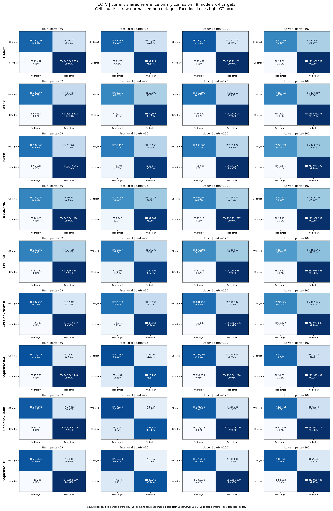

<!-- SHARED_DATASET_CURRENT_START -->

# ผลล่าสุดของ CCTV — คะแนนสี่คลาสและเวลาประมวลผล

อัปเดต 2026-11-09T17:27:38.250271+07:00 (Asia/Bangkok) ประเมินครบ 9 โมเดล ตัวละ 90 ภาพตาม STRICT_COMPLETE ใช้ผล shared-reference run `shared-c3-face-local-20261108T083533Z`

## คะแนนรายคลาสและค่าเฉลี่ย

**Macro4-local = (Hair + Face-local + Upper + Lower) ÷ 4** โดยค่ารายคลาสเป็นค่าเฉลี่ย IoU รายส่วนของ GT แต่ละคน แต่ละ target มีน้ำหนัก 25% ส่วน mIoU3 เฉลี่ย Hair/Upper/Lower เท่ากัน คำนวณค่าเฉลี่ยจากตัวเลขเต็มก่อนปัดเศษ Macro4-local เพิ่มตามคำขอผู้ใช้หลังเห็นผลแล้ว

| โมเดล | Hair % | Face-local % | Upper % | Lower % | mIoU3 % | Macro4-local % | ภาพครบ |
|---|---:|---:|---:|---:|---:|---:|---:|
| QANet | 56.788 | 61.813 | 66.083 | 56.905 | 59.925 | 60.397 | 90/90 |
| M2FP | 44.413 | 46.095 | 53.519 | 46.249 | 48.061 | 47.569 | 90/90 |
| D2FP | 45.184 | 49.550 | 47.820 | 41.053 | 44.686 | 45.902 | 90/90 |
| RP-R-CNN | 41.571 | 45.173 | 48.570 | 42.766 | 44.302 | 44.520 | 90/90 |
| CPI R50 | 38.460 | 46.295 | 37.882 | 36.382 | 37.575 | 39.755 | 90/90 |
| CPI ConvNeXt-B | 56.275 | 60.603 | 50.917 | 45.959 | 51.050 | 53.438 | 90/90 |
| Sapiens2 0.4B | 61.497 | 62.957 | 59.366 | 53.103 | 57.989 | 59.231 | 90/90 |
| Sapiens2 0.8B | 57.699 | 66.148 | 56.881 | 54.731 | 56.437 | 58.865 | 90/90 |
| Sapiens2 1B | 62.394 | 69.497 | 63.744 | 59.281 | 61.806 | 63.729 | 90/90 |

ค่าเฉลี่ยสี่คลาสสูงสุดคือ **Sapiens2 1B 63.729%**

## วิธีให้คะแนนและตัวหาร

GT มี 127 คน ส่วนที่มีสิทธิ์ประเมินคือ Hair 69, Face 35, Upper 120 และ Lower 102 รายการ แต่ละคลาสเฉลี่ยเฉพาะ GT person-parts ที่มี annotation ของคลาสนั้น

จับคู่คนด้วย mask IoU ตั้งแต่ 0.50 แบบหนึ่งต่อหนึ่ง เลือกจำนวนคู่สูงสุดแล้วเลือกผลรวม IoU สูงสุด ใช้รูปทรง mask ตัดสินกรณีเสมอตาม common matcher ส่วนที่มี GT แต่จับคู่คนไม่ได้มี IoU เป็นศูนย์และยังอยู่ในตัวหาร

Hair/Upper/Lower ใช้พื้นที่ valid ทั้งภาพสำหรับ prediction ของคนที่จับคู่ ส่วน Face-local ใช้กรอบสี่เหลี่ยมครอบ GT Face พอดีทุกโมเดล ภายในกรอบทายเกินเป็น FP ทายขาดเป็น FN และพื้นที่นอกกรอบไม่ประเมิน กรอบนี้ใช้ให้คะแนนหลัง inference โดยคงผลทำนายต้นฉบับไว้

Prediction ของ CIHP ใช้ Face ID 13 และของ Sapiens ใช้ Face_Neck พร้อมรายละเอียดใบหน้าตาม mapping ที่ตรึง Upper/Lower คง garment unions และ OTHER ของ Dress/Apparel ใช้ shared GT-valid/VOID เหมือนกันทุกโมเดล

**IoU = TP/(TP+FP+FN)** โดย TP คือพิกเซลที่ทายถูก FP คือทายเกิน และ FN คือ GT ที่ทายขาด วิธีคำนวณและการจับคู่คนใช้ร่วมกันใน CIHP/CCTV ส่วนขอบเขต annotation ยังอ้างอิง GT ของแต่ละ dataset

## เวลาประมวลผล parsing

ตารางนี้รวมช่วงเวลาที่มีบันทึกของ ROI ทุกคนในแต่ละภาพ แล้วหารด้วยจำนวนภาพทั้งชุด 90 ภาพ หน่วย s/ภาพคือวินาทีต่อภาพต้นฉบับ ส่วน ms/ROI ในตารางขั้นตอนคือมิลลิวินาทีต่อภาพย่อยบุคคล กลุ่ม timer A/B/C มีขอบเขตตามคำอธิบายใต้ตาราง ภาพที่ YOLO ให้ศูนย์ ROI มีเวลาเรียก parser เท่ากับศูนย์

**ต่อ ROI** คือเวลาต่อภาพย่อยบุคคลที่ YOLO ตรวจพบหนึ่งรายการ คำนวณผลรวมช่วงเวลาที่บันทึก ÷ จำนวน ROI แล้วคูณ 1,000 เพื่อแสดงเป็น ms ส่วน **ต่อภาพ** นำผลรวมช่วงเวลาเดียวกัน ÷ จำนวนภาพต้นฉบับ แสดงเป็นวินาที CIHP ใช้ตัวหาร 24,062 ROI / 5,000 ภาพ และ CCTV ใช้ 130 ROI / 90 ภาพต่อโมเดล

| โมเดล | เฉลี่ย ms/ROI | เฉลี่ยช่วงที่มีบันทึก s/ภาพ | รวมช่วงที่มีบันทึก s | ภาพครบ | ROI ครบ | ขอบเขต timer |
|---|---:|---:|---:|---:|---:|---|
| QANet | 76.325 | 0.110 | 9.922 | 90/90 | 130/130 | A |
| M2FP | 220.187 | 0.318 | 28.624 | 90/90 | 130/130 | A |
| D2FP | 694.885 | 1.004 | 90.335 | 90/90 | 130/130 | A |
| RP-R-CNN | 226.784 | 0.328 | 29.482 | 90/90 | 130/130 | A+B |
| CPI R50 | 2994.517 | 4.325 | 389.287 | 90/90 | 130/130 | A+B |
| CPI ConvNeXt-B | 490.608 | 0.709 | 63.779 | 90/90 | 130/130 | A+B |
| Sapiens2 0.4B | 1384.706 | 2.000 | 180.012 | 90/90 | 130/130 | A+C |
| Sapiens2 0.8B | 2881.421 | 4.162 | 374.585 | 90/90 | 130/130 | A+C |
| Sapiens2 1B | 4096.048 | 5.917 | 532.486 | 90/90 | 130/130 | A+C |

ลิงก์ที่มี commit `2863d64` เปิด snapshot เดิม ซึ่ง CCTV Sapiens เฉลี่ยเฉพาะ 84 ภาพที่มี adapter timer ได้ 1.931/4.001/5.672 s ต่อภาพ ส่วนตารางปัจจุบันรวมช่วง forward เดิมอีก 15 ROI แล้วหาร 90 ภาพ ได้ 2.000/4.162/5.917 s ต่อภาพ ตัวเลขเปลี่ยนจากการรวมช่วงเวลาและตัวหารที่ต่างกัน ทั้งสองชุดยังมีแหล่งอ้างอิงเดิมอยู่ใน canonical index

**การรวมเวลาเดิมของ Sapiens** ตรวจจับคู่ logs กับ accepted packet metadata/geometry แล้วพบเวลาอีก 15 ROI ต่อขนาด จึงรวมกับ 115 ROI รอบหลังได้ครบ 130 ROI ใน 90 ภาพ ตารางนี้เป็นบัญชีผลรวมช่วงเวลาที่มีบันทึก โดยแบ่งขอบเขต A เป็น adapter รอบหลัก, B เป็น event interval ของ continuation และ C เป็น FORWARD event ของรอบเดิม C มี preprocessing และ map-back อยู่ภายนอกช่วง ค่ารวม A+B+C จึงสะท้อนต้นทุนช่วงที่จับเวลาได้จากทั้งสามกลุ่ม

สำหรับ Sapiens เวลา adapter ที่วัดครบ 84 ภาพยังมีค่าเฉลี่ย 1.931/4.001/5.672 วินาทีต่อภาพ ส่วนตัวเลข 2.000/4.162/5.917 ในตารางใช้ผลรวมช่วง A+C หาร 90 ภาพ ทั้งสองค่าใช้ขอบเขตและตัวหารต่างกัน

เวลา A จับรอบ adapter ด้วยนาฬิกาวัดระยะเวลา เวลา B ของ continuation ใช้ event จบลบ event เริ่ม ซึ่งรวมการรอ GPU และการเขียน resource log ผลรวมช่วงที่มี log เก็บ A+B ตาม observation ที่ไม่ซ้ำกัน

GT รอบนี้ใช้ Face 35 ส่วนและ raw positive parts ของ annotation ที่ผู้ใช้ตรวจรับ ค่าชุดนี้จึงใช้ตัวหารและ Face-local domain ตามกติกาปัจจุบัน รายละเอียดของ Face-domain 21 ส่วนในประวัติด้านล่างอ้างอิงการประเมินรอบเดิม

เวลาของ adapter ครอบ preprocessing, model call และ map-back ตาม implementation รวม native file I/O ของ CPI ส่วน YOLO cache/crop, การส่งออก packet, การให้คะแนนและงานสีอยู่ภายนอกช่วงนี้ ทุก call ทำนาย native classes พร้อมกัน ข้อมูลเวลาจึงเป็นเวลารวมของ call

จำนวน ROI ต่อภาพ การใช้ GPU ร่วม และ implementation/ขอบเขต timer มีผลต่อเวลาที่บันทึก รายงานใช้เวลาเป็น diagnostics โดยแสดง coverage ประกอบ

[รายงานรวมพร้อมรายละเอียด stage timing](../../Human_Parsing_Benchmark/reports/CIHP_CCTV_COMPARABILITY_REVIEW_TH.md#เวลาต่อภาพและเวลารวม) · [สูตรและข้อกำหนดร่วม](../../Human_Parsing_Benchmark/reports/CIHP_CCTV_COMPARABILITY_REVIEW_TH.md#นิยามที่ใช้อธิบายร่วมกัน)

[CSV ตัวเลขเต็ม](../../Human_Parsing_Benchmark/metrics/SHARED_REFERENCE_SUMMARY.csv) · [Canonical result index](../../Human_Parsing_Benchmark/reports/SHARED_REFERENCE_RESULT_INDEX.json)

## การตรวจตัวเลข

ตรวจ 9 แถวคุณภาพและ 9 แถวเวลาในไฟล์นี้กับ canonical aggregate และ CSV ที่ 2026-11-09T17:27:38.250271+07:00 โดยใช้ค่าก่อนปัดเศษ ตรวจสูตรสี่คลาส ตัวหารภาพ timing และสถานะของข้อมูลที่ขาด แหล่ง aggregate ใช้ protocol hash `5cecc46446b4c33f5da56cd639c1b829f2c477c616873e7d1a42b5c09cea6357` ข้อมูลตัวเลขนี้เผยแพร่ร่วมกับ source/configuration และ ledger hashes ใน canonical index

<!-- CURRENT_SHARED_DIAGNOSTICS_START -->

## Confusion matrix และความครบของแต่ละส่วน

ภาพชุดนี้สร้างจากสถิติรายส่วนของ shared-reference run ล่าสุด เก็บ binary confusion แยก target โดยแถวเป็น GT และคอลัมน์เป็น prediction เรียง target ก่อน other จึงได้ **[[TP, FN], [FP, TN]]** ตัวเลขในช่องเป็นจำนวนพิกเซล ส่วนสีและเปอร์เซ็นต์หารด้วยผลรวมของ GT แต่ละแถว

TP คือทายส่วนที่ต้องการถูก FN คือส่วน GT ที่ทายขาด FP คือทายเกินบนส่วนอื่นในพื้นที่ประเมิน และ TN คือพื้นที่อื่นที่ทายเป็นอื่น แต่ละ target มีงานราย GT person-part ของตนเอง พิกเซลของภาพเดียวกันอาจถูกประเมินในหลายงานตามเจ้าของ GT ตารางรวมพิกเซลตามงานเหล่านี้

**Recall = TP/(TP+FN)** บอกว่าเก็บพิกเซล GT ได้ครบเท่าไร **Precision = TP/(TP+FP)** บอกว่าพิกเซลที่ทายมาถูกเท่าไร และ **F1/Dice = 2TP/(2TP+FP+FN)** สรุปทั้งการทายเกินและทายขาด ค่าด้านล่างรวม counts ก่อนหาร ส่วน mean-part IoU ในตารางคะแนนเฉลี่ยแต่ละส่วนเท่ากัน

| โมเดล | Target | Precision % | Recall % | F1/Dice % | GT parts | ไม่ทับ GT เลย | ในจำนวนนั้นจับคู่คนไม่ได้ |
|---|---|---:|---:|---:|---:|---:|---:|
| QANet | Hair | 94.461 | 79.843 | 86.539 | 69 | 13 | 11 |
| QANet | Face_local | 96.637 | 80.017 | 87.545 | 35 | 5 | 5 |
| QANet | Upper | 91.171 | 84.125 | 87.507 | 120 | 22 | 20 |
| QANet | Lower | 90.867 | 66.457 | 76.768 | 102 | 21 | 16 |
| M2FP | Hair | 96.954 | 74.869 | 84.492 | 69 | 27 | 11 |
| M2FP | Face_local | 97.144 | 66.650 | 79.058 | 35 | 12 | 5 |
| M2FP | Upper | 91.191 | 74.971 | 82.289 | 120 | 40 | 20 |
| M2FP | Lower | 93.286 | 67.956 | 78.631 | 102 | 39 | 16 |
| D2FP | Hair | 96.984 | 74.657 | 84.368 | 69 | 27 | 11 |
| D2FP | Face_local | 96.408 | 70.496 | 81.440 | 35 | 12 | 5 |
| D2FP | Upper | 91.777 | 71.314 | 80.262 | 120 | 48 | 20 |
| D2FP | Lower | 92.248 | 61.155 | 73.551 | 102 | 45 | 16 |
| RP-R-CNN | Hair | 90.656 | 67.047 | 77.084 | 69 | 26 | 11 |
| RP-R-CNN | Face_local | 96.436 | 63.217 | 76.370 | 35 | 12 | 5 |
| RP-R-CNN | Upper | 89.447 | 67.593 | 76.999 | 120 | 38 | 20 |
| RP-R-CNN | Lower | 90.632 | 62.678 | 74.107 | 102 | 31 | 16 |
| CPI R50 | Hair | 90.600 | 68.449 | 77.982 | 69 | 24 | 11 |
| CPI R50 | Face_local | 94.804 | 72.239 | 81.997 | 35 | 13 | 5 |
| CPI R50 | Upper | 90.912 | 64.273 | 75.306 | 120 | 40 | 20 |
| CPI R50 | Lower | 86.270 | 58.376 | 69.633 | 102 | 39 | 16 |
| CPI ConvNeXt-B | Hair | 85.434 | 84.743 | 85.087 | 69 | 14 | 11 |
| CPI ConvNeXt-B | Face_local | 96.985 | 75.331 | 84.797 | 35 | 7 | 5 |
| CPI ConvNeXt-B | Upper | 88.668 | 76.418 | 82.088 | 120 | 33 | 20 |
| CPI ConvNeXt-B | Lower | 92.445 | 67.092 | 77.754 | 102 | 35 | 16 |
| Sapiens2 0.4B | Hair | 93.122 | 87.353 | 90.145 | 69 | 13 | 11 |
| Sapiens2 0.4B | Face_local | 91.330 | 88.366 | 89.824 | 35 | 5 | 5 |
| Sapiens2 0.4B | Upper | 85.112 | 84.907 | 85.009 | 120 | 20 | 20 |
| Sapiens2 0.4B | Lower | 85.176 | 78.717 | 81.819 | 102 | 24 | 16 |
| Sapiens2 0.8B | Hair | 95.269 | 83.699 | 89.110 | 69 | 16 | 11 |
| Sapiens2 0.8B | Face_local | 90.914 | 90.213 | 90.562 | 35 | 6 | 5 |
| Sapiens2 0.8B | Upper | 86.110 | 82.466 | 84.249 | 120 | 24 | 20 |
| Sapiens2 0.8B | Lower | 87.618 | 79.316 | 83.261 | 102 | 26 | 16 |
| Sapiens2 1B | Hair | 95.368 | 85.929 | 90.403 | 69 | 13 | 11 |
| Sapiens2 1B | Face_local | 91.333 | 92.214 | 91.771 | 35 | 5 | 5 |
| Sapiens2 1B | Upper | 87.826 | 86.586 | 87.201 | 120 | 22 | 20 |
| Sapiens2 1B | Lower | 85.245 | 85.278 | 85.261 | 102 | 20 | 16 |

“ไม่ทับ GT เลย” หมายถึง TP = 0 ของส่วนที่มี GT ส่วน “จับคู่คนไม่ได้” เป็นกลุ่มย่อยของรายการเหล่านั้นและยังนับพิกเซล GT เป็น FN กรณีที่จับคู่คนได้แต่ TP = 0 อาจเป็นผลว่าง ผิดคลาส ผิดตำแหน่ง หรือผิด ownership ต้องดู masks ประกอบเพื่อแยกสาเหตุ

| โมเดล | Target | TP px | FP px | FN px | TN px | GT support px | Union px | GT พิกเซลที่พลาด % |
|---|---|---:|---:|---:|---:|---:|---:|---:|
| QANet | Hair | 195,251 | 11,449 | 49,293 | 143,666,775 | 244,544 | 255,993 | 20.157 |
| QANet | Face_local | 42,465 | 1,478 | 10,605 | 31,929 | 53,070 | 54,548 | 19.983 |
| QANet | Upper | 750,233 | 72,651 | 141,571 | 250,721,081 | 891,804 | 964,455 | 15.875 |
| QANet | Lower | 247,538 | 24,881 | 124,941 | 213,968,587 | 372,479 | 397,360 | 33.543 |
| M2FP | Hair | 183,087 | 5,752 | 61,457 | 143,672,472 | 244,544 | 250,296 | 25.131 |
| M2FP | Face_local | 35,371 | 1,040 | 17,699 | 32,367 | 53,070 | 54,110 | 33.350 |
| M2FP | Upper | 668,592 | 64,589 | 223,212 | 250,729,143 | 891,804 | 956,393 | 25.029 |
| M2FP | Lower | 253,120 | 18,217 | 119,359 | 213,975,251 | 372,479 | 390,696 | 32.044 |
| D2FP | Hair | 182,568 | 5,678 | 61,976 | 143,672,546 | 244,544 | 250,222 | 25.343 |
| D2FP | Face_local | 37,412 | 1,394 | 15,658 | 32,013 | 53,070 | 54,464 | 29.504 |
| D2FP | Upper | 635,980 | 56,981 | 255,824 | 250,736,751 | 891,804 | 948,785 | 28.686 |
| D2FP | Lower | 227,790 | 19,141 | 144,689 | 213,974,327 | 372,479 | 391,620 | 38.845 |
| RP-R-CNN | Hair | 163,959 | 16,900 | 80,585 | 143,661,324 | 244,544 | 261,444 | 32.953 |
| RP-R-CNN | Face_local | 33,549 | 1,240 | 19,521 | 32,167 | 53,070 | 54,310 | 36.783 |
| RP-R-CNN | Upper | 602,796 | 71,115 | 289,008 | 250,722,617 | 891,804 | 962,919 | 32.407 |
| RP-R-CNN | Lower | 233,463 | 24,131 | 139,016 | 213,969,337 | 372,479 | 396,610 | 37.322 |
| CPI R50 | Hair | 167,388 | 17,367 | 77,156 | 143,660,857 | 244,544 | 261,911 | 31.551 |
| CPI R50 | Face_local | 38,337 | 2,101 | 14,733 | 31,306 | 53,070 | 55,171 | 27.761 |
| CPI R50 | Upper | 573,191 | 57,301 | 318,613 | 250,736,431 | 891,804 | 949,105 | 35.727 |
| CPI R50 | Lower | 217,438 | 34,605 | 155,041 | 213,958,863 | 372,479 | 407,084 | 41.624 |
| CPI ConvNeXt-B | Hair | 207,233 | 35,332 | 37,311 | 143,642,892 | 244,544 | 279,876 | 15.257 |
| CPI ConvNeXt-B | Face_local | 39,978 | 1,243 | 13,092 | 32,164 | 53,070 | 54,313 | 24.669 |
| CPI ConvNeXt-B | Upper | 681,497 | 87,096 | 210,307 | 250,706,636 | 891,804 | 978,900 | 23.582 |
| CPI ConvNeXt-B | Lower | 249,904 | 20,422 | 122,575 | 213,973,046 | 372,479 | 392,901 | 32.908 |
| Sapiens2 0.4B | Hair | 213,617 | 15,778 | 30,927 | 143,662,446 | 244,544 | 260,322 | 12.647 |
| Sapiens2 0.4B | Face_local | 46,896 | 4,452 | 6,174 | 28,955 | 53,070 | 57,522 | 11.634 |
| Sapiens2 0.4B | Upper | 757,203 | 132,454 | 134,601 | 250,661,278 | 891,804 | 1,024,258 | 15.093 |
| Sapiens2 0.4B | Lower | 293,205 | 51,031 | 79,274 | 213,942,437 | 372,479 | 423,510 | 21.283 |
| Sapiens2 0.8B | Hair | 204,681 | 10,165 | 39,863 | 143,668,059 | 244,544 | 254,709 | 16.301 |
| Sapiens2 0.8B | Face_local | 47,876 | 4,785 | 5,194 | 28,622 | 53,070 | 57,855 | 9.787 |
| Sapiens2 0.8B | Upper | 735,438 | 118,632 | 156,366 | 250,675,100 | 891,804 | 1,010,436 | 17.534 |
| Sapiens2 0.8B | Lower | 295,435 | 41,750 | 77,044 | 213,951,718 | 372,479 | 414,229 | 20.684 |
| Sapiens2 1B | Hair | 210,133 | 10,205 | 34,411 | 143,668,019 | 244,544 | 254,749 | 14.071 |
| Sapiens2 1B | Face_local | 48,938 | 4,644 | 4,132 | 28,763 | 53,070 | 57,714 | 7.786 |
| Sapiens2 1B | Upper | 772,173 | 107,033 | 119,631 | 250,686,699 | 891,804 | 998,837 | 13.414 |
| Sapiens2 1B | Lower | 317,641 | 54,982 | 54,838 | 213,938,486 | 372,479 | 427,461 | 14.722 |

GT support = TP+FN และ union = TP+FP+FN สัดส่วน GT ที่พลาด = FN/(TP+FN) = 1−Recall ค่า TN อ้างอิงพื้นที่ valid ของงานนั้น และมีขนาดใหญ่มากในงานบางคลาส จึงอ่านความครบควบคู่กับ Precision/Recall/IoU ตามเป้าหมาย

## การจับคู่คนและความครบถ้วนของผล

ตารางนี้ใช้ YOLO extents ที่ตรึงไว้กับ common geometry matcher ทั้งเก้าโมเดล ค่า person TP คือคู่ที่ผ่าน threshold, FP คือ predicted extent ที่ไม่มีคู่ และ FN คือ GT extent ที่ไม่มีคู่ Person Precision = TP/(TP+FP), Recall = TP/(TP+FN), F1 = 2TP/(2TP+FP+FN)

| โมเดล | Mask IoU threshold | GT คน | Pred คน | TP | FP | FN | Precision % | Recall % | F1 % | Ambiguous frames |
|---|---:|---:|---:|---:|---:|---:|---:|---:|---:|---:|
| QANet | 0.5 | 127 | 130 | 104 | 26 | 23 | 80.000 | 81.890 | 80.934 | 0 |
| QANet | 0.75 | 127 | 130 | 82 | 48 | 45 | 63.077 | 64.567 | 63.813 | 0 |
| M2FP | 0.5 | 127 | 130 | 104 | 26 | 23 | 80.000 | 81.890 | 80.934 | 0 |
| M2FP | 0.75 | 127 | 130 | 82 | 48 | 45 | 63.077 | 64.567 | 63.813 | 0 |
| D2FP | 0.5 | 127 | 130 | 104 | 26 | 23 | 80.000 | 81.890 | 80.934 | 0 |
| D2FP | 0.75 | 127 | 130 | 82 | 48 | 45 | 63.077 | 64.567 | 63.813 | 0 |
| RP-R-CNN | 0.5 | 127 | 130 | 104 | 26 | 23 | 80.000 | 81.890 | 80.934 | 0 |
| RP-R-CNN | 0.75 | 127 | 130 | 82 | 48 | 45 | 63.077 | 64.567 | 63.813 | 0 |
| CPI R50 | 0.5 | 127 | 130 | 104 | 26 | 23 | 80.000 | 81.890 | 80.934 | 0 |
| CPI R50 | 0.75 | 127 | 130 | 82 | 48 | 45 | 63.077 | 64.567 | 63.813 | 0 |
| CPI ConvNeXt-B | 0.5 | 127 | 130 | 104 | 26 | 23 | 80.000 | 81.890 | 80.934 | 0 |
| CPI ConvNeXt-B | 0.75 | 127 | 130 | 82 | 48 | 45 | 63.077 | 64.567 | 63.813 | 0 |
| Sapiens2 0.4B | 0.5 | 127 | 130 | 104 | 26 | 23 | 80.000 | 81.890 | 80.934 | 0 |
| Sapiens2 0.4B | 0.75 | 127 | 130 | 82 | 48 | 45 | 63.077 | 64.567 | 63.813 | 0 |
| Sapiens2 0.8B | 0.5 | 127 | 130 | 104 | 26 | 23 | 80.000 | 81.890 | 80.934 | 0 |
| Sapiens2 0.8B | 0.75 | 127 | 130 | 82 | 48 | 45 | 63.077 | 64.567 | 63.813 | 0 |
| Sapiens2 1B | 0.5 | 127 | 130 | 104 | 26 | 23 | 80.000 | 81.890 | 80.934 | 0 |
| Sapiens2 1B | 0.75 | 127 | 130 | 82 | 48 | 45 | 63.077 | 64.567 | 63.813 | 0 |

Person metrics เท่ากันข้ามโมเดลในแต่ละ dataset เพราะใช้ YOLO extents ชุดเดียวกัน ส่วน semantic masks และคะแนนรายส่วนยังต่างกัน สำหรับ CCTV จำนวนคนที่ทายมาแต่ไม่มีคู่ GT อ้างอิงเฉพาะคนที่ annotate ไว้

| โมเดล | Expected | Completed | Missing | Duplicate | STRICT_COMPLETE |
|---|---:|---:|---:|---:|---|
| QANet | 90 | 90 | 0 | 0 | True |
| M2FP | 90 | 90 | 0 | 0 | True |
| D2FP | 90 | 90 | 0 | 0 | True |
| RP-R-CNN | 90 | 90 | 0 | 0 | True |
| CPI R50 | 90 | 90 | 0 | 0 | True |
| CPI ConvNeXt-B | 90 | 90 | 0 | 0 | True |
| Sapiens2 0.4B | 90 | 90 | 0 | 0 | True |
| Sapiens2 0.8B | 90 | 90 | 0 | 0 | True |
| Sapiens2 1B | 90 | 90 | 0 | 0 | True |

## รายละเอียด timing ที่ตรวจได้

ตารางขั้นตอนใช้หน่วย ms ต่อ ROI ที่มี timer ช่วงย่อยอาจอยู่ซ้อนภายใน adapter_total ของโมเดลหนึ่ง call รองรับ native classes ทั้งหมด แล้วจึงแปลงผลเป็นสี่ target

| โมเดล | Preprocess ms/ROI | Native call ms/ROI | Map-back ms/ROI | Adapter A ms/ROI (n) | Event B ms/ROI (n) | Original forward C ms/ROI (n) |
|---|---:|---:|---:|---:|---:|---:|
| QANet | รวมใน adapter | รวมใน adapter | รวมใน adapter | 76.325 (130) | — (0) | — (0) |
| M2FP | รวมใน adapter | รวมใน adapter | รวมใน adapter | 220.187 (130) | — (0) | — (0) |
| D2FP | รวมใน adapter | รวมใน adapter | รวมใน adapter | 694.885 (130) | — (0) | — (0) |
| RP-R-CNN | รวมใน adapter | รวมใน adapter | รวมใน adapter | 351.633 (1) | 225.817 (129) | — (0) |
| CPI R50 | รวมใน adapter | รวมใน adapter | รวมใน adapter | 2806.344 (28) | 3046.172 (102) | — (0) |
| CPI ConvNeXt-B | รวมใน adapter | รวมใน adapter | รวมใน adapter | 485.599 (27) | 491.921 (103) | — (0) |
| Sapiens2 0.4B | รวมใน adapter | รวมใน adapter | รวมใน adapter | 1410.127 (115) | — (0) | 1189.810 (15) |
| Sapiens2 0.8B | รวมใน adapter | รวมใน adapter | รวมใน adapter | 2922.120 (115) | — (0) | 2569.400 (15) |
| Sapiens2 1B | รวมใน adapter | รวมใน adapter | รวมใน adapter | 4143.146 (115) | — (0) | 3734.958 (15) |

“รวมใน adapter” หมายถึงมีเวลารวม แต่ log ของรอบนั้นแยกขั้นตอนนี้ไม่ได้ ส่วน — (0) หมายถึงไม่มี calls ในกลุ่ม timer นั้น ขอบเขต A และ B ของ CCTV อธิบายไว้ในตารางเวลาต่อภาพด้านบน CPI มี native file I/O ภายใน adapter และสภาพ GPU ร่วมถูกบันทึกไว้ใน resource policy ของ source run

## ที่มาของ configuration และข้อจำกัด

| โมเดล | Checkpoint SHA256 prefix | Canonical source reference | Implementation reference |
|---|---|---|---|
| QANet | `cf7374ea109e05c1` | `CCTV_Human_Parsing_Benchmark/outputs/controlled-roi-part-diagnostics-20261101/QANet_CIHP_HRNetW48_512x384/METRICS.json` | `รายละเอียดใน source config hash ac329e637c840d5ae2868dfcfa25f8cf5535c331e136e6a039178ec49d8834ae` |
| M2FP | `7451e822298c8dee` | `CCTV_Human_Parsing_Benchmark/outputs/controlled-roi-part-diagnostics-20261101/M2FP_R101_CIHP/METRICS.json` | `รายละเอียดใน source config hash ac329e637c840d5ae2868dfcfa25f8cf5535c331e136e6a039178ec49d8834ae` |
| D2FP | `acdfb2eceff57682` | `CCTV_Human_Parsing_Benchmark/outputs/controlled-roi-part-diagnostics-20261101/D2FP_R101_CIHP/METRICS.json` | `รายละเอียดใน source config hash ac329e637c840d5ae2868dfcfa25f8cf5535c331e136e6a039178ec49d8834ae` |
| RP-R-CNN | `6b596210f3ea67c7` | `CCTV_Human_Parsing_Benchmark/outputs/controlled-roi-part-continuation-scores-20261101/RPR_CIHP/METRICS.json` | `รายละเอียดใน source config hash c336a36aea63370162ce650bc5af3ae7419e581f8f9a17c123dff6437775baa9` |
| CPI R50 | `e58f8cb4b4fb3b75` | `CCTV_Human_Parsing_Benchmark/outputs/controlled-roi-part-continuation-scores-20261101/CPI_R50_CIHP/METRICS.json` | `รายละเอียดใน source config hash c336a36aea63370162ce650bc5af3ae7419e581f8f9a17c123dff6437775baa9` |
| CPI ConvNeXt-B | `25b7b12527e550f1` | `CCTV_Human_Parsing_Benchmark/outputs/controlled-roi-part-continuation-scores-20261101/CPI_ConvNeXtB_CIHP/METRICS.json` | `รายละเอียดใน source config hash c336a36aea63370162ce650bc5af3ae7419e581f8f9a17c123dff6437775baa9` |
| Sapiens2 0.4B | `b85fdb50b7d6123a` | `CCTV_Human_Parsing_Benchmark/outputs/controlled-roi-part-diagnostics-20261101/Sapiens2_0.4b/METRICS.json` | `รายละเอียดใน source config hash ac329e637c840d5ae2868dfcfa25f8cf5535c331e136e6a039178ec49d8834ae` |
| Sapiens2 0.8B | `e7c1655b7e11678b` | `CCTV_Human_Parsing_Benchmark/outputs/controlled-roi-part-diagnostics-20261101/Sapiens2_0.8b/METRICS.json` | `รายละเอียดใน source config hash ac329e637c840d5ae2868dfcfa25f8cf5535c331e136e6a039178ec49d8834ae` |
| Sapiens2 1B | `4b73c44963b377e9` | `CCTV_Human_Parsing_Benchmark/outputs/controlled-roi-part-diagnostics-20261101/Sapiens2_1b/METRICS.json` | `รายละเอียดใน source config hash ac329e637c840d5ae2868dfcfa25f8cf5535c331e136e6a039178ec49d8834ae` |

กติกาสี่ target, Face-local, VOID/OTHER, mask matching และวิธีเฉลี่ยใช้ร่วมกันใน CIHP/CCTV โดย GT และ annotation boundaries ยังเป็น reference ของแต่ละชุด การประเมินใช้ส่วนที่มี annotation และ Face ใช้กรอบ GT ของงานนั้น คำอ้างเกี่ยวกับขอบเขตหน้า/คอและ Dress จึงอิงนิยามเหล่านี้

ผลเปรียบเทียบ checkpoint พร้อม application configuration ซึ่งรวมข้อมูลฝึก adapter และ implementation revision การแก้หน่วยความจำ CPI มีหลักฐาน parity ตาม revision ของแต่ละ segment ประวัติ OOM และ interruption ยังอยู่ใน source runs การปิดผลครบเป็นสถานะของ assembled cohort

[CSV ราย target พร้อม counts และตัวหาร](../../Human_Parsing_Benchmark/metrics/SHARED_REFERENCE_TARGET_COUNTS.csv) · [Canonical index และหลักฐานการตรวจ](../../Human_Parsing_Benchmark/reports/SHARED_REFERENCE_RESULT_INDEX.json)

<!-- CURRENT_SHARED_DIAGNOSTICS_END -->

[โค้ดนิยามและการนับรายส่วน](../../Human_Parsing_Benchmark/src/common_view/reference_parts.py) เก็บสูตร จำนวน GT และการให้ศูนย์เมื่อจับคู่ไม่ได้ ส่วน Q_C4_GT ในประวัติอ้างอิง semantic person score ของ protocol เดิม รายงานปัจจุบันสรุปคุณภาพรายส่วนด้วย mean-part IoU และแสดง person extent diagnostics แยกกัน

<!-- SHARED_DATASET_CURRENT_END -->

## ประวัติผลและคำอธิบายตาม protocol เดิม

> **View clarification (8 November2026):** รายงานนี้เป็นผล/ประวัติของ protocol เดิม เก็บตัวเลขครบ. สำหรับตารางปัจจุบันที่ใช้C3-partและFace-localเหมือนกันในCIHP/CCTV ดู[รายงานร่วมล่าสุด](../../Human_Parsing_Benchmark/reports/CIHP_CCTV_COMPARABILITY_REVIEW_TH.md);ห้ามนำคะแนนต่างviewมาปะปนหรือเปลี่ยนชื่อแทนกัน.

# ผลประเมิน Human Parsing บนภาพ CCTV: 9 โมเดลและ 4 ส่วนเป้าหมาย

> **การเทียบกับ CIHP (2 พ.ย. 2026):** คะแนนหลักนี้เป็น mean-part IoU บน controlled person ROI และ Face domain ที่ตรวจแก้แล้ว จึงเทียบตัวเลขตรงกับ CIHP global C4-P ไม่ได้. [รายงานตรวจเงื่อนไขและผล aggregation sensitivity](../../Human_Parsing_Benchmark/reports/CIHP_CCTV_COMPARABILITY_REVIEW_TH.md) ยืนยันตัวเลขเดิมและอธิบายขอบเขตคำอ้าง

ตรวจปิดผลคุณภาพเมื่อ 2026-11-01T23:26:54.611649+07:00 (Asia/Bangkok) สถานะ **FOUR_TARGET_EVALUATION_COMPLETE_ON_REVIEWED_GT — 9/9** รายงานใช้ผลทำนายเดิมที่ครบ 90 ภาพ/130 ROIs ต่อ checkpoint ไม่มี inference ใหม่เพื่อจัดทำสรุป และยังเก็บผลกับประวัติการรันเดิมครบ

**Sapiens2 1B ได้คะแนนเฉลี่ยหลักของสี่ส่วนสูงสุดที่ 65.430%** ตาม GT และพื้นที่ประเมินที่กำหนด QANet ได้ 64.533% ต่างกัน 0.898 จุดเปอร์เซ็นต์ โดย QANet ได้คะแนนใบหน้าและเสื้อผ้าส่วนบนสูงสุด ส่วน Sapiens2 1B ได้คะแนนผมและเสื้อผ้าส่วนล่างสูงสุด ผลนี้เป็นค่าที่สังเกตได้ ยังไม่ได้ยืนยันนัยสำคัญทางสถิติหรือความพร้อมใช้งานจริง

การประเมินใบหน้าใช้ GT ได้ **21 จาก 35 รายการ** หลังตรวจ GT โดยไม่อาศัยผลทำนาย อีก 14 รายการมีปัญหาขอบเขตอ้างอิงหรือยืนยันจากภาพ RGB ไม่ได้ จึงกันออกเหมือนกันทุกโมเดล ใน 21 รายการที่ใช้ได้ มี 18 รายการที่ขอบคอไม่แน่ชัดและได้ระบุพื้นที่ไม่แน่นอนไว้ การประเมินใบหน้ารวมคอจึงใช้ได้เพียง 3 รายการ **ผลคุณภาพคำนวณครบตามขอบเขตนี้ ไม่ได้หมายความว่า GT ทั้ง 35 รายการถูกต้องทางกายวิภาคทุกพิกเซล หรือวัดใบหน้า/คอได้ครบทุกกรณี**

คำที่ใช้ในรายงาน: **GT** คือ mask อ้างอิง, **ROI** คือภาพย่อยรอบบุคคลที่ YOLO ตรวจพบ, **Hair / Face-domain / Upper / Lower** คือผม / ใบหน้าบนพื้นที่ประเมินที่ตัดคอและบริเวณไม่แน่นอนออก / เสื้อผ้าส่วนบน / เสื้อผ้าส่วนล่าง ส่วน **native classes** หมายถึงคลาสเดิมทั้งหมดที่โมเดลทำนายก่อนแปลงเป็นสี่ส่วนนี้

## วิธีอ่านคะแนนชุด CCTV นี้

**หน่วยประเมินคือ “ส่วนของบุคคลที่มี GT”** เช่น ผมของคนหนึ่งเป็นหนึ่งรายการ คนเดียวกันอาจมีทั้งผม เสื้อ และกางเกง จึงไม่ใช่จำนวนคนที่ไม่ซ้ำกัน ชุดนี้มี 90 ภาพ, 130 ROI ที่ YOLO ตรวจพบ และ GT ที่ใช้ประเมิน 290 ส่วน จำนวนทั้งสามบอกคนละเรื่อง และใช้แทนกันเป็นตัวหารไม่ได้

### การจัดสี่คลาสและการใช้ GT

GT คือ mask อ้างอิงจากการ annotate ส่วน prediction คือ mask ที่โมเดลทำนาย โมเดลทำนายคลาสเดิมทั้งหมดก่อน แล้วจึงรวมคลาสตามตารางนี้ การรวมคือ union ของพิกเซล ไม่ใช่เฉลี่ยคะแนน IoU ของคลาสย่อย

Mask คือพื้นที่ที่ระบุส่วนของภาพแบบพิกเซล, bbox คือกรอบสี่เหลี่ยมรอบบุคคล ส่วน adapter คือตัวเชื่อมที่เตรียม input เรียกโมเดล และคืนผลกลับมา คำว่า native หมายถึงคลาสหรือผลเดิมของโมเดลก่อนแปลงเข้ากติกาประเมินนี้ ชื่อคลาสใกล้กันไม่ได้ยืนยันว่าขอบเขต annotation ของทุก taxonomy ตรงกันทุกพิกเซล

| เป้าหมายที่ประเมิน | คลาสจากโมเดล CIHP20 | คลาสจาก Sapiens29 |
|---|---|---|
| Hair: ผม | Hair ID 2 | Hair ID 4 |
| Face candidate: ผลทำนายที่จะนำไปประเมินใบหน้า | Face ID 13 | Face_Neck ID 3 รวมรายละเอียดปาก IDs 24–28 |
| Upper: เสื้อผ้าส่วนบนที่ไม่รวม Dress | UpperClothes ID 5 รวม Coat ID 7 | Upper_Clothing ID 23 |
| Lower: เสื้อผ้าส่วนล่างที่ไม่รวม Dress | Pants ID 9 รวม Skirt ID 12 | Lower_Clothing ID 13 |

Face-domain คือพื้นที่ที่ให้คะแนน Face หลังกันคอที่ทราบและบริเวณไม่แน่นอนของบุคคลนั้นออก ใช้ domain เดียวกันทุกโมเดล แต่ไม่ได้ใช้ GT ตัดคอจากผลทำนายของ Sapiens ให้กลายเป็น Face-only ส่วน Dress ของ CIHP และ Apparel ของ Sapiens เป็น OTHER ซึ่งหมายถึงคลาสที่รู้จักแต่ไม่ใช่เป้าหมายสี่กลุ่ม ไม่แบ่งเป็นบน/ล่างด้วยเส้นตัด และไม่ตัดทิ้งเฉพาะโมเดลใด หาก GT เป็น Upper แต่ทำนาย OTHER จะเกิด FN ของ Upper

### คะแนนแต่ละค่าเกิดจากอะไร

สมมติกำลังวัด Hair ของบุคคลหนึ่ง: **TP** คือพิกเซลที่ GT และ prediction เป็นผมตรงกัน, **FN** คือพิกเซล GT ผมที่ทำนายพลาด และ **FP** คือพิกเซลที่ทำนายว่าเป็นผมของคนนี้แต่ไม่ตรง GT ของส่วนนี้ ทั้งหมดนับเฉพาะพื้นที่ประเมินที่กำหนด

- **IoU = TP ÷ (TP + FP + FN):** พื้นที่ที่ทับกันหารด้วยพื้นที่ที่ GT หรือ prediction ระบุว่าเป็นส่วนนั้น ลงโทษทั้งทำนายเกินและตกหล่น
- **Recall = TP ÷ (TP + FN):** เก็บพื้นที่ GT ได้มากแค่ไหน สูงไม่ได้แปลว่าไม่มีพื้นที่เกิน
- **Precision = TP ÷ (TP + FP):** พื้นที่ที่ทำนายมีส่วนถูกมากแค่ไหน สูงไม่ได้แปลว่าเก็บ GT ครบ
- **Dice หรือ binary F1 = 2×TP ÷ (2×TP + FP + FN):** ดูความครอบคลุมกับส่วนเกินร่วมกัน สำหรับ masks และ domain เดียวกัน Dice กับ F1 เป็นค่าเดียวกัน จึงไม่ใช่หลักฐานอิสระเพิ่มอีกชุด

**ตัวอย่างสมมติ:** TP=80, FP=20, FN=20 พิกเซล จะได้ IoU=80÷120=66.67%, Precision=80%, Recall=80%, F1=160÷200=80% สูตรเหล่านี้เป็นสูตรมาตรฐาน; ตัวเลขตัวอย่างไม่ใช่ผลของโมเดลใด ที่มาและโค้ดนับพิกเซลอยู่ในตารางนิยามด้านล่าง

### คะแนนหลักกับคะแนนรวมพิกเซลต่างกันอย่างไร

**Mean-part IoU ของคลาส** คือบวก IoU ของส่วนที่มี GT ในคลาสนั้น แล้วหารจำนวนส่วน เช่น Hair ใช้ 61 รายการ ส่วน **Macro4** คือ (Mean-part IoU ของ Hair + Face-domain + Upper + Lower) ÷ 4 คลาสละ 25% ชื่อ Macro4 และการเลือกหน่วยเฉลี่ยนี้เป็นกติกาของโครงการที่ระบุใน protocol ไม่ใช่ชื่อคะแนน benchmark ทางการของ CCTV

**Pooled** หมายถึงรวม TP/FP/FN ทุกส่วนในคลาสก่อนคำนวณ ดังนั้นส่วนที่ใหญ่มีน้ำหนักมากกว่า ตัวอย่างสมมติผมสองรายการ: รายการเล็ก GT 10 พิกเซลทำนายถูกครบ และรายการใหญ่ GT 90 พิกเซลทำนายว่าง จะได้ mean-part IoU=(100%+0%)/2=50% แต่ pooled IoU=10÷100=10% ไม่มีค่าใดคำนวณผิด ทั้งสองตอบคนละคำถาม รายงานใช้อันดับจาก Mean-part IoU/Macro4 ตามเดิม ไม่เปลี่ยนเกณฑ์ตาม pooled score

**ไม่ได้คำนวณ C3 หรือ Q_C4_GT ในผล CCTV รอบนี้** ค่าสองตัวนั้นอยู่ในรายงาน CIHP ที่ใช้ protocol และ GT ต่างกัน ส่วน F1 รายคลาสของ CCTV เป็น F1 ของพิกเซลในส่วนที่เลือกประเมิน ไม่ใช่ person-detection F1 หรือหลักฐานว่าพบทุกคนในฉาก

**อ่าน 0 กับ null ให้ต่างกัน:** คะแนน 0 เกิดได้เมื่อมี GT บวกแต่ไม่มีส่วนทำนายที่ทับกัน ส่วน null หมายถึงข้อมูลหรือตัวหารไม่พอ เช่น Precision เมื่อไม่มีพิกเซลทำนาย หรือเวลา ROI เดิมที่ไม่ได้จับไว้ การจับคู่บุคคลไม่ได้ยังได้ FN และ IoU=0 ของส่วนที่มี GT ไม่ตัดออกจากค่าเฉลี่ย รายการ GT ที่ไม่ผ่านเกณฑ์มีเหตุผลกำกับและกันออกเหมือนกันทุกโมเดล ไม่ใช่ภาพที่โมเดลล้มเหลวแล้วตัดทิ้งเพื่อเพิ่มคะแนน

## ตารางหลัก

คะแนนแสดงเป็นเปอร์เซ็นต์ โดยคำนวณ **IoU ของแต่ละส่วนที่มี GT แล้วเฉลี่ยภายในคลาส** (mean-part IoU) จากนั้นเฉลี่ยสี่คลาสด้วยน้ำหนักคลาสละ 25% เป็น Macro4 ไม่ใช่ mIoU ของภาพเต็ม การทำซ้ำ benchmark ทางการของแต่ละโมเดล หรือคะแนน CIHP เดิม ตารางเรียงตามรายชื่อที่กำหนดไว้ก่อนประเมิน

`n` คือจำนวนส่วน GT ที่ใช้คำนวณในคลาสนั้น ไม่ใช่จำนวนภาพหรือจำนวนบุคคลที่ไม่ซ้ำ ส่วน `pp` ที่พบในข้อมูลประกอบหมายถึงจุดเปอร์เซ็นต์ ซึ่งใช้แสดงผลต่างระหว่างคะแนนเปอร์เซ็นต์สองค่า

| Checkpoint | ภาพที่มีผลทำนาย | Hair (n=61) | Face-domain (n=21) | Upper (n=112) | Lower (n=96) | Macro4 |
|---|---:|---:|---:|---:|---:|---:|
| QANet_CIHP_HRNetW48_512x384 | 90/90 | 60.817 | 71.434 | 68.746 | 57.134 | 64.533 |
| M2FP_R101_CIHP | 90/90 | 48.990 | 54.790 | 56.264 | 46.032 | 51.519 |
| D2FP_R101_CIHP | 90/90 | 47.454 | 57.279 | 51.497 | 41.062 | 49.323 |
| RPR_CIHP | 90/90 | 43.918 | 52.964 | 51.482 | 41.940 | 47.576 |
| CPI_R50_CIHP | 90/90 | 41.730 | 56.192 | 39.992 | 35.993 | 43.477 |
| CPI_ConvNeXtB_CIHP | 90/90 | 59.795 | 63.172 | 53.832 | 44.967 | 55.441 |
| Sapiens2_0.4b | 90/90 | 65.746 | 64.157 | 62.330 | 53.818 | 61.513 |
| Sapiens2_0.8b | 90/90 | 60.770 | 65.665 | 60.281 | 55.198 | 60.479 |
| Sapiens2_1b | 90/90 | 67.152 | 69.607 | 66.044 | 58.919 | 65.430 |

ใช้ GT ที่ผ่านเกณฑ์ **290 ส่วน**: Hair 61 + Face 21 + Upper 112 + Lower 96 จาก 326 ส่วนหลังแก้ข้อมูลเจ้าของส่วนร่างกายแล้ว กันส่วนที่ไม่ใช่ใบหน้าออก 22 รายการและใบหน้าออก 14 รายการ โดยเก็บเหตุผลไว้ในข้อมูลส่วนตัวครบ ไม่แทนรายการ GT ที่ใช้ไม่ได้ด้วยคะแนน 0 และไม่ถือว่าการกัน GT ออกเป็นความล้มเหลวของโมเดล

[CSV หลัก: ค่าก่อนปัดเศษ](../metrics/CONTROLLED_ROI_FOUR_TARGET_RESULTS.csv) / [ผลรายคลาส: รวม/กลางวัน/กลางคืน](../metrics/CONTROLLED_ROI_PER_TARGET.csv) / [ผลใบหน้าและคอ](../metrics/CONTROLLED_ROI_FACE_VIEWS.csv) / [ดัชนีผลที่ใช้อ้างอิง](CONTROLLED_ROI_FOUR_TARGET_INDEX.json)

## สูงสุดรายเป้าหมายและข้อเสนอเลือกใช้ต่อ

| ส่วนที่ประเมิน | โมเดลที่ได้คะแนนสูงสุด | IoU (%) | อันดับถัดไป | ส่วนต่าง (จุดเปอร์เซ็นต์) |
|---|---|---:|---|---:|
| Hair | Sapiens2_1b | 67.152 | Sapiens2_0.4b | 1.406 |
| Face-domain | QANet_CIHP_HRNetW48_512x384 | 71.434 | Sapiens2_1b | 1.827 |
| Upper | QANet_CIHP_HRNetW48_512x384 | 68.746 | Sapiens2_1b | 2.702 |
| Lower | Sapiens2_1b | 58.919 | QANet_CIHP_HRNetW48_512x384 | 1.785 |
| Macro4 | Sapiens2_1b | 65.430 | QANet_CIHP_HRNetW48_512x384 | 0.898 |

**แนะนำ Sapiens2 segmentation 1B สำหรับขั้นถัดไป หากให้น้ำหนักคุณภาพรวม Hair / Face-domain / Upper / Lower เท่ากันตามเกณฑ์เดิม** ได้ Macro4 **65.430%** สูงสุดจากเก้าระบบที่มีผลครบ ส่วน QANet ได้ 64.533% ต่างกัน **0.898 จุดเปอร์เซ็นต์** คำแนะนำอิงผล CCTV ชุดนี้ ไม่รวมคะแนน CIHP ที่ใช้ protocol ต่างกัน

เหตุผลที่แนะนำ 1B แม้ QANet ได้คะแนนสูงกว่าสองส่วน: Hair ของ 1B สูงกว่า 6.335 จุดเปอร์เซ็นต์ และ Lower สูงกว่า 1.785 จุดเปอร์เซ็นต์ จึงชดเชย Face-domain ที่ต่ำกว่า 1.827 จุดเปอร์เซ็นต์ และ Upper ที่ต่ำกว่า 2.702 จุดเปอร์เซ็นต์ เมื่อเฉลี่ยสี่ส่วนด้วยน้ำหนักเท่ากัน ไม่ได้เปลี่ยนน้ำหนักหลังเห็นผลเพื่อให้ 1B ชนะ

| ส่วนที่ประเมิน/คะแนนรวม | Sapiens2 1B (%) | QANet (%) | 1B − QANet (จุดเปอร์เซ็นต์) |
|---|---:|---:|---:|
| Hair | 67.152 | 60.817 | +6.335 |
| Face-domain | 69.607 | 71.434 | -1.827 |
| Upper | 66.044 | 68.746 | -2.702 |
| Lower | 58.919 | 57.134 | +1.785 |
| Macro4 | 65.430 | 64.533 | +0.898 |

**QANet เป็นทางเลือกเมื่อให้ความสำคัญกับใบหน้าและเสื้อผ้าส่วนบนมากกว่า** หากเปลี่ยนความสำคัญของเป้าหมายในอนาคต ต้องแยกจากผล Macro4 ปัจจุบัน ส่วนผลการครอบคลุมคอที่ Sapiens2 0.4B ได้สูงสุดนั้นเป็น Recall จากเพียง 3 รายการ จึงใช้ประกอบการอธิบาย ไม่แทนเกณฑ์หลักสี่ส่วน

### รุ่นและการตั้งค่าที่ใช้ในผลประเมินนี้

| รายการ | รุ่นและค่าที่ใช้ประเมินจริง |
|---|---|
| รหัสโมเดล | `Sapiens2_1b`, งาน segmentation, ทำนาย 29 คลาสเดิมของโมเดล |
| จำนวนพารามิเตอร์ | **1,470,819,805** รวม segmentation module ตาม `MODEL_DETAILS.json` ของรอบรัน; 1B เป็นชื่อ variant และรอบเขียนสรุปนี้ไม่ได้โหลดโมเดลเพื่อนับใหม่ |
| Checkpoint | `sapiens2_1b_seg.safetensors`, 5,883,353,380 bytes; เก็บภายนอก Git |
| เส้นทางประมวลผล | `CONTROLLED_YOLO_PERSON_ROI`: ใช้ YOLO crop บุคคล → parser → แปลงกลับพิกัดภาพต้นฉบับ → กำหนดเจ้าของส่วนด้วย YOLO mask ที่ตรึงไว้ |
| Input | RGB crop ที่เก็บแบบ lossless ร่วมกับทุกระบบ เพิ่มบริบทด้านละ 10% รักษาสัดส่วนภาพ และทำ letterbox **1024H × 768W** โดยเติมขอบด้วยค่าสีเฉลี่ย |
| รูปแบบคำนวณ | FP32, batch 1, eval/inference mode; ปิด AMP/TF32 และไม่มี TTA เพิ่ม |
| Preprocessing / map-back | ใช้ official preprocessor/channel conversion เพียงครั้งเดียวตาม adapter ที่ตรวจแล้ว; ถอด padding แล้ว map logits กลับก่อน argmax |
| Environment ที่ใช้จริง | Python 3.12.3, PyTorch 2.14.0+cu130, CUDA runtime 13.0, GPU Tesla T4; ไม่ติดตั้งหรือแก้ environment เพื่อจัดทำรายงานนี้ |
| ผลที่ใช้ประเมิน | Integer masks ครบ 29 คลาสเดิม, person masks บนพิกัดภาพต้นฉบับ, ข้อมูลบุคคล/ขอบเขตจาก YOLO และ geometry; ไม่ใช่ person-instance IDs ที่ Sapiens ทำนายเอง |
| การแปลงคลาสเดิมเป็นส่วนที่ประเมิน | Hair 4; Face candidate 3+24–28; Upper 23; Lower 13 โดย Face candidate รวมคอ และ Apparel 1 เป็น OTHER ตามกติกาเสื้อผ้าที่ไม่รวม Dress |

เส้นทางข้างต้นใช้ **ภาพย่อยของบุคคลตาม ROI ที่รันจริงในชุดนี้** ฟิลด์ `SAPIENS_FRAME_YOLO_MASK_OWNERSHIP` ใน registry เดิมเป็นชื่อเส้นทางของรอบเก่า ไม่ใช่เส้นทางที่ให้คะแนน 65.430% นี้ การแนะนำ 1B จึงหมายถึง **checkpoint พร้อมการตั้งค่าและวิธีประมวลผลนี้** ไม่ได้ครอบคลุมทุกวิธีป้อน input ให้ 1B

Checkpoint SHA256: `4b73c44963b377e93fcb4c4053f72a189836a22d05e12c30383046b9cd3c5bd4`. Native config SHA256: `d33d8802741cb7b0cddc09ac3b2f780a801932bdeb88dc097c22a43996fef61d`. Upstream source revision: `7e5bae88456ac418ff0e58e74106c9fe192055d4`. ตำแหน่ง local assets, environment/model-details hashes และ source result hashes อยู่ใน [machine-readable recommendation](MODEL_RECOMMENDATION.json). Hashes อ้าง frozen records/accepted packets เดิม; รอบนี้ไม่ rehash weights หรือเริ่ม inference เพิ่ม.

### ขอบเขตของข้อสรุป

- เหมาะเป็น **ข้อเสนอเลือก configuration เพื่อทำงานต่อจากหลักฐานคุณภาพชุดนี้**. ค่าเฉลี่ยสูงสุดยังไม่ใช่ absolute pass threshold หรือ production acceptance.
- Face ใช้ 21/35 รายการและมีพื้นที่ไม่แน่นอน ส่วน Face+Neck ใช้ 3 รายการ GT ผ่านการตรวจโดยผู้ช่วยและยังสืบทอดขอบเขตจากต้นทาง ไม่ใช่ GT ที่ผู้เชี่ยวชาญอิสระรับรอง ส่วนต่าง 0.898 จุดเปอร์เซ็นต์ยังไม่ได้ประเมินช่วงความไม่แน่นอนหรือนัยสำคัญทางสถิติ
- รายงานความเร็ว/VRAM เดิมมีขอบเขตและสภาพ shared GPU ต่างกัน จึงไม่สรุปว่า1Bเร็วที่สุด เบาที่สุด หรือคุ้มทรัพยากรที่สุด. ขนาด checkpoint/parameter count ไม่ใช่ค่า peak VRAM ที่วัดแล้ว.
- Native Face_Neck hard labels ยังแยก strict Face-only/Neck-only ไม่ได้. ผลนี้ยังไม่รับรองการแยกชุด Dress, สี, attributes หรือทุกคน/ทุกส่วนของฉาก.
- ไม่มีการรวมโมเดลเป็น ensemble/fusion, เปลี่ยน execution config, อนุมัติ deployment หรือเริ่มการทดลองถัดไปจากการบันทึกคำแนะนำนี้.

## GT Face/Neck และความหมายของคะแนน

1. ตรวจภาพ RGB และ GT ต้นทาง 35 รายการ เทียบพิกัดและภาพซ้อน GT หกหน้า ไม่แก้ annotations/masks ต้นฉบับ ส่วนการแก้เจ้าของ mask สองจุดก่อนหน้ายังคงอยู่ในสำเนาสำหรับประเมิน ผู้ตรวจคือผู้ช่วย Codex ไม่ใช่ผู้เชี่ยวชาญอิสระ
2. GT ใบหน้าที่ใช้คือ **ขอบเขต Face ต้นทาง ลบคอที่ระบุได้ พื้นที่ไม่แน่นอน และแกนของวัตถุทึบที่บังหน้า** ขอบเขตส่วนอื่นยังอ้างอิง annotation ต้นทาง จึงไม่ได้รับรองว่าถูกต้องทางกายวิภาคทุกพิกเซลหรือแก้ข้อผิดพลาดของ GT ทั้งหมดแล้ว
3. วาด polygon คอที่มองเห็นและระบุได้ 3 กรณี อีก 18 กรณีใช้สถานะ `REGION_UNCERTAIN` โดยกำหนดบริเวณรอยต่อคอ/กราม/คอเสื้อที่ภาพ RGB บอกขอบไม่ได้แน่ชัด สถานะไม่ทราบยังคงเป็นไม่ทราบ ไม่ได้ถือว่าคอหายไปจริง ทุกโมเดลประเมิน Face บนพื้นที่ที่เหลือเดียวกัน ส่วน Face+Neck/NeckCoverage เป็น null สำหรับกรณีเหล่านี้
4. พื้นที่ประเมิน Face คือ `พื้นที่ประเมินของบุคคลนี้ = ภาพต้นฉบับทั้งกริด − คอที่ระบุได้ของคนนี้ − พื้นที่ไม่แน่นอนที่กำหนดจาก GT` ใช้คอและพื้นที่ไม่แน่นอนของบุคคลที่ประเมินเท่านั้น ไม่ตัดคอคนอื่นออกทั้งภาพ แกนของวัตถุทึบที่บังหน้าเป็น valid negative และไม่เติมคอที่ซ่อนหลังวัตถุ เคยพบส่วนของต้นไม้หลุดเข้า draft คอ จึงแก้จาก RGB ก่อนเปิดคะแนน Face และเก็บ draft เดิมไว้
5. ใช้ mapping เดิม: CIHP Face 13; Sapiens Face_Neck 3 รวมรายละเอียดปาก 24–28 ไม่ใช้ผิวลำตัวแทนคอและไม่แบ่งผลทำนายโดยอาศัย GT หรือเส้นตัดทางเรขาคณิต ผลของ Sapiens จึงยังเป็น Face+Neck candidate ไม่ใช่ Face-only ที่แยกคอออกได้จริง
6. ตรึง annotations, GT masks, รายการที่ผ่านเกณฑ์, พื้นที่ประเมินและ protocol ด้วย hashes **ก่อนคำนวณคะแนน Face รอบนี้** แต่ทราบผลเก่าและผลส่วนที่ไม่ใช่ใบหน้ามาก่อน จึงเป็นการปรับเพื่อสำรวจภายหลังเห็นผล ไม่ใช่การยืนยันแบบปกปิดผลหรือการลงทะเบียนล่วงหน้า ไม่ได้ปรับ GT/mapping ตามคะแนน Face รอบนี้

GT ใบหน้าที่ใช้ได้มี 21/35 รายการ (กลางวัน 9/กลางคืน 12) มีพิกเซลบวกที่ใช้ประเมิน 36,743 พิกเซล จาก Face ต้นทางของ 21 รายการรวม 45,453 พิกเซล หรือเหลือ 80.837% รายละเอียดที่กันออกหรือเปลี่ยนบทบาทเก็บไว้ใน bindings ส่วนตัว สัดส่วนนี้ไม่ใช่ความแม่นยำของ annotation หรือความครบถ้วนของทั้ง dataset

[Protocol รุ่น R2](../configs/CONTROLLED_ROI_FACE_NECK_PROTOCOL.json) / [ความครอบคลุมของ GT และสถานะ](FACE_NECK_GT_SUMMARY.json) / [ผลตรวจ CPU และ prediction packets](FACE_NECK_ACCEPTANCE.json) ส่วน [รายงานก่อนหน้า](CONTROLLED_ROI_GT_AND_PART_RESULTS_TH.md) และดัชนี R1 ยังคงค่า Face เป็น null ตามสถานะในเวลานั้น ไม่แก้ประวัติย้อนหลัง

## Face+Neck delivery และ known-Neck coverage — supplementary n3

แสดงเป็นเปอร์เซ็นต์ Face+Neck ใช้ค่าเฉลี่ย IoU รายส่วนบนพื้นที่ที่ตัด GT uncertainty ออก ส่วนการครอบคลุมคอคือค่าเฉลี่ย Recall ของ candidate บนคอที่ระบุได้ **ไม่ใช่ IoU หรือ Precision ของ Neck-only** และไม่นำมารวมซ้ำใน Macro4

| Checkpoint | Face+Neck IoU (n=3) | Recall บนคอที่ระบุได้ (n=3) |
|---|---:|---:|
| QANet_CIHP_HRNetW48_512x384 | 62.288 | 5.949 |
| M2FP_R101_CIHP | 39.632 | 3.668 |
| D2FP_R101_CIHP | 70.151 | 30.438 |
| RPR_CIHP | 61.729 | 4.512 |
| CPI_R50_CIHP | 63.509 | 5.386 |
| CPI_ConvNeXtB_CIHP | 55.091 | 0.000 |
| Sapiens2_0.4b | 85.751 | 68.605 |
| Sapiens2_0.8b | 84.240 | 57.126 |
| Sapiens2_1b | 86.614 | 66.336 |

คอที่ระบุได้มีพิกเซล GT รวม 10,190 พิกเซล มีเพียง 3 รายการและขนาดไม่เท่ากัน จึงใช้เป็นข้อมูลประกอบ ไม่สรุปความสามารถแยกคอทั่วไป อีก 18 รายการที่ไม่ทราบคอไม่ถูกนับเป็น background หรือคะแนน 0 และไม่ได้เปลี่ยนเป็นยืนยันว่าคอมองไม่เห็น Scorer รองรับสถานะ verified-not-visible แต่ GT ชุดนี้ไม่มีกรณีนั้น

## การจับคู่บุคคล ตัวชี้วัด และความครบถ้วนของผล

คงการจับคู่เดิม: รวม mask ส่วนที่ annotate ของแต่ละคนหลังแก้เจ้าของ แล้วจับคู่กับกล่อง YOLO ที่ตรึงไว้ โดยกล่องต้องครอบคลุมพิกเซล mask อ้างอิงของคนนั้นอย่างน้อย 50% เลือกให้มีคู่มากที่สุดก่อน แล้วพิจารณาผลรวม coverage และกติกาตัดสินกรณีเสมอตามเดิม เกณฑ์นี้เป็นสัดส่วนความครอบคลุม GT ไม่ใช่ bbox IoU หรือ mask IoU 0.50 แบบ CIHP คอ/พื้นที่ไม่แน่นอนที่เพิ่มไม่เปลี่ยน matching, YOLO cache, การเลือก parser instance หรือ ownership เป็นการจับคู่บุคคลจากส่วนที่ annotate ไว้ ไม่ใช่ mask AP หรือ F1 ของทุกคนในฉาก

ประเมิน mask ของบุคคลที่จับคู่ได้บนพิกัดภาพต้นฉบับ โดยไม่ครอบ prediction ให้เหลือเฉพาะ GT bbox หรือ polygon: TP คือพิกเซลที่ GT กับ prediction ตรงกัน, FP คือส่วนทำนายที่เกิน GT และ FN คือส่วน GT ที่ prediction ขาด ภายในพื้นที่ประเมินเดียวกัน ใช้สูตร IoU/Dice ข้างต้นแล้วเฉลี่ยรายส่วนภายในคลาสก่อนรวม Macro4 ส่วน pooled IoU/Dice รวม counts ก่อนหารและใช้ประกอบการอธิบาย การรวมคลาสใช้ union ของ masks จริง ไม่เฉลี่ย IoU คลาสย่อย กลุ่มที่ไม่มี support ให้ null

บุคคลใน GT ที่จับคู่ไม่ได้ใช้ผลทำนายว่าง และส่วนที่มี GT บวกถูกนับเป็น FN/IoU 0 โดย Face มี **2 ส่วนที่จับคู่ไม่ได้และยังอยู่ในตัวหาร 21** ส่วน Hair 5 / Upper 15 / Lower 14 ตามเดิม สถานะ `detector_unmatched` ครอบคลุมทั้งกรณีไม่มี bbox ที่ผ่านเกณฑ์และกรณีแข่งขันจับคู่แบบหนึ่งต่อหนึ่ง จึงไม่ได้พิสูจน์ว่า detector มองไม่เห็นคนทุกกรณี หากมี extent ถูกต้องแต่ไม่มีพิกเซลของคลาสนั้น ยังคงเป็นผลทำนายว่าง ไม่ใช่การรันล้มเหลว

เกณฑ์ STRICT_COMPLETE ต่อระบบต้องมี packets ของภาพต้นทางครบ 90 ภาพไม่ซ้ำ สถิติส่วนที่ไม่ใช่ใบหน้าเดิมครบ Face 21 รายการครบ และ Face+Neck 3 รายการครบ ผลจริงครบ 9/9 ระบบ โดย accepted view มี missing/duplicate/scoring failed เท่ากับ 0 ยังเก็บประวัติ model/setup/controller/CPU errors ไว้ทั้งหมด จึงไม่ได้หมายความว่าไม่เคยล้มเหลว ชุด CCTV นี้ annotate บางคน/บางส่วนเท่านั้น ไม่สร้างคนที่ไม่มี annotation เป็น negative ของทั้งฉาก และไม่อ้าง full-scene FP/AP

## สิ่งที่ตรวจสอบและหลักฐานเดิมที่นำมาใช้

- การตรวจ CPU 9 กรณีที่มี expected values อิสระผ่าน ครอบคลุมคอที่ทราบ/ไม่ทราบ/ไม่ปรากฏ, OTHER/invalid ID, union, FN และคนที่พลาด/ผิดคน, FP บนวัตถุบัง, geometry ไม่สมมาตร, mean-part กับ pooled, null/STRICT_COMPLETE, atomic packet → scorer → JSON และการคง source เดิม จำนวน tests ที่ผ่านไม่ใช่การรับรอง GT
- เส้นทาง packet → scorer → report สำหรับ Face ครบ **171 source frame packets / 189 Face tasks / 27 Face+Neck tasks** ตรวจ NPZ/COMMIT และ identities เทียบกับ non-Face ที่รับรองแล้ว รวม checkpoint/input/config/คลาสเดิม/พิกัดภาพต้นฉบับ/YOLO และ hashes ของ masks ตรวจ ledger, record hashes, GT support, counts, ค่าเฉลี่ยและ Macro4 ตรงกัน
- ใช้ผล Hair/Upper/Lower และ audit สมาชิก 90 ภาพเดิม ตรวจค่าก่อนปัดเศษตรงกัน ไม่รัน scorer ส่วนเหล่านี้หรือโมเดลซ้ำ ใช้ identities ของ weights/environment จากหลักฐานเดิม ไม่ hash weights หรือ datasets ทั้งชุดใหม่เพื่อเขียนรายงาน
- ช่วง usage limit เกิดระหว่างสร้าง GT bindings เมื่อกลับมาตรวจ process และไฟล์สุดท้ายพบว่าเสร็จแล้ว จึงใช้ต่อโดยไม่เปิดซ้ำ ส่วน CPU scoring เปิดครั้งเดียวและปิดครบ

ตรึง scientific bindings ด้วย file hashes ก่อน Face CPU scoring ส่วน Git commit ที่ส่งมอบเป็น **snapshot หลังคำนวณคะแนน** ไม่ใช่ launch commit ของ inference หรือหลักฐานว่า source ถูก commit ก่อน CPU launch พื้นที่ทำงาน `CCTV_Human_Parsing_Benchmark/` แยกจาก publication checkout `Human_Parsing_Study_Public/`

## ภาพประกอบและไฟล์ผลการทดลอง

ไฟล์ส่วนตัวที่เปิดได้ใน workspace:

- **หน้าดูรายละเอียดรายโมเดล:** `CCTV_Human_Parsing_Benchmark/outputs/model-detail-gallery-20261102/index.html` — เลือกภาพ/ROI/โมเดล, ซูมและปรับ opacity, เทียบ RGB/GT/prediction, สลับ shared4-target/native20หรือ29 classes และ owned/raw output. Owned คือ mask ที่ใช้คิดคะแนน; raw ก่อน YOLO clip เป็น diagnostic. ทุกภาพใช้ saved masks เดิม ไม่มี inference หรือ rescoring.
- **เปิดนอก server:** ดาวน์โหลด `outputs/model-detail-gallery-20261102.zip` แตกไฟล์แล้วเปิด `index.html` มีไฟล์ประกอบครบและไม่ต้องตั้งเว็บหรือเชื่อมเครือข่าย ใช้ `by_model/<model_id>.html` เปิดแต่ละโมเดลโดยตรงได้ และมีภาพเทียบทั้งเก้าโมเดลต่อ ROI หน้าดู ROI ครอบคลุม 15 ROIs จาก 6 ภาพเดิม ส่วนบุคคลใน GT ที่ไม่มี ROI จับคู่ ให้ดูภาพรวมฉากและจำนวนที่พลาดประกอบ

- `CCTV_Human_Parsing_Benchmark/outputs/face-neck-comparison-gallery-20261101/index.html` — ภาพตัวอย่างเดิม 6 ภาพ เทียบ RGB/GT/เก้าโมเดลด้วย palette เดียวกัน ไม่เลือกภาพจากคะแนน การย่อภาพใช้เพื่อแสดงผลเท่านั้น ส่วน scorer ใช้ mask รายบุคคลบนพิกัดภาพต้นฉบับ ผล Face candidate ของ Sapiens ในภาพยังรวมคอด้วย
- `outputs/face-neck-gt-reviewed-20261101/GT_ONLY_CONTACT/page_01.png` ถึง`page_06.png` — ภาพซ้อน GT ใบหน้าที่ผ่านเกณฑ์ 21 รายการ เทียบ RGB กับหน้า คอที่ทราบ พื้นที่ไม่แน่นอน และวัตถุบัง ไดเรกทอรีนี้เป็นหลักฐานการตรวจร่าง GT; ข้อมูลที่ตรึงเพื่อให้คะแนนอยู่ในตำแหน่งถัดไป
- `outputs/face-neck-gt-frozen-20261101/index.html` — ดัชนีตรวจ GT ทั้ง 35 รายการพร้อมเหตุผล และภาพซ้อนของ 21 รายการที่ใช้ประเมิน มี `FACE_NECK_GT_BINDING.json` กับ GT NPZ บนพิกัดต้นฉบับ 21 ชุดอยู่ร่วมกัน ตรวจว่า arrays ตรงกับชุดที่เปิดดูก่อนตรึงไว้แล้ว
- `outputs/face-neck-manual-review-20261101/` — ภาพและพิกัดต้นทาง 35 รายการ จุด polygon ที่ตรึงไว้ เหตุผลของรายการที่ใช้ไม่ได้ และภาพรวม/ภาพขยาย
- `outputs/face-neck-evaluation-20261101/` — ผล Face รายบุคคล ประวัติการประมวลผลที่เก็บไว้ และไฟล์อ้างอิง `FROZEN_INPUTS` / `METRICS` / `RESULTS` ที่ใช้ยืนยันคะแนน

ภาพ CCTV, ชื่อไฟล์ต้นทาง, vertices, ข้อมูลรายบุคคล, GT masks, predictions และ raw logs อยู่ใน private outputs เท่านั้น ไม่ขึ้น public Git ส่วน public repo เก็บ code/tests/protocol และผลรวม CSV/JSON/เอกสาร การ clone อย่างเดียวจึงยังทำซ้ำไม่ได้ ต้องมีสิทธิ์เข้าถึง assets, prediction packets และ GT bindings ตาม hashes [CPU requirements](../requirements-cpu.txt) บันทึก environment ที่ใช้เดิม ไม่ได้ติดตั้งหรือแก้ model environment ในงานสรุปนี้

## ข้อจำกัดและสถานะจบ

เปรียบเทียบ **checkpoint พร้อมการตั้งค่า application ที่ใช้ YOLO person ROI ร่วมกัน** บน CCTV 90 ภาพชุดนี้ แต่ละระบบใช้ crop/context/ownership เดียวกัน แต่ native resolution, normalization, internal detector และ decoder ต่างกัน จึงแยกผลของ architecture, training data และ adapter ออกจากกันไม่ได้ ผล native/common CIHP และ frozen YOLO เดิมคงอยู่

GT ผ่านการตรวจโดยผู้ช่วยจากภาพ ยังไม่ใช่ GT ที่ผู้เชี่ยวชาญอิสระรับรอง Face มีพื้นที่ไม่แน่นอนและกันออก 14 รายการ ส่วนคอที่ระบุได้มี 3 รายการ ผลจึงรองรับการเลือกเบื้องต้นตาม GT/พื้นที่ประเมินนี้ ไม่รับรอง Face-only/Neck-only ทุกคนหรือทุกส่วนในฉาก ประสิทธิภาพ CCTV ทั่วไปหรือกลางคืน สี/attributes หรือความพร้อมใช้งานจริง เวลาที่มีเป็นข้อมูลจาก adapter ภายใต้การใช้ GPU ร่วม จึงไม่ใช้จัดอันดับ FPS/latency/ประสิทธิภาพ VRAM

**ประเมินครบสี่ส่วนตาม GT ที่กำหนดแล้ว ไม่มีงาน Face scoring หรือ GPU ที่ต้องเปิดต่อเพื่อให้ได้ตารางนี้** ขั้นถัดไปคือใช้หลักฐานพิจารณา Sapiens2 1B/QANet ตามความต้องการ หรือจัด GT อิสระและทดสอบการใช้งานจริงหากต้องการข้อสรุปที่เข้มกว่า ไม่มีการเริ่ม training สี inference บน CCTV เพิ่ม หรือการทดลองอื่นโดยอัตโนมัติ

<!-- TARGET_CONFUSION_START -->
## Confusion matrix และการเก็บส่วนที่ต้องการครบแค่ไหน

อัปเดตจาก **สถิติที่ตรวจรับแล้ว** ของ CCTV ชุดล่าสุด 90 ภาพเท่านั้น ไม่มี inference หรือ rescore และไม่แก้ GT, mapping หรือคะแนนหลักเดิม ใช้ภาพเดียวรวม 36 binary matrices (9 โมเดล × 4 targets) และ CSV เดียวรวม 36 แถวพร้อมตัวหารและค่าก่อนปัดเศษ

[เปิดภาพ matrix ขนาดเต็ม](figures/CONTROLLED_ROI_TARGET_CONFUSION.png) · [CSV ตัวเลข/ตัวหาร/ส่วนที่พลาด](../metrics/CONTROLLED_ROI_TARGET_CONFUSION.csv)

### อ่าน matrix และเข้าใจ domain

| GT / ผลทำนาย | ทำนายเป็นส่วนที่ประเมิน | ไม่ทำนายเป็นส่วนนั้น |
|---|---:|---:|
| GT เป็นส่วนที่ประเมิน | TP: พิกเซลที่ทำนายถูก | FN: พิกเซล GT ที่พลาด |
| GT ไม่ใช่ส่วนนี้ของคนที่ประเมิน ภายในพื้นที่ที่ให้คะแนน | FP: พิกเซลที่ทำนายเกิน | TN: พิกเซลที่เหลือในพื้นที่ประเมิน |

**เหตุผลที่ใช้ 2×2 ต่อคลาส:** Hair 61 / Face 21 / Upper 112 / Lower 96 ส่วน ใช้คนที่มีสิทธิ์และพื้นที่ประเมินต่างกันตาม selected-person part task เดิม สถิติ binary ไม่บอกว่า Hair ที่พลาดถูกทำนายเป็น Face, Upper, BG หรือ OTHER อย่างละเท่าไร จึงสร้างตาราง cross-class 4×4 จาก TP/FP/FN นี้ไม่ได้ การตอบคำถามนั้นต้องอ่าน native planes ภายใต้ joint-domain protocol เพิ่มเติม ซึ่งยังไม่ได้ทำในรอบนี้

Hair/Upper/Lower ให้คะแนน mask ของบุคคลที่จับคู่ได้บนพิกัดภาพต้นฉบับทั้งภาพ ส่วน Face กันคอที่ระบุได้และบริเวณไม่แน่นอนของเจ้าของส่วนนั้นออกก่อน โดยใช้พื้นที่เดียวกันทุกโมเดล วัตถุทึบที่บังหน้ายังเป็นพื้นที่ที่ทำนาย Face ทับแล้วเกิด FP ได้ ถ้าคอไม่ชัด ใช้บริเวณไม่แน่นอนที่ระบุจาก GT ไม่ตีความว่าไม่มีคอ

**TN = จำนวนพิกเซลในพื้นที่ประเมิน − TP − FP − FN** เป็นจำนวนพิกเซลที่เหลือจากงานประเมินส่วนนั้น ไม่ใช่หลักฐานว่าทุกอย่างในฉากถูก annotate เป็น background จึงไม่ใช้ TN จำนวนมากหรือ pixel accuracy อ้างว่าตรวจคนได้ครบ พิกเซลเดียวกันอาจถูกนับในหลายงานรายส่วน เนื่องจากกำลังประเมินคนละบุคคลหรือคนละ target

ความเข้มสีในรูปคิดเป็นเปอร์เซ็นต์แยกแต่ละแถว แถวบนบอกสัดส่วนพิกเซล GT ที่ทำนายถูกและที่พลาด แถวล่างบอกสัดส่วน FP/TN ภายในพื้นที่ที่ไม่ใช่ส่วนของคนนี้ แต่ละช่องมีจำนวนพิกเซลจริงกำกับ สีเข้มจึงไม่ได้หมายถึงคุณภาพสูงเสมอ ต้องอ่านชื่อช่อง TP/FP/FN/TN ประกอบ และไม่ใช้สีแถวล่างเลือกผู้ชนะ

### Metric มาจากไหน คำนวณอย่างไร และตอบอะไร

| ตัวชี้วัด | สูตร/ตัวหาร | ความหมายและข้อจำกัด | ที่มา |
|---|---|---|---|
| Recall / สัดส่วน GT ที่ทำนายได้ | TP รวม ÷ (TP รวม + FN รวม) | ทำนายครอบคลุมพิกเซล GT กี่เปอร์เซ็นต์ ไม่ลงโทษการทำนายเกิน และไม่ใช่เปอร์เซ็นต์คนที่ตรวจครบ | [นิยาม Recall](https://scikit-learn.org/stable/modules/generated/sklearn.metrics.recall_score.html) |
| สัดส่วนพิกเซลที่พลาด | FN รวม ÷ (TP รวม + FN รวม) หรือ 1 − Recall | พิกเซลของส่วนที่ต้องการซึ่งโมเดลทำนายไม่ครอบคลุม ไม่ใช่จำนวนคนที่ตรวจไม่พบ | ค่าที่เหลือจาก Recall บนพื้นที่ประเมินเดียวกัน |
| Precision | TP รวม ÷ (TP รวม + FP รวม) | พิกเซลที่ทำนายเป็นส่วนนี้ถูกต้องตาม GT เท่าไร ภายใต้ขอบเขตของบุคคลและส่วนที่เลือกประเมิน | [นิยาม Precision](https://scikit-learn.org/stable/modules/generated/sklearn.metrics.precision_score.html) |
| IoU / Jaccard | TP ÷ (TP + FP + FN) ของส่วนที่ประเมินแต่ละรายการ | ลงโทษทั้งการทำนายไม่ครบและการทำนายเกิน | [นิยาม Jaccard](https://scikit-learn.org/stable/modules/generated/sklearn.metrics.jaccard_score.html), [การนับพิกเซลใน scorer](../scripts/controlled_roi_core.py) |
| Dice / binary F1 | (2 × TP) ÷ (2 × TP + FP + FN) | วัดการซ้อนทับจาก counts เดียวกัน จึงไม่ใช่หลักฐานอิสระเพิ่ม และไม่ใช่ F1 ของการตรวจจับบุคคล | [นิยาม F1](https://scikit-learn.org/stable/modules/generated/sklearn.metrics.f1_score.html) |
| Mean-part IoU / Macro4 เดิม | บวก IoU รายส่วนในคลาสแล้วหารจำนวนส่วน จากนั้นเฉลี่ยสี่คลาส คลาสละ 25% | แต่ละ part น้ำหนักเท่ากันก่อนรวม targets; **ยังเป็นเกณฑ์หลักเดิม** | [protocol R2](../configs/CONTROLLED_ROI_FACE_NECK_PROTOCOL.json), [โค้ดรวมคะแนน Macro4](../scripts/face_neck_evaluation.py) |
| Pooled IoU / Dice | รวมจำนวน TP/FP/FN ของทุกส่วนในคลาสก่อนเข้าสูตร | ส่วนที่มีพื้นที่มากมีน้ำหนักมากกว่า จึงต่างจาก mean-part; ไม่ใช้เปลี่ยนอันดับหลักเดิม | CSV และสูตรเดียวกัน |
| ไม่ทับ GT เลย / ครอบคลุม GT ครบ | นับส่วนที่ TP=0 / ส่วนที่ FN=0 จากรายการที่ใช้ประเมิน | จำนวนส่วนที่ไม่ทับ GT แม้แต่พิกเซลเดียว / ครอบคลุมทุกพิกเซล GT; **FN=0 ยังมี FP ได้** จึงไม่ได้หมายถึง mask ถูกทุกจุด | สรุปจาก counts เดิม ไม่ตั้ง threshold เพิ่ม |
| ผลทำนายว่าง / Mask ตรง GT ทุกพิกเซล | นับส่วนที่ไม่มีพิกเซลทำนาย / ส่วนที่ FP=0 และ FN=0 | ไม่มีพิกเซลของคลาสนั้น / ทุกพิกเซลตรงกับ GT อ้างอิง ไม่ใช่สถานะการรันล้มเหลวหรือเกณฑ์ผ่านใช้งานจริง | สรุปจาก counts เดิม |
| ส่วนของบุคคลที่จับคู่ไม่ได้ (unmatched) | นับ detector_miss หรือ detector_unmatched ในรายการที่ตรวจรับแล้ว | GT ของส่วนที่ไม่มี predicted person จับคู่ได้ อาจมาจากไม่มี detection หรือการจับคู่แข่งขันกัน ไม่ใช่จำนวนคนทั้งฉากที่ YOLO มองไม่เห็น | [โค้ดให้คะแนนส่วนที่ไม่ใช่ใบหน้า](../scripts/controlled_roi_evaluation.py), [โค้ดให้คะแนนใบหน้า](../scripts/face_neck_evaluation.py) |

นิยาม matrix อิง [official confusion-matrix reference](https://scikit-learn.org/stable/modules/generated/sklearn.metrics.confusion_matrix.html) โดยเรียง labels [target, not-target] จึงเป็น [[TP,FN],[FP,TN]] คำนวณจาก canonical integer counts โดยตรง ไม่ได้เรียก sklearn มา rescore หากตัวหารเป็นศูนย์จะให้ null เพราะไม่มี support (CSV ใช้คำว่า null) ไม่แทนด้วยศูนย์อัตโนมัติ; ชุดนี้ทุก target มี positive GT การรวม native classes ใช้ union ตาม mapping เดิมแล้วจึงนับพิกเซล ไม่เฉลี่ย IoU ของคลาสย่อย

### รายโมเดลและรายคลาส: เก็บได้/พลาด/เกิน

ร้อยละในตารางคำนวณจาก **ผลรวมพิกเซลของทุกส่วนที่ใช้ประเมินในคลาสนั้น** (pooled pixels) ส่วนที่มีพื้นที่มากจึงมีน้ำหนักมากกว่า ต่างจาก mean-part IoU ที่ให้แต่ละส่วนมีน้ำหนักเท่ากัน “ไม่ทับ GT เลย” หมายถึง TP=0 รวมผลทำนายว่าง ผิดตำแหน่ง หรือจับคู่บุคคลไม่ได้ ไม่ใช่แค่ขอบ mask ไม่เรียบ ส่วน “ครอบคลุม GT ครบ” หมายถึง FN=0 เท่านั้น CSV มีจำนวนผลทำนายว่าง mask ที่ตรง GT ทุกพิกเซล ส่วนที่จับคู่ไม่ได้ และ TN เพิ่มเติม

### F1 score แยก 4 คลาสต่อโมเดล

**หนึ่งโมเดลมี F1 สี่ค่า** ได้แก่ Hair / Face-domain / Upper / Lower แสดงเป็น % โดยรวม TP/FP/FN ของส่วนที่ใช้ประเมินในแต่ละคลาสก่อนคำนวณ เรียกว่า pooled binary pixel F1 ไม่ใช่ F1 ของการตรวจจับบุคคลหรือค่าเฉลี่ย F1 รายคน

| โมเดล | Hair F1 (%) | Face-domain F1 (%) | Upper F1 (%) | Lower F1 (%) |
|---|---:|---:|---:|---:|
| QANet | 89.945 | 89.326 | 89.233 | 75.409 |
| M2FP | 87.994 | 81.075 | 84.873 | 77.757 |
| D2FP | 87.748 | 84.883 | 83.020 | 72.210 |
| RP-R-CNN | 81.034 | 78.718 | 79.388 | 72.659 |
| CPI R50 | 81.743 | 83.772 | 77.780 | 69.321 |
| CPI ConvNeXt-B | 87.574 | 86.882 | 84.840 | 76.518 |
| Sapiens2 0.4B | 93.502 | 87.187 | 86.771 | 81.586 |
| Sapiens2 0.8B | 92.055 | 87.335 | 86.835 | 83.137 |
| Sapiens2 1B | 93.935 | 89.316 | 88.946 | 84.786 |

| Metric ต่อคลาส | สูตรจาก pooled counts | ตอบคำถามอะไร |
|---|---|---|
| Precision | TP ÷ (TP + FP) | พิกเซลที่โมเดลระบุว่าเป็นคลาสนี้ถูกต้องเท่าไร; ลงโทษการทำนายเกิน |
| Recall | TP ÷ (TP + FN) | เก็บพิกเซล GT ของคลาสนี้ได้เท่าไร; ลงโทษส่วนที่หายไป |
| F1 | (2 × TP) ÷ (2 × TP + FP + FN) | สมดุล Precision กับ Recall; เป็นค่าเฉลี่ยฮาร์มอนิกของ Precision และ Recall หรือ 2 × Precision × Recall ÷ (Precision + Recall) เมื่อคำนวณตัวหารได้ |

ใช้ [นิยาม F1 มาตรฐาน](https://scikit-learn.org/stable/modules/generated/sklearn.metrics.f1_score.html) คำนวณจาก integer counts ก่อนปัดเศษ ไม่คำนวณจาก P/R ที่ปัดเศษแล้ว สำหรับ binary masks ที่มี domain/aggregation เดียวกัน **F1 เท่ากับ pooled Dice ที่มีอยู่เดิม** จึงเพิ่มชื่อ pooled_F1 ใน CSV ให้ค้นได้ตรงคำถาม ไม่ใช่หลักฐานคุณภาพอีกชุดที่เป็นอิสระ และไม่เท่ากับ mean-part Dice หรือ mean-part IoU/Macro4 ในตารางหลัก

ถ้ามี GT แต่ไม่มีพิกเซลทำนายของคลาสนั้น: Recall=0 และ F1=0 ส่วน Precision=null เพราะไม่มี predicted support หากไม่มีทั้ง GT และ prediction จะให้ F1=null ตามกติกาตัวหารเป็นศูนย์เดิม ซึ่งเป็นตัวเลือกของ protocol ไม่ใช่ค่า default ของ sklearn ชุดจริงทั้ง 36 คู่โมเดล–คลาสมี GT และ prediction support จึงไม่มี null

จำนวนส่วน GT ที่ใช้ประเมินคงเดิม: Hair 61 / Face-domain 21 / Upper 112 / Lower 96 ใช้ชุดเดียวกันทุกโมเดล ส่วนที่จับคู่ไม่ได้ยังถูกนับเป็น FN ไม่มีพื้นที่ ignore เพิ่มเฉพาะโมเดล Face ยังคงตัดคอและบริเวณไม่แน่นอนออกจากพื้นที่ประเมิน ส่วน Upper/Lower ใช้ mapping เดิม การรวมพิกเซลให้น้ำหนักตามขนาดส่วน จึงไม่ใช้ตาราง pooled F1 แทนอันดับ mean-part IoU/Macro4 เดิม

Precision, Recall และ F1 ของทุกคู่โมเดล–คลาสอยู่ในตารางรายคลาสถัดไปและ [CSV เดิม](../metrics/CONTROLLED_ROI_TARGET_CONFUSION.csv) ใช้ชื่อคอลัมน์ pooled_precision / pooled_recall / pooled_F1 ตัวเลขใน CSV เป็นสัดส่วน 0–1 ส่วนตารางในรายงานแสดงเป็น %

สร้างเฉพาะส่วน F1/P/R ซ้ำจาก aggregate CSV และ canonical index ที่อยู่บน public clone ได้ด้วย `python CCTV_Human_Parsing_Benchmark/scripts/report_target_confusion.py --f1-only --audit-dir CCTV_Human_Parsing_Benchmark/outputs/<fresh-audit-id>` ไม่ต้องมี weights, ภาพ หรือ prediction packets และไม่เปิด inference

#### Hair: GT 61 ส่วน รวม 232,447 พิกเซล

| โมเดล | Recall (%) | พลาด (%) | Precision (%) | F1 (%) | TP (px) | FN (px) | FP (px) | ไม่ทับ GT เลย/ทั้งหมด | ครอบคลุม GT ครบ/ทั้งหมด |
|---|---:|---:|---:|---:|---:|---:|---:|---:|---:|
| QANet | 86.031 | 13.969 | 94.232 | 89.945 | 199,977 | 32,470 | 12,241 | 7/61 | 1/61 |
| M2FP | 80.648 | 19.352 | 96.811 | 87.994 | 187,465 | 44,982 | 6,176 | 20/61 | 0/61 |
| D2FP | 80.207 | 19.793 | 96.855 | 87.748 | 186,439 | 46,008 | 6,054 | 21/61 | 0/61 |
| RP-R-CNN | 73.216 | 26.784 | 90.721 | 81.034 | 170,189 | 62,258 | 17,407 | 20/61 | 0/61 |
| CPI R50 | 74.545 | 25.455 | 90.480 | 81.743 | 173,277 | 59,170 | 18,231 | 19/61 | 0/61 |
| CPI ConvNeXt-B | 90.643 | 9.357 | 84.706 | 87.574 | 210,696 | 21,751 | 38,043 | 9/61 | 0/61 |
| Sapiens2 0.4B | 93.979 | 6.021 | 93.030 | 93.502 | 218,451 | 13,996 | 16,368 | 8/61 | 1/61 |
| Sapiens2 0.8B | 89.113 | 10.887 | 95.197 | 92.055 | 207,141 | 25,306 | 10,450 | 11/61 | 0/61 |
| Sapiens2 1B | 92.776 | 7.224 | 95.124 | 93.935 | 215,655 | 16,792 | 11,055 | 8/61 | 0/61 |

#### FaceDomain: GT 21 ส่วน รวม 36,743 พิกเซล

| โมเดล | Recall (%) | พลาด (%) | Precision (%) | F1 (%) | TP (px) | FN (px) | FP (px) | ไม่ทับ GT เลย/ทั้งหมด | ครอบคลุม GT ครบ/ทั้งหมด |
|---|---:|---:|---:|---:|---:|---:|---:|---:|---:|
| QANet | 84.680 | 15.320 | 94.511 | 89.326 | 31,114 | 5,629 | 1,807 | 2/21 | 0/21 |
| M2FP | 71.992 | 28.008 | 92.781 | 81.075 | 26,452 | 10,291 | 2,058 | 5/21 | 0/21 |
| D2FP | 77.136 | 22.864 | 94.360 | 84.883 | 28,342 | 8,401 | 1,694 | 5/21 | 0/21 |
| RP-R-CNN | 69.415 | 30.585 | 90.901 | 78.718 | 25,505 | 11,238 | 2,553 | 6/21 | 0/21 |
| CPI R50 | 76.009 | 23.991 | 93.302 | 83.772 | 27,928 | 8,815 | 2,005 | 5/21 | 0/21 |
| CPI ConvNeXt-B | 83.640 | 16.360 | 90.386 | 86.882 | 30,732 | 6,011 | 3,269 | 3/21 | 0/21 |
| Sapiens2 0.4B | 88.441 | 11.559 | 85.968 | 87.187 | 32,496 | 4,247 | 5,304 | 2/21 | 0/21 |
| Sapiens2 0.8B | 90.757 | 9.243 | 84.161 | 87.335 | 33,347 | 3,396 | 6,276 | 2/21 | 0/21 |
| Sapiens2 1B | 92.682 | 7.318 | 86.186 | 89.316 | 34,054 | 2,689 | 5,458 | 2/21 | 0/21 |

#### Upper: GT 112 ส่วน รวม 861,845 พิกเซล

| โมเดล | Recall (%) | พลาด (%) | Precision (%) | F1 (%) | TP (px) | FN (px) | FP (px) | ไม่ทับ GT เลย/ทั้งหมด | ครอบคลุม GT ครบ/ทั้งหมด |
|---|---:|---:|---:|---:|---:|---:|---:|---:|---:|
| QANet | 87.278 | 12.722 | 91.277 | 89.233 | 752,203 | 109,642 | 71,883 | 17/112 | 0/112 |
| M2FP | 78.629 | 21.371 | 92.194 | 84.873 | 677,661 | 184,184 | 57,374 | 34/112 | 0/112 |
| D2FP | 75.091 | 24.909 | 92.821 | 83.020 | 647,170 | 214,675 | 50,054 | 40/112 | 0/112 |
| RP-R-CNN | 70.768 | 29.232 | 90.399 | 79.388 | 609,911 | 251,934 | 64,774 | 31/112 | 0/112 |
| CPI R50 | 67.565 | 32.435 | 91.634 | 77.780 | 582,302 | 279,543 | 53,164 | 34/112 | 0/112 |
| CPI ConvNeXt-B | 80.041 | 19.959 | 90.251 | 84.840 | 689,831 | 172,014 | 74,516 | 28/112 | 0/112 |
| Sapiens2 0.4B | 88.284 | 11.716 | 85.309 | 86.771 | 760,872 | 100,973 | 131,030 | 15/112 | 1/112 |
| Sapiens2 0.8B | 86.319 | 13.681 | 87.356 | 86.835 | 743,940 | 117,905 | 107,679 | 18/112 | 0/112 |
| Sapiens2 1B | 89.949 | 10.051 | 87.966 | 88.946 | 775,218 | 86,627 | 106,054 | 17/112 | 2/112 |

#### Lower: GT 96 ส่วน รวม 327,214 พิกเซล

| โมเดล | Recall (%) | พลาด (%) | Precision (%) | F1 (%) | TP (px) | FN (px) | FP (px) | ไม่ทับ GT เลย/ทั้งหมด | ครอบคลุม GT ครบ/ทั้งหมด |
|---|---:|---:|---:|---:|---:|---:|---:|---:|---:|
| QANet | 64.743 | 35.257 | 90.283 | 75.409 | 211,849 | 115,365 | 22,800 | 19/96 | 0/96 |
| M2FP | 67.049 | 32.951 | 92.535 | 77.757 | 219,395 | 107,819 | 17,699 | 36/96 | 0/96 |
| D2FP | 59.536 | 40.464 | 91.738 | 72.210 | 194,811 | 132,403 | 17,544 | 42/96 | 0/96 |
| RP-R-CNN | 61.055 | 38.945 | 89.709 | 72.659 | 199,779 | 127,435 | 22,918 | 29/96 | 0/96 |
| CPI R50 | 58.764 | 41.236 | 84.502 | 69.321 | 192,285 | 134,929 | 35,267 | 36/96 | 0/96 |
| CPI ConvNeXt-B | 65.549 | 34.451 | 91.896 | 76.518 | 214,485 | 112,729 | 18,914 | 33/96 | 0/96 |
| Sapiens2 0.4B | 79.386 | 20.614 | 83.911 | 81.586 | 259,763 | 67,451 | 49,808 | 22/96 | 0/96 |
| Sapiens2 0.8B | 79.867 | 20.133 | 86.687 | 83.137 | 261,336 | 65,878 | 40,134 | 24/96 | 0/96 |
| Sapiens2 1B | 85.491 | 14.509 | 84.092 | 84.786 | 279,739 | 47,475 | 52,921 | 18/96 | 0/96 |

### สรุปการทำนายครอบคลุมและการทำนายเกิน

- **Hair:** Recall จากผลรวมพิกเซลสูงสุดคือ Sapiens2 0.4B 93.979% (พลาด 13,996/232,447 px); Precision จากผลรวมพิกเซลสูงสุดคือ D2FP 96.855% ค่านี้อธิบายความครอบคลุมและการทำนายเกิน ไม่ได้เปลี่ยนอันดับ mean-part IoU เดิม
- **FaceDomain:** Recall จากผลรวมพิกเซลสูงสุดคือ Sapiens2 1B 92.682% (พลาด 2,689/36,743 px); Precision จากผลรวมพิกเซลสูงสุดคือ QANet 94.511% ค่านี้อธิบายความครอบคลุมและการทำนายเกิน ไม่ได้เปลี่ยนอันดับ mean-part IoU เดิม
- **Upper:** Recall จากผลรวมพิกเซลสูงสุดคือ Sapiens2 1B 89.949% (พลาด 86,627/861,845 px); Precision จากผลรวมพิกเซลสูงสุดคือ D2FP 92.821% ค่านี้อธิบายความครอบคลุมและการทำนายเกิน ไม่ได้เปลี่ยนอันดับ mean-part IoU เดิม
- **Lower:** Recall จากผลรวมพิกเซลสูงสุดคือ Sapiens2 1B 85.491% (พลาด 47,475/327,214 px); Precision จากผลรวมพิกเซลสูงสุดคือ M2FP 92.535% ค่านี้อธิบายความครอบคลุมและการทำนายเกิน ไม่ได้เปลี่ยนอันดับ mean-part IoU เดิม

**ตัวอย่างอ่านผลผมของ Sapiens2 1B:** เก็บถูก 215,655/232,447 พิกเซล = Recall 92.776% พลาด 16,792 พิกเซล = 7.224% และทำนายเกิน 11,055 พิกเซล จึงได้ Precision 95.124% แต่ยังมี 8/61 ส่วนที่ไม่ทับ GT เลย (ในจำนวนนี้จับคู่บุคคลไม่ได้ 5 ส่วน) ขณะที่ mean-part IoU = 67.152% คะแนน pooled ที่สูงไม่ได้หมายความว่าทำนายผมครบทุกคน เพราะส่วนที่มีพื้นที่มากมีน้ำหนักมากกว่าส่วนเล็ก และ Recall ไม่ลงโทษ FP

จำนวนส่วนที่จับคู่บุคคลไม่ได้เท่ากันทุกระบบ: Hair 5/61, Face 2/21, Upper 15/112, Lower 14/96 รายการเหล่านี้ยังอยู่ในตัวหารและถูกนับเป็น FN ไม่ตัดออกเพื่อช่วยคะแนน กรณีที่ไม่ทับ GT เลยนอกเหนือจากนี้อาจมาจากผลทำนายว่าง ผิดคลาส ผิดตำแหน่ง หรือการกำหนดเจ้าของ mask จึงไม่ควรเหมารวมว่า YOLO ตรวจคนไม่พบ

การตอบว่า “แบ่งส่วนผมครบหรือไม่” ต้องดู Recall คู่กับ Precision/IoU และจำนวนส่วนที่ไม่ทับ GT เลย การครอบคลุม GT ได้ 100% เพียงอย่างเดียวอาจเกิดจาก mask ใหญ่เกินจริง ยังไม่มีเกณฑ์ผ่านแบบตายตัวสำหรับใช้งานจริง และไม่ได้เปลี่ยนน้ำหนักเพื่อให้โมเดลใดชนะ การไม่มี mask ที่ตรง GT ทุกพิกเซลก็ไม่ได้หมายความว่าทุกส่วนใช้งานไม่ได้ เพราะเกณฑ์นั้นเข้มถึงระดับทุกพิกเซล

Face ใช้ขอบเขตอ้างอิง 21/35 รายการที่ผู้ช่วยตรวจจากภาพ ไม่ใช่ GT ที่ผู้เชี่ยวชาญอิสระรับรอง ผล Face_Neck ของ Sapiens ยังประเมินบนพื้นที่ที่ตัดคอออกตามกติกาเดิม จึงไม่ได้รับรองการแยก Face-only, Dress หรือ Neck-only และไม่อธิบายผลจาก architecture/training เพียงอย่างเดียว ตารางนี้เพิ่มหลังเห็นผลแล้ว เป็นการสรุปเพิ่มเติม ไม่ใช่การวิเคราะห์ยืนยันที่ลงทะเบียนล่วงหน้า ไม่มีการรันโมเดล ให้คะแนนจาก masks ใหม่ ตรวจ GT เพิ่ม หรือปรับ mapping

หลักฐานการสร้างภาพ/CSV และการตรวจว่า canonical results คงเดิม: [STUDY_STATE.json](../STUDY_STATE.json) → target_confusion_reporting เก็บเฉพาะ aggregate counts บน public Git ไม่มีภาพ CCTV, person IDs, annotation vertices หรือ prediction packets

สร้างซ้ำจาก private accepted scoring artifacts ที่ตรวจรับแล้วได้ด้วย environment เดิมที่มี matplotlib (ไม่โหลดโมเดล): `python CCTV_Human_Parsing_Benchmark/scripts/report_target_confusion.py --audit-dir CCTV_Human_Parsing_Benchmark/outputs/<fresh-audit-id>` คำสั่งสร้างเฉพาะภาพ/CSV/ส่วน diagnostics ในรายงานนี้ และเก็บ verification ใน private outputs; public clone ไม่มี private inputs จึงยังสร้างซ้ำไม่ได้จนกว่าจะจัดเตรียม artifacts ที่มีสิทธิ์เข้าถึง
<!-- TARGET_CONFUSION_END -->

<!-- RUNTIME_DIAGNOSTICS_START -->
## ความเร็วและเวลาประมวลผลจาก log เดิม

**ตารางนี้สรุปเวลาจาก log เดิมบน Tesla T4 ภายใต้นโยบายใช้ GPU ร่วม** ไม่ใช่ benchmark ความเร็วของ model forward เพียงอย่างเดียวหรือ pipeline ทั้งระบบ ไม่มีการรันโมเดลเพิ่ม หน่วยหลักคือหนึ่ง ROI หรือภาพย่อยของบุคคลที่ YOLO ตรวจพบ ชุด 90 ภาพมี 130 ROIs และมี 8 ภาพที่ไม่มี detection แต่ละ call ทำนายทุกคลาสเดิมพร้อมกัน จึงไม่มีเวลาราย Hair / Face / Upper / Lower

### A. เวลาของ adapter ในรอบหลัก — จับด้วยนาฬิกาวัดระยะเวลา

| โมเดล | ROI ที่มีข้อมูลเวลา / 130 | เฉลี่ยต่อ ROI (ms) | ค่ากลางต่อ ROI (ms) | P95 ต่อ ROI (ms) | เวลารวมที่บันทึกได้ (s) |
|---|---:|---:|---:|---:|---:|
| QANet | 130/130 | 76.325 | 75.173 | 91.062 | 9.922 |
| M2FP | 130/130 | 220.187 | 224.719 | 264.329 | 28.624 |
| D2FP | 130/130 | 694.885 | 702.347 | 858.098 | 90.335 |
| RP-R-CNN | 1/130 | 351.633 | 351.633 | 351.633 | 0.352 |
| CPI R50 | 28/130 | 2806.344 | 2551.307 | 5762.779 | 78.578 |
| CPI ConvNeXt-B | 27/130 | 485.599 | 502.240 | 710.526 | 13.111 |
| Sapiens2 0.4B | 115/130 | 1410.127 | 1435.509 | 1450.973 | 162.165 |
| Sapiens2 0.8B | 115/130 | 2922.120 | 2944.655 | 3021.344 | 336.044 |
| Sapiens2 1B | 115/130 | 4143.146 | 4187.459 | 4307.980 | 476.462 |

รวม ROI_READINESS ที่อยู่ในชุดประเมินจริง แต่ไม่นับ TRAIN warmup ไม่มีการรันซ้ำเพื่อจับเวลาและไม่คัดภาพตามคะแนน RP-R-CNN มีเวลารอบหลักเพียง 1 ROI ส่วน CPI มี 28/27 ROIs จึงยังไม่แทนทั้งชุด Sapiens แต่ละขนาดมีเวลาของ 115 ROIs อีก 15 ROIs นำผลจากการทดลองเดิมมาใช้ จึงไม่มีเวลาของรอบนี้ ไม่เติมศูนย์หรือนำเวลาจาก pilot ที่จับคนละขอบเขตมารวม

### B. เวลาของรอบทำต่อ — คำนวณจากบันทึกเริ่มและจบ

| โมเดล | ROI ที่มีเวลาเริ่มและจบ | เฉลี่ยต่อ ROI (ms) | ค่ากลางต่อ ROI (ms) | P95 ต่อ ROI (ms) | ผลรวมช่วงเวลา (s) |
|---|---:|---:|---:|---:|---:|
| RP-R-CNN | 129 | 225.817 | 220.679 | 307.976 | 29.130 |
| CPI R50 | 102 | 3046.172 | 3372.932 | 5982.932 | 310.710 |
| CPI ConvNeXt-B | 103 | 491.921 | 456.155 | 809.974 | 50.668 |

รอบทำต่อไม่ได้เก็บค่าจากตัวจับเวลาแบบ A จึงใช้เวลาของบันทึกจบลบเวลาของบันทึกเริ่ม โดยบันทึกจบใช้ชื่อ `FORWARD_END` และบันทึกเริ่มใช้ชื่อ `FORWARD_START` ช่วงนี้รวมการรอ GPU ก่อนเรียกโมเดลและการเขียนข้อมูลทรัพยากรลงดิสก์ ต่างจาก A และอาจได้รับผลจากการปรับนาฬิการะบบ จึงไม่เฉลี่ย A/B รวมเป็นค่าความเร็วที่มีขอบเขตเดียวกัน RP-R-CNN มี 1 ครั้งที่เริ่มแล้วไม่มีบันทึกจบ จึงไม่มีเวลาที่คำนวณได้สำหรับครั้งนั้น ส่วน CPI รอบหลักหยุดเพราะ guard พื้นที่หน่วยความจำก่อนเรียกโมเดล ไม่ใช่หลักฐาน CUDA OOM ของรอบนี้

### C. เวลาที่ worker ทำงานในแต่ละรอบ

| โมเดล | จำนวนรอบที่รัน | รอบหลัก (s) | รอบทำต่อ (s) | เวลารวมของ worker (s) |
|---|---:|---:|---:|---:|
| QANet | 1 | 52.864 | — | 52.864 |
| M2FP | 1 | 72.627 | — | 72.627 |
| D2FP | 1 | 132.674 | — | 132.674 |
| RP-R-CNN | 2 | 10.704 | 65.200 | 75.904 |
| CPI R50 | 2 | 99.918 | 386.909 | 486.827 |
| CPI ConvNeXt-B | 2 | 39.048 | 100.763 | 139.811 |
| Sapiens2 0.4B | 1 | 237.995 | — | 237.995 |
| Sapiens2 0.8B | 1 | 468.761 | — | 468.761 |
| Sapiens2 1B | 1 | 698.234 | — | 698.234 |

Worker คือโปรแกรมเบื้องหลังที่ประมวลผลโมเดล เวลาของแต่ละรอบคำนวณจากเวลาจบลบเวลาเริ่มที่เก็บใน `STATE.json` แล้วบวกรอบหลักกับรอบทำต่อ ค่านี้รวมการเตรียมงาน โหลดโมเดล ตรวจไฟล์ อุ่นเครื่อง (warmup) งานใน attempt ที่ล้มเหลว การประกอบ/บันทึกผล และการบันทึกสถานะ ภายในรอบเหล่านั้น แต่ไม่รวมช่วงรอระหว่างรอบ ต้นทุนการทดลองเก่าที่นำผลกลับมาใช้ การสร้าง YOLO cache การตรวจ GT หรือการให้คะแนนบน CPU ภายหลัง จึงเป็นบัญชีเวลา worker ของรอบที่นำมารายงาน ไม่ใช่เวลาเฉพาะการคำนวณบน GPU หรือเวลาเริ่มใหม่ครบทุกภาพโดยไม่ reuse

### D. สรุปเวลาที่บันทึกได้และเวลารวมของ worker

**ไม่ได้จับเวลาแยกรายคลาส:** โมเดลทำนายทุกคลาสเดิมพร้อมกันในหนึ่ง forward (CIHP 20 / Sapiens 29 คลาส) แล้วจึงแปลงผลเป็น Hair / Face / Upper / Lower เพื่อประเมินภายหลัง จึงแบ่งเวลารวมเป็นเวลาของแต่ละคลาสไม่ได้ ส่วน IoU/Recall/Precision/Dice รายคลาสดูได้ในตารางคุณภาพและ confusion matrix ข้างต้น

| โมเดล | ROI ที่มีข้อมูลเวลา / 130 | รวม A (s) | รวม B (s) | รวมช่วงเวลาที่บันทึก A+B (s) | เวลารวมของ worker C (s) |
|---|---:|---:|---:|---:|---:|
| QANet | 130/130 | 9.922 | — | 9.922 | 52.864 |
| M2FP | 130/130 | 28.624 | — | 28.624 | 72.627 |
| D2FP | 130/130 | 90.335 | — | 90.335 | 132.674 |
| RP-R-CNN | 130/130 | 0.352 | 29.130 | 29.482 | 75.904 |
| CPI R50 | 130/130 | 78.578 | 310.710 | 389.287 | 486.827 |
| CPI ConvNeXt-B | 130/130 | 13.111 | 50.668 | 63.779 | 139.811 |
| Sapiens2 0.4B | 115/130 | 162.165 | — | 162.165 | 237.995 |
| Sapiens2 0.8B | 115/130 | 336.044 | — | 336.044 | 468.761 |
| Sapiens2 1B | 115/130 | 476.462 | — | 476.462 | 698.234 |
| **รวม 9 ระบบ** | **1125/1170** | **1195.592** | **390.508** | **1586.100** | **2365.697** |

**A+B รวมช่วงเวลาของ ROI ที่สำเร็จและไม่ซ้ำกัน** แต่ A/B ใช้นาฬิกาและขอบเขตการจับเวลาต่างกัน จึงไม่ใช่ latency ที่วัดด้วยวิธีเดียวกัน อีกทั้ง Sapiens มีเวลาบันทึกเพียง 115 จาก 130 ROIs เครื่องหมาย — หมายถึงไม่มีช่วงเวลาจาก continuation ให้รวม ไม่ใช่ประมวลผลโดยใช้เวลาเป็นศูนย์ ไม่ประมาณเวลาอีก 15 ROIs จากค่าเฉลี่ย ยอดรวมใช้ค่าก่อนปัดเศษ จึงอาจต่างจากผลบวกของเลข 3 ตำแหน่งที่แสดงเล็กน้อย

**ไม่บวก A+B+C เพราะจะนับเวลาซ้ำ:** C ครอบช่วง A/B อยู่แล้ว หากต้องการเวลารวมของ worker ให้ใช้ C ซึ่งบวกรอบหลักและรอบ continuation แล้ว ผลรวม 9 ระบบเป็นเวลารวมของงานทั้งเก้า ไม่ใช่เวลาต่อภาพ ระยะเวลาทั้ง batch ที่รวมช่วงรอ หรือเวลาเต็มเส้นทาง YOLO → parsing → สี → ฐานข้อมูล

### นิยามตัวชี้วัดเวลาและจำนวนตัวอย่าง

**หน่วยเวลา:** 1 วินาที (s) = 1,000 มิลลิวินาที (ms) คำว่า ms/ROI หมายถึงเวลาต่อภาพย่อยของบุคคลหนึ่งรายการ ไม่ใช่ต่อภาพต้นฉบับ ส่วน ms/ภาพหมายถึงผลรวมเวลาของทุก ROI ในภาพนั้นตามตาราง E

**ตัวอย่างสมมติของ A:** เริ่มอ่านนาฬิกาที่ 100.000 s หลังรอ GPU ก่อนหน้าเสร็จ เรียก adapter แล้วรอ GPU ของงานนี้เสร็จ อ่านได้ 100.070 s จึงใช้เวลา 0.070 s หรือ 70 ms ต่อ ROI ชื่อนาฬิกาเป็นตัวนับระยะเวลา ไม่ใช่เวลาเกิดเหตุในภาพ

**ตัวอย่างสมมติของสถิติ:** ROI ห้ารายการใช้เวลา 10, 20, 30, 40, 50 ms ผลรวมคือ 150 ms; Mean=150÷5=30 ms; Median=30 ms; P95=48 ms จากการคั่นค่าระหว่าง 40 กับ 50 ตามตำแหน่งร้อยละ 95 ทั้งหมดเป็นตัวอย่างอธิบายวิธีคิด ไม่ใช่ผลของโมเดลใดในตาราง

| ตัวชี้วัด | สูตรและหน่วย | ความหมายและข้อจำกัด | ที่มา |
|---|---|---|---|
| A: เวลาเรียกตัวเชื่อมโมเดล หรือ adapter | เวลาหลัง adapter และ GPU ทำงานเสร็จ − เวลาเริ่มเรียก adapter; หน่วยวินาทีต่อ ROI | จับหลังรอ GPU ก่อนเริ่มแล้ว และหยุดหลังรอ GPU ของงานนี้เสร็จ รวมการเตรียมข้อมูล การส่งข้อมูล และการคืนผลภายใน adapter ไม่ใช่เวลาเฉพาะ neural network | [จุดจับเวลาในรอบหลัก](../scripts/controlled_roi.py); ฟิลด์ `adapter_elapsed_seconds` |
| B: ช่วงเวลาระหว่างบันทึกเริ่มและจบในรอบทำต่อ | เวลาของบันทึกจบ − เวลาของบันทึกเริ่ม; หน่วยวินาทีต่อ ROI | เริ่มก่อนรอ GPU และจบหลังบันทึกข้อมูลทรัพยากร จึงรวมงานมากกว่า A และใช้นาฬิกาวันเวลาของระบบ | [บันทึกเวลาในรอบทำต่อ](../scripts/controlled_roi_continuation.py) |
| Mean: เวลาเฉลี่ยต่อ ROI (ms) | ผลรวมเวลาที่บันทึกเป็นวินาที ÷ จำนวน ROI ที่มีเวลา แล้วคูณ 1,000 | เฉลี่ยเฉพาะ ROI ที่มีข้อมูลเวลาในกลุ่มนั้น แม้ถ่วงด้วยจำนวน ROI ก็ยังทำให้ขอบเขต A/B เหมือนกันไม่ได้ | [โค้ดคำนวณสถิติเวลา](../scripts/report_runtime.py) จากข้อมูลที่ตรวจรับแล้ว |
| Median: เวลาค่ากลางต่อ ROI (ms) | เรียงเวลาแต่ละ ROI จากน้อยไปมาก ใช้ค่ากลาง; ถ้ามีจำนวนคู่ให้เฉลี่ยสองค่ากลาง | แสดงเวลาของข้อมูลลำดับกลาง ได้รับผลจากค่าสุดขั้วน้อยกว่าค่าเฉลี่ย | สถิติเชิงพรรณนาของแต่ละกลุ่ม log |
| P95: เวลาบริเวณเปอร์เซ็นไทล์ที่ 95 ต่อ ROI (ms) | เรียงเวลาแล้วหาตำแหน่งร้อยละ 95; ถ้าอยู่ระหว่างสองค่า ให้คั่นค่าตามสัดส่วนระยะห่าง | แสดงค่าบริเวณปลายด้านช้าของข้อมูลที่วัด ไม่ใช่ช่วงความเชื่อมั่นหรือคำรับประกัน 95% ของภาพใหม่ | [โค้ดคำนวณสถิติเวลา](../scripts/report_runtime.py); เมื่อมีเวลาเพียงหนึ่ง ROI ค่า P95 จะเท่ากับเวลาของ ROI นั้น |
| ผลรวม A+B | ผลรวมเวลา ROI ใน A + ผลรวมเวลา ROI ใน B; หน่วยวินาที | รวมช่วงเวลาที่มี log ของ ROI ที่ไม่ซ้ำกัน โดยยังคงความต่างของวิธีจับเวลา ไม่ใช่เวลารวมทั้ง pipeline | [โค้ดรวมบัญชีเวลา](../scripts/report_runtime.py) |
| C: เวลารวมของ worker | นำเวลาจบ worker ลบเวลาเริ่มของแต่ละรอบ แล้วบวกรอบที่นำมารายงาน; หน่วยวินาที | รวมการโหลด warmup การตรวจไฟล์ การส่งออกผล และงานใน attempt ที่ล้มเหลว ไม่รวมช่วงรอระหว่าง attempts หรืองานนอก worker | `STATE.json` ของรอบหลักและรอบทำต่อ; ตาราง C |
| สัดส่วน ROI ที่มีข้อมูลเวลา | จำนวน ROI ที่มีเวลาจาก A และ B ÷ 130; คูณ 100 เมื่อต้องการเปอร์เซ็นต์ | บอกว่ามีเวลาให้คำนวณกี่ ROI ไม่ใช่ความครบถ้วนของผลทำนายหรือความแม่นยำ | จับคู่ log กับ ROI ที่ตรวจรับแล้ว; Sapiens มีเวลา 115/130=88.462% แต่ผลทำนายครบ 130 ROIs |

Mean/Median/P95 เป็นสถิติสรุปเวลา ส่วน IoU/Recall/Precision/Dice เป็นตัวชี้วัดคุณภาพการแบ่งส่วนภาพ ซึ่งอธิบายแยกไว้ในส่วน confusion matrix รายงานนี้ไม่รวมคุณภาพกับความเร็วเป็นคะแนนใหม่ และไม่ใช้ตารางเวลาเปลี่ยนผู้ชนะตามเกณฑ์คุณภาพเดิม

### E. เวลาต่อหนึ่งภาพ และรวมทั้ง 90 ภาพ

**เวลาประมวลผลต่อภาพในขั้น parsing คือผลรวมเวลาของทุก ROI ในภาพนั้น** โดย ROI คือภาพย่อยของบุคคลที่ได้จาก YOLO ตัวอย่างเช่น หากภาพหนึ่งมีสอง ROI ที่ใช้เวลา 70 และ 90 ms เวลารวมของภาพนั้นจะเท่ากับ 160 ms คำนวณจากเวลาที่บันทึกจริงของแต่ละ ROI ไม่ได้นำเวลาเฉลี่ยต่อ ROI มาคูณจำนวนคน และยังไม่รวมเวลาของ pipeline ทั้งหมด

| โมเดล | ภาพที่มีข้อมูลเวลาครบ / 90 | เฉลี่ยต่อภาพที่มีข้อมูลครบ (ms) | เฉลี่ยต่อภาพทั้งชุด 90 ภาพ (ms) | เวลารวมทั้งชุด 90 ภาพ (s) | ผลรวมเวลาที่บันทึกได้ (s) |
|---|---:|---:|---:|---:|---:|
| QANet | 90/90 | 110.247 | 110.247 | 9.922 | 9.922 |
| M2FP | 90/90 | 318.049 | 318.049 | 28.624 | 28.624 |
| D2FP | 90/90 | 1003.722 | 1003.722 | 90.335 | 90.335 |
| RP-R-CNN | 90/90 | 327.577 | 327.577 | 29.482 | 29.482 |
| CPI R50 | 90/90 | 4325.413 | 4325.413 | 389.287 | 389.287 |
| CPI ConvNeXt-B | 90/90 | 708.656 | 708.656 | 63.779 | 63.779 |
| Sapiens2 0.4B | 84/90 | 1930.530 | null | null | 162.165 |
| Sapiens2 0.8B | 84/90 | 4000.521 | null | null | 336.044 |
| Sapiens2 1B | 84/90 | 5672.165 | null | null | 476.462 |

ตารางรายภาพมี **810 รายการ จาก 9 โมเดลที่ประเมินภาพชุดเดิม 90 ภาพ** มีข้อมูลเวลาครบ 792/810 รายการ ผลรวมเวลาที่บันทึกได้คือ 1586.100 s แต่ยังใช้แทนเวลารวมครบ 90 ภาพของทุกโมเดลไม่ได้ หากโมเดลนั้นมีช่อง null

**null หมายถึงข้อมูลเวลาไม่เพียงพอ ไม่ใช่ใช้เวลาเป็นศูนย์** มี 8 ภาพที่ YOLO ไม่พบ ROI จึงไม่มีการเรียก parser และเวลาเฉพาะขั้น parsing เป็น 0 จริง ค่าเฉลี่ยรวมภาพเหล่านี้ด้วย แต่การอ่านภาพและการทำงานของ YOLO ยังมีต้นทุน ส่วนภาพที่มี ROI แต่ขาดข้อมูลเวลาจะคงเป็น null โดยไม่เติมศูนย์หรือประมาณจากภาพอื่น

Sapiens แต่ละขนาดนำผลเดิม 15 ROIs จาก 6 ภาพกลับมาใช้ จึงมีข้อมูลเวลาของรอบนี้ครบ 84/90 ภาพ คอลัมน์เฉลี่ยเฉพาะภาพที่มีข้อมูลครบใช้ตัวหาร 84 ส่วนค่าเฉลี่ยและเวลารวมของทั้งชุด 90 ภาพเป็น null ผลทำนายยังครบ 90 ภาพ/130 ROIs และคะแนนคุณภาพไม่ได้ขาดตามไปด้วย เวลาของการทดลองเดิมจับเฉพาะ model forward โดยไม่รวม preprocessing และ map-back จึงนำมาเติมช่วงเวลาของ adapter ที่ขาดไม่ได้

ดูเวลารายภาพได้จากไฟล์ส่วนตัว `outputs/<runtime-report-id>/PER_IMAGE_TIMING.csv` ที่สร้างโดย report_runtime.py มีรหัสโมเดล ชื่อภาพต้นทาง จำนวน ROI จำนวน ROI ที่มีเวลา สถานะ และเวลารวมของภาพนั้น หากข้อมูลไม่ครบจะเป็น null ไฟล์นี้มีข้อมูลอ้างอิงภาพ CCTV จึงไม่เผยแพร่บน public Git ดูตำแหน่ง จำนวนรายการ และ hash ได้ใน STUDY_STATE.json → per_image_timing_reporting

| ตัวชี้วัด | สูตร / ตัวหาร | ความหมาย |
|---|---|---|
| เวลาต่อภาพในขั้น parsing (image_parsing_work_ms) | บวกเวลา ROI ทุกคนของภาพนั้น แล้วแปลงเป็น ms; ต้องมีข้อมูลครบทุก ROI | ผลรวมเวลาที่บันทึกของภาพนั้น หน่วย ms; ขอบเขตการจับเวลา A/B ยังต่างกันตามที่ระบุ |
| เวลาเฉลี่ยต่อภาพที่มีข้อมูลครบ | ผลรวมเวลาต่อภาพที่มีข้อมูลครบ ÷ จำนวนภาพที่มีข้อมูลครบ; หน่วย ms ต่อภาพ | รวมเฉพาะภาพที่มีข้อมูลเวลาครบ รวมภาพที่ไม่มี ROI; Sapiens ใช้ 84 ภาพ โมเดลอื่นใช้ 90 ภาพ จึงไม่ใช้จัดอันดับความเร็วบนชุดภาพเดียวกัน |
| เวลาเฉลี่ยต่อภาพทั้งชุด 90 ภาพ | ผลรวมเวลาของทั้งชุด ÷ 90; หน่วย ms ต่อภาพ คำนวณได้เมื่อครบทั้ง 90 ภาพ | หากภาพใดขาดข้อมูลเวลา ค่านี้จะเป็น null |
| เวลารวมทั้งชุด 90 ภาพ | บวกเวลาต่อภาพทั้ง 90 ภาพ แล้วหาร 1,000 เพื่อแปลง ms เป็นวินาที | รวมเวลาเฉพาะขั้น parsing หน่วย s ไม่รวม YOLO การส่งออกไฟล์ scorer สี หรือฐานข้อมูล |
| ผลรวมเวลาที่บันทึกได้ | รวมเฉพาะช่วงเวลาที่มี log | อาจรวมบาง ROI ของภาพที่ข้อมูลยังไม่ครบ จึงใช้แทนเวลารวมของทั้งชุดไม่ได้ |

ส่วน A–D รายงานเวลาต่อ ROI และเวลาของ worker ส่วน E จัดกลุ่ม ROI ตามภาพใน input manifest เดิม ไม่ได้จับเวลา inference ใหม่ ไม่ใช้เวลา worker หาร 90 และไม่ลบ timestamp ของ FRAME_COMMITTED เพื่อแทนเวลาต่อภาพ เพราะการทำงานอาจสลับภาพและมีขั้นตอนเตรียมหรือประกอบผลคั่นอยู่ ไม่มีการรันเพิ่มเพื่อเติมช่อง null

### ขอบเขตที่รวมและไม่รวม

| ขั้นตอน | รวมอยู่ในเวลา A/B หรือไม่ |
|---|---|
| YOLO26x แยกคน การสร้าง crop และการอ่าน/ตรวจ crop PNG ก่อนเข้า adapter | ไม่รวม จึงยังคำนวณ FPS ของ pipeline ทั้งหมดไม่ได้ |
| Preprocessing ภายใน adapter, CPU→GPU, parser, GPU→CPU, การคืน labels สู่พิกัด crop และการเลือก native instance | รวมตามขั้นตอนที่แต่ละ adapter ใช้จริง |
| Internal proposals/detector ของโมเดลที่ทำนาย instances | รวมเมื่อโมเดลนั้นมีขั้นตอนนี้; QANet/Sapiens ไม่ได้ทำงานส่วนเดียวกัน |
| การอ่านและเขียนไฟล์ native ของ CPI | รวมการเปิด crop ผ่าน MMCV การส่งออก/อ่าน native PNG และการเลือก instance ภายใน infer จึงไม่ใช่เวลา forward อย่างเดียว |
| การวางผลบนภาพต้นฉบับ การตัดด้วย YOLO mask/กำหนด ownership และการเขียน/อ่าน atomic packet | ไม่รวมใน A/B แม้ B จะรวมการเขียน resource JSON ก่อน event end |
| การโหลดโมเดล TRAIN warmup การให้คะแนนกับ GT และการสกัดสี | ไม่รวมในค่าเฉลี่ย A/B; C รวมการโหลดและ warmup แต่ไม่รวม GT scoring หรือสี |

ตรวจจุดเริ่ม/จบจาก [ตัวจับเวลารอบหลัก](../scripts/controlled_roi.py), [บันทึกในรอบทำต่อ](../scripts/controlled_roi_continuation.py) และ [ตัวเชื่อมโมเดลสำหรับ ROI](../scripts/controlled_roi_models.py) รอบ A ใช้ [time.monotonic](https://docs.python.org/3/library/time.html#time.monotonic) ซึ่งเหมาะกับวัดระยะเวลา และรอ GPU ให้ทำงานเสร็จด้วย [torch.cuda.synchronize](https://docs.pytorch.org/docs/stable/generated/torch.cuda.synchronize.html) ไม่อ่านเพียงเวลาที่ CPU ส่งคำสั่งเสร็จ สถิติใช้ ROI ที่ประมวลผลสำเร็จและตรวจรับแล้ว รวมผลทำนายว่างที่ถูกต้องตาม contract ไม่คัดจากคะแนนคุณภาพ

**ขอบเขตการตีความ:** ใช้อธิบายเวลาที่บันทึกได้ของแต่ละ configuration ในสภาพเครื่องรอบนั้น พร้อมจำนวนตัวอย่างที่มีข้อมูลเวลา ยังใช้จัดอันดับความเร็ว/FPS/ประสิทธิภาพ VRAM ข้ามระบบไม่ได้ เพราะการใช้ GPU ร่วม ขั้นตอนใน adapter ความละเอียด input รุ่น PyTorch/CUDA วิธีจับเวลา และความครบถ้วนของข้อมูลต่างกัน ทุกคลาสถูกทำนายใน forward เดียว จึงหารเวลาด้วยสี่เพื่ออ้างเวลารายคลาสไม่ได้ คะแนนคุณภาพและคำแนะนำเดิมคงอยู่

ค่าก่อนปัดเศษและหลักฐานอ้างอิงอยู่ใน [STUDY_STATE.json](../STUDY_STATE.json) → runtime_reporting ระบุ run IDs จำนวนตัวอย่าง environments เวลาของแต่ละ segment และ hash ของ inputs ส่วน raw ATTEMPTS.jsonl / RESOURCE_OBSERVATIONS.json / STATE.json เก็บใน private outputs ของรอบหลัก/continuation สร้างรายงานส่วนนี้ซ้ำได้ด้วย `python CCTV_Human_Parsing_Benchmark/scripts/report_runtime.py --audit-dir CCTV_Human_Parsing_Benchmark/outputs/<fresh-audit-id>` โดยไม่อ่านภาพ masks หรือ weights และไม่เริ่ม inference
<!-- RUNTIME_DIAGNOSTICS_END -->
