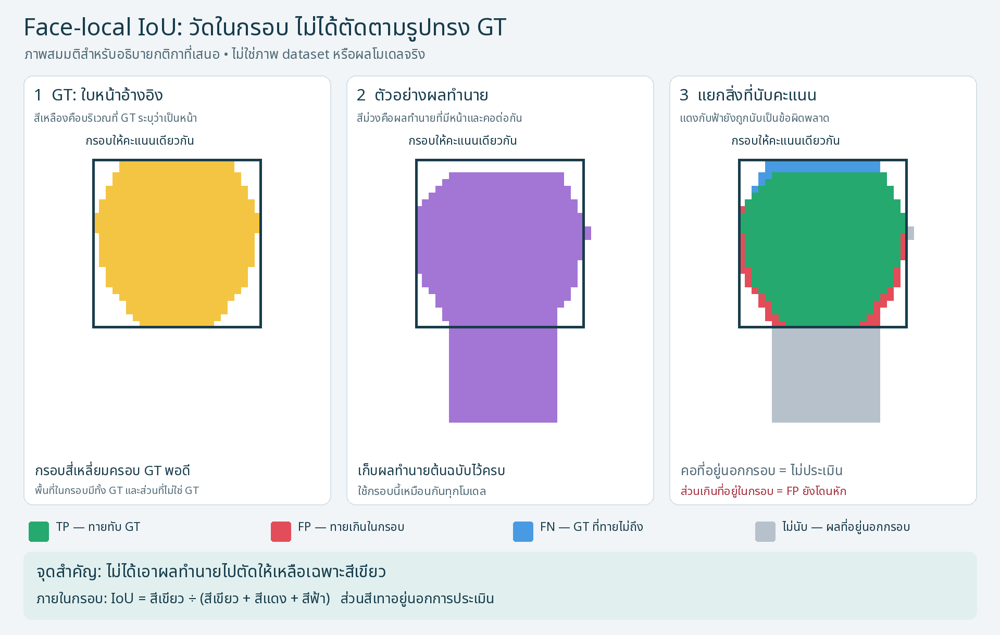

# ตรวจความเทียบกันได้ของ CIHP และ CCTV 90 ภาพ

<!-- SHARED_REFERENCE_CURRENT_START -->

## ผลล่าสุด: สามคลาสหลัก + Face-local — 2026-11-08T16:07:36.763806+07:00

**COMPLETE** — run `shared-c3-face-local-20261108T083533Z`. ใช้ saved predictions ของ controlled YOLO person-ROI ทั้งเก้า checkpoints; **ไม่มี inference ใหม่**. ผล CIHP/CCTV อยู่คนละตารางและไม่รวมเป็นคะแนนเดียว. กติกาใหม่ตรึงก่อนคำนวณ แต่จัดทำหลังเห็นผลเดิมแล้ว จึงเป็นการวิเคราะห์ exploratory ไม่ใช่ preregistered confirmation.

### นิยามที่ใช้อธิบายร่วมกัน

**สามคลาสหลัก:** วัด IoU ของส่วน Hair/Upper/Lower ของ GT แต่ละคนที่มี annotation แล้วเฉลี่ยภายในคลาส จากนั้นเฉลี่ยสามคลาสเท่ากัน เรียก **mIoU3 (part-mean)**. ตัวนี้ไม่ใช่ global C3 เดิม และไม่ใช่ full-scene semantic mIoU. ขอบเขตที่ส่งออกของโมเดลยังเป็น native classes ทั้งหมด; Upper/Lower projection ไม่รวม Dress/Apparel.

**Face-local:** รวม Face ของ CIHP หรือ Face_Neck+รายละเอียดใบหน้าของ Sapiens เป็น face candidate แล้วคิด IoU ภายในกรอบสี่เหลี่ยมครอบ GT Face พอดี ใช้กรอบเดียวกันทุกโมเดลในคน/ภาพเดียวกัน ไม่มี margin. **ภายในกรอบส่วนเกินยังเป็น FP; GT ที่ทายขาดเป็น FN; นอกกรอบไม่ประเมิน**. เฉลี่ยราย GT Face ที่มีสิทธิ์ทุกคน รวมคนที่ระบบพลาดเป็นศูนย์ ไม่ได้ตัด prediction ตามรูปทรง GT.

กรอบ Face GT ใช้หลังจากได้ saved prediction แล้วสำหรับให้คะแนนเท่านั้น ไม่ได้ใช้เปลี่ยน input/crop หรือช่วยโมเดลสร้าง prediction. เก็บ output หน้าและคอต้นฉบับไว้ครบ.

จับคู่คนแบบหนึ่งต่อหนึ่งด้วย mask IoU ตั้งแต่ 0.50 ขึ้นไป: เลือกให้จับคู่ได้มากที่สุดก่อน จากนั้นเลือกผลรวม IoU สูงสุด และใช้ลำดับจากรูปทรง mask ตัดสินกรณีเสมอ โดยไม่ใช้ความถูกต้องของคลาสช่วยเลือกคู่ ส่วน threshold 0.75 ใช้รายงานประกอบ ทั้งสองชุดใช้กติกานี้เหมือนกัน ขอบเขตคนสำหรับจับคู่แยกจากพื้นที่พิกเซลที่ให้คะแนนคลาส พื้นที่ GT ที่ระบุเป็น VOID หรือกำกวมเรื่องเจ้าของถูกยกเว้นเหมือนกันทุกโมเดล ไม่มีการยกเว้นคอเฉพาะ Sapiens.

สำหรับ Hair/Upper/Lower ของคนที่จับคู่แล้ว ใช้ prediction ของคนนั้นเทียบ GT ของคนนั้นบนพื้นที่ valid ทั้งภาพ ดังนั้นหากทายคลาสนั้นเกินไปบน OTHER หรือส่วนอื่น จะเป็น FP และหากทาย OTHER บน GT ของคลาสนั้น จะเป็น FN ส่วนคนที่พลาดให้คะแนนศูนย์ ไม่ตัดออกจากตัวหาร การไม่มี GT ของคลาสใดไม่สร้างงานของคลาสนั้น จึงเป็นการวัดส่วนที่มี annotation ไม่ใช่การให้คะแนนทุกพิกเซลทั้งฉาก.

### ประชากรและตัวหารที่อ่านจาก GT จริง

| Dataset | ภาพ/โมเดล | GT persons | Hair parts | Upper parts | Lower parts | Face parts |
|---|---:|---:|---:|---:|---:|---:|
| CIHP | 5,000 | 17,520 | 15,803 | 15,674 | 10,157 | 16,494 |
| CCTV | 90 | 127 | 69 | 120 | 102 | 35 |

CCTV ใช้ annotation 90 ภาพที่ผู้ใช้ตรวจรับ พร้อมการแก้เจ้าของส่วนร่างกายตามหลักฐานเดิม ไม่ใช้ชุดคัดเลือก 269 ส่วนที่ไม่ใช่หน้า/21 ส่วนหน้า หรือกติกายกเว้นคอของรายงานเก่า พื้นที่ GT ที่คนหรือคลาสทับกันอย่างกำกวมเป็น VOID ร่วมกันก่อนคำนวณ ทั้งสอง dataset มีคนและส่วนที่ติดป้ายกำกับต่างกัน จึงเปรียบเทียบโมเดลภายในแต่ละชุด ไม่สรุปว่าคะแนนที่ต่างข้ามชุดเกิดจากสภาพภาพเพียงอย่างเดียว.

### ผลคุณภาพ — หน่วยเปอร์เซ็นต์

เรียง frozen roster ไม่ใช่เรียงอันดับ. ตารางนี้แสดงค่าเฉลี่ยสามคลาสและ Face-local แยกกัน ส่วน Macro4-local ที่ผู้ใช้ขอเพิ่มอยู่ในตารางถัดไป

#### CIHP

| Checkpoint + configuration | Hair IoU | Upper IoU | Lower IoU | mIoU3 part-mean | Face-local IoU | ครบภาพ |
|---|---:|---:|---:|---:|---:|---:|
| QANet | 69.879 | 75.639 | 62.888 | 69.469 | 80.018 | 5,000/5,000 |
| M2FP | 71.051 | 78.079 | 69.519 | 72.883 | 81.423 | 5,000/5,000 |
| D2FP | 69.478 | 76.323 | 67.140 | 70.980 | 79.840 | 5,000/5,000 |
| RP-R-CNN | 64.342 | 72.248 | 59.903 | 65.498 | 76.542 | 5,000/5,000 |
| CPI R50 | 65.544 | 67.376 | 57.344 | 63.421 | 77.233 | 5,000/5,000 |
| CPI ConvNeXt-B | 69.392 | 75.350 | 65.659 | 70.134 | 80.698 | 5,000/5,000 |
| Sapiens2 0.4B | 70.245 | 79.006 | 70.239 | 73.163 | 75.775 | 5,000/5,000 |
| Sapiens2 0.8B | 70.163 | 78.184 | 68.951 | 72.433 | 77.007 | 5,000/5,000 |
| Sapiens2 1B | 69.360 | 76.801 | 71.457 | 72.539 | 75.205 | 5,000/5,000 |

**คะแนนสูงสุดในชุดนี้:** Hair: M2FP (71.051%, ต่างอันดับสอง 0.805 pp); Upper: Sapiens2 0.4B (79.006%, ต่างอันดับสอง 0.822 pp); Lower: Sapiens2 1B (71.457%, ต่างอันดับสอง 1.218 pp); mIoU3 (part-mean): Sapiens2 0.4B (73.163%, ต่างอันดับสอง 0.280 pp); Face-local: M2FP (81.423%, ต่างอันดับสอง 0.726 pp).

#### CCTV

| Checkpoint + configuration | Hair IoU | Upper IoU | Lower IoU | mIoU3 part-mean | Face-local IoU | ครบภาพ |
|---|---:|---:|---:|---:|---:|---:|
| QANet | 56.788 | 66.083 | 56.905 | 59.925 | 61.813 | 90/90 |
| M2FP | 44.413 | 53.519 | 46.249 | 48.061 | 46.095 | 90/90 |
| D2FP | 45.184 | 47.820 | 41.053 | 44.686 | 49.550 | 90/90 |
| RP-R-CNN | 41.571 | 48.570 | 42.766 | 44.302 | 45.173 | 90/90 |
| CPI R50 | 38.460 | 37.882 | 36.382 | 37.575 | 46.295 | 90/90 |
| CPI ConvNeXt-B | 56.275 | 50.917 | 45.959 | 51.050 | 60.603 | 90/90 |
| Sapiens2 0.4B | 61.497 | 59.366 | 53.103 | 57.989 | 62.957 | 90/90 |
| Sapiens2 0.8B | 57.699 | 56.881 | 54.731 | 56.437 | 66.148 | 90/90 |
| Sapiens2 1B | 62.394 | 63.744 | 59.281 | 61.806 | 69.497 | 90/90 |

**คะแนนสูงสุดในชุดนี้:** Hair: Sapiens2 1B (62.394%, ต่างอันดับสอง 0.897 pp); Upper: QANet (66.083%, ต่างอันดับสอง 2.339 pp); Lower: Sapiens2 1B (59.281%, ต่างอันดับสอง 2.376 pp); mIoU3 (part-mean): Sapiens2 1B (61.806%, ต่างอันดับสอง 1.881 pp); Face-local: Sapiens2 1B (69.497%, ต่างอันดับสอง 3.348 pp).

### การจับคู่คน — diagnostic ของ GT reference และ YOLO extents

คะแนน IoU รายส่วนไม่ลงโทษคนที่ทำนายเกินแต่จับคู่ GT ไม่ได้โดยตรง จึงต้องอ่าน TP/FP/FN ของการจับคู่ประกอบ ตัวเลขส่วนนี้สะท้อน YOLO extents ที่ตรึงไว้ ไม่ใช่ความสามารถแยก instance โดยตัว parser เอง สำหรับ CCTV คนที่ทำนายแต่ไม่มีคู่ GT อาจเป็นคนที่ไม่ได้ annotate จึงใช้เป็น diagnostic ภายใต้ GT ที่มี ไม่ใช่ precision ของการตรวจจับคนทั้งฉาก.

| Dataset | Model | threshold | TP | FP | FN | F1 % |
|---|---|---:|---:|---:|---:|---:|
| CIHP | QANet | 0.5 | 16,906 | 7,156 | 614 | 81.314 |
| CIHP | QANet | 0.75 | 15,304 | 8,758 | 2,216 | 73.609 |
| CIHP | M2FP | 0.5 | 16,906 | 7,156 | 614 | 81.314 |
| CIHP | M2FP | 0.75 | 15,304 | 8,758 | 2,216 | 73.609 |
| CIHP | D2FP | 0.5 | 16,906 | 7,156 | 614 | 81.314 |
| CIHP | D2FP | 0.75 | 15,304 | 8,758 | 2,216 | 73.609 |
| CIHP | RP-R-CNN | 0.5 | 16,906 | 7,156 | 614 | 81.314 |
| CIHP | RP-R-CNN | 0.75 | 15,304 | 8,758 | 2,216 | 73.609 |
| CIHP | CPI R50 | 0.5 | 16,906 | 7,156 | 614 | 81.314 |
| CIHP | CPI R50 | 0.75 | 15,304 | 8,758 | 2,216 | 73.609 |
| CIHP | CPI ConvNeXt-B | 0.5 | 16,906 | 7,156 | 614 | 81.314 |
| CIHP | CPI ConvNeXt-B | 0.75 | 15,304 | 8,758 | 2,216 | 73.609 |
| CIHP | Sapiens2 0.4B | 0.5 | 16,906 | 7,156 | 614 | 81.314 |
| CIHP | Sapiens2 0.4B | 0.75 | 15,304 | 8,758 | 2,216 | 73.609 |
| CIHP | Sapiens2 0.8B | 0.5 | 16,906 | 7,156 | 614 | 81.314 |
| CIHP | Sapiens2 0.8B | 0.75 | 15,304 | 8,758 | 2,216 | 73.609 |
| CIHP | Sapiens2 1B | 0.5 | 16,906 | 7,156 | 614 | 81.314 |
| CIHP | Sapiens2 1B | 0.75 | 15,304 | 8,758 | 2,216 | 73.609 |
| CCTV | QANet | 0.5 | 104 | 26 | 23 | 80.934 |
| CCTV | QANet | 0.75 | 82 | 48 | 45 | 63.813 |
| CCTV | M2FP | 0.5 | 104 | 26 | 23 | 80.934 |
| CCTV | M2FP | 0.75 | 82 | 48 | 45 | 63.813 |
| CCTV | D2FP | 0.5 | 104 | 26 | 23 | 80.934 |
| CCTV | D2FP | 0.75 | 82 | 48 | 45 | 63.813 |
| CCTV | RP-R-CNN | 0.5 | 104 | 26 | 23 | 80.934 |
| CCTV | RP-R-CNN | 0.75 | 82 | 48 | 45 | 63.813 |
| CCTV | CPI R50 | 0.5 | 104 | 26 | 23 | 80.934 |
| CCTV | CPI R50 | 0.75 | 82 | 48 | 45 | 63.813 |
| CCTV | CPI ConvNeXt-B | 0.5 | 104 | 26 | 23 | 80.934 |
| CCTV | CPI ConvNeXt-B | 0.75 | 82 | 48 | 45 | 63.813 |
| CCTV | Sapiens2 0.4B | 0.5 | 104 | 26 | 23 | 80.934 |
| CCTV | Sapiens2 0.4B | 0.75 | 82 | 48 | 45 | 63.813 |
| CCTV | Sapiens2 0.8B | 0.5 | 104 | 26 | 23 | 80.934 |
| CCTV | Sapiens2 0.8B | 0.75 | 82 | 48 | 45 | 63.813 |
| CCTV | Sapiens2 1B | 0.5 | 104 | 26 | 23 | 80.934 |
| CCTV | Sapiens2 1B | 0.75 | 82 | 48 | 45 | 63.813 |

### สูตร วิธีอ่าน และไฟล์ตรวจตัวเลข

- **IoU ต่อส่วน = TP/(TP+FP+FN)**: TP คือพิกเซลที่ทายถูก, FP คือทายเกิน, FN คือ GT ที่ทายขาด ค่า mean-part IoU ให้แต่ละส่วนของแต่ละคนมีน้ำหนักเท่ากัน ส่วน pooled IoU รวมพิกเซลของทุกส่วนก่อนหาร จึงให้น้ำหนักส่วนขนาดใหญ่มากกว่า.
- **Precision = TP/(TP+FP)** บอกว่าที่ทายมาถูกเท่าไร; **Recall = TP/(TP+FN)** บอกว่าเก็บ GT ได้ครบเท่าไร; **F1/Dice = 2TP/(2TP+FP+FN)** สรุปทั้งการทายเกินและทายขาด P/R/F1 ใน CSV รวมจำนวนพิกเซลจากงานรายส่วนก่อนคำนวณ ไม่ใช่แปลงจาก mean IoU และไม่ใช่คะแนนทั้งฉาก.
- ประเมินเฉพาะคน–คลาสที่มี GT ของคลาสนั้น ถ้าไม่มี polygon จะไม่ถือว่าเป็นส่วนที่ยืนยันว่าไม่มี และไม่สร้างงาน negative เพิ่ม หากไม่มีส่วนที่มีสิทธิ์เลย คะแนนเป็น รวมใน adapter ส่วนที่มี GT แต่จับคู่คนไม่ได้ให้ IoU = 0 คลาส Dress/Apparel ที่รู้จักเป็น OTHER; prediction ID ที่ไม่รู้จักหรือ 255 เป็น output ผิดข้อกำหนด ไม่ใช่ ignore.
- ช่องว่างใน CSV หมายถึง รวมใน adapter เช่น ไม่มีตัวหารหรือประเมินไม่ครบ ไม่ใช่คะแนน 0 ส่วน JSON เก็บ รวมใน adapter โดยตรง.
- [ตารางสรุปก่อนปัดเศษ](../metrics/SHARED_REFERENCE_SUMMARY.csv), [TP/FP/FN, support, union และ P/R/F1 ครบ 72 รายการ](../metrics/SHARED_REFERENCE_TARGET_COUNTS.csv), [ผลรวม canonical และแหล่งที่มา](SHARED_REFERENCE_RESULT_INDEX.json), [ข้อกำหนดที่ตรึงไว้](../protocol/SHARED_C3_FACE_LOCAL_V1.json).

### การตรวจและข้อจำกัด

ผ่าน CPU acceptance 13 กรณี โดยใช้ผลคาดหวังจากตัวอย่างขนาดเล็กที่คำนวณแยกจาก implementation และทดสอบเส้นทาง packet → scorer → reporter ตรวจ saved packets จริงของ CIHP ทั้ง 9 โมเดลบนภาพเดียวกัน และจำนวน TP/FP/FN ของ C3 ตรงกับ scorer เดิม ตรวจ CCTV 63 รายการก่อนรันเต็ม และทดสอบ resume โดยรักษา 63 รายการเดิมแล้วเพิ่ม 9 รายการโดยไม่ซ้ำ งานเต็มใช้ SQLite ที่บังคับ dataset/model/image ไม่ซ้ำ บันทึกแต่ละภาพแบบ atomic และเก็บประวัติเหตุการณ์พร้อม source/protocol hashes ผล CPU ฉบับละเอียดเก็บเป็น private ที่ `Human_Parsing_Benchmark/outputs/shared-c3-face-local-20261108T083533Z/`.

STRICT_COMPLETE ตรวจว่าแต่ละ checkpoint มี CIHP ครบ 5,000 IDs และ CCTV ครบ 90 IDs ตรงประชากรโดยไม่ซ้ำ คะแนนหลักเป็น รวมใน adapter หากขาด ซ้ำ หรือมี failure ไม่ใช้ subset แทนชุดเต็มและไม่เลือก output จากคะแนนที่ดีที่สุด ประวัติ OOM, interruption และ time guard ของ inference เดิมยังอยู่ครบ การประเมินบน CPU สำเร็จไม่ได้หมายความว่าไม่เคยเกิดข้อผิดพลาดมาก่อน.

Face-local ไม่ลงโทษผลเกินนอกกรอบ จึงไม่ใช่ Face IoU ทั้งภาพ หรือหลักฐานว่าแยกหน้าออกจากคอได้สมบูรณ์ แม้ใช้วิธีให้คะแนนเดียวกัน ขอบเขต Face/Face_Neck ตาม annotation ยังต่างกันได้ GT ของ CCTV เป็น reference ที่ผู้ใช้ตรวจรับและมีเครื่องมือโมเดลช่วยจัดทำ ไม่ใช่ชุด gold standard ที่ผู้เชี่ยวชาญอิสระตรวจรับ การไม่มี annotation ไม่ทำให้พื้นที่นั้นกลายเป็น background ที่ยืนยันแล้ว.

CCTV ใช้ป้าย Upper/Lower ที่ผู้ใช้ตรวจรับเป็น reference ไม่อนุมานจากชื่อคลาสใน metadata ว่าทุก polygon แยก Dress/ผิวหนังเหมือน CIHP ทุกพิกเซล การแปลง prediction ไม่รวม Dress/Apparel เข้า Upper/Lower และเก็บเป็น OTHER ตามเดิม ไม่มี ignore เฉพาะโมเดลเพื่อช่วยคะแนน แม้ใช้แหล่ง ROI และ scorer ร่วมกัน การ resize/decoder และ implementation revision ยังเป็นคุณสมบัติของแต่ละ configuration.

ผลนี้เปรียบเทียบ pretrained checkpoint พร้อม application configuration บนแต่ละ dataset ไม่สามารถแยกผลของ architecture, ข้อมูลฝึก และ adapter ออกจากกันทั้งหมด ไม่อ้างนัยสำคัญทางสถิติ ความพร้อม deploy หรือความแม่นของงานสี ผล native/C4/global C3 และ Face-domain ของ CCTV เดิมยังเก็บเป็นประวัติ ไม่เปลี่ยนชื่อให้เป็นคะแนนใหม่นี้ และไม่ใช้ timing เดิมหรือเวลาประเมินบน CPU จัดอันดับ latency/FPS/ประสิทธิภาพ VRAM.

### ข้อเสนอสำหรับพรีเซนต์

> เราใช้ YOLO person-ROI pipeline ที่ตรึงไว้ เปรียบเทียบ Hair/Upper/Lower ด้วยค่าเฉลี่ย IoU รายส่วน และวัด Face แยกด้วย IoU ภายในกรอบ Face GT เดียวกันทุกโมเดล โดยใช้กติกาเดียวกันใน CIHP และ CCTV.

อ่านคะแนนราย target และค่าเฉลี่ยสามคลาสประกอบ Macro4-local ที่เพิ่มตามคำขอผู้ใช้ เพื่อพิจารณา configuration ตามเป้าหมายงาน

<!-- FOUR_TARGET_RUNTIME_START -->

## ค่าเฉลี่ยสี่คลาสและเวลาจากการรันที่บันทึกไว้

เพิ่มตามคำขอผู้ใช้เมื่อ 2026-11-09T17:19:03.944519+07:00 โดยใช้คะแนนและ timing ที่บันทึกแล้ว

**Macro4-local = (Hair mean-part IoU + Face-local IoU + Upper mean-part IoU + Lower mean-part IoU) ÷ 4** แต่ละคลาสมีน้ำหนัก 25% คำนวณจากค่าก่อนปัดเศษ โดย Face ใช้พื้นที่ภายในกรอบ GT Face ส่วนอีกสามคลาสใช้พื้นที่ valid ของงานรายส่วน ผลรวมนี้สรุปคุณภาพสี่ target ตามขอบเขตดังกล่าว ผู้ใช้ขอเพิ่มค่าเฉลี่ยหลังเห็นผลแล้ว จึงบันทึกเป็น derived summary แยกจาก primary mIoU3 ที่ตรึงไว้

| Dataset | โมเดล | Hair % | Face-local % | Upper % | Lower % | Macro4-local % |
|---|---|---:|---:|---:|---:|---:|
| CIHP | QANet | 69.879 | 80.018 | 75.639 | 62.888 | 72.106 |
| CIHP | M2FP | 71.051 | 81.423 | 78.079 | 69.519 | 75.018 |
| CIHP | D2FP | 69.478 | 79.840 | 76.323 | 67.140 | 73.195 |
| CIHP | RP-R-CNN | 64.342 | 76.542 | 72.248 | 59.903 | 68.259 |
| CIHP | CPI R50 | 65.544 | 77.233 | 67.376 | 57.344 | 66.874 |
| CIHP | CPI ConvNeXt-B | 69.392 | 80.698 | 75.350 | 65.659 | 72.775 |
| CIHP | Sapiens2 0.4B | 70.245 | 75.775 | 79.006 | 70.239 | 73.816 |
| CIHP | Sapiens2 0.8B | 70.163 | 77.007 | 78.184 | 68.951 | 73.576 |
| CIHP | Sapiens2 1B | 69.360 | 75.205 | 76.801 | 71.457 | 73.206 |
| CCTV | QANet | 56.788 | 61.813 | 66.083 | 56.905 | 60.397 |
| CCTV | M2FP | 44.413 | 46.095 | 53.519 | 46.249 | 47.569 |
| CCTV | D2FP | 45.184 | 49.550 | 47.820 | 41.053 | 45.902 |
| CCTV | RP-R-CNN | 41.571 | 45.173 | 48.570 | 42.766 | 44.520 |
| CCTV | CPI R50 | 38.460 | 46.295 | 37.882 | 36.382 | 39.755 |
| CCTV | CPI ConvNeXt-B | 56.275 | 60.603 | 50.917 | 45.959 | 53.438 |
| CCTV | Sapiens2 0.4B | 61.497 | 62.957 | 59.366 | 53.103 | 59.231 |
| CCTV | Sapiens2 0.8B | 57.699 | 66.148 | 56.881 | 54.731 | 58.865 |
| CCTV | Sapiens2 1B | 62.394 | 69.497 | 63.744 | 59.281 | 63.729 |

ค่าเฉลี่ยสี่คลาสสูงสุดใน CIHP คือ M2FP 75.018% และใน CCTV คือ Sapiens2 1B 63.729%

### เวลาต่อภาพและเวลารวม

ROI คือภาพย่อยของบุคคลหนึ่งรายการ เวลา parsing ต่อภาพได้จากผลรวม adapter ของทุก ROI ในภาพนั้น ค่าเฉลี่ยต่อภาพทั้งชุดนำผลรวมนี้หารจำนวนภาพ รวมภาพที่ YOLO ให้ศูนย์ ROI ซึ่งมีเวลาเรียก parser เท่ากับศูนย์ ส่วนภาพที่มี ROI แต่ขาด timer เก็บเป็น รวมใน adapter แต่ละ call ทำนาย native classes พร้อมกัน แล้วจึงแปลงเป็นสี่ target จึงมีเวลารวมต่อ ROI

| Dataset | โมเดล | บัญชีช่วงเวลาที่บันทึก s/ภาพ | รวมช่วงที่บันทึก s | ภาพครบ | ROI ครบ |
|---|---|---:|---:|---:|---:|
| CIHP | QANet | 0.352 | 1761.300 | 5,000/5,000 | 24,062/24,062 |
| CIHP | M2FP | 1.038 | 5188.312 | 5,000/5,000 | 24,062/24,062 |
| CIHP | D2FP | 3.067 | 15333.696 | 5,000/5,000 | 24,062/24,062 |
| CIHP | RP-R-CNN | 1.095 | 5475.890 | 5,000/5,000 | 24,062/24,062 |
| CIHP | CPI R50 | 10.178 | 50891.941 | 5,000/5,000 | 24,062/24,062 |
| CIHP | CPI ConvNeXt-B | 2.974 | 14868.420 | 5,000/5,000 | 24,062/24,062 |
| CIHP | Sapiens2 0.4B | 6.742 | 33710.728 | 5,000/5,000 | 24,062/24,062 |
| CIHP | Sapiens2 0.8B | 13.927 | 69632.749 | 5,000/5,000 | 24,062/24,062 |
| CIHP | Sapiens2 1B | 19.976 | 99879.530 | 5,000/5,000 | 24,062/24,062 |
| CCTV | QANet | 0.110 | 9.922 | 90/90 | 130/130 |
| CCTV | M2FP | 0.318 | 28.624 | 90/90 | 130/130 |
| CCTV | D2FP | 1.004 | 90.335 | 90/90 | 130/130 |
| CCTV | RP-R-CNN | 0.328 | 29.482 | 90/90 | 130/130 |
| CCTV | CPI R50 | 4.325 | 389.287 | 90/90 | 130/130 |
| CCTV | CPI ConvNeXt-B | 0.709 | 63.779 | 90/90 | 130/130 |
| CCTV | Sapiens2 0.4B | 2.000 | 180.012 | 90/90 | 130/130 |
| CCTV | Sapiens2 0.8B | 4.162 | 374.585 | 90/90 | 130/130 |
| CCTV | Sapiens2 1B | 5.917 | 532.486 | 90/90 | 130/130 |

**การรวมเวลาเดิมของ Sapiens** ตรวจจับคู่ logs กับ accepted packet metadata/geometry แล้วพบเวลาอีก 15 ROI ต่อขนาด จึงรวมกับ 115 ROI รอบหลังได้ครบ 130 ROI ใน 90 ภาพ ตารางนี้เป็นบัญชีผลรวมช่วงเวลาที่มีบันทึก โดยแบ่งขอบเขต A เป็น adapter รอบหลัก, B เป็น event interval ของ continuation และ C เป็น FORWARD event ของรอบเดิม C มี preprocessing และ map-back อยู่ภายนอกช่วง ค่ารวม A+B+C จึงสะท้อนต้นทุนช่วงที่จับเวลาได้จากทั้งสามกลุ่ม

สำหรับ Sapiens เวลา adapter ที่วัดครบ 84 ภาพยังมีค่าเฉลี่ย 1.931/4.001/5.672 วินาทีต่อภาพ ส่วนตัวเลข 2.000/4.162/5.917 ในตารางใช้ผลรวมช่วง A+C หาร 90 ภาพ ทั้งสองค่าใช้ขอบเขตและตัวหารต่างกัน

CIHP ใช้ synchronized adapter_total จาก FRAME_COMMITTED ของ accepted segments จับเวลาด้วยนาฬิกาวัดระยะเวลาและรอ CUDA ที่ขอบ span ตรวจเวลาได้ครบ 5,000 ภาพและ 24,062 ROI ต่อโมเดล โดยใช้เฉพาะ frame record ที่ผูกกับ accepted packet ของภาพนั้น ผลรวมนี้นับช่วง adapter ที่สำเร็จของแต่ละ ROI หนึ่งครั้ง

CCTV ใช้สถิติ runtime ที่ตรวจรับเดิม เวลา A จับรอบ adapter ด้วยนาฬิกาวัดระยะเวลา เวลา B ใช้ event จบลบ event เริ่มของ continuation ซึ่งรวมการรอ GPU และการเขียน resource log ด้วย ผลรวม A+B ใช้เป็นบัญชีช่วงเวลาที่บันทึกได้ Sapiens นำผลเดิม 15 ROI จาก 6 ภาพกลับมาใช้ โดยแสดง original forward intervals เป็นกลุ่ม C แยกจาก adapter กลุ่ม A

ภายใน adapter รวม preprocessing การส่งข้อมูล การคำนวณโมเดล และ map-back ตาม implementation ของแต่ละตัว CPI รวม native file I/O ด้วย ช่วงนี้อยู่หลัง YOLO cache/crop ที่ใช้ร่วมกัน ขั้นนำ mask ไปวางบนภาพ กำหนด ownership ส่งออก packet ให้คะแนน และสกัดสีอยู่ภายนอก adapter การใช้ GPU ร่วมและหลาย segments มีผลต่อเวลาที่สังเกต จึงรายงานเป็น timing diagnostics

### รายละเอียดช่วงเวลาที่ CIHP บันทึกได้

แต่ละช่องแสดงค่าเฉลี่ย ms ต่อ ROI ที่มี timer ของช่วงนั้น พร้อมจำนวน ROI ในวงเล็บ ช่วงย่อยอยู่ภายใน adapter_total และบางช่วงซ้อนกัน ตารางคงช่วง native call แบบ inclusive ตามที่ instrument ไว้

| โมเดล | เตรียม input | native call หรือ backbone+head | map-back | adapter รวม |
|---|---:|---:|---:|---:|
| QANet | 6.515 (24,062) | 63.661 (24,062) + 1.253 (24,062) | 0.810 (24,062) | 73.198 (24,062) |
| M2FP | รวมใน adapter | 204.595 (24,062) | รวมใน adapter | 215.623 (24,062) |
| D2FP | รวมใน adapter | 626.132 (24,062) | รวมใน adapter | 637.258 (24,062) |
| RP-R-CNN | รวมใน adapter | รวมใน adapter | รวมใน adapter | 227.574 (24,062) |
| CPI R50 | รวมใน adapter | 1499.411 (24,062) | รวมใน adapter | 2115.034 (24,062) |
| CPI ConvNeXt-B | รวมใน adapter | 477.133 (24,062) | รวมใน adapter | 617.921 (24,062) |
| Sapiens2 0.4B | 43.344 (24,062) | 1354.472 (24,062) | 2.795 (24,062) | 1400.994 (24,062) |
| Sapiens2 0.8B | 23.399 (24,062) | 2867.349 (24,062) | 2.773 (24,062) | 2893.889 (24,062) |
| Sapiens2 1B | 23.357 (24,062) | 4124.412 (24,062) | 2.781 (24,062) | 4150.924 (24,062) |

[ขอบเขตเวลาและบัญชี worker ของ CCTV](../../CCTV_Human_Parsing_Benchmark/reports/CONTROLLED_ROI_FOUR_TARGET_RESULTS_TH.md#ความเร็วและเวลาประมวลผลจาก-log-เดิม) · [การจับเวลา CIHP](../src/controlled_ci_hp/measurement.py) · [จุดบันทึกต่อภาพ](../scripts/controlled_cihp.py)

ไฟล์ aggregate index เก็บ hash ของ ledgers และผลสรุปแยกตาม stage ส่วน summary CSV เพิ่ม Macro4-local และเวลาต่อภาพพร้อม coverage ให้ตรวจค่าก่อนปัดเศษได้

<!-- FOUR_TARGET_RUNTIME_END -->

<!-- CURRENT_CONFUSION_NAVIGATION -->

## Confusion matrix และข้อมูลรายคลาสล่าสุด

ตรวจครบเมื่อ 2026-11-09T17:40:23.483262+07:00 โดยใช้สถิติจาก shared-reference run เดียวกับคะแนนด้านบน มี binary confusion ครบ 72 ชุดย่อย พร้อม Precision/Recall/F1, จำนวนส่วนที่ไม่ทับ GT, raw counts, person matching, timing และ source bindings รายงานราย dataset ใช้หัวข้อและคอลัมน์เดียวกัน

- [CIHP เก้าโมเดล พร้อม 36 matrices](CIHP_COMMON_NINE_RESULTS_TH.md#confusion-matrix-และความครบของแต่ละส่วน)
- [CCTV เก้าโมเดล พร้อม 36 matrices](../../CCTV_Human_Parsing_Benchmark/reports/CONTROLLED_ROI_FOUR_TARGET_RESULTS_TH.md#confusion-matrix-และความครบของแต่ละส่วน)

CSV ราย target เพิ่ม TN, valid-task pixels และจำนวนส่วนที่พลาด โดยคงค่าคะแนนเดิมไว้ครบ พื้นที่ Face-local และ GT-positive person-part ของแต่ละ target เป็น domain อ้างอิงของตัวเลขเหล่านี้

<!-- SHARED_REFERENCE_CURRENT_END -->

## ประวัติการตรวจและข้อเสนอก่อนรอบ shared view (historical)

## แก้ปัญหาเปิด HTML แล้วไม่เห็นข้อมูล — 2026-11-08T02:33:44.406474+07:00

**OFFLINE_VIEWER_VERIFIED / GT_UNCHANGED**. ผู้ใช้รายงานว่าHTMLไม่มีข้อมูล. ตรวจพบว่า `index.html` เดิมมีannotation90recordsจริง แต่ภาพอ้างrelativepathsไปdatasetบนserver และเมนูสร้างด้วยJavaScript. การย้ายไฟล์HTMLเดี่ยวๆหรือดูในpreviewที่ไม่รันสคริปต์จึงไม่ใช่เส้นทางเปิดที่รับรองไว้ การตรวจบนserverก่อนหน้ายังไม่ทดสอบสถานการณ์ผู้ใช้ย้ายไฟล์นี้

แก้ด้วย [export_master_review_offline.py](../../CCTV_Human_Parsing_Benchmark/scripts/export_master_review_offline.py) ซึ่งสร้างไฟล์ใหม่ `outputs/master-gt-repair-20261107T191020Z/review_offline.html` ภายใต้CCTVbenchmark. ฝังrasterpreviewก่อน–หลัง90ภาพรวม184JPEGและfontไทยไว้ในHTMLเดียว ไม่มีscript/SVG/URLภาพภายนอก. ใช้HTMLdetailsเปิด–ปิดภาพโดยไม่พึ่งJavaScript และมีcropขยายสองownerrepairs. เก็บ `index.html` เดิมไว้ครบ. ไฟล์ประมาณ59.2MiBควรดาวน์โหลดแล้วเปิดChrome/Edge/Firefox ไม่พึ่งpreviewของแชท

มี `owner_repairs_before_after.jpg` สำหรับเปิดสองจุดที่แก้แบบภาพโดยตรง. รูปทั้งหมดเป็นprivateartifacts ไม่ขึ้นpublicGit. รูปพรีวิวลดด้านยาวไม่เกิน1280px/JPEGquality84เพื่อดู ไม่ใช่maskสำหรับประเมิน; annotation/GTpackets/COMPLETIONและผลเดิมไม่เปลี่ยน

**ตรวจรับจริง:** คัดลอกเฉพาะHTMLไปfresh temp directoryที่ไม่มีdatasetหรือassets, เปิดChromiumโดยJavaScriptdisabledและnetworkoffline:90details/184embeddedimages/0scripts/0externalimageURLs; เปิด–ปิดหัวข้อได้และภาพของทั้งoriginal/editedpanelsโหลดจริง ไม่มีpageerrors. อ่าน184JPEGกลับผ่านทุกภาพ และตรวจ90ชุดGTpacket/annotation/personPNG hashesคงเดิม. Fontไทยอยู่ในไฟล์ ไม่ต้องติดตั้งหรือdownloadเพิ่มเติม. [หลักฐานรวม](../../CCTV_Human_Parsing_Benchmark/reports/ADDED_ANNOTATION_INTAKE.json) ส่วนoffline_viewer

ขั้นตอนผู้ใช้: ดาวน์โหลดreview_offline.htmlแล้วเปิดด้วยbrowser;หากต้องการดูตัวอย่างทันทีให้เปิดJPGข้างต้น. สถานะGTยังMECHANICAL_REPAIR_COMPLETE_REVIEW_PENDING ไม่ใช่scoringready. ไม่มีinference/GTrepairเพิ่มเติม/scoringหรือการเปิดwebservice/เปลี่ยนBodyExtractionappในงานแก้viewerนี้

## บันทึกก่อนแก้เส้นทางเปิด viewer (historical)

## แก้ mask ฉบับอนุพันธ์ให้แล้ว — 2026-11-08T02:17:50.448008+07:00

**MECHANICAL_REPAIR_COMPLETE / COVERAGE_REVIEW_PENDING / SCORING_NOT_READY**. ผู้ใช้ขอให้จัดการmaskให้ จึงเพิ่มเครื่องมือสร้างGTฉบับอนุพันธ์และส่งออกจริงจากMasterครบ90ภาพ โดยไม่ทับsource. สถานะนี้หมายถึงแก้เจ้าของที่ยืนยันแล้วและทำrepresentationให้ตรวจสอบได้ ไม่ใช่การรับรองGTทุกพิกเซลหรือผลคะแนนใหม่

| งานที่ทำจริง | ผล |
|---|---|
| แก้ownerจากหลักฐานเดิม | 2polygons: Face p2→p1 และLower p2→p1; labels/verticesคงเดิม |
| ตรวจกรณีผิดเดิมอย่างอิสระ | 7,495พิกเซลที่PNGเดิมให้person2แต่polygonให้person1 ตอนนี้เป็นperson1ทุกพิกเซล |
| ส่งออกฉบับแก้ | 90annotationJSON,90personPNG,90atomicNPZ;127person groupsและ326person-target parts |
| อ่านไฟล์กลับ | ทุกarray/PNGตรงกับค่าที่สร้าง; imagePathของJSON90ไฟล์เปิดไปRGBเดิมได้ |
| ป้องกันGTปลอมจากส่วนที่ไม่มีข้อมูล | ไม่เติมBG/OTHER;182จาก508คน–คลาสtasksที่ไม่มีpolygonยังเป็นUNKNOWN |
| ป้องกันoverlapถูกตัดสินเงียบ | เก็บทุกperson extentแยกplane; PNGใช้255เมื่อคนทับกัน รวม3,365พิกเซล ไม่ใช้IDใหญ่/เล็กเป็นผู้ชนะ |
| ความไม่ตรงระหว่างcontours | เก็บ262partsที่มีบางพิกเซลนอกraw person polygonsรวม5,582พิกเซลเป็นรายการตรวจ ไม่clippartหรือขยายตัวคนอัตโนมัติ |
| ป้องกันmetadataถูกใช้เกินหลักฐาน | เก็บรายการCIHPที่sourceอ้างไว้เป็นsource_claimed_cihp_equivalent_classesและNOT_CERTIFIED;ไม่ประกาศUpper/Faceequivalentจากชื่อคลาส |

**ตำแหน่งใช้งาน:** `CCTV_Human_Parsing_Benchmark/outputs/master-gt-repair-20261107T191020Z/`. เปิด `index.html` ดูก่อน–หลังได้ทั้ง90ภาพ; `Annotations_Reviewed/` เป็นJSONฉบับแก้สำหรับโปรแกรมannotation, `Full_Person_ids/` เป็นbitmapฉบับcandidate, `packets/` เก็บextentsและpartsแยกคน. มี `README_TH.md`, `REVIEW_QUEUE.csv` และ `GEOMETRY_REVIEW.json` อธิบายสิ่งที่ต้องตรวจต่อ. ไม่ต้องแทนไฟล์ในMasterเพื่อเปิดฉบับแก้นี้. Viewerใช้RGBเดิมผ่านrelativepath จึงไม่ใช่ZIPที่ย้ายHTMLไปเครื่องอื่นเดี่ยวๆแล้วมีภาพครบ

เครื่องมือใหม่ [prepare_master_gt_revision.py](../../CCTV_Human_Parsing_Benchmark/scripts/prepare_master_gt_revision.py) แยกจากnative/common evaluatorและไม่อ่านpredictionของparser. ตรวจsourcecanonical/RGBhashesก่อนนำownerfixเก่ามาใช้;จับpolygonด้วยlabel+verticesที่ตรงกันเพียงหนึ่งรายการ ไม่ใช้กล่องใกล้ที่สุดหรือคะแนนโมเดลเลือกowner. กติกาrasterคือOpenCVfillPolyโดยfloat→int32แบบtruncateตามsemantic exporterเดิม;กำหนดcoordinatesชนขอบW/Hและoverlapอย่างเปิดเผย. Person masksใช้unionของperson componentsของคนเดียวกัน;ไม่มีbboxfill ไม่มีการเอาsemanticpartsไปเติมextentเงียบๆ

ตัวเลข5,582พิกเซลกับ117พิกเซลในintakeก่อนหน้าเปรียบเทียบคนละrepresentation/renderer: รอบนี้เทียบcorrected partsกับraw person polygonsด้วยOpenCV ส่วนเดิมเทียบsourcepartsกับPNGเดิมด้วยPIL. ไม่ใช้ส่วนต่างนี้อ้างว่าความแม่นลดลงหรือเพิ่มขึ้น

**สิ่งที่ตรวจจริง:** [CPU acceptance](../../CCTV_Human_Parsing_Benchmark/tests/test_master_gt_revision.py) ผ่าน8กรณี: ownerfixไม่เปลี่ยนsource/vertices,source driftต้องหยุด,extentแยกจากsemanticและunknownไม่เป็นBG,multiplecomponents/overlap,semanticconflict,partนอกextentไม่ถูกclip,bboxไม่ใช่silhouette,invalidowner/labelต้องfail. Actual90-imageexportตรวจreadback/pathsและ360sourcehashesคงเดิม;protectedscientificfilesหกไฟล์จากintakeคงเดิม. Browserตรวจ90optionsและสองภาพที่แก้จริง โหลดRGBสองpanelผ่าน ไม่มีJSerror;headlessภาพไทยใช้fontเดิมในworkspace ไม่ติดตั้งหรือดาวน์โหลด. ไม่มีinference/GPUmodel callsหรือการคำนวณคะแนน

**สิ่งที่ยังไม่รับรอง:** contour/visible-overlap, coverageครบทุกtargetและคนในverifieddomain, Face-reference/Upper non-Dress semantics, การแยกconfirmed absentออกจากunknown. ข้อมูลprior_selected_part_screenในreviewqueueเป็นbase/non-Face screenเดิม ไม่ใช่ผลadjudicationของFace-reference;ห้ามใช้ค่าfalseนั้นแทนFace exclusionsที่ตรวจรับภายหลัง. GT Face/Neckเดิมยังอยู่และต้องเลือกviewให้ถูกก่อนimport ไม่ตัดคอจากpredictionด้วยGT. ดังนั้น `scoring_ready=false` และ `primary=null`;ผลCCTVเก่าและCIHPcontrolled9/9คงเดิม

**ขั้นถัดไป:** ตรวจรายการgeometry/coverageจากRGBและประวัติQAที่มีอยู่ →freezeGT/domain revisionและextent/semantic-valid contract → targetedCPUactualpacketacceptance →score savedpredictionsทั้งเก้าระบบ. ไม่ต้องinferenceใหม่หากคงYOLO/input/conditioningเดิม. [หลักฐานรวม](../../CCTV_Human_Parsing_Benchmark/reports/ADDED_ANNOTATION_INTAKE.json) มีcounts/sourcehashesและขอบเขตการตรวจ

## การตรวจ intake ก่อนสร้างฉบับแก้ (historical)

## ตรวจ Annotations_Master ที่เพิ่ม person masks — 2026-11-08T01:38:24.419588+07:00

**REVIEW_COMPLETE / GT_REVISION_REQUIRED / PROPOSED_NOT_FROZEN**. ตรวจตามโฟลเดอร์ที่ผู้ใช้ระบุคือ `datasets/CCTV_100_Evaluation/Annotations_Master` โดยตรง ไม่ใช้ dataset ชุดอื่นแทน. **ทำ CCTV ให้ใช้สูตร การจับคู่คน และวิธีเฉลี่ยคะแนนแบบ CIHP ได้มากขึ้น โดยไม่รัน parsing ใหม่ แต่ annotation ที่เพิ่มมายังไม่พร้อมแทน GT ที่ตรวจรับแล้วทันที**. การเพิ่ม person silhouettes ปิดช่องว่างเรื่อง extent; ไม่ได้ยืนยันว่าคลาสของทุกคนครบหรือขอบเขต Face/เสื้อผ้าตรงกับ CIHP แล้ว

### สิ่งที่มีจริงและสิ่งที่ยังเหมือนเดิม

| รายการใน Master | ผลที่ตรวจได้ | ความหมายต่อการประเมิน |
|---|---|---|
| JSON / JPG | 90 / 90 ไฟล์; image membership ตรงกับ frozen CCTV cohort; JPG ทั้ง90ตรงกับ Images แบบ byte-for-byte | ใช้ภาพและ saved prediction cohort เดิมได้ ไม่ต้องเปลี่ยน input |
| person polygons | 133 polygons แทน127 person groups | คนหนึ่งมีหลาย polygon ได้; มี full-person reference ให้เตรียม mask-IoU matching |
| bbox | 127 rectangles | เป็น annotation metadata อ้าง `co_detr_swin_b+sam2.1_hiera_b+`; ไม่ใช่เหตุให้เปลี่ยน frozen YOLO input/crops |
| Hair | 69 polygons /69 person-target pairs | จำนวน raw annotations ไม่ใช่จำนวนที่ผ่าน QA แล้ว |
| Face | 35 polygons /34 person-target pairs | ต้องรวมหลายpolygonของคนเดียวกันอย่างถูกต้อง และแก้ ownership ที่เคยตรวจพบ |
| Upper | 129 polygons /120 person-target pairs | ต้องยืนยันว่าเป็นเสื้อผ้าตาม non-Dress definition |
| Lower | 104 polygons /101 person-target pairs | มี owner correction เดิมที่ต้องนำมา reconcile |

Master กับ `Annotations_canonical_with_person` ตรงกันทุกไฟล์ JSON. เมื่อถอด person/bbox และเปรียบเทียบ labels/owner/vertices ของสี่ targets กลับไปยัง `Annotations_canonical` พบว่า **semantic polygons เดิมไม่เปลี่ยนทั้ง90ภาพ**; hash ของ canonical JSON เดิมยังตรง frozen input bindings90/90. จึงยืนยันได้ว่าของเพิ่มคือ person/bbox/metadata ไม่ใช่หลักฐานว่าแก้ Face/Neck หรือเติม semantic coverage ครบแล้ว

127 groups มี Face polygon34กลุ่ม, Hair69, Upper120, Lower101. การไม่มีpolygon **ยังแปลไม่ได้ว่า annotation ผิดหรือ target ไม่ปรากฏ**: อาจหันหลัง ถูกบัง มองไม่ชัด หรือยังไม่ได้ annotate. ต้องมีสถานะ visible-and-complete / confirmed absent / unknown ต่อคน–คลาสก่อนใช้ส่วนที่ว่างเป็น negative เพื่อคิด FP

### ช่องว่างที่พบจริง

| ประเด็น | หลักฐาน | ข้อเสนอ / เงื่อนไขผ่าน |
|---|---|---|
| เจ้าของ semantic parts ยังสืบทอดข้อผิดพลาดเดิม | Master semantic polygons ตรง source เดิมทั้งหมด; owner corrections สองรายการใน `outputs/controlled-gt-owner-20261101/GT_REVISION.json` ยังไม่ได้สะท้อนกลับ source | สร้าง GT revision แยกและ reconcile สองรายการเดิมกับ person polygons จาก RGB; ไม่ทับ Master และไม่ทิ้งผล review เดิม |
| Person PNG กับ polygons ไม่ใช่ representation เดียวกันทุกจุด | `Full_Person_ids` ครบ90, shape/IDsตรงgroups; แต่ต่างจาก OpenCV fillPoly แบบ truncate89ภาพรวม13,454พิกเซล และต่างจากPILรวม19,718พิกเซล | ระบุ representation และ rasterization/overlap rule ที่ authoritative พร้อมhash. จำนวนต่างไม่ใช่หลักฐานว่าไฟล์เสียทั้งหมด เพราะ renderer/ขอบfloatต่างกันได้ |
| พบ interior ownership conflict ที่ไม่ใช่แค่ขอบไม่เรียบ | กรณี `GT_OWNER_002`: PNGให้7,495พิกเซลเป็นperson2 แต่ person polygonให้เป็นperson1; ทั้ง7,495พิกเซลทับlower polygonที่sourceให้person2. เปิดดูRGBยืนยันเป็นบริเวณกางเกงของคนที่polygonกำหนดเป็นperson1 | MUST_FIX ก่อนextent/ownership scoring; ห้ามให้part-ownerเก่าทับfull-person extentแล้วถือว่าเป็นGTที่ถูกต้อง |
| Upper metadata กว้างกว่า CIHP non-Dress | Masterระบุ `cihp_equivalent_classes=[5,6,7,10,11,12]` ซึ่งมี Dress, Torso-skin, Scarf และSkirt; protocol CIHPปัจจุบันใช้Upper5+7 และLower9+12 | ไม่ใช้รายการmetadataนี้เป็นmappingทันที. ตรวจ polygons ตามนิยามเสื้อผ้า แยก Dress/skin/scarf/unknown อย่างมีหลักฐาน; metadataผิดไม่ได้พิสูจน์ว่าทุกpolygonผิด |
| ความครบของ semantic/scene ยังไม่รับรอง | ไม่พบ per-target absent/unknown/complete states หรือหลักฐานที่ยืนยันว่าทุกคนและทุกtargetในภาพ annotateครบในmetadataที่ตรวจ | ตรวจGT-only coverage; ทำนอกverified domainเป็นVOIDร่วมทุกโมเดล ไม่เหมาว่าง=background. หากยังไม่ครบต้องรายงานrestricted-domain ไม่อ้างfull-scene precision |
| Provenance ของ silhouettes | bbox metadataระบุCo-DETR+SAM2.1; ไม่พบgenerator revision/review certificateในmetadataที่ตรวจ | คงเป็นmodel-assisted referenceจนมีreview record ไม่อ้างindependent expert gold. การใช้โมเดลช่วยannotateไม่ใช่เหตุให้ทิ้งข้อมูล แต่ต้องตรวจผลและบันทึกที่มา |

ข้อสังเกต geometry เพิ่มเติม: person polygons ทับกัน5ภาพรวม3,224พิกเซลภายใต้PIL union-per-person; semantic polygons5ชิ้นมีรวม117พิกเซลนอกPNGของเจ้าของเมื่อ rasterizeด้วยPIL. ต้องตรวจ ownership/visible-overlap policy และเลือกbitmap authority ก่อนใช้; ไม่clipGTให้ตรงprediction. พิกัดบางpolygon/rectangleชนขอบW/H แต่ไม่มีจุดเกินขอบปิด[0,W]×[0,H] จึงไม่จัดเป็นmalformedเพียงเพราะมากกว่าindexสุดท้ายW−1/H−1

### แนวทางหลัก: ปรับ CCTV เข้าหา CIHP โดยคง inference เดิม

1. **ใช้ Master เป็นแหล่งannotation intake และสร้าง derived GT revision แยก**. คง127คนและ133person polygonsเป็นcandidate references; ตรวจowner/occlusionและrasterizationให้ผ่านก่อนfreeze. Person masksเก็บแยกจากsemantic labels; ไม่เอาbboxมาเติมเป็นsilhouette และไม่ย้าย semantic part ไปคนใกล้ที่สุดด้วยheuristic
2. **กำหนด target ตาม CIHP C4-P revision2**: FaceตามCIHP reference, Hair, Upper=UpperClothes+Coat, Lower=Pants+Skirt; Dress/Apparel และสิ่งอื่นที่ยืนยันนิยามแล้วเป็นOTHER ไม่แบ่งเดรสครึ่งบน/ล่าง. C4 common IDsคือFace1/Hair2/Upper3/Lower4; เก็บBG/OTHER/VOIDแยก. ไม่สร้าง native20 subclasses ที่ไม่มีannotationจริงเพียงเพื่อให้ไฟล์ดูเหมือนCIHP
3. **ใช้ Face-reference view เป็นตารางที่อิง CIHP**. บนCIHPใช้Face13ตามเดิม; CCTVต้องตรวจFace polygonsตามคู่มือreferenceเดียวกันและบันทึกความไม่แน่ชัด. ไม่ตัดNeckออกจากdomainอัตโนมัติในviewนี้เพียงเพราะSapiensส่งFace_Neck. PredictionบนGT non-Faceที่validยังเป็นFP. เก็บ Face-domain ที่ยกเว้นNeck/uncertaintyเดิมเป็นคนละviewและคนละresult version; ไม่สลับกันในตารางเดียว. Hard masksของSapiensยังรวมFace_Neck+facialsubpartsตามmappingเดิม ไม่ใช้GTตัดprediction
4. **ตรวจความครบก่อนใช้ global confusion**. ภายในverified domainต้องตัดสินtargetทุกคลาสรวมknown non-targetและbackgroundได้; พื้นที่unknownเป็นVOIDที่มาจากGTและใช้เหมือนกันทุกโมเดล. Full-scene C4-P claimต้องมีcoverageของทุกคน/targetและnegativesครบทั้งฉาก. ไม่จำเป็นต้องannotateทุกnative class20/29 หากมีC4/BG/OTHER/VOIDที่ตรวจรับแล้ว แต่แค่มีfull-person silhouetteยังไม่พอ. ถ้าใช้บางdomainต้องประกาศcoverageและข้อจำกัด ไม่เรียกเท่ากับfull-sceneCIHP
5. **ใช้ mask-IoU one-to-one matching0.50/0.75 และ geometry-canonical tie policy เดียวกับ CIHP** หลังextent/domainผ่าน. GTจำนวน127ไม่ต้องเท่ากับ130YOLOopportunities. Missed eligible GTมีsemantic contribution0; valid extentแต่semanticว่างยังเก็บเป็นคนเพื่อmatching; duplicates/unmatchedpredictionsรายงานFP/F1ในdomainที่รับรอง. G_loc/G_semคำนวณจากbindingsใหม่ ไม่คัดลอก17,520/17,454จากCIHP
6. **ตรวจจุดเชื่อม extent กับ semantic-valid domain ก่อนนำscorerมาใช้**. `common_view.core.gt_domains` ปัจจุบันสร้างextentจาก `(Human==id) & global_valid`. หากCCTVมีunknown semantic pixelsเป็นVOIDอยู่ในfull-person silhouette การส่งplaneเข้าเดิมตรงๆจะทำextentหายบางส่วน. ต้องเลือกGT-complete domainที่ทำให้contractนี้ถูกจริง หรือเสนอsharedcontract revisionที่รับlocalization extentและsemantic-validแยกกัน พร้อมตรวจผลCIHPบนbindingsเดิม; ห้ามบอกว่าคัดลอกmatcherแล้วเท่ากันโดยยังไม่ปิดจุดนี้
7. **ใช้วิธีรวมคะแนนเดียวกันในตารางร่วม**: global mapped confusion → IoU/P/R/F1รายtarget → C4 mean4 และC3 meanของHair/Upper/Lower; คำนวณQ_C4_GTจากmatched saved planesและตัวหารGTใหม่. Mean-part/pooled partของCCTVเดิมเก็บเป็นตารางประกอบ ไม่เอาscalarเดิมมาแปลงเป็นglobal. คงzero-union/failure/STRICT_COMPLETEตามrevisionที่รับรองก่อนscoring; ไม่มีmodel-specificignoreหรือweightsช่วยคะแนน

### งานตรวจและคำนวณรอบถัดไปที่ทำได้จริง

| งาน | วิธีตรวจรับ | ต้อง inference ใหม่หรือไม่ |
|---|---|---|
| Derived ownership/extent QA | สองowner correctionsตรงRGB; polygons↔bitmapใช้กติกาเดียว; person IDsไม่สลับ; overlap/edge/multiple componentsมีexpected outcomes | ไม่ต้อง |
| Target coverageและFace/garment definition | ต่อคน–คลาสมีcomplete/absent/unknown; known non-targetไม่กลายเป็นBG; contour/Neck/Dress ambiguityตัดสินจากannotationหลักฐาน ไม่ดูคะแนนparser | อาจต้องannotation/reviewเพิ่ม แต่ไม่ต้องรันโมเดล |
| GT bindingsและscorer integration | Tiny independent cases: semanticVOIDไม่ทำextentหายโดยเงียบ, missed/duplicate/semantic-empty, owner swap/ID rename,OTHER FP/FN,Face valid negative,zero-union; ตรวจsaved actualpacket→scorer→reporterจำนวนจำเป็น | CPUเท่านั้น |
| CCTV shared scoring | ใช้saved90ภาพ/130ROIsต่อcheckpointจากทุกsegmentที่รับรอง คงYOLOcache/input geometry/native output/mapping; primarynullหากmembership/contractไม่ครบ | CPUเท่านั้น |
| เปรียบเทียบกับCIHPล่าสุด | ใช้canonical controlled9×5000ที่ครบแล้วและsame-formula counts; เก็บผลคนละdataset/domainและไม่รวมpopulationเป็นคะแนนเดียว | ไม่ต้องรันCIHPใหม่ |

**สิ่งที่ยังต้องทราบ:** recordของคนทำannotationว่าตรวจ/เติมtargetครบหรือไม่ และรายละเอียดmanual reviewของmodel-assisted silhouettes. ระหว่างที่ยังไม่มีrecordเหล่านี้ให้ถือว่ายังไม่รับรองcoverage ไม่ต้องเดาว่าmissingpolygonคือไม่ปรากฏ. รอบนี้ยังไม่freezeGT revision ไม่รันscorerและไม่อ้างว่าทั้งสองdatasetเทียบกันเหมือนทุกประการแล้ว

**หลักฐานและภาพตรวจ:** [สรุปintakeและhashes](../../CCTV_Human_Parsing_Benchmark/reports/ADDED_ANNOTATION_INTAKE.json). Private galleryอยู่ `CCTV_Human_Parsing_Benchmark/outputs/annotation-intake-20261107T183824Z/` มี `cctv_added_annotation_review.png` (สามตัวอย่างเลือกจากmulti-person/Face ownership/night visibility ไม่ใช้คะแนนเลือก) และ `cctv_person_raster_disagreement.png` (RGBเทียบPNGกับpolygonของกรณีowner conflict). ภาพ/vertices/รายชื่อไฟล์ไม่เผยแพร่publicGit. การดูสามตัวอย่างไม่ใช่certificationขอบannotationทั้ง90ภาพ

ตรวจ90JSON/90PNGและRGBhashesบนCPU, source semantic verticesเทียบcanonicalเดิม, maskshape/IDs, referencehashesและprotectedscientificfilesหกไฟล์; ไม่มีmodelinference/GPUdiagnostic/fullscoring/เปลี่ยนoriginaldatasetหรือnative/commonresults. ข้อเสนอออกแบบหลังเห็นผลเดิมแล้ว ไม่เรียกpreregisteredหรือใช้เพิ่มคะแนนให้โมเดลใด

## บันทึกการทบทวนก่อนมี Annotations_Master ชุด person silhouettes (historical)

## ทบทวนเพิ่มเติม: ทำไมไม่ใช้วิธีให้คะแนนเดียวกัน

**REVIEW_COMPLETE / SHARED_SCORING_PROPOSAL_NOT_FROZEN** — ตรวจจาก config และ scorer ที่รันจริง รวมถึงที่มาของข้อกำหนดเดิม งานนี้อ่าน source/metadata/bindings แบบจำกัดและตรวจตัวอย่างสมมติ ไม่รันโมเดล ไม่ให้คะแนน masks ใหม่ ไม่เปลี่ยน GT/scorer/config ที่ตรึงไว้ และไม่ใช้คะแนนบางส่วนของคิวปัจจุบันเลือกวิธีประเมิน

**คำตอบตรงประเด็น:** ความต่างไม่ได้จำเป็นทั้งหมด การเฉลี่ยคะแนนและสูตร IoU/Precision/Recall/F1 ใช้วิธีเดียวกันได้ ส่วนการทำให้ Face domain และการจับคู่บุคคลตรงกันจริงต้องมี GT และ derived bindings ที่รองรับ ไม่ใช่เพียงเปลี่ยนชื่อคะแนนหรือค่า threshold ให้เหมือนกัน การใช้ YOLO ใน pipeline ทั้งสองชุดไม่ได้ทำให้ annotation หน้า/คอหรือความครบถ้วนของ GT เท่ากันเอง

### สิ่งที่ตรวจพบกับเหตุผลของการออกแบบเดิม

| ประเด็น | เหตุผลที่เดิมใช้ต่างกัน | จำเป็นต้องต่างเสมอหรือไม่ | วิธีใช้ร่วมกันอย่างถูกต้อง |
|---|---|---|---|
| เฉลี่ยคะแนน | CIHP ใช้ global mIoU4 เพื่อรายงานตามแนวทาง semantic segmentation; CCTV ใช้ mean-part เพราะมี GT ของบางคน/บางส่วนและต้องการให้ส่วนเล็กมีน้ำหนักต่อรายการเท่าส่วนใหญ่ | **ไม่จำเป็น** เป็นการเลือกหน่วยเฉลี่ยของโครงการ ไม่ใช่เพราะ 5,000 กับ 90 ภาพทำให้ใช้สูตรเดียวกันไม่ได้ | ใช้ mean-part IoU ราย target และ pooled part counts เหมือนกันเป็นตารางประกอบทั้งสองชุด โดยเก็บ CIHP global และ CCTV primary เดิมแยกไว้ |
| Negative/FP ทั้งฉาก | CIHP มี semantic GT บน valid pixels ที่กำหนดไว้ แต่ CCTV ไม่ได้ annotate ทุกคนและทุกส่วน | **ใช้ global เต็มภาพกับ CCTV ตรง ๆ ไม่ได้ใน GT ปัจจุบัน** คนที่ถูกต้องแต่ไม่ได้ annotate อาจถูกคิดว่าเป็น FP | ใช้งานประเมินรายคน–รายส่วนที่มี positive GT ร่วมกัน หรือเพิ่ม GT/verified valid-domain หากต้องการ full-scene metric; อย่าตีความพื้นที่ที่ยังไม่ annotate ว่าเป็น background ที่ยืนยันแล้ว |
| Face/Neck | CIHP bindings ปัจจุบันมี projected/valid/person_valid ไม่มี mask Neck หรือ uncertainty แยก; CCTV มี derived Face/Neck/uncertainty ที่ตรวจจากภาพแล้วในขอบเขตที่ประกาศ | **ยังทำให้เท่ากันด้วย remapping อย่างเดียวไม่ได้** CIHP Face13 และ Sapiens Face_Neck3 ไม่ได้แยกคอจาก hard label ได้ | คงชื่อ CIHP Face-reference proxy และ CCTV Face-domain แยกชัด ถ้าจะมี anatomy-equivalent Face view ต้องจัด GT หน้า/คอ/uncertainty ตามคู่มือเดียวกันในทั้งสองชุดก่อน แล้วใช้ domain เดียวกันทุกโมเดล |
| การจับคู่คน | CIHP มี full-person extent จึงใช้ mask IoU0.50/0.75; CCTV มีเพียง union ของส่วนที่ annotate จึงใช้ coverage ในกล่อง YOLO0.50 | **ไม่ควรคัดลอก mask-IoU matcher ลง partial GT โดยตรง** แต่สามารถกำหนด association แบบเดียวกันสำหรับ shared part view ได้ | สร้าง binding แยกของทั้งสองชุดจาก GT-part union ที่นิยามร่วมกันกับ frozen YOLO boxes ใช้ algorithm/threshold/ties เดียวกัน และทดสอบคนซ้อน/กล่องใหญ่/partial parts ก่อน ไม่เปลี่ยน official/global/reference matcher เดิม |
| Q_C4_GT/person F1 | CIHP มี eligibility ของคนทั้งชุดและ full-person extents; CCTV เป็น selected-person parts และไม่มี full-person/negative annotation ครบ | **ไม่ควรยกชื่อและตัวหารไปใช้ตรง ๆ** | shared view ใช้ part IoU/P/R/F1 ที่นิยามเดียวกันก่อน; Q/F1 คนของ CIHP คงเป็นข้อมูลเพิ่มเติมของ CIHP หากเพิ่ม CCTV Q ภายหลังต้องมีนิยาม eligibility/denominator ใหม่ และห้ามเรียกว่า metric เดียวกันโดยอัตโนมัติ |

ที่มาของการเลือกต่างกันมีบันทึกอยู่แล้วในข้อ5.3–5.4 ของรายงานเดิมด้านล่าง: รักษา CIHP global primary พร้อมเพิ่ม mean-part เป็น secondary และระบุว่าความเท่ากันของ Face ต้องใช้ annotation เพิ่ม ส่วน [protocol CCTV](../../CCTV_Human_Parsing_Benchmark/CONTROLLED_ROI_PROTOCOL_TH.md) กำหนด selected-part mean และ neck-excluded domain ไว้โดยตรง นี่เป็นเหตุผลเชิงออกแบบ ไม่ใช่ข้อพิสูจน์ว่าสองคะแนนหลักเทียบตรงกันได้

### รอบ CIHP ที่กำลังรันมีส่วนที่ใช้สูตรเดียวกับ CCTV แล้ว

[Config ปัจจุบัน](../configs/controlled_cihp_resources.json) ระบุ primary เป็น global mIoU4 และ mean-part/Q/person F1 เป็น secondary โดย [scoring.evaluate](../src/controlled_ci_hp/scoring.py) สร้างรายการต่อ GT person ต่อ target ที่มี positive pixels แล้วนับ TP/FP/FN และ IoU ส่วน [worker ตอนรวมผล](../scripts/controlled_cihp.py) และ [continuation accumulator](../scripts/continue_controlled_cihp.py) เก็บ count, IoU_sum และ pooled counts ต่อคลาส

ดังนั้นเมื่อระบบครบตามเกณฑ์ สามารถอ่าน **mean-part IoU = IoU_sum ÷ count** และ **pooled IoU = TP รวม ÷ (TP รวม + FP รวม + FN รวม)** จากผลที่เก็บไว้ได้โดยไม่ inference ใหม่ การสรุป Macro4 ประกอบจากค่าเฉลี่ยสี่คลาสก็ใช้หลักเดียวกับ CCTV ได้ แต่ต้องติดป้ายว่าเป็น secondary ไม่เปลี่ยน primary ย้อนหลังและไม่เรียกว่าเป็นคะแนนข้าม dataset ภายใต้ GT/matching เดียวกัน เพราะสองจุดนั้นยังต่าง

รายละเอียดที่ตรวจจากโค้ดจริง:

- CIHP part scorer ใช้เฉพาะ target ที่มี GT ของบุคคลนั้นบน person-valid domain กัน GT Category>0/Human=0 ออก และให้ missed person ใช้ empty prediction ไม่ตัดออกจากตัวหาร
- CCTV non-Face scorer ใช้เฉพาะ positive GT parts ที่ผ่านเกณฑ์ แต่อ่าน candidate ของคู่จาก mask บุคคลบน original grid ทั้งภาพ; Face scorer ใช้ original grid ลบคอที่ทราบและ uncertainty ของคนที่ประเมิน ทั้งสองไม่ตัด prediction ด้วย GT bbox เพื่อซ่อน FP
- การรวม counts ต่อ GT part อาจนับพิกัดเดิมซ้ำในหลาย person-part tasks จึงไม่เท่ากับ global confusion ที่นับพิกเซลภาพครั้งเดียว แม้จะใช้คำว่า pooled เหมือนกัน
- GT PART eligibility/จำนวนส่วนเป็นของแต่ละ dataset ห้ามใช้ 290 ของ CCTV หรือ G_sem_C4 ของ CIHP เป็นตัวหารให้อีกชุด และห้ามถือว่า target ที่ไม่ได้ annotate คือ target ที่ไม่มีจริง

### ตัวอย่างที่แยกสาเหตุได้โดยไม่รันโมเดล

**ตัวอย่าง Face domain:** สมมติ GT หน้า100พิกเซลและคอ25พิกเซลแยกกันชัด prediction เดียวกันเป็นหน้า+คอ125พิกเซล หากใช้ face-only GT บนพื้นที่ที่คอเป็น valid non-Face จะมี TP100/FP25/FN0 ได้ IoU80% หากกันคอ25พิกเซลออกจาก domain จะได้ TP100/FP0/FN0 หรือ100% Mask ไม่ได้ดีขึ้นเลย เปลี่ยนเฉพาะสิ่งที่นำมาคิดคะแนน และถ้าทำนายล้นออกนอกหน้า/คออีก พื้นที่นั้นยังเป็น FP ตัวอย่างนี้ไม่ใช่การวัดว่า neck pixels ของ CIHP จริงมีเท่าไร หรือพิสูจน์ว่าคะแนนต่ำทั้งหมดเกิดจากคอ

**ตัวอย่างการเฉลี่ย:** GT ผมสองรายการมี10กับ90พิกเซล รายการเล็กทำนายถูกครบ ส่วนใหญ่ทำนายว่าง จะได้ mean-part IoU=(100%+0%)/2=50% แต่ pooled IoU=10/(10+90)=10% ทั้งสองใช้ predictions เดียวกัน สูตรฐาน IoU เดียวกัน แต่ให้บทบาทกับขนาดส่วนต่างกัน จึงควรรายงานทั้งสองตามชื่อที่ถูกต้อง แหล่งมาตรฐาน [Cityscapes](https://www.cityscapes-dataset.com/benchmarks/) อธิบายการรวมพิกเซลทั้งชุดและผลของ object area ต่อ global IoU แต่ไม่ได้รับรอง equal-part aggregation ของโครงการ

**ตัวอย่าง partial person matching:** สมมติ full-person mask100พิกเซล แต่ CCTV annotate เฉพาะเสื้อ20พิกเซล ถ้าเอาGTเพียง20นี้ไปเทียบกับ predicted full-person mask100ที่ถูกต้อง จะได้ mask IoU20% และไม่ผ่าน0.50 ขณะที่กล่อง YOLO ครอบGT20พิกเซลครบจะได้ coverage100% ดังนั้น0.50ของสองสูตรไม่ใช่เกณฑ์เดียวกัน และไม่ควรให้คนนี้กลายเป็น missed เพียงเพราะGTเป็นpartial ขณะเดียวกัน coverageอย่างเดียวไม่ลงโทษกล่องใหญ่เหมือนIoU จึงต้องใช้เป็น association ของงานpartพร้อมข้อจำกัด ไม่เรียกว่า full-person extent accuracy

### ข้อเสนอหลักที่แนะนำหลังการตรวจนี้

1. **รักษางาน inference และผลที่ตรึงแล้วทั้งหมด** ให้คิว CIHP ปัจจุบันดำเนินต่อด้วย config เดิม ไม่เปลี่ยน matcher/Face domain/primary ระหว่างรันหรือหลังเห็น partial ranks การแก้ scorer/GT ภายหลังทำเป็น derived CPU view ที่มี version/hash แยก ไม่ใช้ GT สร้าง prediction และไม่ inference ซ้ำเพียงเพื่อเปลี่ยนวิธีให้คะแนน
2. **รายงาน common part metrics ที่ใช้สูตรเดียวกัน** ได้แก่ mean-part IoU ราย target, mean สี่ target, pooled part Precision/Recall/F1/IoU พร้อม GT-part counts, missed counts และ valid-domain labels ทั้งสองชุด CIHP มีข้อมูลส่วนใหญ่พร้อมใน saved scoring records อยู่แล้ว แต่ขั้นนี้เป็นข้อเสนอการจัดรายงาน ไม่ได้เปิด full rescoring หรือเลือกผู้ชนะใหม่
3. **ถ้าต้องการให้ association เป็นวิธีเดียวกันด้วย ให้มี shared-part evaluation revision ใหม่** ระบุ GT-part union, coverage threshold, maximum-cardinality/coverage objective และ tie policy เดียวกันทั้งสองชุด ไม่ใช้ semantic agreement หรือผลคะแนนเลือกคู่ ไม่เปลี่ยนแค่ตัวเลข threshold และไม่แทนที่ mask-IoU person diagnostics ของ CIHP การทำจาก saved native planes/YOLO cache/GT ทำได้ในหลักการ แต่ต้องตรวจ bindings/targeted expected cases และคำนวณใหม่บน CPU ภายใต้ revision นั้น ไม่ใช้ aggregate counts เดิมตอบ matcher ใหม่
4. **Face ต้องมีคู่มือ GT เดียวกันก่อนอ้างว่าเป็นงานเดียวกันทางกายวิภาค** ข้อเสนอที่ตรงงานสี่targetคือ visible Face บน shared neck/uncertainty-excluded domain เช่น CCTV โดยต้องสร้าง/review Neck/uncertainty ของ CIHP ใน population ที่ประกาศ ไม่อ้างว่ามีอยู่แล้วในCIHP และต้องตรวจCCTVตามคู่มือเดียวกันแบบไม่ดูoutputs หากยังไม่มีannotationนั้น ให้แสดงFaceสองdomainแยก และ Hair/Upper/Lower เป็นข้อมูลร่วมประกอบโดยไม่ลดเหลือสามแล้วอ้างว่าครบสี่หรือใช้คะแนนเลือกmapping
5. **หากต้องการ full-scene IoU/FP/person recall ของ CCTV ต้องเพิ่มความครบถ้วนของ annotation** หรือมี verified valid-domain ที่ระบุว่าอะไร annotate ครบ ไม่อาศัย zero นอกpolygonหรือYOLOpredictionเป็นGT การ annotate เพิ่มกับการเลือกsubsetเป็น scope/data-version decision ต้องระบุขนาด/ต้นทุนก่อน ไม่ถือว่าการตรวจครั้งนี้อนุมัติ relabel CIHP5,000 หรือ CCTVทั้งหมดโดยอัตโนมัติ

หลักฐาน [official Sapiens2 native29 ที่ revision ตรึงไว้](https://github.com/facebookresearch/sapiens2/blob/7e5bae88456ac418ff0e58e74106c9fe192055d4/docs/SEG.md) ยืนยันชื่อ Face_Neck และคลาสเสื้อผ้า แต่ไม่ได้รับรองว่าขอบGTเท่ากับCIHP/CCTV การเพิ่มignoreเฉพาะSapiens, รวมCIHPTorso-skinเป็นNeck หรือแบ่งFace_Neckด้วยเส้นตัดไม่ใช่ทางแก้ที่เทียบกันได้

### ขอบเขตการตรวจครั้งนี้

ตรวจ small configs/scorer/metadata schemas และตัวอย่างคำนวณสมมติ6ค่าเท่านั้น ตรวจ CIHP GT binding หนึ่ง record/ชื่อarrays (`projected`, `valid`, `person_valid`) และ schema ของ CCTV frozenFacebinding ไม่อ่านภาพหรือGT arraysเพื่อประเมินคุณภาพใหม่ ไม่ทำbulk audit/rehash datasets/weights/predictions และไม่เรียกscorerบน5,000ภาพ ใช้หลักฐานเดิมเมื่อbindingsตรง ไม่ใช้สถานะในบันทึก2พฤศจิกายนด้านล่างเป็นความคืบหน้าปัจจุบัน

คำอธิบายก่อนหน้านี้ที่ว่า “วิธีประเมินยังต่างกัน” ถูกต้อง แต่ต้องเติมว่า **บางความต่างเป็นการเลือกของเราเองและทำให้ใช้วิธีร่วมกันได้** โดยไม่ต้องเปลี่ยนโมเดล ส่วน Face และ partial-GT ต้องจัดข้อมูลอ้างอิงก่อน ไม่ควรใช้ข้อจำกัดนี้เป็นเหตุผลปล่อยให้ตารางคะแนนสองนิยามดูเหมือนเปรียบเทียบตรงกันได้

## บันทึกการตรวจ 2 พฤศจิกายน 2026 — ผลเก่าและข้อเสนอก่อนเปิด controlled CIHP

ตรวจ 2 พฤศจิกายน 2026 (Asia/Bangkok) · **AUDIT_COMPLETE / CROSS_DATASET_DIRECT_COMPARISON_NOT_VALID / CONTROLLED_CIHP_NOT_RUN**

## คำตอบและข้อแก้ไข

ข้อสงสัยของผู้ใช้มีเหตุผล: การนำอันดับ CIHP เดิมไปเทียบกับ CCTV รอบ controlled ROI แล้วอธิบายว่าเป็นความสามารถของโมเดลล้วน ๆ ไม่ถูกต้อง เพราะเปลี่ยน input route, ownership, GT/domain และการเฉลี่ยคะแนนพร้อมกัน **ยังไม่พบ arithmetic error ในสถิติที่ตรวจ แต่พบความไม่ตรงกันของคำถามที่แต่ละตารางตอบ**. การใช้ official CIHP validation ไม่ทำให้ C4-P หรือ Q_GT ที่โครงการกำหนดเป็น official benchmark โดยอัตโนมัติ

CIHP เดิมยังเป็นผลที่ใช้ได้ของ checkpoint พร้อม application configuration ที่ระบุ ส่วน CCTV เป็นผลเฉพาะ selected annotated parts ภายใต้ controlled ROI และ GT ที่ตรวจแก้แล้ว ไม่ใช่ gold standard ที่รับรอง CIHP ว่าผิด และยังไม่ใช่ independent expert-reviewed test set. ไม่ควรลบผลเดิมหรือเปลี่ยน weight/mapping จน Sapiens ชนะ

รอบนี้ทำ CPU audit และ aggregation sensitivity จากสถิติจริงเสร็จแล้ว ไม่มี inference/mask rescore ใหม่ ไม่มีการเขียนทับ GT, predictions, scientific configs หรือ scorer เดิม. ผลและขอบเขตตรวจอยู่ใน [evidence](CIHP_CCTV_COMPARABILITY_EVIDENCE.json), [ตารางก่อนปัดเศษ](../metrics/CIHP_CCTV_AGGREGATION_SENSITIVITY.csv), [สคริปต์ทำซ้ำ](../scripts/audit_cihp_cctv_comparability.py)

## 1. เงื่อนไขที่ต่างกันจริง

| ประเด็น | CIHP common C4-P revision2 | CCTV controlled ROI ล่าสุด | ผลต่อข้อสรุป |
|---|---|---|---|
| ประชากร | official validation 5,000 ภาพ/ระบบ; 17,520 GT persons, 17,454 eligible C4 persons | 90 ภาพ/130 YOLO ROIs; GT ใช้ได้ Hair61/Face21/Upper112/Lower96 รวม290parts | จำนวนภาพและหน่วยประเมินไม่ใช่สิ่งเดียวกัน |
| QANet input | native YOLO box/aspect conversion + native ROI expansion | shared person crop/context10% แต่ละข้าง + letterbox; ไม่ขยาย ROI ซ้ำ | แม้ QANet ก็เปลี่ยน configuration |
| M2FP/D2FP/RPR/CPI input | native full frame/internal instances → YOLO association | shared person crops → native parser → designated-instance selection | ความยากและบริบทของ internal detection เปลี่ยน |
| Sapiens input | ทั้งภาพ stretch เป็น1024H×768W | crop ต่อคน + aspect-preserving letterbox1024H×768W | ขนาดคนใน tensor/context/distortion ต่างกัน |
| Ownership | QANet/Sapiens ใช้ YOLO extents; อีกห้าระบบคง native extents หลัง association | final extents/identity และ clip ตาม YOLO เดียวกันทุกระบบ | fairness ของ opportunity/extent ใน CCTV ควบคุมมากกว่า |
| Augmentation | ตาม frozen checkpoint config; บางระบบมี flip/multiscale | ปิด external TTA; คง internal architecture เช่น CPI branches | compute/behavior ไม่เหมือนกัน; อย่าเหมารวมทุก native route ว่า no TTA |
| Face | CIHP Face เป็น reference; Sapiens Face_Neck+facial subparts เป็น proxy; ไม่มี neck GT แยก | Face domain ตัด known neck และ GT-only uncertainty รายบุคคลออก; 21/35 eligible | Sapiens neck prediction อาจเป็น FP ใน CIHP แต่ถูกกันออกใน CCTV บางพื้นที่ |
| เสื้อผ้า | CIHP UpperClothes+Coat / Pants+Skirt; Dress/Apparel เป็น OTHER | projection เดียวกัน แต่ reference เป็น selected CCTV annotations ที่ผ่าน screen | ชื่อ mapping เหมือนกันไม่ได้ยืนยัน annotation equivalence |
| ตัวชี้วัดหลัก | รวม global pixel confusion ทั้งชุด → IoU รายคลาส → mean4 | IoU ของแต่ละ GT part → meanภายในคลาส → mean4 | CIHP ให้ส่วนที่มี union ใหญ่มีน้ำหนักมากกว่าในแต่ละคลาส; CCTV ให้แต่ละ part เท่ากัน |
| Person matching | mask-IoU one-to-one ที่0.50/0.75, geometry-canonical rev2 | partial GT union-box coverage0.50 กับ frozen detector opportunities | threshold0.50 ไม่ได้หมายถึง matching metric เดียวกัน |
| Negatives/การตรวจเกิน | global valid BG/OTHER คิด FP; Q_GT ไม่หัก unmatched prediction โดยตรง | ประเมิน candidate ของคน/ส่วนที่มี GT; unannotated people ไม่ใช่ global negatives | pooled CCTV ก็ไม่เท่ากับ full-image confusion; ไม่อ้าง scene precision จาก partial GT |
| GT quality | release annotations เดิม; native label identities มี bindings | derived owner fixes/contour screen/Face uncertainty; ผู้ช่วยเป็นผู้ตรวจ | ต้องมี independent annotation review ก่อนคำอ้างที่เข้มขึ้น |

หลักฐาน source: [CIHP input](../src/common_view/sapiens_route.py), [CIHP scorer](../src/common_view/core.py), [CCTV adapter](../../CCTV_Human_Parsing_Benchmark/scripts/controlled_roi_models.py), [ROI geometry](../../CCTV_Human_Parsing_Benchmark/scripts/sapiens_input_variants.py), [CCTV scorer](../../CCTV_Human_Parsing_Benchmark/scripts/controlled_roi_evaluation.py), [Face scorer](../../CCTV_Human_Parsing_Benchmark/scripts/face_neck_evaluation.py), [CCTV mapping/matching](../../CCTV_Human_Parsing_Benchmark/configs/CONTROLLED_ROI_SCORING_PROTOCOL.json)

## 2. ผลจริงและ sensitivity ของ aggregation

ตารางต่อไปนี้วางเทียบเพื่ออธิบายความต่างของนิยาม **ห้ามลบคะแนน CIHP−CCTV เพื่อวัด domain degradation**. คอลัมน์ pooled CCTV คำนวณจาก counts ของ selected person-part tasks ไม่ใช่ global pixels ที่ไม่ซ้ำทั้งภาพ และไม่ใช่คะแนนหลักใหม่. ไม่มีการเลือก aggregation ตามโมเดลที่ชนะ

| Checkpoint | CIHP global C4-P % | CCTV mean-part Macro4 % (เดิม) | CCTV pooled person-part mean4 % (diagnostic) |
|---|---:|---:|---:|
|QANet_CIHP_HRNetW48_512x384|80.984|64.533|75.881|
|M2FP_R101_CIHP|83.623|51.519|71.016|
|D2FP_R101_CIHP|82.610|49.323|69.846|
|RPR_CIHP|78.747|47.576|63.975|
|CPI_R50_CIHP|78.595|43.477|64.471|
|CPI_ConvNeXtB_CIHP|81.961|55.441|72.585|
|Sapiens2_0.4b|75.827|61.513|77.653|
|Sapiens2_0.8b|74.618|60.479|77.668|
|Sapiens2_1b|72.759|65.430|80.735|

ตัวอย่าง QANet: เปลี่ยนเฉพาะ aggregation บน CCTV จาก64.533เป็น75.881 ไม่ได้ inference ดีขึ้นหรือแก้ mask. Sapiens0.8B ต่ำกว่า0.4B ใน mean-part แต่สูงกว่าเล็กน้อยใน pooled; แสดงว่าลำดับอาจเปลี่ยนได้แม้ภาพ/GT/prediction คงเดิม. ขณะเดียวกัน M2FP ยังไม่เป็นอันดับหนึ่งใน CCTV เมื่อใช้ pooled จึงอธิบายทั้งหมดด้วย aggregation อย่างเดียวไม่ได้

IoU_c=TP/(TP+FP+FN), Precision_c=TP/(TP+FP), Recall_c=TP/(TP+FN), F1_c=2TP/(2TP+FP+FN). สำหรับ binary pixel masks F1 เท่ากับ Dice. Mean-part IoU_c=(sum IoU_i)/N_c; pooled IoU_c=sumTP_i/sumUnion_i เท่ากับค่าเฉลี่ย IoU_i ถ่วงด้วย union_i จึงมีน้ำหนักต่างกัน. C4-P global mean เป็นค่าเฉลี่ยสี่ IoU จาก global confusion ไม่ใช่เฉลี่ย IoU ของ native classes ที่รวมกลุ่ม

Q_C4_GT เป็น supplementary project metric: match person extents ก่อน → mean IoU ของ target classes ที่มีใน GT หรือ prediction ของคู่นั้น → รวม eligible GT persons โดย missed=0. ไม่ใช่ AP/PCP/F1 และไม่ลงโทษ unmatched predicted persons โดยตรง. G_sem=17,454 ของ common CIHP ห้ามยกมาใช้ CCTV290parts. Native20 Q ใช้17,520และอีก taxonomy แยกกัน

## 3. Sapiens: หลักฐานสาเหตุและสิ่งที่ยังสรุปไม่ได้

- **ยืนยันจาก source:** CIHP full-frame stretch กับ CCTV controlled ROI คนละ input configuration; ไม่ใช่แค่เปลี่ยน dataset path. การ harmonize คะแนนย้อนหลังไม่สามารถทำให้ network เคยเห็น crop ได้
- **หลักฐาน diagnostic เดิมบน CCTV0.4B:** same6images/31parts/GT/mapping/YOLOownership ได้ mean-part Macro4=37.447% full-frame stretch,29.913% full-frame letterbox,59.575% person ROI letterbox. การเพิ่ม22.128pp รองรับผลของ input configuration ในชุดนั้น; ไม่พิสูจน์ว่า stretch อย่างเดียวผิด, ไม่ใช่ estimate CIHP5000, และไม่แทนผลทั้งสามขนาด. [รายงานและ attempts](../../CCTV_Human_Parsing_Benchmark/reports/SAPIENS2_INPUT_DIAGNOSTIC_TH.md)
- **ไม่พบหลักฐาน RGB/BGR หรือ normalization ซ้ำใน audit เดิม:** official-normalizer CPU parity/asymmetric geometry ผ่าน; controlหนึ่งภาพมี original-grid hard maskตรง แต่ raw logitsต่างเล็กน้อยและมี failed numeric gate เก็บไว้. ห้ามเรียก bitwise forward parity ทั้งประชากร. [หลักฐาน preprocessing](../../CCTV_Human_Parsing_Benchmark/reports/SAPIENS2_PREPROCESSING_AUDIT_TH.md)
- **Face mismatch มีจริงตาม taxonomy:** native29ใช้ Face_Neck ไม่ใช่ Face-only. จำนวน FP ของ neck ที่แท้จริงใน CIHPยังไม่ทราบ เพราะไม่มี neck GTแยก. ห้ามกล่าวว่าคะแนนต่ำทั้งหมดเกิดจากคอ/GTผิด หรือ ignore neck จาก prediction เพื่อช่วยคะแนน
- **Domain/training exposure เป็น residual confounder:** CIHP-labelled checkpoints กับ Sapiens taxonomy/trainingต่างกัน. UNKNOWN overlap ไม่ใช่ NO overlap; การตรวจครั้งนี้ไม่ได้พิสูจน์การปนเปื้อนหรือแยกผล architecture. กล้อง/ขนาดคน/แสง/occlusionอาจมีผล แต่ยังไม่มี controlled CIHP ROIผลใหม่เพื่อแยกแต่ละสาเหตุ

## 4. คำว่าเป็นมาตรฐานและเป็นทางการ

IoU/mIoU, Precision/Recall, Dice/F1 เป็นสูตรมาตรฐาน แต่ protocol ต้องระบุหน่วย, classes, valid domain, negatives, matching และ aggregation. Custom task ที่นิยามโปร่งใสทำงานวิจัยได้ ไม่ควรเปลี่ยนชื่อให้ดูเป็น official reproduction

[CIHP/PGN ของผู้จัดทำ](https://github.com/Engineering-Course/CIHP_PGN) มี evaluation code สำหรับงาน instance-level parsing. [Parsing R-CNN official repository](https://github.com/soeaver/Parsing-R-CNN#results-and-models) รายงาน mIoU และ parsing APp50/APvol/PCP50 แยกกัน จึงห้ามเรียก Q_GT หรือ extent F1 ว่า parsing AP. [Sapiens2 native29 documentation ที่ revisionเดิม](https://github.com/facebookresearch/sapiens2/blob/7e5bae88456ac418ff0e58e74106c9fe192055d4/docs/SEG.md) ระบุ Face_Neck/Upper_Clothing/Lower_Clothing/Apparel ต่างจากCIHP20. รอบนี้ตรวจแหล่งต้นทางเหล่านี้แล้ว แต่ไม่ได้รัน official evaluators หรือรับรอง reproduction

ให้รายงานสามคำถามแยกชัด: (1) native20 application reference ของหกระบบ (ยังมี YOLO association จึงไม่ใช่ official reproduction), (2) common C4-P CIHP application comparison ของเก้าระบบที่ routeต่างกัน, (3) controlled ROI selected-part CCTV comparison. คำว่า winner ต้องผูกกับตาราง/metric/GT/version ไม่ใช่โมเดลที่ดีที่สุดทั่วไป

## 5. ข้อเสนอรอบเปรียบเทียบที่ควบคุมได้จริง

เลือก **controlled YOLO person-ROI application comparison** เป็นการศึกษาถัดไปบน CIHP; reuse validated CCTV adaptersทั้งเก้าระบบแทนแก้เฉพาะ Sapiensให้ได้ inputที่ดีกว่า. นี่เป็นข้อเสนอวิธีทำที่แนะนำและได้รับอนุญาตในหลักการจากคำสั่งล่าสุด แต่ **ยังไม่เป็น execution manifest ที่ผ่าน readiness**. ผู้ใช้ไม่ต้องยืนยันอนุญาต inference ซ้ำเพื่อทำงานในขอบเขตนี้ ทว่าไม่ควรเปิด old controller5000โดยถือว่า contractตรงแล้ว

1. ใช้ CIHP5000 IDsเดิม/checkpointsเดิม/frozenYOLO cache; ทุกโมเดลได้ ROI/context10%/RGBbytesและ final extentเดียวกัน. คง native normalization/resolution, FP32/batch1/no externalTTA; internal CPI feature branchesคงเดิม. Model-specificinternal instance selectionตาม adapterเดียวกับCCTV. ควบคุม shared opportunity ไม่เท่ากับควบคุม training/computeทั้งหมด
2. แยก protocol ใหม่/run/output/hashจากnative/commonเดิม. Freeze geometry, projection, scorer, dispositionก่อนดูscoreใหม่; noVAL threshold tuning, score-drivencrop selectionหรือbest-attemptselection. คนYOLOmissต้องได้0ใน eligible-person/part metricsตามนิยามและนับแยกจากexecutionfailure
3. PrimaryบนCIHPคง conventional global C4-P mIoU4/per-target IoUจาก projected pixels; รายงาน mean-part, pooled person-part และQ/F1เป็นsecondaryโดยไม่รวมเป็นweightedscoreใหม่. CCTVคง primarymean-partเดิมและpooledประกอบ. **เลือกสูตรเดียวไม่ได้ทำให้GTdomainsเหมือนกัน**; รายงานผลข้ามdatasetเป็นexternal-validity evidenceมีข้อจำกัด ไม่ลบคะแนนหาความสามารถที่ตกลงโดยอัตโนมัติ
4. Faceใช้สองชื่อแยก: CIHP-reference proxy และ CCTV neck-excluded domain. หากต้องการ headlineFaceที่equivalentจริง ต้องมี independent Face/Neck/uncertainty GTบนชุดที่กำหนดล่วงหน้าและใช้domainเดียวกับทุกโมเดล; ไม่ใช้ GTแก้prediction ไม่ใช้geometrysplit. Hair/garment C3เป็นsensitivityประกอบ ไม่มีการอ้างว่าผ่านstrict4targetsเมื่อFaceยังเป็นproxy
5. Readinessเฉพาะช่องว่าง: CIHP cache→opportunity binding, RGBcrop hashes, losslessCPIbridge, channel/asymmetricmapback, intendedinstance selection, no-person/empty/duplicate, globalcompose-before-project และfixedGTvoid; literalCPUfixturesและpacket→scorer→report. Reuseเดิมเมื่อ source/configตรง; TRAIN bounded checksก่อนVALและเก็บ model-call budgetในmanifest
6. ก่อนเปิดGPU ต้องมี exactROIjobcount, pilot-byte estimate, peaksตามขนาดแต่ละmodel, sharedGPUheadroom, diskreserve/freeguard50GiB/permodel80GiB/24hและimmutable attempt history. ไม่ใช้จำนวนparamsตัดสินว่าVRAMพอ. Freeze reused/pendingตามscientificbindings; full-frame packetsเดิมไม่ผ่านROIreuseเพราะinputต่างกัน. ไม่rerunYOLO; QANetเดิมก็ reuseไม่ได้โดยอัตโนมัติถ้าcropcontractต่าง
7. หลัง readiness ใช้ one detached worker/locks, per-model stop-on-error/no hiddenfallback/retry และexact5000strictcompleteก่อนคะแนนหลัก. SharedGPUauthorizationไม่ใช่การยกเลิกguards. รายงานคะแนนหลังclosure ไม่ปรับprotocolระหว่างดูrank

การรันSapiens ROIบนCIHPอย่างเดียวตอบได้เพียง **input-route sensitivityของSapiens** หากต้องการ leaderboard controlledROIทั้งเก้าต้องทำconfigurationเดียวกันตามข้อ1กับทุกระบบที่ยังไม่มีpredictionsตรงbinding. ความต่างนี้เป็นเหตุผลต้องมีinferenceใหม่ในอนาคต ไม่ใช่เหตุผลrerunเพื่อให้คะแนนสวยขึ้น

## 6. Risk disposition และงานที่ยังเหลือ

| ประเด็น | ระดับ/ผลต่อคำอ้าง | สิ่งที่ปิดแล้ว/งานต่อ |
|---|---|---|
| เทียบต่างroute/metricว่าเป็นmodel-onlywinner | MUST_FIX สำหรับคำอ้างนั้น | แก้label/รายงานและเพิ่มsensitivityแล้ว; controlledCIHPใหม่ยังไม่รัน |
| Face_NeckกับFaceและGTdomainต่าง | MUST_FIX สำหรับstrictface-equivalence | proxyแยกชัด; independentFace/NeckGTยังไม่มี ไม่แก้ด้วยweight |
| CustomQดูเหมือนofficialmetric | MUST_FIX ด้านการนำเสนอ | กำหนดsupplementary projectmetric/formula/FP caveatและofficialreferenceแล้ว |
| arithmetic/canonicalnull/membership | CONTROL_AND_REPORT | เก้าCIHPcanonicalMETRICShashesตรง; reuseexactmembershipauditเดิม; 36targetcount/formula/domainchecksผ่าน |
| CCTVpartialannotation/unmatchedpred | CONTROL_AND_REPORT | ใช้selectedperson-partclaims; ไม่มีfullsceneAP/precisionclaim |
| GTreviewหลังเห็นผล/ผู้ตรวจคนเดียว | RESIDUAL_LIMITATION | exploratory; ยังต้องindependentreviewเพื่อstrongconfirmation |
| exposure/architecture/internaldecoder | RESIDUAL_LIMITATION | ไม่อ้างควบคุมข้อมูลฝึกหรือzero bias |
| sharedGPU/timingขอบเขตต่าง | CONTROL_AND_REPORT | ไม่จัดspeed/VRAMefficiencyranking |

ตรวจGPU ณ2026-11-02 17:56เวลาไทย: TeslaT4,ใช้อยู่10009/15360MiB,externalPID1846640;ไม่พบactivebenchmarkworkerจากprocessnamesที่ตรวจ พบtmuxsessionlauncherเก่าเพียงอย่างเดียวซึ่งไม่ใช่หลักฐานworkerทำงาน. ไม่แตะprocessอื่น. **ไม่ได้ใช้externalPIDอย่างเดียวเป็นblocker** และยังไม่ได้วัดresourceadmissionของcontrolledCIHPconfigurationใหม่. รอบนี้ไม่เปิดinferenceเพราะทำcomparabilityaudit/แก้reportingก่อน; ไม่อ้างว่ารันใหม่แล้วหรือfullfairnessปิดครบ

## 7. การตรวจที่ทำจริงและวิธีทำซ้ำ

`python3 Human_Parsing_Benchmark/scripts/audit_cihp_cctv_comparability.py`

ตรวจ9modelIDs/order, CIHPacceptedcompletion5000และexact-membership flagsจากindexเดิม, canonicalMETRICShashes9ไฟล์, protocolhashes3ไฟล์, CCTV90/130acceptedcompleteness, targetrowunique36, sharedGTsupport/domains, nonnegativeTP/FP/FN/TN, IoU/F1จากintegercounts, mean4ตรงsummaryทั้งสองชุด และimmutabilityของ16inputsที่อ่าน. ไม่อ้างว่าเป็นpacket/fullGTauditใหม่หรือmodel execution acceptance. CSVมี36targets+9macro rows; outputevidenceระบุhashesและขอบเขตชัดเจน

ผลauditนี้ไม่รับรองว่าGTถูกทุกpixel, checkpointทั้งหมดใช้bestsettings, หรือpaperreproductionผ่าน. ขั้นต่อไปที่ตรงเป้าหมายคือ bind/ตรวจcontrolledCIHPROIreadinessตามข้อ5 แล้วจึงรันconfigurationใหม่เมื่อผ่าน โดยยังเก็บตารางเดิมเป็นhistoricalreferenceครบ

## การปรับขอบเขตคิวและความเร็วหลังทบทวน

ผู้ใช้ยืนยัน sequential automatic queue และการเก็บเวลาทั้งpipelineตามแนวทางงานYOLO. รายละเอียดอยู่ใน [PLAN ส่วนคิวและเวลา](../PLAN.md#คิวอัตโนมัติและการเก็บเวลาแยกขั้นสำหรับ-controlled-cihp). Qualityใช้cachedYOLOพร้อมstage diagnostics ส่วนliveend-to-end timingต้องใช้frozenYOLOจริงบนfixedsampleพร้อมjointresidencyและcleanmeasurementgates. สถานะinstrumentationและcontrolledCIHPreadinessยังpending
