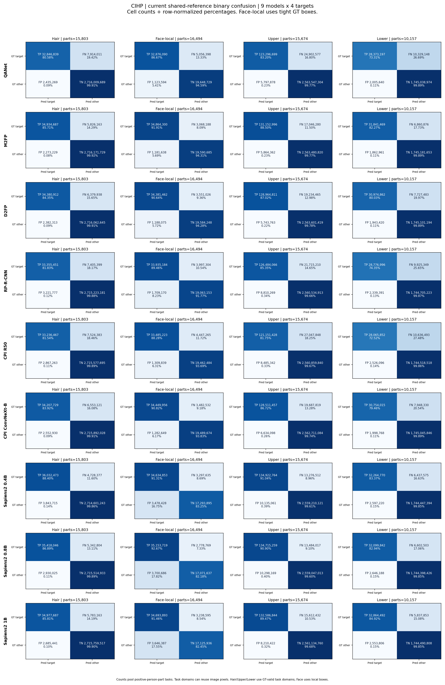

<!-- SHARED_DATASET_CURRENT_START -->

# ผลล่าสุดของ CIHP — คะแนนสี่คลาสและเวลาประมวลผล

อัปเดต 2026-11-09T17:27:38.250271+07:00 (Asia/Bangkok) ประเมินครบ 9 โมเดล ตัวละ 5,000 ภาพตาม STRICT_COMPLETE ใช้ผล shared-reference run `shared-c3-face-local-20261108T083533Z`

## คะแนนรายคลาสและค่าเฉลี่ย

**Macro4-local = (Hair + Face-local + Upper + Lower) ÷ 4** โดยค่ารายคลาสเป็นค่าเฉลี่ย IoU รายส่วนของ GT แต่ละคน แต่ละ target มีน้ำหนัก 25% ส่วน mIoU3 เฉลี่ย Hair/Upper/Lower เท่ากัน คำนวณค่าเฉลี่ยจากตัวเลขเต็มก่อนปัดเศษ Macro4-local เพิ่มตามคำขอผู้ใช้หลังเห็นผลแล้ว

| โมเดล | Hair % | Face-local % | Upper % | Lower % | mIoU3 % | Macro4-local % | ภาพครบ |
|---|---:|---:|---:|---:|---:|---:|---:|
| QANet | 69.879 | 80.018 | 75.639 | 62.888 | 69.469 | 72.106 | 5,000/5,000 |
| M2FP | 71.051 | 81.423 | 78.079 | 69.519 | 72.883 | 75.018 | 5,000/5,000 |
| D2FP | 69.478 | 79.840 | 76.323 | 67.140 | 70.980 | 73.195 | 5,000/5,000 |
| RP-R-CNN | 64.342 | 76.542 | 72.248 | 59.903 | 65.498 | 68.259 | 5,000/5,000 |
| CPI R50 | 65.544 | 77.233 | 67.376 | 57.344 | 63.421 | 66.874 | 5,000/5,000 |
| CPI ConvNeXt-B | 69.392 | 80.698 | 75.350 | 65.659 | 70.134 | 72.775 | 5,000/5,000 |
| Sapiens2 0.4B | 70.245 | 75.775 | 79.006 | 70.239 | 73.163 | 73.816 | 5,000/5,000 |
| Sapiens2 0.8B | 70.163 | 77.007 | 78.184 | 68.951 | 72.433 | 73.576 | 5,000/5,000 |
| Sapiens2 1B | 69.360 | 75.205 | 76.801 | 71.457 | 72.539 | 73.206 | 5,000/5,000 |

ค่าเฉลี่ยสี่คลาสสูงสุดคือ **M2FP 75.018%**

## วิธีให้คะแนนและตัวหาร

GT มี 17,520 คน ส่วนที่มีสิทธิ์ประเมินคือ Hair 15,803, Face 16,494, Upper 15,674 และ Lower 10,157 รายการ แต่ละคลาสเฉลี่ยเฉพาะ GT person-parts ที่มี annotation ของคลาสนั้น

จับคู่คนด้วย mask IoU ตั้งแต่ 0.50 แบบหนึ่งต่อหนึ่ง เลือกจำนวนคู่สูงสุดแล้วเลือกผลรวม IoU สูงสุด ใช้รูปทรง mask ตัดสินกรณีเสมอตาม common matcher ส่วนที่มี GT แต่จับคู่คนไม่ได้มี IoU เป็นศูนย์และยังอยู่ในตัวหาร

Hair/Upper/Lower ใช้พื้นที่ valid ทั้งภาพสำหรับ prediction ของคนที่จับคู่ ส่วน Face-local ใช้กรอบสี่เหลี่ยมครอบ GT Face พอดีทุกโมเดล ภายในกรอบทายเกินเป็น FP ทายขาดเป็น FN และพื้นที่นอกกรอบไม่ประเมิน กรอบนี้ใช้ให้คะแนนหลัง inference โดยคงผลทำนายต้นฉบับไว้

Prediction ของ CIHP ใช้ Face ID 13 และของ Sapiens ใช้ Face_Neck พร้อมรายละเอียดใบหน้าตาม mapping ที่ตรึง Upper/Lower คง garment unions และ OTHER ของ Dress/Apparel ใช้ shared GT-valid/VOID เหมือนกันทุกโมเดล

**IoU = TP/(TP+FP+FN)** โดย TP คือพิกเซลที่ทายถูก FP คือทายเกิน และ FN คือ GT ที่ทายขาด วิธีคำนวณและการจับคู่คนใช้ร่วมกันใน CIHP/CCTV ส่วนขอบเขต annotation ยังอ้างอิง GT ของแต่ละ dataset

## เวลาประมวลผล parsing

เวลาต่อภาพได้จากผลรวมเวลา adapter ของ ROI ทุกคนในภาพ แล้วเฉลี่ยตามภาพที่มีข้อมูลเวลาครบ หน่วย ms/ROI คือมิลลิวินาทีต่อภาพย่อยบุคคล ส่วนวินาที/ภาพคือเวลารวม parsing ของคนในภาพต้นฉบับ ภาพที่ YOLO ให้ศูนย์ ROI มีเวลาเรียก parser เท่ากับศูนย์

**ต่อ ROI** คือเวลาต่อภาพย่อยบุคคลที่ YOLO ตรวจพบหนึ่งรายการ คำนวณผลรวมช่วงเวลาที่บันทึก ÷ จำนวน ROI แล้วคูณ 1,000 เพื่อแสดงเป็น ms ส่วน **ต่อภาพ** นำผลรวมช่วงเวลาเดียวกัน ÷ จำนวนภาพต้นฉบับ แสดงเป็นวินาที CIHP ใช้ตัวหาร 24,062 ROI / 5,000 ภาพ และ CCTV ใช้ 130 ROI / 90 ภาพต่อโมเดล

| โมเดล | เฉลี่ย ms/ROI | เฉลี่ยช่วงที่มีบันทึก s/ภาพ | รวมช่วงที่มีบันทึก s | ภาพครบ | ROI ครบ | ขอบเขต timer |
|---|---:|---:|---:|---:|---:|---|
| QANet | 73.198 | 0.352 | 1761.300 | 5,000/5,000 | 24,062/24,062 | A synchronized |
| M2FP | 215.623 | 1.038 | 5188.312 | 5,000/5,000 | 24,062/24,062 | A synchronized |
| D2FP | 637.258 | 3.067 | 15333.696 | 5,000/5,000 | 24,062/24,062 | A synchronized |
| RP-R-CNN | 227.574 | 1.095 | 5475.890 | 5,000/5,000 | 24,062/24,062 | A synchronized |
| CPI R50 | 2115.034 | 10.178 | 50891.941 | 5,000/5,000 | 24,062/24,062 | A synchronized |
| CPI ConvNeXt-B | 617.921 | 2.974 | 14868.420 | 5,000/5,000 | 24,062/24,062 | A synchronized |
| Sapiens2 0.4B | 1400.994 | 6.742 | 33710.728 | 5,000/5,000 | 24,062/24,062 | A synchronized |
| Sapiens2 0.8B | 2893.889 | 13.927 | 69632.749 | 5,000/5,000 | 24,062/24,062 | A synchronized |
| Sapiens2 1B | 4150.924 | 19.976 | 99879.530 | 5,000/5,000 | 24,062/24,062 | A synchronized |

CIHP มี adapter_total ครบ 24,062 ROI และ 5,000 ภาพต่อโมเดล ใช้ synchronized timers ที่ผูกกับ FRAME_COMMITTED และ accepted packet ของแต่ละภาพ

รายงานปัจจุบันนี้ใช้ controlled YOLO person-ROI predictions ของทั้งเก้าโมเดล ส่วนตาราง global C4-P ในประวัติด้านล่างมาจากรอบ routes และวิธี aggregation เดิม การเปิดรายงานนี้ให้ใช้ตารางปัจจุบันด้านบนประกอบการเทียบกับ CCTV

เวลาของ adapter ครอบ preprocessing, model call และ map-back ตาม implementation รวม native file I/O ของ CPI ส่วน YOLO cache/crop, การส่งออก packet, การให้คะแนนและงานสีอยู่ภายนอกช่วงนี้ ทุก call ทำนาย native classes พร้อมกัน ข้อมูลเวลาจึงเป็นเวลารวมของ call

จำนวน ROI ต่อภาพ การใช้ GPU ร่วม และ implementation/ขอบเขต timer มีผลต่อเวลาที่บันทึก รายงานใช้เวลาเป็น diagnostics โดยแสดง coverage ประกอบ

[รายงานรวมพร้อมรายละเอียด stage timing](CIHP_CCTV_COMPARABILITY_REVIEW_TH.md#เวลาต่อภาพและเวลารวม) · [สูตรและข้อกำหนดร่วม](CIHP_CCTV_COMPARABILITY_REVIEW_TH.md#นิยามที่ใช้อธิบายร่วมกัน)

[CSV ตัวเลขเต็ม](../metrics/SHARED_REFERENCE_SUMMARY.csv) · [Canonical result index](SHARED_REFERENCE_RESULT_INDEX.json)

## การตรวจตัวเลข

ตรวจ 9 แถวคุณภาพและ 9 แถวเวลาในไฟล์นี้กับ canonical aggregate และ CSV ที่ 2026-11-09T17:27:38.250271+07:00 โดยใช้ค่าก่อนปัดเศษ ตรวจสูตรสี่คลาส ตัวหารภาพ timing และสถานะของข้อมูลที่ขาด แหล่ง aggregate ใช้ protocol hash `5cecc46446b4c33f5da56cd639c1b829f2c477c616873e7d1a42b5c09cea6357` ข้อมูลตัวเลขนี้เผยแพร่ร่วมกับ source/configuration และ ledger hashes ใน canonical index

<!-- CURRENT_SHARED_DIAGNOSTICS_START -->

## Confusion matrix และความครบของแต่ละส่วน

ภาพชุดนี้สร้างจากสถิติรายส่วนของ shared-reference run ล่าสุด เก็บ binary confusion แยก target โดยแถวเป็น GT และคอลัมน์เป็น prediction เรียง target ก่อน other จึงได้ **[[TP, FN], [FP, TN]]** ตัวเลขในช่องเป็นจำนวนพิกเซล ส่วนสีและเปอร์เซ็นต์หารด้วยผลรวมของ GT แต่ละแถว

TP คือทายส่วนที่ต้องการถูก FN คือส่วน GT ที่ทายขาด FP คือทายเกินบนส่วนอื่นในพื้นที่ประเมิน และ TN คือพื้นที่อื่นที่ทายเป็นอื่น แต่ละ target มีงานราย GT person-part ของตนเอง พิกเซลของภาพเดียวกันอาจถูกประเมินในหลายงานตามเจ้าของ GT ตารางรวมพิกเซลตามงานเหล่านี้

**Recall = TP/(TP+FN)** บอกว่าเก็บพิกเซล GT ได้ครบเท่าไร **Precision = TP/(TP+FP)** บอกว่าพิกเซลที่ทายมาถูกเท่าไร และ **F1/Dice = 2TP/(2TP+FP+FN)** สรุปทั้งการทายเกินและทายขาด ค่าด้านล่างรวม counts ก่อนหาร ส่วน mean-part IoU ในตารางคะแนนเฉลี่ยแต่ละส่วนเท่ากัน

| โมเดล | Target | Precision % | Recall % | F1/Dice % | GT parts | ไม่ทับ GT เลย | ในจำนวนนั้นจับคู่คนไม่ได้ |
|---|---|---:|---:|---:|---:|---:|---:|
| QANet | Hair | 93.098 | 80.584 | 86.390 | 15,803 | 1,064 | 435 |
| QANet | Face_local | 96.695 | 86.670 | 91.409 | 16,494 | 1,145 | 464 |
| QANet | Upper | 95.509 | 83.197 | 88.929 | 15,674 | 870 | 443 |
| QANet | Lower | 93.398 | 73.311 | 82.145 | 10,157 | 1,237 | 241 |
| M2FP | Hair | 93.890 | 85.706 | 89.612 | 15,803 | 954 | 435 |
| M2FP | Face_local | 96.722 | 91.911 | 94.255 | 16,494 | 955 | 464 |
| M2FP | Upper | 95.720 | 88.498 | 91.967 | 15,674 | 908 | 443 |
| M2FP | Lower | 94.473 | 82.273 | 87.952 | 10,157 | 1,070 | 241 |
| D2FP | Hair | 93.520 | 84.348 | 88.697 | 15,803 | 1,229 | 435 |
| D2FP | Face_local | 96.660 | 90.639 | 93.552 | 16,494 | 1,239 | 464 |
| D2FP | Upper | 95.736 | 87.021 | 91.171 | 15,674 | 1,131 | 443 |
| D2FP | Lower | 94.096 | 80.034 | 86.497 | 10,157 | 1,279 | 241 |
| RP-R-CNN | Hair | 91.192 | 81.832 | 86.259 | 15,803 | 1,276 | 435 |
| RP-R-CNN | Face_local | 95.205 | 89.462 | 92.244 | 16,494 | 1,230 | 464 |
| RP-R-CNN | Upper | 93.488 | 85.347 | 89.232 | 15,674 | 979 | 443 |
| RP-R-CNN | Lower | 92.482 | 74.355 | 82.433 | 10,157 | 1,588 | 241 |
| CPI R50 | Hair | 92.058 | 81.540 | 86.481 | 15,803 | 1,180 | 435 |
| CPI R50 | Face_local | 96.236 | 88.276 | 92.084 | 16,494 | 1,102 | 464 |
| CPI R50 | Upper | 93.455 | 81.749 | 87.211 | 15,674 | 1,345 | 443 |
| CPI R50 | Lower | 91.743 | 72.517 | 81.005 | 10,157 | 1,764 | 241 |
| CPI ConvNeXt-B | Hair | 93.055 | 83.923 | 88.254 | 15,803 | 1,041 | 435 |
| CPI ConvNeXt-B | Face_local | 96.410 | 90.819 | 93.531 | 16,494 | 901 | 464 |
| CPI ConvNeXt-B | Upper | 95.091 | 86.715 | 90.710 | 15,674 | 952 | 443 |
| CPI ConvNeXt-B | Lower | 93.897 | 79.463 | 86.079 | 10,157 | 1,319 | 241 |
| Sapiens2 0.4B | Hair | 90.361 | 88.400 | 89.370 | 15,803 | 651 | 435 |
| Sapiens2 0.4B | Face_local | 90.873 | 91.307 | 91.089 | 16,494 | 680 | 464 |
| Sapiens2 0.4B | Upper | 93.013 | 91.041 | 92.017 | 15,674 | 511 | 443 |
| Sapiens2 0.4B | Lower | 92.550 | 83.366 | 87.719 | 10,157 | 888 | 241 |
| Sapiens2 0.8B | Hair | 92.359 | 86.892 | 89.542 | 15,803 | 719 | 435 |
| Sapiens2 0.8B | Face_local | 90.476 | 92.674 | 91.562 | 16,494 | 701 | 464 |
| Sapiens2 0.8B | Upper | 92.898 | 90.901 | 91.889 | 15,674 | 566 | 443 |
| Sapiens2 0.8B | Lower | 92.384 | 82.940 | 87.408 | 10,157 | 945 | 241 |
| Sapiens2 1B | Hair | 92.870 | 85.812 | 89.202 | 15,803 | 899 | 435 |
| Sapiens2 1B | Face_local | 90.489 | 91.462 | 90.973 | 16,494 | 911 | 464 |
| Sapiens2 1B | Upper | 94.169 | 89.465 | 91.757 | 15,674 | 690 | 443 |
| Sapiens2 1B | Lower | 92.790 | 84.916 | 88.678 | 10,157 | 785 | 241 |

“ไม่ทับ GT เลย” หมายถึง TP = 0 ของส่วนที่มี GT ส่วน “จับคู่คนไม่ได้” เป็นกลุ่มย่อยของรายการเหล่านั้นและยังนับพิกเซล GT เป็น FN กรณีที่จับคู่คนได้แต่ TP = 0 อาจเป็นผลว่าง ผิดคลาส ผิดตำแหน่ง หรือผิด ownership ต้องดู masks ประกอบเพื่อแยกสาเหตุ

| โมเดล | Target | TP px | FP px | FN px | TN px | GT support px | Union px | GT พิกเซลที่พลาด % |
|---|---|---:|---:|---:|---:|---:|---:|---:|
| QANet | Hair | 32,846,839 | 2,435,269 | 7,914,011 | 2,716,009,689 | 40,760,850 | 43,196,119 | 19.416 |
| QANet | Face_local | 32,876,090 | 1,123,594 | 5,056,398 | 19,648,729 | 37,932,488 | 39,056,082 | 13.330 |
| QANet | Upper | 123,296,699 | 5,797,878 | 24,902,577 | 2,563,547,304 | 148,199,276 | 153,997,154 | 16.803 |
| QANet | Lower | 28,373,197 | 2,005,640 | 10,329,148 | 1,745,038,974 | 38,702,345 | 40,707,985 | 26.689 |
| M2FP | Hair | 34,934,687 | 2,273,229 | 5,826,163 | 2,716,171,729 | 40,760,850 | 43,034,079 | 14.294 |
| M2FP | Face_local | 34,864,300 | 1,181,638 | 3,068,188 | 19,590,685 | 37,932,488 | 39,114,126 | 8.089 |
| M2FP | Upper | 131,152,996 | 5,864,362 | 17,046,280 | 2,563,480,820 | 148,199,276 | 154,063,638 | 11.502 |
| M2FP | Lower | 31,841,469 | 1,862,961 | 6,860,876 | 1,745,181,653 | 38,702,345 | 40,565,306 | 17.727 |
| D2FP | Hair | 34,380,912 | 2,382,313 | 6,379,938 | 2,716,062,645 | 40,760,850 | 43,143,163 | 15.652 |
| D2FP | Face_local | 34,381,462 | 1,188,075 | 3,551,026 | 19,584,248 | 37,932,488 | 39,120,563 | 9.361 |
| D2FP | Upper | 128,964,811 | 5,743,763 | 19,234,465 | 2,563,601,419 | 148,199,276 | 153,943,039 | 12.979 |
| D2FP | Lower | 30,974,862 | 1,943,420 | 7,727,483 | 1,745,101,194 | 38,702,345 | 40,645,765 | 19.966 |
| RP-R-CNN | Hair | 33,355,451 | 3,221,777 | 7,405,399 | 2,715,223,181 | 40,760,850 | 43,982,627 | 18.168 |
| RP-R-CNN | Face_local | 33,935,184 | 1,709,170 | 3,997,304 | 19,063,153 | 37,932,488 | 39,641,658 | 10.538 |
| RP-R-CNN | Upper | 126,484,066 | 8,810,269 | 21,715,210 | 2,560,534,913 | 148,199,276 | 157,009,545 | 14.653 |
| RP-R-CNN | Lower | 28,776,996 | 2,339,391 | 9,925,349 | 1,744,705,223 | 38,702,345 | 41,041,736 | 25.645 |
| CPI R50 | Hair | 33,236,467 | 2,867,263 | 7,524,383 | 2,715,577,695 | 40,760,850 | 43,628,113 | 18.460 |
| CPI R50 | Face_local | 33,485,223 | 1,309,839 | 4,447,265 | 19,462,484 | 37,932,488 | 39,242,327 | 11.724 |
| CPI R50 | Upper | 121,151,428 | 8,485,342 | 27,047,848 | 2,560,859,840 | 148,199,276 | 156,684,618 | 18.251 |
| CPI R50 | Lower | 28,065,852 | 2,526,096 | 10,636,493 | 1,744,518,518 | 38,702,345 | 41,228,441 | 27.483 |
| CPI ConvNeXt-B | Hair | 34,207,729 | 2,552,930 | 6,553,121 | 2,715,892,028 | 40,760,850 | 43,313,780 | 16.077 |
| CPI ConvNeXt-B | Face_local | 34,449,956 | 1,282,649 | 3,482,532 | 19,489,674 | 37,932,488 | 39,215,137 | 9.181 |
| CPI ConvNeXt-B | Upper | 128,511,457 | 6,634,098 | 19,687,819 | 2,562,711,084 | 148,199,276 | 154,833,374 | 13.285 |
| CPI ConvNeXt-B | Lower | 30,754,015 | 1,998,768 | 7,948,330 | 1,745,045,846 | 38,702,345 | 40,701,113 | 20.537 |
| Sapiens2 0.4B | Hair | 36,032,473 | 3,843,715 | 4,728,377 | 2,714,601,243 | 40,760,850 | 44,604,565 | 11.600 |
| Sapiens2 0.4B | Face_local | 34,634,853 | 3,478,428 | 3,297,635 | 17,293,895 | 37,932,488 | 41,410,916 | 8.693 |
| Sapiens2 0.4B | Upper | 134,922,764 | 10,135,061 | 13,276,512 | 2,559,210,121 | 148,199,276 | 158,334,337 | 8.959 |
| Sapiens2 0.4B | Lower | 32,264,770 | 2,597,220 | 6,437,575 | 1,744,447,394 | 38,702,345 | 41,299,565 | 16.634 |
| Sapiens2 0.8B | Hair | 35,418,046 | 2,930,025 | 5,342,804 | 2,715,514,933 | 40,760,850 | 43,690,875 | 13.108 |
| Sapiens2 0.8B | Face_local | 35,153,719 | 3,700,686 | 2,778,769 | 17,071,637 | 37,932,488 | 41,633,174 | 7.326 |
| Sapiens2 0.8B | Upper | 134,715,259 | 10,298,169 | 13,484,017 | 2,559,047,013 | 148,199,276 | 158,497,445 | 9.099 |
| Sapiens2 0.8B | Lower | 32,099,842 | 2,646,188 | 6,602,503 | 1,744,398,426 | 38,702,345 | 41,348,533 | 17.060 |
| Sapiens2 1B | Hair | 34,977,687 | 2,685,441 | 5,783,163 | 2,715,759,517 | 40,760,850 | 43,446,291 | 14.188 |
| Sapiens2 1B | Face_local | 34,693,893 | 3,646,387 | 3,238,595 | 17,125,936 | 37,932,488 | 41,578,875 | 8.538 |
| Sapiens2 1B | Upper | 132,586,844 | 8,210,422 | 15,612,432 | 2,561,134,760 | 148,199,276 | 156,409,698 | 10.535 |
| Sapiens2 1B | Lower | 32,864,492 | 2,553,806 | 5,837,853 | 1,744,490,808 | 38,702,345 | 41,256,151 | 15.084 |

GT support = TP+FN และ union = TP+FP+FN สัดส่วน GT ที่พลาด = FN/(TP+FN) = 1−Recall ค่า TN อ้างอิงพื้นที่ valid ของงานนั้น และมีขนาดใหญ่มากในงานบางคลาส จึงอ่านความครบควบคู่กับ Precision/Recall/IoU ตามเป้าหมาย

## การจับคู่คนและความครบถ้วนของผล

ตารางนี้ใช้ YOLO extents ที่ตรึงไว้กับ common geometry matcher ทั้งเก้าโมเดล ค่า person TP คือคู่ที่ผ่าน threshold, FP คือ predicted extent ที่ไม่มีคู่ และ FN คือ GT extent ที่ไม่มีคู่ Person Precision = TP/(TP+FP), Recall = TP/(TP+FN), F1 = 2TP/(2TP+FP+FN)

| โมเดล | Mask IoU threshold | GT คน | Pred คน | TP | FP | FN | Precision % | Recall % | F1 % | Ambiguous frames |
|---|---:|---:|---:|---:|---:|---:|---:|---:|---:|---:|
| QANet | 0.5 | 17,520 | 24,062 | 16,906 | 7,156 | 614 | 70.260 | 96.495 | 81.314 | 0 |
| QANet | 0.75 | 17,520 | 24,062 | 15,304 | 8,758 | 2,216 | 63.602 | 87.352 | 73.609 | 0 |
| M2FP | 0.5 | 17,520 | 24,062 | 16,906 | 7,156 | 614 | 70.260 | 96.495 | 81.314 | 0 |
| M2FP | 0.75 | 17,520 | 24,062 | 15,304 | 8,758 | 2,216 | 63.602 | 87.352 | 73.609 | 0 |
| D2FP | 0.5 | 17,520 | 24,062 | 16,906 | 7,156 | 614 | 70.260 | 96.495 | 81.314 | 0 |
| D2FP | 0.75 | 17,520 | 24,062 | 15,304 | 8,758 | 2,216 | 63.602 | 87.352 | 73.609 | 0 |
| RP-R-CNN | 0.5 | 17,520 | 24,062 | 16,906 | 7,156 | 614 | 70.260 | 96.495 | 81.314 | 0 |
| RP-R-CNN | 0.75 | 17,520 | 24,062 | 15,304 | 8,758 | 2,216 | 63.602 | 87.352 | 73.609 | 0 |
| CPI R50 | 0.5 | 17,520 | 24,062 | 16,906 | 7,156 | 614 | 70.260 | 96.495 | 81.314 | 0 |
| CPI R50 | 0.75 | 17,520 | 24,062 | 15,304 | 8,758 | 2,216 | 63.602 | 87.352 | 73.609 | 0 |
| CPI ConvNeXt-B | 0.5 | 17,520 | 24,062 | 16,906 | 7,156 | 614 | 70.260 | 96.495 | 81.314 | 0 |
| CPI ConvNeXt-B | 0.75 | 17,520 | 24,062 | 15,304 | 8,758 | 2,216 | 63.602 | 87.352 | 73.609 | 0 |
| Sapiens2 0.4B | 0.5 | 17,520 | 24,062 | 16,906 | 7,156 | 614 | 70.260 | 96.495 | 81.314 | 0 |
| Sapiens2 0.4B | 0.75 | 17,520 | 24,062 | 15,304 | 8,758 | 2,216 | 63.602 | 87.352 | 73.609 | 0 |
| Sapiens2 0.8B | 0.5 | 17,520 | 24,062 | 16,906 | 7,156 | 614 | 70.260 | 96.495 | 81.314 | 0 |
| Sapiens2 0.8B | 0.75 | 17,520 | 24,062 | 15,304 | 8,758 | 2,216 | 63.602 | 87.352 | 73.609 | 0 |
| Sapiens2 1B | 0.5 | 17,520 | 24,062 | 16,906 | 7,156 | 614 | 70.260 | 96.495 | 81.314 | 0 |
| Sapiens2 1B | 0.75 | 17,520 | 24,062 | 15,304 | 8,758 | 2,216 | 63.602 | 87.352 | 73.609 | 0 |

Person metrics เท่ากันข้ามโมเดลในแต่ละ dataset เพราะใช้ YOLO extents ชุดเดียวกัน ส่วน semantic masks และคะแนนรายส่วนยังต่างกัน สำหรับ CCTV จำนวนคนที่ทายมาแต่ไม่มีคู่ GT อ้างอิงเฉพาะคนที่ annotate ไว้

| โมเดล | Expected | Completed | Missing | Duplicate | STRICT_COMPLETE |
|---|---:|---:|---:|---:|---|
| QANet | 5,000 | 5,000 | 0 | 0 | True |
| M2FP | 5,000 | 5,000 | 0 | 0 | True |
| D2FP | 5,000 | 5,000 | 0 | 0 | True |
| RP-R-CNN | 5,000 | 5,000 | 0 | 0 | True |
| CPI R50 | 5,000 | 5,000 | 0 | 0 | True |
| CPI ConvNeXt-B | 5,000 | 5,000 | 0 | 0 | True |
| Sapiens2 0.4B | 5,000 | 5,000 | 0 | 0 | True |
| Sapiens2 0.8B | 5,000 | 5,000 | 0 | 0 | True |
| Sapiens2 1B | 5,000 | 5,000 | 0 | 0 | True |

## รายละเอียด timing ที่ตรวจได้

ตารางขั้นตอนใช้หน่วย ms ต่อ ROI ที่มี timer ช่วงย่อยอาจอยู่ซ้อนภายใน adapter_total ของโมเดลหนึ่ง call รองรับ native classes ทั้งหมด แล้วจึงแปลงผลเป็นสี่ target

| โมเดล | Preprocess ms/ROI | Native call ms/ROI | Map-back ms/ROI | Adapter A ms/ROI (n) | Event B ms/ROI (n) | Original forward C ms/ROI (n) |
|---|---:|---:|---:|---:|---:|---:|
| QANet | 6.515 | 63.661 + 1.253 | 0.810 | 73.198 (24,062) | — (0) | — (0) |
| M2FP | รวมใน adapter | 204.595 | รวมใน adapter | 215.623 (24,062) | — (0) | — (0) |
| D2FP | รวมใน adapter | 626.132 | รวมใน adapter | 637.258 (24,062) | — (0) | — (0) |
| RP-R-CNN | รวมใน adapter | รวมใน adapter | รวมใน adapter | 227.574 (24,062) | — (0) | — (0) |
| CPI R50 | รวมใน adapter | 1499.411 | รวมใน adapter | 2115.034 (24,062) | — (0) | — (0) |
| CPI ConvNeXt-B | รวมใน adapter | 477.133 | รวมใน adapter | 617.921 (24,062) | — (0) | — (0) |
| Sapiens2 0.4B | 43.344 | 1354.472 | 2.795 | 1400.994 (24,062) | — (0) | — (0) |
| Sapiens2 0.8B | 23.399 | 2867.349 | 2.773 | 2893.889 (24,062) | — (0) | — (0) |
| Sapiens2 1B | 23.357 | 4124.412 | 2.781 | 4150.924 (24,062) | — (0) | — (0) |

“รวมใน adapter” หมายถึงมีเวลารวม แต่ log ของรอบนั้นแยกขั้นตอนนี้ไม่ได้ ส่วน — (0) หมายถึงไม่มี calls ในกลุ่ม timer นั้น ขอบเขต A และ B ของ CCTV อธิบายไว้ในตารางเวลาต่อภาพด้านบน CPI มี native file I/O ภายใน adapter และสภาพ GPU ร่วมถูกบันทึกไว้ใน resource policy ของ source run

## ที่มาของ configuration และข้อจำกัด

| โมเดล | Checkpoint SHA256 prefix | Canonical source reference | Implementation reference |
|---|---|---|---|
| QANet | `cf7374ea109e05c1` | `Human_Parsing_Benchmark/outputs/cihp-controlled-roi-20261102T120403Z/QANet_CIHP_HRNetW48_512x384/METRICS.json` | `original accepted source` |
| M2FP | `7451e822298c8dee` | `Human_Parsing_Benchmark/outputs/cihp-controlled-roi-20261102T120403Z/M2FP_R101_CIHP/METRICS.json` | `original accepted source` |
| D2FP | `acdfb2eceff57682` | `Human_Parsing_Benchmark/outputs/cihp-controlled-roi-20261102T120403Z/D2FP_R101_CIHP/METRICS.json` | `original accepted source` |
| RP-R-CNN | `6b596210f3ea67c7` | `Human_Parsing_Benchmark/outputs/cihp-controlled-continuation-20261103T021021Z/RPR_CIHP/METRICS.json` | `RPR_ROI_EMPTY_OUTPUT_1` |
| CPI R50 | `e58f8cb4b4fb3b75` | `Human_Parsing_Benchmark/outputs/cihp-controlled-resources-20261103T062248Z/CPI_R50_CIHP/METRICS.json` | `PARENT_MODEL_BEHAVIOR` |
| CPI ConvNeXt-B | `25b7b12527e550f1` | `Human_Parsing_Benchmark/outputs/cihp-pending-cpi_convnextb_cihp-20261106T105013Z/CPI_ConvNeXtB_CIHP/METRICS.json` | `{"parent_revision": "CPI_PERSON_CHUNK_RESTORATION_1", "parent_accepted_ROIs": 20702, "new_revision": "CPI_FEATURE_BRANCH_SCHEDULE_3"}` |
| Sapiens2 0.4B | `b85fdb50b7d6123a` | `Human_Parsing_Benchmark/outputs/cihp-controlled-resources-20261103T062248Z/Sapiens2_0.4b/METRICS.json` | `PARENT_MODEL_BEHAVIOR` |
| Sapiens2 0.8B | `e7c1655b7e11678b` | `Human_Parsing_Benchmark/outputs/cihp-sapiens-resume-20261105T044738Z/Sapiens2_0.8b/METRICS.json` | `PARENT_MODEL_BEHAVIOR` |
| Sapiens2 1B | `4b73c44963b377e9` | `Human_Parsing_Benchmark/outputs/cihp-pending-sapiens2_1b-20261106T105013Z/Sapiens2_1b/METRICS.json` | `{"parent_revision": "PARENT_MODEL_BEHAVIOR", "parent_accepted_ROIs": 20356, "new_revision": "PARENT_MODEL_BEHAVIOR"}` |

กติกาสี่ target, Face-local, VOID/OTHER, mask matching และวิธีเฉลี่ยใช้ร่วมกันใน CIHP/CCTV โดย GT และ annotation boundaries ยังเป็น reference ของแต่ละชุด การประเมินใช้ส่วนที่มี annotation และ Face ใช้กรอบ GT ของงานนั้น คำอ้างเกี่ยวกับขอบเขตหน้า/คอและ Dress จึงอิงนิยามเหล่านี้

ผลเปรียบเทียบ checkpoint พร้อม application configuration ซึ่งรวมข้อมูลฝึก adapter และ implementation revision การแก้หน่วยความจำ CPI มีหลักฐาน parity ตาม revision ของแต่ละ segment ประวัติ OOM และ interruption ยังอยู่ใน source runs การปิดผลครบเป็นสถานะของ assembled cohort

[CSV ราย target พร้อม counts และตัวหาร](../metrics/SHARED_REFERENCE_TARGET_COUNTS.csv) · [Canonical index และหลักฐานการตรวจ](SHARED_REFERENCE_RESULT_INDEX.json)

<!-- CURRENT_SHARED_DIAGNOSTICS_END -->

[โค้ดนิยามและการนับรายส่วน](../src/common_view/reference_parts.py) เก็บสูตร จำนวน GT และการให้ศูนย์เมื่อจับคู่ไม่ได้ ส่วน Q_C4_GT ในประวัติอ้างอิง semantic person score ของ protocol เดิม รายงานปัจจุบันสรุปคุณภาพรายส่วนด้วย mean-part IoU และแสดง person extent diagnostics แยกกัน

<!-- SHARED_DATASET_CURRENT_END -->

## ประวัติผลและคำอธิบายตาม protocol เดิม

> **View clarification (8 November2026):** รายงานนี้เป็นผล/ประวัติของ protocol เดิม เก็บตัวเลขครบ. สำหรับตารางปัจจุบันที่ใช้C3-partและFace-localเหมือนกันในCIHP/CCTV ดู[รายงานร่วมล่าสุด](CIHP_CCTV_COMPARABILITY_REVIEW_TH.md);ห้ามนำคะแนนต่างviewมาปะปนหรือเปลี่ยนชื่อแทนกัน.

# ผล Human Parsing common C4-P ครบเก้า checkpoints — สรุปสำหรับตรวจต่อ

> **ขอบเขตการใช้ผล (2 พ.ย. 2026):** ตารางนี้เป็น common-view application comparison ซึ่ง input routes ต่างกัน ไม่ใช่ official native-parser reproduction หรือ controlled-ROI comparison แบบ CCTV ล่าสุด. Q_GT เป็น supplementary metric ของโครงการ. ดู [การตรวจ CIHP เทียบ CCTV และ sensitivity ของวิธีเฉลี่ย](CIHP_CCTV_COMPARABILITY_REVIEW_TH.md) ก่อนเปรียบเทียบอันดับข้ามชุดข้อมูล

อัปเดต **2026-10-30T11:11:02.674074+07:00 (เวลาไทย UTC+07)** · **COMMON_C4P_COMPLETE_9_OF_9** · งานเพิ่มรอบนี้คือ saved-only CPI สองระบบ ไม่มี model inference ใหม่

## ผลที่ครบแล้วและคำตอบหลัก

checkpoint ทั้งเก้าตัวมีคะแนน common C4-P revision2 บน **official CIHP Validation ชุดเดียวกัน 5,000 unique IDs ต่อระบบ** แล้ว ตารางหลักใช้ full-precision canonical statistics ก่อนปัดเศษ ไม่ใช่ค่าจากแชท คะแนนสูงสุด global C4-P ในกลุ่มนี้คือ **M2FP_R101_CIHP** เป็น semantic quality leader ของ checkpoint พร้อม application configuration นี้ ไม่ใช่ architecture-only winner หรือการรับรองพร้อมใช้งาน CCTV

|Metric|คะแนนสูงสุด|IoU/mean %|อันดับถัดไป|ส่วนต่าง pp|
|---|---|---|---|---|
|Hair|M2FP_R101_CIHP|82.760|D2FP_R101_CIHP|0.754|
|Face ตาม CIHP reference|M2FP_R101_CIHP|88.111|QANet_CIHP_HRNetW48_512x384|0.416|
|Upper non-Dress|M2FP_R101_CIHP|85.563|D2FP_R101_CIHP|1.260|
|Lower non-Dress|M2FP_R101_CIHP|78.056|D2FP_R101_CIHP|1.351|
|C4-P mean|M2FP_R101_CIHP|83.623|D2FP_R101_CIHP|1.013|

ส่วนต่างเป็น **percentage points (pp)** ไม่ใช่ relative percent; เป็น descriptive comparison ไม่มี uncertainty interval/statistical-significance claim ไม่สร้าง weighted overall score เพิ่ม การเลือก deployment ยังต้องดู person Q/FP/coverage และ capabilities ที่งานต่อไปต้องใช้

## วิธีอ่านตัวชี้วัด: ความหมาย ที่มา และตัวอย่างคำนวณ

เพิ่มคำอธิบายเมื่อ **3 พฤศจิกายน 2026 เวลา 15:18 น. (Asia/Bangkok)** โดยตรวจเทียบ protocol และ scorer เดิม ไม่ได้คำนวณผลทดลองใหม่ **ตารางคะแนนในรายงานนี้เป็นผล CIHP รอบก่อนที่ครบเก้าโมเดลแล้ว** ส่วนรอบ controlled person-ROI ที่กำลังรันเป็นคนละรอบ ให้ติดตามจาก [รายงานรอบปัจจุบัน](CIHP_CONTROLLED_ROI_RUN_TH.md) ห้ามใช้ผลเก่าเติมแทนผลรอบใหม่

ตรวจทานเพิ่มเติมเมื่อ **2026-11-03T15:28:11+07:00**: เทียบ canonical METRICS ขนาดเล็กเก้าระบบกับ CSV/ตาราง, สูตรจาก counts รายคลาส54รายการและ person metrics18รายการ, protocol hashes และหลักฐาน exact membership เดิมครบ คะแนนในตารางไม่เปลี่ยน ไม่มีการรันโมเดลหรืออ่าน masks เพื่อให้คะแนนใหม่

**GT (Ground Truth)** คือ mask อ้างอิงที่ dataset ให้มา ส่วน prediction คือ mask ที่ระบบทำนาย คะแนนจึงบอกความสอดคล้องกับ GT ภายใต้นิยามนี้ ไม่ได้ยืนยันว่า GT ถูกต้องทางกายวิภาคทุกพิกเซล โดยเฉพาะ Face ของ CIHP กับ Face_Neck ของ Sapiens ที่ขอบเขตไม่เท่ากัน

### IoU รายคลาส: พื้นที่ตรงกันมากน้อยแค่ไหน

สมมติกำลังวัด Hair ให้แยกพิกเซลเป็นสามกลุ่ม:

- **TP:** GT เป็นผม และระบบทำนายว่าผม ถูกทั้งตำแหน่งและคลาส
- **FP:** ระบบทำนายว่าผม แต่ GT เป็นอย่างอื่น เช่น เสื้อหรือพื้นหลัง คือพื้นที่ที่ทำนายเกิน
- **FN:** GT เป็นผม แต่ระบบทำนายเป็นอย่างอื่นหรือไม่ได้ทำนาย คือพื้นที่ที่ตกหล่น

สูตร **IoU = TP / (TP + FP + FN)** หรือพื้นที่ทับกันหารด้วยพื้นที่รวมที่ GT หรือ prediction ระบุว่าเป็นคลาสนั้น ตัวอย่างสมมติ TP=80, FP=20, FN=20 จะได้ 80/120 = **66.67%** ค่าสูงหมายถึงพื้นที่ตรงกับ GT มากขึ้น โดยลงโทษทั้งส่วนเกินและส่วนที่ขาด

IoU เป็นสูตรมาตรฐานที่ใช้ในงาน semantic segmentation เช่น [คำอธิบายอย่างเป็นทางการของ Cityscapes](https://www.cityscapes-dataset.com/benchmarks/) ซึ่งระบุสูตรและการรวมจำนวนพิกเซลทั้งชุด รายงานนี้ใช้หลักการเดียวกัน แต่ใช้ GT, กลุ่มคลาส และพื้นที่ประเมินของโครงการ ไม่ใช่การนำ evaluator หรืออันดับของ Cityscapes มาใช้

### C4-P และ C3: เฉลี่ยความถูกต้องของกลุ่มคลาสที่โครงการเลือก

**C4-P = (IoU Hair + IoU Face + IoU Upper + IoU Lower) / 4** เป็นคะแนนหลัก ส่วน **C3 = (IoU Hair + IoU Upper + IoU Lower) / 3** เป็นคะแนนประกอบเพื่อดูผลเมื่อไม่นำคะแนน Face มาเฉลี่ย เพราะมีข้อจำกัดเรื่อง Face/Face_Neck ชื่อ C4-P/C3 และการเลือกคลาสเป็นนิยามของโครงการ ไม่ใช่ชื่อคะแนนทางการของ CIHP หรือคะแนนที่ยืมมาจาก paper โดยตรง

ทั้งสองค่ารวมจำนวนพิกเซลจาก 5,000 ภาพเป็น confusion matrix ก่อนหา IoU แต่ละคลาส แล้วจึงเฉลี่ยคลาส ไม่ใช่เฉลี่ยคะแนนภาพ และไม่เอา IoU ของคลาส native มาบวกหรือเฉลี่ยแทนการรวม masks ตัวอย่างสมมติ Hair=80%, Face=60%, Upper=70%, Lower=50% จะได้ **C4-P=65%** และ **C3=66.67%** ตัวเลขตัวอย่างเหล่านี้ไม่ใช่ผลของโมเดลใดในตาราง

สี่คลาสมีน้ำหนักเท่ากันใน C4-P แต่ภายในคลาส พื้นที่ชิ้นใหญ่มีจำนวนพิกเซลมากจึงมีส่วนต่อสถิติรวมมากกว่า BG และ OTHER ไม่ถูกนำมาเฉลี่ย แต่ยังใช้ตรวจความผิดพลาด เช่น ทำนาย Hair บน GT OTHER เป็น FP ส่วน GT Hair ที่ทำนาย OTHER เป็น FN สำหรับ C3 พื้นที่ GT Face ยังเป็นพื้นที่ที่ประเมิน ไม่ได้กลายเป็น ignore ถ้าทำนาย Hair/Upper/Lower บน GT Face ก็ยังเกิด FP ตามจริง กรณีไม่มีพิกเซลของคลาสนั้นทั้ง GT และ prediction ทั่วชุด ใช้ IoU=0 ตามกติกา fixed-class เดิมพร้อมแสดง support; ไม่ใช่ถือว่าทำนายถูกทั้งหมด

### Q_C4_GT: แบ่งส่วนถูกต้องต่อคนใน GT มากแค่ไหน

**Q_C4_GT เป็นตัวชี้วัดเสริมที่โครงการนิยามเอง** เพื่อดูทั้งการพบบุคคลที่ควรพบและคุณภาพการแบ่งส่วนของคนนั้น ไม่ใช่ official CIHP metric, parsing AP, PQ หรือ Cityscapes iIoU แม้ใช้ IoU เป็นองค์ประกอบ ที่มาที่ตรวจสอบได้คือ [protocol revision2](../protocol/CIHP_SAPIENS_COMMON_VIEW_REVISION2.json), [ฟังก์ชัน score_packet ใน scorer](../src/common_view/core.py) และ [score_people/Accumulator ที่รวมผลทั้งชุด](../src/common_view/full.py)

คำนวณตามลำดับดังนี้:

1. จับคู่ mask พื้นที่บุคคลที่ระบบส่งออกกับ mask บุคคลใน GT แบบหนึ่งต่อหนึ่ง รายงานแยกที่ **mask IoU ≥ 0.50** และ **≥ 0.75** ค่า 0.75 ต้องทับกันมากกว่า ค่านี้เป็นเกณฑ์จับคู่บุคคล ไม่ใช่ detection confidence หรือเกณฑ์ว่า Hair/Face ผ่านแล้ว การเลือกคู่พิจารณาจำนวนคู่และ geometry ตามกติกา revision2 ไม่ใช้คะแนน semantic เลือกคู่ให้ดูดี
2. สำหรับคนที่จับคู่ได้ คำนวณ IoU ของแต่ละ target จาก mask ของคู่นั้น บนพื้นที่ประเมินบุคคลที่กำหนดไว้ ใช้คลาสในสี่เป้าหมายที่ปรากฏใน **GT ของคนนั้นหรือ prediction ที่จับคู่กัน** แล้วเฉลี่ยเป็นคะแนนของคนนั้น คลาสที่ไม่มีทั้งสองฝั่งไม่นำมาเฉลี่ย แต่คลาสที่ทำนายเกินจะถูกนำมาคิดด้วย **จึงไม่ได้หารด้วยสี่ตายตัวสำหรับทุกคน**
3. คนใน GT ที่มีอย่างน้อยหนึ่ง target ที่ประเมินได้ แต่จับคู่ไม่ได้ ให้คะแนน **0** และยังอยู่ในตัวหาร ถ้าจับคู่ extent ได้แต่ prediction ไม่มี target ขณะที่ GT มี target คะแนน semantic ของคนนั้นก็เป็น 0
4. บวกคะแนนของคนที่มีสิทธิ์ทั้งหมด แล้วหารด้วยจำนวนคนใน GT ที่มี target ให้ประเมิน: **Q_C4_GT = ผลรวมคะแนนรายคน / G_sem_C4** คนที่มีสิทธิ์แต่ละคนมีน้ำหนักเท่ากัน ไม่ใช่เฉลี่ยเฉพาะคนที่ระบบหาเจอ

ตัวอย่างสมมติ GT มีสองคนที่มีสิทธิ์: คนแรกมี Hair IoU=80%, Face IoU=60% และไม่มี Upper/Lower ทั้ง GT และ prediction จึงได้คะแนนรายคน (80+60)/2=70%; คนที่สองจับคู่ไม่ได้จึงได้ 0% ผล **Q_C4_GT=(70+0)/2=35%** ตัวอย่างนี้ใช้เพื่ออธิบายสูตร ไม่ใช่การคำนวณผลใหม่หรือเปลี่ยนตัวหารของชุดจริง

ในผลจริงของรายงานนี้ **G_loc=17,520 คน** คือคนที่มี extent GT ใช้จับคู่ได้ ส่วน **G_sem_C4=17,454 คน** คือคนที่มีอย่างน้อยหนึ่งในสี่ targets บนพื้นที่ประเมิน semantic จึงใช้เป็นตัวหาร Q ไม่ใช้ 17,520 แทน ตัวเลขทั้งสองตรวจจาก GT bindings เดิม และไม่จำเป็นต้องเท่ากัน หาก G_sem_C4=0 ต้องคืน null ว่าไม่มีข้อมูลให้คำนวณ ไม่เติม 0 เพื่ออ้างว่าคุณภาพต่ำ

ข้อจำกัดสำคัญ: **Q ไม่ลงโทษ predicted persons ที่ไม่มีคู่โดยตรง** ระบบอาจมี Q สูงแต่ทำนายคนเกินมากได้ จึงอ่านร่วมกับ FP/F1 เสมอ และไม่เรียกผู้มี Q สูงสุดว่าเป็นผู้ชนะทุกด้าน

### Person TP/FP/FN และ F1: จับคู่บุคคลได้ครบและเกินเท่าไร

ในตาราง person metrics หน่วยเปลี่ยนจากพิกเซลเป็น **รายการบุคคล**: TP คือคู่บุคคลที่ผ่าน threshold, FP คือบุคคลที่ทำนายแล้วไม่มีคู่ รวมรายการซ้ำที่ไม่ได้รับคู่, FN คือคนใน GT ที่ไม่มีคู่ สูตรคือ Precision=TP/(TP+FP), Recall=TP/(TP+FN), **F1=2TP/(2TP+FP+FN)** โดยรายงานแยกที่ threshold 0.50/0.75 และกรณีตัวหารศูนย์ใช้ null ตาม scorer

ค่าเหล่านี้วัดการจับคู่ extent ไม่ได้ยืนยันว่า semantic ถูก: mask คนอาจจับคู่ได้แต่ Hair/Face ผิดทั้งหมด ซึ่งจะสะท้อนใน IoU/Q แทน ในรอบเก่านี้ extent ของ QANet/Sapiens มาจาก YOLO จึงไม่ใช้ F1 ที่เท่ากันอ้างว่าความสามารถแบ่ง instance ของ parser เท่ากัน และไม่เรียก F1 นี้ว่า parsing AP

**อ่านร่วมกัน:** C4-P บอกคุณภาพพื้นที่รวม, C3 ช่วยดูผลสามคลาสโดยตัดคะแนน Face ออกจากค่าเฉลี่ย, Q_C4_GT ให้คนใน GT แต่ละคนมีน้ำหนักเท่ากัน, FP/F1 บอกคนที่เกินหรือขาด ไม่รวมทั้งสี่ชนิดเป็นคะแนนผสมใหม่ ส่วน CCTV ใช้การเฉลี่ยรายส่วนของบุคคลและ Face domain คนละนิยามกับ CIHP ดู [รายงานตรวจความเทียบกันได้](CIHP_CCTV_COMPARABILITY_REVIEW_TH.md) ก่อนนำตัวเลขสองชุดมาเทียบ

### รายละเอียดที่ต้องรู้ก่อนนำผลไปอธิบาย

**การจัดสี่คลาสใช้ทั้ง GT และ prediction:** สำหรับ CIHP20: Hair=2, Face=13, Upper=5+7 (UpperClothes+Coat), Lower=9+12 (Pants+Skirt) สำหรับ Sapiens29: Hair=4, Face candidate=3+24–28 (Face_Neck และรายละเอียดปาก), Upper=23, Lower=13 เลขเดียวกันข้าม taxonomy อาจหมายถึงคนละส่วน ห้ามตีความจาก ID อย่างเดียว Dress ของ CIHP6 และ Apparel ของ Sapiens1 เป็น OTHER ไม่ได้เท่ากันโดยนิยามและไม่มีการแบ่งให้กลายเป็น Upper/Lower

**Confusion matrix ที่ใช้คำนวณจริงมี 6×6 ช่อง:** แถวคือ GT คอลัมน์คือ prediction ตามลำดับ BG, Face, Hair, Upper, Lower, OTHER ช่องแนวทแยงคือทำนายตรง GT; TP ของคลาสหนึ่งคือช่องทแยง, FP คือผลรวมคอลัมน์นั้นลบ TP, FN คือผลรวมแถวนั้นลบ TP การทำนาย GT Hair เป็น Upper จะเป็น FN ของ Hair และ FP ของ Upper จึงไม่ตัด BG/OTHER ออกก่อนคำนวณเพื่อเหลือเพียงตาราง 4×4

**พื้นที่ที่ให้คะแนนมีสองแบบและใช้เหมือนกันทุกโมเดล:** คะแนน global ใช้ GT Category IDs0–19 ทั้งหมด รวม BG/OTHER โดยไม่รวม GT255 ซึ่งเป็น VOID หรือพื้นที่ไม่ประเมิน ส่วน Q ใช้พื้นที่เดียวกันแต่กันพิกเซลที่ GT ระบุส่วนคนไว้โดยไม่ระบุเจ้าของ (Category>0 และ Human=0) ออก พื้นที่ background ที่ valid ยังคงอยู่ การคิด Q ใช้ semantic mask ของ predicted person ทั้งระนาบภาพบนพื้นที่ที่ valid นี้ ไม่ครอบ prediction ให้เหลือเฉพาะ GT mask/bbox ของคู่ เพื่อซ่อนส่วนที่ทำนายเกินหรือปนคนอื่น

**รวมคนซ้อนกันก่อนรวมคลาส:** ในคะแนน global ให้ประกอบ masks ของคนบนพิกัดภาพต้นฉบับใน native labels ก่อน แล้วค่อย project เป็นหกกลุ่ม เมื่อ native foreground ทับกันใช้ score ที่บันทึกไว้สูงกว่าทับ; ถ้า score เท่ากัน packet index ต่ำกว่าชนะ native BG โปร่งใส แต่คลาสที่ภายหลังกลายเป็น OTHER ยังมีสิทธิ์ทับ จึงไม่ลบ Dress/Apparel/OTHER ก่อนจัดการ overlap สำหรับ Q ประเมิน mask แยกราย predicted person ไม่เอาภาพรวมที่ compose แล้วมาแทน

**จับคู่คนจากพื้นที่ ไม่ใช่จากชื่อคนหรือคลาสเสื้อผ้า:** ใช้ mask IoU ของ extent โดยเลือกให้มีคู่ที่ผ่าน threshold มากที่สุดก่อน แล้วให้ผลรวม mask IoU มากที่สุด หากยังเสมอเรียงด้วย geometry ของ masks ตาม revision2 กรณี GT geometry ต่างกัน การเปลี่ยนหมายเลข GT IDs ไม่เปลี่ยนการจับคู่ แต่ถ้า GT geometry เหมือนกันจริงต้องใช้ stable ID เป็น fallback และอาจเปลี่ยน Q เมื่อเปลี่ยนชื่อ IDs ได้ จึงรายงาน matching ambiguity ไม่รับรอง ID-renaming invariance ทุกกรณี ไม่มีการใช้ semantic score ช่วยเลือกคู่

**ไม่พบบุคคล กับพบบุคคลแต่ไม่มีสี่คลาส ไม่ใช่กรณีเดียวกัน:** ถ้าไม่มี predicted person ทั้งภาพ คนใน GT จะเป็น missed ตาม matching และมี Q=0 เมื่อมีสิทธิ์ แต่ถ้ามี valid extent/identity โดย semantics ว่างหรือเป็น OTHER ทั้งหมด ให้เก็บ extent ไว้ อาจจับคู่เป็น person TP ได้แต่ Q=0 เมื่อ GT มี target การทำนาย native Dress/Apparel ที่รู้จักเป็น valid output และอาจเกิด target FN ไม่ทำให้ run INCOMPLETE เพียงเพราะ map เป็นสี่ target ไม่ได้ ส่วน prediction ID255/ID นอก taxonomy, shape ผิดหรือ output ที่ผิด contract เป็น invalid execution และทำให้คะแนนหลัก null จนตรวจปิดตาม STRICT_COMPLETE

**ทำนายคนซ้ำ กับ mask ของคนหนึ่งปนอีกคน ต้องอธิบายแยกกัน:** matching หนึ่งต่อหนึ่งทำให้รายการซ้ำที่ไม่มีคู่เป็น person FP ส่วนการจับคู่ได้แต่เอาผม/เสื้อผ้าของคนอื่นมาปนจะเพิ่ม semantic FP/FN ใน Q และตรวจเพิ่มได้จาก contamination = พิกเซล target ของ predicted person ที่ตกบน GT คนอื่น / พิกเซล target ทั้งหมดของคู่บุคคลที่จับได้บน person-valid domain ตัวชี้วัด background leakage ใช้พิกเซล target ที่ตกบน GT Human=0 ใน domain เดียวกันเป็นตัวตั้ง ตัวหารเป็นศูนย์ให้ null ไม่ใช่แปลว่าไม่มีการปนเปื้อน

**support, union และคะแนนแต่ละชนิดใช้หน่วยต่างกัน:** GT support คือจำนวนพิกเซลบวกของ target ใน GT; prediction support คือจำนวนที่ระบบทำนาย; union=GT support+prediction support−TP เป็นตัวหาร IoU ส่วน G_loc/G_sem_C4 นับคน และ completeness นับภาพ ค่า IoU=0 ของ Hair หมายถึงไม่มีพื้นที่ทับกันบน domain นั้น แต่ยังสรุปไม่ได้ลำพังว่าไม่พบบุคคล ทำนายผิดคลาส หรือ geometry ผิด ต้องอ่าน packet/matching/diagnostics ประกอบ IoU เป็นการวัดพื้นที่ ไม่ใช่คะแนนขอบเขตแบบ Boundary IoU โดยตรง

**null กับ 0 ต้องไม่สลับกัน:** 0 คือค่าที่นิยามแล้วคำนวณได้ว่าเป็นศูนย์ ส่วน null คือไม่มีตัวหารหรือผลยังไม่พร้อมใช้ บาง historical COMPLETION มี primary:null แต่ canonical METRICS มีผลครบแล้ว ให้ใช้ normalized result index และ exact membership ที่ประกาศในส่วน8 ไม่แทน null ด้วย0 และไม่ใช้คะแนน subset แทน 5,000 ภาพ

**ผลนี้เปรียบเทียบอะไรได้:** เปรียบเทียบ checkpoint พร้อม application configuration ในรอบเก่าที่ระบุ route ไว้ ไม่ใช่ควบคุม architecture/training data ให้เหมือนกัน Face ของ Sapiens เป็น proxy; ไม่ได้แก้ neck จาก hard mask หรือยืนยัน taxonomy equivalent การรันครบ 5,000 ภาพไม่รับรองความพร้อม CCTV/color หรือความแม่นพอสำหรับ deployment และ timing ที่มีไม่ใช่ clean speed ranking คะแนนจากรอบ controlled ROI ที่กำลังรันต้องรายงานแยกเมื่อปิด batch แล้ว ไม่วิเคราะห์อันดับบางส่วนหรือเติมผลเก่าลงรอบใหม่

## 1. ตารางหลัก — frozen roster order

|ระบบ|Hair IoU %|Face ref. IoU %|Upper %|Lower %|C4-P %|C3 %|ครบ|
|---|---|---|---|---|---|---|---|
|QANet_CIHP_HRNetW48_512x384|79.919|87.695|81.870|74.452|80.984|78.747|5,000/5,000|
|M2FP_R101_CIHP|82.760|88.111|85.563|78.056|83.623|82.127|5,000/5,000|
|D2FP_R101_CIHP|82.006|87.423|84.303|76.706|82.610|81.005|5,000/5,000|
|RPR_CIHP|77.708|84.794|81.356|71.131|78.747|76.732|5,000/5,000|
|CPI_R50_CIHP|79.344|85.794|79.259|69.983|78.595|76.195|5,000/5,000|
|CPI_ConvNeXtB_CIHP|81.220|87.023|83.777|75.824|81.961|80.274|5,000/5,000|
|Sapiens2_0.4b|80.101|72.196|76.736|74.278|75.827|77.038|5,000/5,000|
|Sapiens2_0.8b|78.942|72.648|75.867|71.015|74.618|75.275|5,000/5,000|
|Sapiens2_1b|77.427|70.175|71.778|71.657|72.759|73.621|5,000/5,000|

Face คือ agreement กับ **CIHP reference Face**; Sapiens ใช้ Face_Neck รวม facial subparts เป็น proxy ซึ่งแยก neck จาก hard mask ไม่ได้ Hair/Upper/Lower ใช้ mapping revision2 เดิม Upper = CIHP UpperClothes+Coat, Lower = Pants+Skirt; Sapiens Upper_Clothing/Lower_Clothing ไม่รับรอง annotation-boundary equivalence Dress/Apparel เป็น valid OTHER ไม่แบ่งด้วย heuristic และไม่ ignore รายโมเดล

Primary C4-P = unweighted mean IoU ของสี่ target; C3 เป็น global mean Hair/Upper/Lower เท่านั้น ไม่มี Q_C3 ไม่รวม BG/OTHER ใน macro แต่ทั้งสองยังเป็น valid negatives: target บน OTHER เป็น FP และ OTHER บน target เป็น FN; Face ยังเป็น negative ที่ valid ใน C3 GT255 เป็น shared VOID, prediction unknown/255 contract failure ไม่มีเปลี่ยน policy หลังเห็นผล

สะสม global confusion ทั้งประชากรก่อนหาร IoU=TP_pixels/union ไม่เฉลี่ย IoU ของ native classes เพื่อรวมกลุ่ม zero-union=0 ตาม fixed-class definition พร้อม flags ใน CSV ค่าในตารางเป็นเปอร์เซ็นต์ ตัวเลขใน JSON/CSV เป็นfraction0–1 เก็บprecisionจริง

## 2. Person metrics และข้อเสนอการเลือก

G_loc = **17,520**, G_sem_C4 = **17,454** รวมจาก bound GT-only manifest ไม่ hardcodeแทนการตรวจ ใช้ geometry-canonical matcher revision2 ที่ mask IoU0.50/0.75 เหมือนทั้งเก้าระบบ นิยาม tie/identical-geometry limitation คงเดิม Q_C4_GT รวม target-only per-eligible-GT-person contributions โดย missed GT=0 แล้วหาร G_sem_C4; unmatched predicted persons ไม่ลงโทษ Q โดยตรง ต้องอ่าน FP/F1 ร่วม ไม่เรียกผู้ Q สูงสุดว่า overall winner

|ระบบ|Mask IoU|TP|FP|FN|F1 %|Q_C4_GT %|
|---|---|---|---|---|---|---|
|QANet_CIHP_HRNetW48_512x384|0.50|16906|7156|614|81.314|73.474|
|QANet_CIHP_HRNetW48_512x384|0.75|15304|8758|2216|73.609|67.937|
|M2FP_R101_CIHP|0.50|16163|2119|1357|90.291|69.591|
|M2FP_R101_CIHP|0.75|15318|2964|2202|85.571|67.101|
|D2FP_R101_CIHP|0.50|15972|2176|1548|89.559|68.018|
|D2FP_R101_CIHP|0.75|14817|3331|2703|83.083|64.566|
|RPR_CIHP|0.50|16214|3351|1306|87.442|68.640|
|RPR_CIHP|0.75|14470|5095|3050|78.037|62.987|
|CPI_R50_CIHP|0.50|15819|3896|1701|84.968|67.523|
|CPI_R50_CIHP|0.75|13855|5860|3665|74.419|61.131|
|CPI_ConvNeXtB_CIHP|0.50|16288|2880|1232|88.792|71.938|
|CPI_ConvNeXtB_CIHP|0.75|15026|4142|2494|81.912|67.692|
|Sapiens2_0.4b|0.50|16906|7156|614|81.314|57.789|
|Sapiens2_0.4b|0.75|15304|8758|2216|73.609|53.966|
|Sapiens2_0.8b|0.50|16906|7156|614|81.314|55.106|
|Sapiens2_0.8b|0.75|15304|8758|2216|73.609|51.579|
|Sapiens2_1b|0.50|16906|7156|614|81.314|49.242|
|Sapiens2_1b|0.75|15304|8758|2216|73.609|46.466|

ที่ matching 0.50 Q_C4_GT สูงสุดคือ **QANet_CIHP_HRNetW48_512x384 (73.474%)**; เทียบกับ M2FP_R101_CIHP มี Q 69.591% ส่วนต่าง 3.883 pp และ FP 7,156 เทียบ 2,119; extent F1 81.314% เทียบ 90.291%
ที่ matching 0.75 Q_C4_GT สูงสุดคือ **QANet_CIHP_HRNetW48_512x384 (67.937%)**; เทียบกับ M2FP_R101_CIHP มี Q 67.101% ส่วนต่าง 0.835 pp และ FP 8,758 เทียบ 2,964; extent F1 73.609% เทียบ 85.571%

**ข้อเสนอ shortlist จากหลักฐาน CIHP นี้:** ใช้ M2FP_R101_CIHP เป็นตัวเลือกหลักเมื่อให้ความสำคัญกับความถูกต้องของพื้นที่ Hair/Face-reference/Upper/Lower โดยรวม และพิจารณา QANet_CIHP_HRNetW48_512x384 เป็นทางเลือกสำหรับคุณภาพ semantic ต่อ GT person โดยยอมรับข้อแลกเปลี่ยน FP/extent F1 ตามตาราง ไม่ได้กำหนดน้ำหนัก/threshold ใหม่ ไม่ใช่ final deployment acceptance และไม่ใช่ ensemble ที่ทดสอบแล้ว

**CPI ConvNeXt-B เป็นอีกทางเลือกสำหรับข้อแลกเปลี่ยนนี้:** ที่ matching0.50 มี Q_C4_GT 71.938% สูงกว่า M2FP แต่ต่ำกว่า QANet ขณะที่ FP 2,880 ต่ำกว่า QANet และ F1 88.792% สูงกว่า QANet; global C4-P ยังต่ำกว่า M2FP จึงเสนอให้เก็บใน shortlist เมื่อการใช้งานให้น้ำหนัก semantic ต่อคนร่วมกับ FP โดยไม่สร้างคะแนนผสมหรือน้ำหนักใหม่ ไม่จำเป็นต้องเก็บทุกโมเดลเพียงเพราะอาจเหมาะกับ CCTV โดยยังไม่มีหลักฐาน

extent ของ QANet/Sapiens มาจาก frozen YOLO จึงไม่ใช้ F1 ที่เหมือนกันอ้าง native instance capability ของ parser; CPI และ native-frame ระบบอื่นคง extents/association ที่บันทึกไว้ ไม่มี remask ด้วย YOLO ในงานนี้ ข้อมูล input/conditioning ต่างกันยังเป็นข้อจำกัดของ application comparison

## 3. Support และตัวหารราย target

|ระบบ|Target|GT pixels|Pred pixels|Union pixels|
|---|---|---|---|---|
|QANet_CIHP_HRNetW48_512x384|Face_CIHP_reference_proxy_for_Sapiens|37932488|38642800|40797724|
|QANet_CIHP_HRNetW48_512x384|Hair|40760850|40613642|45228484|
|QANet_CIHP_HRNetW48_512x384|Upper_non_Dress|148199276|150202863|164074286|
|QANet_CIHP_HRNetW48_512x384|Lower_non_Dress|38702345|38776880|44412874|
|M2FP_R101_CIHP|Face_CIHP_reference_proxy_for_Sapiens|37932488|36989348|39828625|
|M2FP_R101_CIHP|Hair|40760850|39858436|44112153|
|M2FP_R101_CIHP|Upper_non_Dress|148199276|146278992|158694160|
|M2FP_R101_CIHP|Lower_non_Dress|38702345|37747418|42935690|
|D2FP_R101_CIHP|Face_CIHP_reference_proxy_for_Sapiens|37932488|36776705|39861215|
|D2FP_R101_CIHP|Hair|40760850|39771557|44247146|
|D2FP_R101_CIHP|Upper_non_Dress|148199276|144252089|158679297|
|D2FP_R101_CIHP|Lower_non_Dress|38702345|37409975|43072876|
|RPR_CIHP|Face_CIHP_reference_proxy_for_Sapiens|37932488|37857687|41013316|
|RPR_CIHP|Hair|40760850|39831467|45351014|
|RPR_CIHP|Upper_non_Dress|148199276|148946509|163847047|
|RPR_CIHP|Lower_non_Dress|38702345|36446617|43913093|
|CPI_R50_CIHP|Face_CIHP_reference_proxy_for_Sapiens|37932488|37589325|40648058|
|CPI_R50_CIHP|Hair|40760850|40800080|45477427|
|CPI_R50_CIHP|Upper_non_Dress|148199276|146747496|164536535|
|CPI_R50_CIHP|Lower_non_Dress|38702345|37827129|45021753|
|CPI_ConvNeXtB_CIHP|Face_CIHP_reference_proxy_for_Sapiens|37932488|37837839|40513885|
|CPI_ConvNeXtB_CIHP|Hair|40760850|40733427|44969889|
|CPI_ConvNeXtB_CIHP|Upper_non_Dress|148199276|148684079|161545412|
|CPI_ConvNeXtB_CIHP|Lower_non_Dress|38702345|38965594|44173586|
|Sapiens2_0.4b|Face_CIHP_reference_proxy_for_Sapiens|37932488|43285474|47166135|
|Sapiens2_0.4b|Hair|40760850|40323588|45021687|
|Sapiens2_0.4b|Upper_non_Dress|148199276|154226412|171117447|
|Sapiens2_0.4b|Lower_non_Dress|38702345|35250001|42433580|
|Sapiens2_0.8b|Face_CIHP_reference_proxy_for_Sapiens|37932488|43543016|47191691|
|Sapiens2_0.8b|Hair|40760850|37688175|43840371|
|Sapiens2_0.8b|Upper_non_Dress|148199276|150280503|169719018|
|Sapiens2_0.8b|Lower_non_Dress|38702345|33314437|42111273|
|Sapiens2_1b|Face_CIHP_reference_proxy_for_Sapiens|37932488|41173601|46485085|
|Sapiens2_1b|Hair|40760850|36278027|43419971|
|Sapiens2_1b|Upper_non_Dress|148199276|138365260|166822127|
|Sapiens2_1b|Lower_non_Dress|38702345|33442478|42028557|

Support เป็นจำนวน pixels ไม่ใช่จำนวนภาพ/คน; union เป็นตัวหาร IoU และต่างจาก GT support แม้ทุกระบบมี GT support เดียวกัน [PER_TARGET.csv](../metrics/cpi-common-c4p-20261030/PER_TARGET.csv) เก็บ BG/OTHER ด้วย ส่วน [PERSON_METRICS.csv](../metrics/cpi-common-c4p-20261030/PERSON_METRICS.csv) มี precision/recall, Q numerator, contamination numerator/denominator และ matching ambiguity ครบ ไม่ใช้ null เป็น0

## 4. ข้อจำกัดด้าน Face และเสื้อผ้าที่เห็นจาก confusion

|ระบบ|Face FP pixels บน GT non-Face|Upper→OTHER pixels|Lower→OTHER pixels|GT Dress→Upper/Lower pixels|
|---|---|---|---|---|
|QANet_CIHP_HRNetW48_512x384|2865236|2991434|1018119|3948232|
|M2FP_R101_CIHP|1896137|3053261|1053519|3115798|
|D2FP_R101_CIHP|1928727|3609944|1090119|2774541|
|RPR_CIHP|3080828|3343522|1201098|3826108|
|CPI_R50_CIHP|2715570|3213152|1285456|4083556|
|CPI_ConvNeXtB_CIHP|2581397|2876661|907792|3646354|
|Sapiens2_0.4b|9233647|2433756|502121|14677291|
|Sapiens2_0.8b|9259203|2287420|446098|13567829|
|Sapiens2_1b|8552597|1801097|401253|13598352|

ตัวเลขนี้ derive จาก native-GT×prediction sufficient statistics เดิม/ใหม่ ไม่เปิด inference หรือ full pixel-scoring เพิ่ม Face FP บน non-Face GT รวมความผิด semantic และความต่าง annotation partition ได้ จึงไม่ยกทั้งหมดว่าเป็น neck error; GT ไม่แยกคอเป็น class อิสระ การนับ GT Dress→Upper/Lower เป็น discordance กับนิยาม fixed task ซึ่งต้องได้ FP ตาม domain ไม่ใช่หลักฐานว่าเสื้อผ้านั้นไม่มีอยู่หรือ parser แย่ทุกtaxonomy

Sapiens native Apparel ID1 เป็น OTHER ไม่เท่ากับ Dress6 โดยอัตโนมัติ [DISCORDANCE.csv](../metrics/cpi-common-c4p-20261030/DISCORDANCE.csv) มี valid-GT pixels ที่ทำนาย Apparel และ Upper/Lower→OTHER เพื่อช่วยอ่านข้อจำกัด ไม่ลบ pixels เหล่านี้หรือเปลี่ยน mapping ให้คะแนนดีขึ้น Full native-GT×prediction histograms อยู่ใน canonical METRICS แต่ละระบบ

## 5. Compatibility ของ CPI และระดับหลักฐาน equivalence

|ระบบ|Implementation / accepted IDs|Route|Resource policy ของการได้ predictions|
|---|---|---|---|
|QANet_CIHP_HRNetW48_512x384|SOURCE_HASH_BOUND_ACCEPTED_CONFIGURATION: 5000|YOLO_ROI|Original admission; runtime exclusivity not certified|
|M2FP_R101_CIHP|SOURCE_HASH_BOUND_ACCEPTED_CONFIGURATION: 5000|YOLO_ASSOCIATED_NATIVE_FRAME|Original admission; runtime exclusivity not certified|
|D2FP_R101_CIHP|SOURCE_HASH_BOUND_ACCEPTED_CONFIGURATION: 5000|YOLO_ASSOCIATED_NATIVE_FRAME|Original admission; runtime exclusivity not certified|
|RPR_CIHP|SOURCE_HASH_BOUND_ACCEPTED_CONFIGURATION: 5000|YOLO_ASSOCIATED_NATIVE_FRAME|SHARED_GPU_QUALITY_ONLY|
|CPI_R50_CIHP|CPI_FEATURE_BUFFER_REUSE_2: 14; CPI_FEATURE_BRANCH_SCHEDULE_3: 4983; ORIGINAL_FROZEN_NATIVE: 3|YOLO_ASSOCIATED_NATIVE_FRAME|SHARED_GPU_QUALITY_ONLY|
|CPI_ConvNeXtB_CIHP|ORIGINAL_FROZEN_NATIVE: 337; CPI_PERSON_CHUNK_RESTORATION_1: 4663|YOLO_ASSOCIATED_NATIVE_FRAME|SHARED_GPU_QUALITY_ONLY|
|Sapiens2_0.4b|SOURCE_HASH_BOUND_ACCEPTED_CONFIGURATION: 5000|SAPIENS_FRAME_YOLO_MASK_OWNERSHIP|SHARED_GPU_QUALITY_ONLY|
|Sapiens2_0.8b|SOURCE_HASH_BOUND_ACCEPTED_CONFIGURATION: 5000|SAPIENS_FRAME_YOLO_MASK_OWNERSHIP|SHARED_GPU_QUALITY_ONLY|
|Sapiens2_1b|SOURCE_HASH_BOUND_ACCEPTED_CONFIGURATION: 5000|SAPIENS_FRAME_YOLO_MASK_OWNERSHIP|SHARED_GPU_QUALITY_ONLY|

R50 original3 + buffer-reuse2 14 + feature-scheduling3 4,983 =5,000; ConvNeXt original337 + person-chunk1 4,663 =5,000 source segments/revisions/dependencies ระบุใน [COMPATIBILITY](../runs/cpi-common-c4p-20261030/COMPATIBILITY.json) และ [PARITY_REVIEW](../runs/cpi-common-c4p-20261030/PARITY_REVIEW.json) ไม่เรียกผลรวมว่าใช้ implementation เดียวทุกภาพ

แยกหลักฐานสามเรื่อง:

- **Forward/output parity:** person-chunk1 มี CPU restoration cases/GPU synthetic labels/native-prefix checks และ known-image NPZ byte regression; buffer-reuse2 มี raw float32 feature fixturesและknown-image regression; schedule3 มี CPU/GPU raw float fixtures, native max-head shape stress และ actual diagnostic frames/known-output equality ที่แยกจาก proof ของperson-chunk1 รวม dependency hashesทั้งสามโมดูล หลักฐานนี้ไม่ยืนยัน bitwise equivalence เทียบ original native inference ครบ5,000ภาพหรือทุก input/resource layout
- **Packet integrity/identity:** final accepted RECONCILED audits ตรวจ NPZ/CRC/metadata/input/checkpoint/geometry/YOLO/config เดิมแล้ว รอบนี้ตรวจ small metadata bindings และอ่าน required arrays พร้อม CRC ระหว่าง scoring โดย reuse audits ไม่ bulk rehash weights/NPZ/datasetsซ้ำ เชื่อมแต่ละคะแนนกับsourcepacket hash/segment/revision
- **Scorer agreement:** native audits มี independent saved-mask native scorer agreement; งานนี้คำนวณ person Q ใหม่จากsaved planes/extents/scoresผ่าน common revision2 ไม่คัดลอก scalar native Q ส่วน global ใช้ผลรวม20×20 confusionจากaccepted auditsแล้วproject ตรวจ pixel-based equivalenceบนfixed ambiguity sampleและตัวแทนแต่ละsegmentก่อน aggregate

ดังนั้นคะแนนคือผลของ configuration พร้อม effective revisions ที่ระบุและ packet contractที่ใช้ได้ ไม่อ้าง native unmodified reproductionทั้งประชากร CPI taxonomy acceptance ยังคง ACCEPTED_WITH_INDIRECT_EVIDENCE ไม่ยกระดับ DIRECT_VERIFIED

## 6. Native CIHP20 — เก็บแยกจาก common C4-P

|ระบบ|mIoU20 รวม BG %|FG19 %|ครบ|
|---|---|---|---|
|QANet_CIHP_HRNetW48_512x384|64.866|63.449|5,000/5,000|
|M2FP_R101_CIHP|68.155|66.796|5,000/5,000|
|D2FP_R101_CIHP|64.352|62.827|5,000/5,000|
|RPR_CIHP|59.124|57.408|5,000/5,000|
|CPI_R50_CIHP|57.551|55.769|5,000/5,000|
|CPI_ConvNeXtB_CIHP|65.411|63.954|5,000/5,000|

ตารางนี้อ่าน native canonical summary ที่ตรวจรับแล้ว ไม่ rescore native ทั้งชุด ไม่เทียบตัวเลขmIoU20กับmIoU4โดยตรง; คนละclasses/denominators/matching interpretation ผล frozen native masks/metrics/confusions/configs ไม่เขียนทับ รายละเอียด native per-class/person อยู่ใน [handoff](CIHP_EVALUATION_HANDOFF_TH.md)

## 7. OOM/recovery และความครบถ้วน

CPI R50 มี historical failed attempts5รายการ และ ConvNeXt3รายการ เก็บแต่ละattemptไว้; successful observationsแต่ละIDเลือกจากacceptedreconciledmanifest ไม่เลือก outputตามคะแนน R50ปิดnativeล่าสุดด้วยreuse912+new4,088; ConvNeXtreuse337+new4,663 Sapiens0.8Bมี historical MODEL_LOAD OOM0006307 ก่อนปิดรอบครบ การมีcurrent failed=0ไม่แปลว่าไม่เคยOOM

งานCPUรอบนี้มีsetup attemptก่อนimport scorerที่ launcher resolve venv symlinkเป็นsystemPythonจนไม่มีnumpy; scores/modelcalls0 เก็บ [SETUP_ATTEMPT_1](../runs/cpi-common-c4p-20261030/SETUP_ATTEMPT_1.json) แล้วแก้เฉพาะlaunch interpreterpath ไม่เปลี่ยนscorer/config/protocol ไม่มีmodel/OOMretryหรือfallbackใหม่ CPU streamsแยกdirectories/locks/atomic scores และimmutableattemptledger; resumeต้องexplicitและเช็คconfig/source/input/scorehash ไม่รันสำเร็จซ้ำหรือทับorphanโดยเงียบ

STRICT_COMPLETE แต่ละระบบต้อง exact5,000unique accepted IDs และscoremembershipตรงpopulation unresolvedinvalid/missing/failureให้primarynull รอบนี้ครบ9/9แล้ว [SCORING_CONFIG](../runs/cpi-common-c4p-20261030/SCORING_CONFIG.json) แยกจากnative frozenconfig เก็บCPUguards24h/80GiB/free50GiBและprovenance; GPU modelcallsใหม่=0 การถอดรหัสsavedNPZ/อ่านGTเพื่อscoringไม่ใช่modelinference

## 8. Canonical sources และ legacy null normalization

|ระบบ|Canonical metrics|Completion|Legacy primary null|
|---|---|---|---|
|QANet_CIHP_HRNetW48_512x384|[METRICS](../runs/common-c4p-full-20261029T063458522990Z/QANet_CIHP_HRNetW48_512x384/METRICS.json)|[COMPLETION](../runs/common-c4p-full-20261029T063458522990Z/QANet_CIHP_HRNetW48_512x384/COMPLETION.json)|True|
|M2FP_R101_CIHP|[METRICS](../runs/common-c4p-full-20261029T063458522990Z/M2FP_R101_CIHP/METRICS.json)|[COMPLETION](../runs/common-c4p-full-20261029T063458522990Z/M2FP_R101_CIHP/COMPLETION.json)|True|
|D2FP_R101_CIHP|[METRICS](../runs/common-c4p-full-20261029T063458522990Z/D2FP_R101_CIHP/METRICS.json)|[COMPLETION](../runs/common-c4p-full-20261029T063458522990Z/D2FP_R101_CIHP/COMPLETION.json)|True|
|RPR_CIHP|[METRICS](../runs/common-c4p-full-20261029T063458522990Z/RPR_CIHP/METRICS.json)|[COMPLETION](../runs/common-c4p-full-20261029T063458522990Z/RPR_CIHP/COMPLETION.json)|True|
|CPI_R50_CIHP|[METRICS](../runs/cpi-common-c4p-20261030/CPI_R50_CIHP/METRICS.json)|[COMPLETION](../runs/cpi-common-c4p-20261030/CPI_R50_CIHP/COMPLETION.json)|False|
|CPI_ConvNeXtB_CIHP|[METRICS](../runs/cpi-common-c4p-20261030/CPI_ConvNeXtB_CIHP/METRICS.json)|[COMPLETION](../runs/cpi-common-c4p-20261030/CPI_ConvNeXtB_CIHP/COMPLETION.json)|False|
|Sapiens2_0.4b|[METRICS](../runs/common-c4p-full-20261029T063458522990Z/Sapiens2_0.4b/METRICS.json)|[COMPLETION](../runs/common-c4p-full-20261029T063458522990Z/Sapiens2_0.4b/COMPLETION.json)|True|
|Sapiens2_0.8b|[METRICS](../runs/sapiens08-c4p-20261029T081254180014Z/METRICS.json)|[COMPLETION](../runs/sapiens08-c4p-20261029T081254180014Z/COMPLETION.json)|True|
|Sapiens2_1b|[METRICS](../runs/sapiens1b-c4p-20261029T200113781375Z/METRICS.json)|[COMPLETION](../runs/sapiens1b-c4p-20261029T200113781375Z/COMPLETION.json)|True|

[CIHP_COMMON_RESULT_INDEX.json](../manifests/CIHP_COMMON_RESULT_INDEX.json) เป็น normalized **derived** index เชื่อม status/exactmembership/metrics path/hash/protocol/source revision/route บางhistoricalCOMPLETION.primaryเป็นnullเพราะreporterเดิมไม่populate ใช้ประกาศcanonical METRICS.primaryหลังตรวจmembership/status มิใช่เติมผลย้อนหลังหรือแทนnullด้วย0 รอบนี้ตรวจแหล่งที่ประกาศไว้ก่อนใช้คะแนน ถ้าผลหายจริง reporterต้องหยุด ไม่ fallbackไปnative/subsetscore

Protocol SHA256 `7fb101672407d465885efcc00202af927e93cd422daeae42bf215cbe504cd33d`; GTbinding manifestSHA256 `1a6f635ffdd0da1b767a6d7279e0437130bdfdd47e510fbfdaeb9b047cc82cc0`; source/config/input manifestsและledger hashesอยู่runrecordและindex [VERIFICATION](../runs/cpi-common-c4p-20261030/FINAL_VERIFICATION.json) ระบุ arithmetic/membership/protocol/immutability checksที่ทำจริง ไม่ใช้จำนวนtestsแทนsemanticreview

ไฟล์เต็มprecisionขนาดเล็ก: [COMMON_SUMMARY.csv](../metrics/cpi-common-c4p-20261030/COMMON_SUMMARY.csv), [PER_TARGET.csv](../metrics/cpi-common-c4p-20261030/PER_TARGET.csv), [PERSON_METRICS.csv](../metrics/cpi-common-c4p-20261030/PERSON_METRICS.csv), [LEADERS.json](../metrics/cpi-common-c4p-20261030/LEADERS.json) ไม่มีrawlogs/images/weightsในGit การcloneอย่างเดียวไม่reproducebenchmarkโดยไม่มีexternaldataset/checkpoints/environment/savedpackets

## 9. ขอบเขตคำอ้างและงานถัดไป

ผลนี้ตอบว่าcheckpoint+application configurationใดได้global target agreementและGT-personsemantic qualityสูงสุด **บนCIHP selection populationนี้** ไม่ควบคุมtraining/pretrainingexposureทั้งหมด ไม่แยกผลarchitecture/training/adapterออกจากกัน Common mappingไม่ทำให้inputroutesfairสมบูรณ์และไม่มีCCTV/colorperformanceclaim

Commonprotocolออกแบบหลังเห็นnativeสี่ระบบแล้ว จึงไม่อ้างpreregistered/independentfinalconfirmation ไม่มีปรับmapping/threshold/conditioningจากคะแนน ไม่มีcleanlatency/FPS/VRAMefficiencyrankingเพราะtimingboundaries/resourceconditionsต่างกัน ไม่เพิ่มuncertaintytestsเป็นเงื่อนไขปิดงาน

ไม่ได้สร้างgalleryใหม่ในรอบนี้ ภาพเดิมเป็นprivatefixed-sample snapshotsพร้อมmodelmanifestตาม [handoff](CIHP_EVALUATION_HANDOFF_TH.md) ไม่อ้างว่ามีpanelครบ9ตัวหรือเผยแพร่datasetimagesอัตโนมัติ ขั้นถัดไปคือผู้ใช้reviewshortlist/เลือกconfigurationไปphaseถัดไปโดยระบุmandatorycapabilities ไม่เปิดinference/training/OOMrepair/color/CCTVอัตโนมัติจากรายงานนี้
