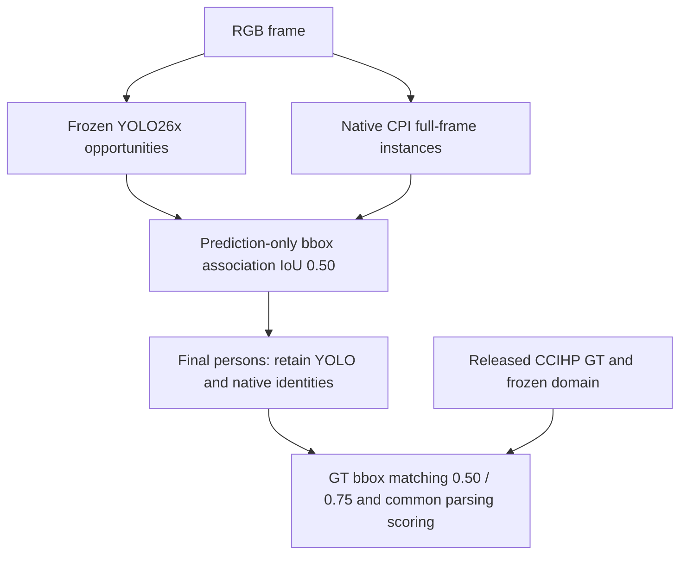
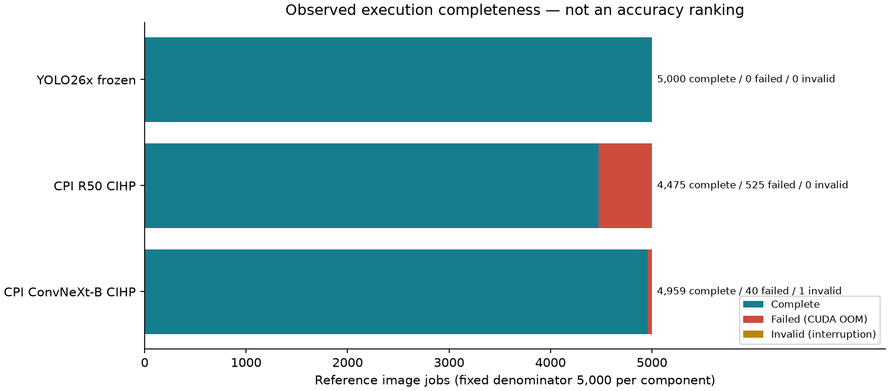

# Human Parsing — หลักฐานและการตีความของกลุ่ม CPI T3b

## 1. คำถามที่กำลังตอบ

เราต้องการคัดระบบ parsing สำหรับ body/clothing ภายใต้ frozen YOLO26x รอบนี้ทดสอบสอง CPI configurations ที่มี native instance parser การทดลองจบแล้ว แต่ยังไม่มีคะแนนหลักครบประชากร จึงยังเลือกผู้ชนะด้าน semantic accuracy ไม่ได้ ดูตัวเลขแบบสแกนเร็วที่ [RESULTS_SUMMARY_TH.md](RESULTS_SUMMARY_TH.md)

## 2. ระบบทำงานอย่างไร

GT ใช้ในการประเมินหลังทำนาย ไม่ใช่ input ของ YOLO/CPI การมีสอง identity ไม่ได้หมายความว่าใช้ GT bbox หรือบังคับให้ทุก native prediction ผ่าน YOLO

## 3. หลักฐานภาพที่เผยแพร่ในรอบนี้

กราฟนี้สร้างจาก ledger-derived canonical counts เป็น **operational evidence** ไม่ใช่ภาพ mask และไม่ใช่ accuracy ranking สีของ failures แสดงจำนวนงานที่ไม่สำเร็จภายใต้ configuration เดิม ภาพ RGB/GT/overlay จริงยังอยู่ภายนอกตาม [artifact policy](ARTIFACTS.md); ยังไม่ยืนยันสิทธิ์แจกจ่ายภาพบุคคล จึงไม่นำภาพมาใส่ public หรือใช้ภาพสร้างขึ้นแทนข้อมูลจริง

## 4. Failure Analysis

**Observation:** YOLO สำเร็จครบ ขณะที่ native CPI พบ CUDA OOM ภาพ 0034896 ของ ConvNeXt-B มีไฟล์ NPZ ที่เขียนไม่สมบูรณ์และคง INVALID/UNRESOLVED_INTERRUPTION ไว้ กระบวนการเดิมหยุดโดยไม่มี terminal manifest จึงไม่อ้างสาเหตุการหยุดเกินหลักฐาน

**Interpretation:** ปัญหาอยู่ที่ความครบของเส้นทาง native configuration/resource ไม่ได้แสดงว่า mask ของโมเดลใดแม่นต่ำกว่า การเปลี่ยน precision, threshold หรือ chunking หลังดู VAL เพื่อให้ผ่านจะเป็น configuration ใหม่และต้องพิจารณาแยก

**ขอบเขต:** OOM counts ไม่ใช่ peak VRAM benchmark และ smoke latency ไม่ใช่ clean timing ไม่มีการจัดอันดับต้นทุนจากกราฟนี้

## 5. ทำไมไม่เฉลี่ยเฉพาะภาพที่ผ่าน

ชุดภาพสำเร็จของสองระบบไม่เท่ากัน คะแนน success-only จึงมีทั้งความต่างของโมเดลและความต่างของประชากรปะปนกัน STRICT_COMPLETE ทำให้รายงานหลักเป็น N/A และคง failures ไว้ ไม่แทนด้วยศูนย์และไม่ทำให้ระบบหายจากตาราง ภาพที่ valid empty ยังต้องได้ execution success พร้อม FP/FN ตาม GT ไม่ใช่เปลี่ยนเป็น failure เพื่อเลี่ยงคะแนนต่ำ

## 6. สิ่งที่ยังบอกไม่ได้จากภาพและ aggregate

ยังไม่มี public same-frame mask case study ที่ตรวจสิทธิ์และจัดทำตามสองระบบ/เกณฑ์นี้ครบ จึงไม่อ้างว่าภาพใดพิสูจน์ความแนบของ mask, coverage superiority, near tie หรือ CCTV robustness รายงานการดู saved TRAIN overlays ก่อนรับ mapping เป็น bounded sanity check และไม่ใช่ validation accuracy selection หรือ independent human annotation-quality review

## 7. เมื่อต้องตัดสินใจ

ขณะนี้ยังไม่มีข้อมูลครบสำหรับเลือกระบบด้านคุณภาพ สิ่งที่ทราบคือ configurations เดิมมี execution limitations ขั้นถัดไปควรเสนอ resource revision ที่พิสูจน์บน TRAIN และกำหนดกติกาก่อนรอบใหม่ โดยไม่ tune จาก VAL หรือเริ่มทดลองต่อเอง

[Technical report](REPORT.md) · [ข้อจำกัดข้อมูล](DATASET_DETAILS.md) · [รายการ failures](metrics/first-cohort-benchmark-20261016T094257313856Z/FAILURES.csv) · [หลักฐาน run](cohorts/first_cpi_t3b/RUN_MANIFEST.json)
