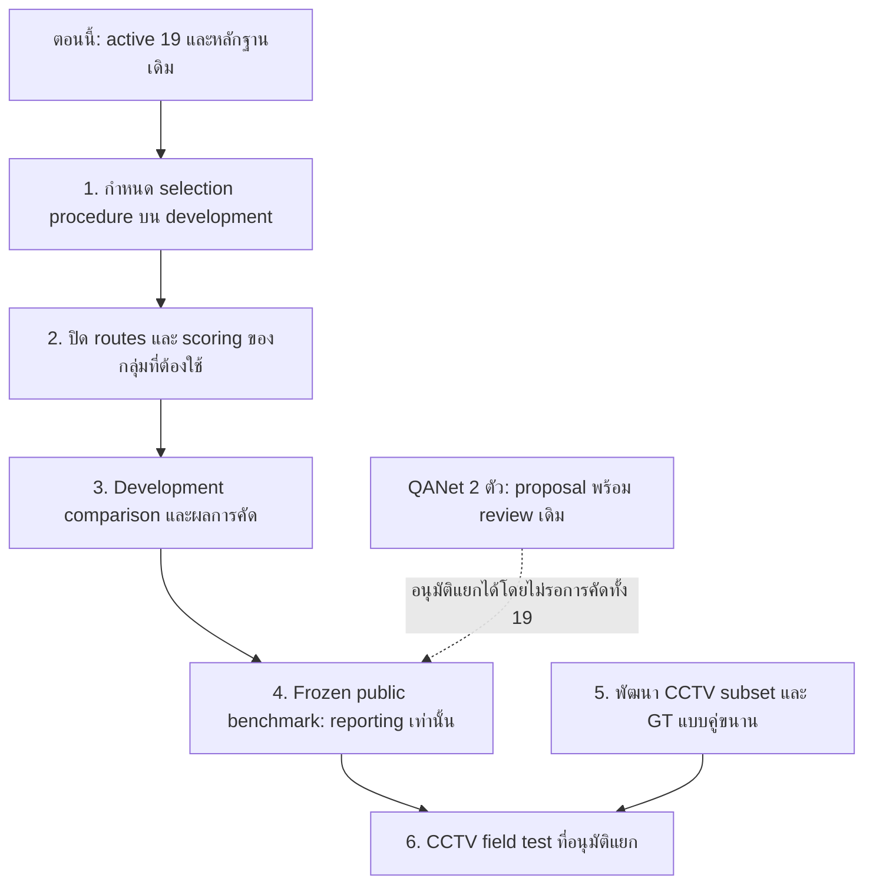

> **WIP — เก็บร่างเดิมเมื่อ 21 ตุลาคม 2026 ก่อน Prompt A รอบใหม่**  
> เนื้อหาด้านล่างสะท้อนสถานะ/ข้อเสนอวันที่ 20 ตุลาคม ไม่ใช่แผนที่รับรองสำหรับรอบใหม่ รายชื่อ 19 รุ่นและ QANet proposal เป็นหลักฐานย้อนหลัง ไม่ใช่ launch scope อัตโนมัติ  
> ยังไม่ได้ปิดแผนเก่าให้สมบูรณ์; การตรวจ Prompt A รอข้อความและรายชื่อจากผู้ใช้ ไม่มี benchmark/inference ใหม่จากการเก็บ WIP นี้  
> สถานะปัจจุบัน: [STATUS](../STATUS.json) · [WORK_LOG](../WORK_LOG.md)

# แผน Human Parsing: ทำเพื่ออะไร อยู่ตรงไหน และจะรู้ผลเมื่อไร

ตรวจสถานะ: 20 ตุลาคม 2026 UTC  
บทบาทเอกสาร: **แผนภาพรวมและจุดตัดสินใจ** อ้างอิงสถานะจริง ไม่ใช่ executable config หรือการอนุมัติทดลองเพิ่ม

แผนเทคนิคหลัก — `../../HUMAN_PARSING_EXPERIMENT_DESIGN_TH.md` (local working-copy reference; not included in this public snapshot) · 19 รุ่นปัจจุบัน — `EXACT_ROSTER_ACTIVE_19_TH_20261020.md` (local working-copy reference; not included in this public snapshot) · [machine-readable state](../STUDY_STATE.json) · [หลักฐานสถานะของแผนนี้](../provenance/PROJECT_ROADMAP_STATUS_V1.json)

## 1. เรากำลังทำทั้งหมดนี้เพื่ออะไร

เป้าหมายคือ **หาว่า pretrained human parsing configurations ใดให้รายละเอียดส่วนร่างกาย เสื้อผ้า และสิ่งประกอบที่จำเป็นได้เหมาะกับงานวิจัย แล้วนำชุดที่คัดอย่างถูกต้องไปตรวจบน CCTV dataset ของเรา** ไม่ใช่เพียงทำให้ดาวน์โหลดโมเดลครบหรือรัน demo ได้

ระบบปลายทางที่สนใจคือ frozen YOLO26x-Seg ช่วยระบุตำแหน่ง/instance ของคน แล้วใช้ parser ให้ semantic regions รายคน ส่วน native multi-human parsers ต้องประเมินในเส้นทางที่รองรับจริง แยก native-reference จากระบบที่เชื่อมกับ YOLO

จึงมีคำถามสามระดับที่ต้องได้คำตอบคนละช่วง:

| คำถาม | หลักฐานที่จะตอบ |
|---|---|
| โมเดลนี้ทำงานได้จริงบนเครื่องและส่งผลถูก schema หรือไม่ | Source/checkpoint/environment + actual bounded inference/route checks |
| ในงาน parsing ที่นิยามไว้ ให้คุณภาพระดับใดเมื่อเทียบ GT และผ่านเกณฑ์คัดที่กำหนดหรือไม่ | Comparable public development evidence และ selection rule ที่ประกาศก่อนใช้ผล; public benchmark reporting แยกตาม policy |
| ชุดที่ผ่านการคัดเหมาะกับ CCTV ของเราหรือไม่ | Field-test protocol ที่อนุมัติแยก, CCTV reference annotations และผลระบบจริงในประชากรที่กำหนด |

**การผ่านข้อแรกยังไม่ใช่การผ่านข้อสองหรือข้อสาม** tests/schema/hash ที่ทำไปมีไว้ป้องกันการเทียบคนละคลาส คนละคน คนละพิกัด หรือได้คะแนนจากภาพไม่ครบ ไม่ใช่คะแนนความแม่นของโมเดลเอง

## 2. ตอนนี้อยู่ตรงไหนจริง

เราอยู่ที่ **มี candidate pool และหลักฐานความเป็นไปได้แล้ว กำลังเชื่อมให้เป็นการทดลองที่ได้คะแนนและตัดสินใจได้อย่างถูกต้อง** ยังไม่ถึงจุดที่มีผู้ชนะครบทุกกลุ่ม

| ส่วนงาน | สถานะจริง | แปลว่าอะไร |
|---|---|---|
| Frozen YOLO26x และ YOLO benchmark เดิม | มีหลักฐานและผลเดิมแล้ว | ไม่ต้องเริ่ม YOLO study ใหม่ |
| Roster Human Parsing | รับรอง **active 19 รุ่น** | เก็บไว้พิจารณา ไม่ใช่อนุมัติรันเต็ม 19 รุ่น |
| Weights/native feasibility | มีหลักฐานจากรอบก่อนของผู้สมัคร รวม Sapiens2 0.4B/0.8B/1B | ไม่ดาวน์โหลดหรือ native-smoke ทุกตัวใหม่เพียงเพื่อยืนยันซ้ำ |
| TRAIN route packets ใน preparation ปัจจุบัน | active candidates **15/19** มี packet PASS ในชุดนี้ | ไม่ได้แปลว่ามี production scoring contexts ครบ 15 ตัว |
| อีก 4 รุ่นที่ไม่มี packet ในชุด preparation นี้ | FASHN และ Sapiens2 ทั้งสาม | มีหลักฐานอื่น/เก่าให้ reuse ได้ ต้องตรวจว่าตรง route ที่จะใช้ ไม่ถือว่าไม่เคยรันได้ |
| QANet CIHP สองตัว | มี candidate config, exact jobs, worker, scorer/reporter และ approval package | พร้อมเสนออนุมัติรวม; ยัง PROPOSED_NOT_FROZEN และไม่มี VAL inference approval |
| QANet bounded GPU route | TRAIN หนึ่งภาพต่อระบบ มี 2 person opportunities ต่อภาพในรอบเตรียม | ยืนยันเส้นทางแบบจำกัด ไม่ยืนยันว่าจะผ่าน 5,000 ภาพ |
| CPI CIHP สองระบบ | ปิดรอบแล้ว ทั้งคู่ INCOMPLETE | เก็บผลและ failures; primary scores null ตาม STRICT_COMPLETE ไม่ใช่ผู้ชนะ/ผู้แพ้ด้านคุณภาพ |
| ผลคุณภาพที่เทียบกันได้ครบ 19 รุ่น | **ยังไม่มี** | ยังตัดรุ่นที่ตอบ task ได้ด้วยเหตุผลว่าแม่นน้อยกว่าไม่ได้ |
| Selection procedure ของทั้งโครงการ | **ยังไม่พบกติกาที่รับรองใน current scope/config** | นี่คือช่องว่างระหว่าง “มีรายงานคะแนน” กับ “ผ่านการคัด” |
| CCTV package | 9,328 JPEG; เปิดดู/strict decode แบบจำกัด 12 ภาพแล้ว | ยังไม่ใช่ full image audit และยังไม่มี parsing GT ใน package ที่รับ |

ฐานอ้างอิง: roster scope V4 — `../configs/experiment_roster_scope_v4.json` (local working-copy reference; not included in this public snapshot), preparation pointer — `../provenance/EXPERIMENT_PREPARATION_ACTIVE.json` (local working-copy reference; not included in this public snapshot), route matrix — `../provenance/RUN_MANIFESTS/experiment-preparation-20261020T064124828436Z/ROSTER_ELIGIBILITY_V1.csv` (local working-copy reference; not included in this public snapshot), [CPI results](../metrics/first-cohort-benchmark-20261016T094257313856Z/QUALITY_RESULTS.csv), CCTV ที่เปิดดูจริง — `../../cctv_dataset/reports/CCTV_BOUNDED_VISUAL_SCOPE_REVIEW_TH_20261020.md` (local working-copy reference; not included in this public snapshot)

## 3. ทำไมยังบอกไม่ได้ว่าตัวไหนผ่านการคัด

**เราเตรียมกลไกการรันและให้คะแนนไว้มากแล้ว แต่ยังไม่มี decision rule ที่เชื่อมผลกับคำว่า “ผ่านการคัด” สำหรับโจทย์ทั้งโครงการ** ไม่ใช่ว่าไม่มี dataset ให้ใช้วัด

มี CCIHP พร้อม released semantic/person GT และ populations ของ cohort ที่ใช้แล้ว ส่วน MHP-v2 มีข้อมูลและ readable-subset evidence สำหรับบทบาทรองตามข้อจำกัดเดิม แต่ checkpoint labels ต่างกัน และ current score วัดได้เพียงบางส่วน

นอกจากนี้ current policy ระบุชัดว่า **ห้าม VAL-based model selection และห้ามเปลี่ยน benchmark reporting เป็น finalist selection อัตโนมัติ** ต่อให้รัน VAL จบก็ยังไม่ใช่สิทธิ์เลือก finalists จากผลนั้น

จึงต้องมี selection procedure แยกบน development population ที่ไม่ใช่ VAL พร้อมนิยาม task, GT domain, วิธีเทียบ และกติกาตัดสินก่อนใช้คะแนน การเสนอส่วนนี้อยู่ในแผนได้ แต่เอกสารฉบับนี้ไม่ทำให้กลายเป็น accepted policy หรืออนุมัติให้รัน

หากใช้ official TRAIN เพื่อ development ต้องเปิดเผยว่า checkpoints บางตัวเคยฝึกกับข้อมูลกลุ่มนี้ ผลช่วยตัดสินภายใต้ development design ได้ แต่ไม่ใช่หลักฐาน held-out generalization ที่อิสระ และห้ามเรียกทุก TRAIN image ว่า unseen

## 4. ยังเหลือกี่อย่าง

**เหลือ 6 ก้อนงานหลักเพื่อครบเป้าหมายทั้งโครงการ** นี่เป็นการจัดงานที่ต้องปิด ไม่ใช่หก benchmark ใหม่ หกวัน หรือหกขั้นที่ได้รับอนุมัติแล้วทั้งหมด งาน CCTV ทำคู่ขนานกับงาน public study ได้

| ก้อนงาน | สถานะเริ่มต้น | สิ่งที่ต้องได้เพื่อปิดก้อน |
|---|---|---|
| **1. ปิดกติกาคัดเลือกและสิ่งที่ต้องวัด** | มี task/metric foundation แต่ selection rule ยังไม่รับรอง | Decision ของ development selection: requirement targets, input population, rule และข้อจำกัดชัด โดยไม่ใช้ VAL |
| **2. ปิด routes/scoring ของกลุ่มที่จะประเมินจริง** | มีหลักฐานหลายเส้นทาง; QANet สองตัวจัด package แล้ว | แต่ละ comparison group มี bindings/config/runner/scorer และหลักฐาน actual path ที่ตรง revision |
| **3. ทำ development comparison และคัดตามกติกา** | ยังไม่อนุมัติ/เริ่ม selection study ใหม่นี้ | ตารางผ่าน/ไม่ผ่าน/ยังสรุปไม่ได้ พร้อมตัวหารและ visual error evidence ตาม accepted development rule |
| **4. รัน frozen public benchmark และรายงาน** | QANet สองตัวมี proposal พร้อม review | ผลของ batch ที่อนุมัติครบทั้ง quality/completeness/failures โดยไม่เลือกหรือเปลี่ยนรุ่นจาก VAL |
| **5. เตรียม CCTV evaluation subset และ GT** | มีภาพ/metadata และ preview จำกัด ยังไม่มี parsing GT | ประชากร, ontology ที่จำเป็น, reference annotations และ QA พร้อมสำหรับคำถาม field test |
| **6. ทดสอบระบบบน CCTV และตัดสินตาม field protocol** | ยังไม่เริ่ม/ไม่อนุมัติ | ผลระบบในเงื่อนไขที่ประกาศ บอกได้ว่าเหมาะหรือยังไม่เหมาะกับกรณีใดของ CCTV study นี้ |

การนับนี้ไม่ให้ความหมายว่า 19 รุ่นต้องผ่านทุกก้อน หากรุ่นไม่พร้อมหรือไม่ผ่านกติกาที่รับรอง ให้คงในรายงานพร้อมเหตุผล ไม่ขยายรอบแก้เองจนไม่มีจุดจบ

ลูกศรแสดงเส้นทางที่เสนอเพื่ออธิบายงาน ไม่ได้เพิ่ม dependency gate ให้ QANet proposal เดิม และไม่อนุญาต inference ตอนนี้ หากรัน QANet VAL reporting ก่อน development selection ต้องแยกผลนั้นออกจากหลักฐานที่ใช้คัด ไม่ใช้ผลที่เห็นแล้วเลือก/ตัดรุ่นย้อนหลัง

## 5. รายละเอียดแต่ละก้อนและจุดจบ

### ก้อน 1 — กำหนดว่าผ่านการคัดแปลว่าอะไร

ต้องแยกข้อกำหนดของงานออกจากจำนวน native classes:

- ส่วนร่างกายที่จำเป็นต้องได้คืออะไร เช่น face region, torso, arms/legs หรือ hands/feet ที่แยกเพิ่ม
- ต้องการเพียง garment region หรือจำเป็นต้องแยก upper/lower/dress/coat ตามนิยามที่ source GT รองรับ
- Accessories ใดจำเป็นจริง และมี GT ที่ตรงกับ checkpoint concepts หรือไม่
- จะรับความผิดพลาด/ความไม่ครบแบบใด และตัดสินผ่าน ไม่ผ่าน หรือยังไม่ทราบอย่างไร

ไม่ตั้งตัวเลขคุณภาพขั้นต่ำขึ้นเอง เช่น IoU ต้องเกินค่าหนึ่งโดยไม่มีเหตุผล และไม่กำหนดว่าต้องเหลือหกรุ่น การผ่าน taxonomy support เป็นเงื่อนไข output ไม่ใช่คะแนน accuracy

**จุดจบ:** มี selection decision/config ที่รับรองก่อนใช้ผล development เลือกรุ่น หาก current six-target ตอบได้เฉพาะ coarse task ต้องจำกัดคำสรุปตามนั้น การวัดรายละเอียดเพิ่มเป็นข้อเสนอแยก ไม่เปลี่ยน accepted six-target เงียบ ๆ

### ก้อน 2 — ให้การเปรียบเทียบวัดสิ่งเดียวกันจริง

จัดตาม operational mode และ target/domain ที่เทียบกันได้ ไม่บังคับ full-frame parser เป็น crop parser และไม่ถือว่าทุก native label แปลงได้จากชื่อคล้ายกัน

- ใช้ existing source/checkpoint/config hashes, native runs และ saved TRAIN packets ก่อน
- ปิดเฉพาะช่องว่างที่จำเป็น เช่น target-person ownership, mapping/support context, map-back และ packet → configured scorer → reporter
- QANet สองตัวไม่ต้องเริ่มใหม่ มี prelaunch ที่กำหนดไว้แล้วสำหรับหลังอนุมัติ
- LIP/ATR five-target, MHP-v2 fine labels, FASHN และ Sapiens2 ต้องรักษาขอบเขต support ของแต่ละกลุ่ม ไม่รวมเป็น universal leaderboard โดยไม่มี common domain
- ถ้าจำเป็นต้องรัน TRAIN เพิ่ม ต้องระบุ exact bounded jobs และอำนาจอนุมัติของรอบนั้น ไม่ใช้การอนุมัติ roster เป็นสิทธิ์รัน

**จุดจบ:** มี readiness ของกลุ่มที่ต้องใช้จริง พร้อม evidence ตรง revision ไม่จำเป็นให้ optional routes ทุกอย่างพร้อม และไม่ใช้ synthetic tests แทน actual model-route evidence

### ก้อน 3 — จุดที่จะรู้ว่าใครผ่านการคัดเบื้องต้น

เมื่อก้อน 1–2 พร้อมและได้รับอนุมัติ development comparison จึงประเมินตาม rule ที่ล็อกไว้ โดยเปรียบเทียบ predictions กับ GT ที่มี domain/identity/coverage ถูกต้อง

ผลควรแสดงรุ่น/config, targets ที่รองรับ, population/person denominators, คุณภาพที่วัดจริง, completeness และตัวอย่างข้อผิดพลาดที่ทำให้เข้าใจการตัดสิน ไม่ใช้ mask ที่ดูดีไม่กี่ภาพเป็นผลทั้ง dataset

เน้นกรณีที่สอดคล้องโจทย์ เช่น คนเล็ก คนใกล้กัน partial visibility และ neighboring objects **เมื่อมี evidence/GT รองรับการแบ่งกรณี** ไม่แต่ง labels ความยากจากชื่อ sequence หรือภาพมืดเพียงอย่างเดียว

**จุดจบ:** ได้ shortlist สำหรับขั้นถัดไปตาม approved development rule หรือสรุปว่าหลักฐานยังไม่พอ/ไม่มีรุ่นผ่านอย่างตรงไปตรงมา ไม่บังคับต้องมีผู้ชนะ ไม่บังคับใช้ hybrid และไม่เลือกรุ่นจาก VAL

จำนวน finalists และ numeric pass thresholds **ยังไม่ถูกกำหนดใน accepted scope** แผนนี้จึงไม่แอบตั้งจำนวนหรือค่าตัดแทนผู้ใช้

### ก้อน 4 — Public benchmark reporting ที่ไม่ย้อนมาเลือกโมเดลจาก VAL

ตรึงรายชื่อ/config/cohort ก่อน VAL และขออนุมัติ execution batch นั้น จากนั้นรายงานผล fixed comparisons เท่านั้น ไม่ปรับ threshold, mapping, resolution, membership หรือเลือกรุ่นใหม่เพราะผล VAL

เมื่อผลขัดกับความคาดหวัง ให้รายงานข้อจำกัดหรือผลที่ยังไม่ยืนยัน ห้ามซ่อนผลหรือเปลี่ยนรายชื่อแล้วเรียกว่าการคัดเดิมผ่าน หากจะทำ selection protocol ใหม่ต้องมี decision แยกก่อน และคงข้อห้ามใช้ VAL นี้เลือกโมเดล

**จุดจบ:** canonical results + completeness/failures + รายงานที่ตรงกับ artifacts คะแนนว่างตาม STRICT_COMPLETE ไม่ถูกแทนด้วย successful-subset scores

### ก้อน 5 — CCTV dataset ทำคู่ขนานเพื่อให้วัดจริงได้

ตอนนี้มี source JPEG 9,328 ภาพและ metadata แต่ใน package ที่ตรวจไม่พบ parsing GT แค่มีภาพไม่สามารถคำนวณ parsing IoU ที่มีความหมายได้

งานที่ต้องเสนอ/ดำเนินตามอำนาจอนุมัติของ CCTV workstream คือกำหนด evaluation population ที่เหมาะสม, visible/unknown/partial annotation policy, person identity/parts ที่จำเป็น, QA/adjudication และการแยก development กับ final field-test data ไม่จำเป็นประกาศว่าจะ annotate ทั้ง 9,328 ภาพ

12 ภาพที่เปิดดูแล้วเป็น preview เพื่อเข้าใจ domain ไม่ใช่ชุดที่รับรองว่าไม่เคยถูกเห็นหรือเป็น prevalence sample ไม่ใช้ model predictions เป็น GT

**จุดจบ:** มี reference ที่ตรวจได้และกติกาคะแนนสำหรับ field question ไม่ต้องรอปิด public study ทั้งหมดจึงเริ่มเตรียม dataset และไม่ย้ายข้อมูลบริษัทเข้ public repository

### ก้อน 6 — จุดที่จะตอบว่าเหมาะกับ CCTV ของเราหรือไม่

เมื่อมีชุดที่คัดตาม procedure ที่รับรอง, CCTV GT พร้อม และ field-test authorization จึงทดสอบ frozen system configurations บนประชากรที่กำหนด

ต้องแสดงทั้ง parsing และผล upstream localization/coverage เพื่อไม่ซ่อนคนที่ YOLO พลาด ไม่เอา ownership/mask clipping error ทั้งหมดไปสรุปว่า parser ผิด และไม่สรุปจาก frame resolution อย่างเดียวว่าคนมีรายละเอียดพอ

หากภายหลังต้องตัดสินเรื่องเวลา/VRAM ให้เป็น measurement protocol ที่อนุมัติแยก ไม่จัดอันดับต้นทุนจาก smoke diagnostics ของรอบ quality-only

**จุดจบ:** บอกได้ว่าระบบใดผ่าน field acceptance ที่กำหนดหรือมีข้อจำกัดต่อกรณีใด ไม่อ้างว่าเป็นโมเดลดีที่สุดสำหรับ CCTV ทุกแห่ง และไม่เท่ากับการรับรอง commercial deployment

## 6. จะรู้ผลเมื่อไร — ตอบเป็น milestones

| ผลที่อยากรู้ | จะรู้หลังอะไร | ตอนนี้รู้แล้วหรือยัง |
|---|---|---|
| ใครโหลดและรัน native mode ได้ | Existing bounded inference evidence | มีหลักฐานหลายรอบแล้ว ไม่ต้องรันทุกตัวซ้ำ |
| ใครพร้อมเข้า specific comparison | ก้อน 2 ของ route/cohort นั้น | QANet สองตัวมี proposal พร้อม review; ไม่ใช่ทั้ง 19 พร้อม |
| ใครผ่านการคัดไปขั้นถัดไป | ก้อน 1–3: accepted development selection procedure และผลตาม rule | ยังไม่มี accepted procedure/ผลการคัดนี้ |
| คะแนน public benchmark เป็นอย่างไร | ก้อน 4 ของ batch ที่อนุมัติ | CPI เดิมมีผล execution แต่ primary quality null; batch QANet ใหม่ยังไม่รัน |
| ใครเหมาะกับ CCTV dataset ของเรา | ก้อน 5–6: reference และ field protocol/results | ยังไม่รู้ ไม่มี CCTV model inference ในงานปัจจุบัน |

**จึงไม่ควรตอบว่าจะรู้หลัง QANet สองตัวรันจบเพียงอย่างเดียว** ตอนนั้นจะมีผลของ comparison สองตัวตาม scope ที่อนุมัติ ไม่ใช่ผลคัดของ 19 หรือข้อสรุป CCTV

## 7. สิ่งที่พร้อมให้เดินก่อนแล้ว: QANet สองตัว

ชุดนี้ยังเดินตาม approval package เดิมได้ โดยไม่ต้องรอให้ทั้งโครงการคัดเสร็จ:

| รายการ | ค่าจาก candidate package จริง |
|---|---:|
| Models | QANet_CIHP (R50), QANet_CIHP_HRNetW48_512x384 |
| Reference images | 5,000 |
| Main subset | 4,961 |
| Parser frame-system jobs | 10,000 |
| Person/ROI tasks | 48,124 |
| New YOLO inference jobs | 0 — ใช้ frozen outputs เดิม |
| Scoring jobs | 20,000 สำหรับสอง thresholds |
| Report rows | 8: สองระบบ × สอง populations × สอง thresholds |
| Matching | 0.50 หลัก / 0.75 เสริม |
| Failure policy | STRICT_COMPLETE |
| Precision/scope | FP32 ตาม candidate; quality-only |

Main เป็น subset ของ reference จึงไม่ inference ซ้ำสองรอบ จำนวน ROI tasks ไม่ใช่จำนวน neural forward calls ที่นับได้แน่นอน

หลังได้รับอนุมัติจึงบันทึก acceptance → derive accepted model-specific contexts/config ตามกติกาเดิม → ตรวจ saved TRAIN packets กับ newly accepted scorer/reporter → ตรวจ hashes/runtime/resources และ freeze → เปิด VAL หาก prelaunch ไม่ผ่านให้หยุดเฉพาะส่วนที่กระทบ ไม่เปลี่ยน scientific policy เอง

Production VAL worker ใหม่นี้ยังไม่เคยรัน GPU บน VAL ไม่มีการรับรองล่วงหน้าว่าจะไม่พบ OOM ในภาพที่ TRAIN sample ไม่ครอบคลุม และยังไม่มี workflow-level resume/general cached rescoring ให้ใช้อ้างโดยอัตโนมัติ

Candidate config — `../configs/experiment_qanet_cihp_candidate_v1.json` (local working-copy reference; not included in this public snapshot) · Approval package — `../provenance/RUN_MANIFESTS/experiment-preparation-20261020T064124828436Z/QANET_APPROVAL_PACKAGE.json` (local working-copy reference; not included in this public snapshot)

## 8. เหลือเวลาเท่าไร

ยังไม่มี ETA ที่มีหลักฐานสำหรับ 19 candidates หรือทั้งโครงการ เพราะยังไม่ล็อก selection workload, routes ของทุกกลุ่ม และปริมาณ CCTV annotation

QANet package มี **cap 24 ชั่วโมงต่อโมเดล** แต่เป็นเพดาน engineering ไม่ใช่คาดว่าจะใช้ 24 ชั่วโมง เสนอ disk reservation 100 GiB และหยุดเมื่อ free ต่ำกว่า 50 GiB ตัวเลขเหล่านี้ไม่ใช่ต้นทุนของ 19 รุ่น

จึงบอกได้แน่นอนเป็น **6 work packages และ milestones ข้างต้น** ไม่แต่งจำนวนวันหรือเปอร์เซ็นต์เสร็จจากจำนวน tests/เอกสาร

## 9. งานถัดไปที่ควรทำ และสิ่งที่ไม่ควรวนทำ

**สองทางที่เดินคู่กันได้:** จัด selection procedure บน development ให้มีจุดจบสำหรับเป้าหมายคัดโมเดล และคง QANet proposal เดิมไว้เสนออนุมัติ reporting batch โดยไม่ผูกเป็นการเลือก finalists จาก VAL

งานที่ทำต่อควรจบด้วย accepted decision/config หรือ execution evidence ที่จำเป็น ไม่ใช่เพียงเพิ่มชื่อไฟล์รายงานหรือจำนวน tests ต้องระบุ gap, exact jobs เมื่อมี execution, ขอบเขตแก้ และ stop condition ของแต่ละ batch ก่อนเริ่ม

ไม่เริ่มใหม่จากศูนย์ ไม่เปิดหา CPI header อีก ไม่ขอรับรอง policies เดิมซ้ำ ไม่ดาวน์โหลด weights ที่มีและ hash-verified แล้ว ไม่รัน native smoke ทั้ง 19 ซ้ำ ไม่ขยาย QANet เป็น 19-model full benchmark และไม่ทำ CCTV inference/GT annotation จากการอ่านแผนนี้

## 10. ขอบเขตของเอกสารฉบับนี้

ข้อเท็จจริงสถานะและงานที่มีหลักฐานแยกจาก **ข้อเสนอ work packages/selection procedure ในอนาคต** อย่างชัดเจน ไม่มีการตั้ง threshold, selection manifest, finalists, metrics ใหม่ หรือยอมรับ taxonomy เพิ่มในเอกสารนี้

คง active19 ตาม scope V4 ไม่เปลี่ยน Sapiens2 roster ไม่แก้ QANet candidate/production code/accepted mappings/results หรือข้อมูลเดิม ไม่มี inference, download, install, training, retry, CCTV field test หรือ publish/push ในรอบเขียนแผนนี้
